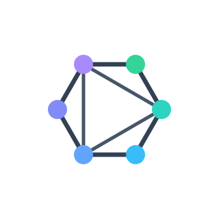

<div align="center">



# Q2Q

<p>
  <a href="https://github.com/mivinci/Q2Q/actions/workflows/docs.yml">
    
  </a>
  <a href="https://github.com/mivinci/Q2Q/stargazers">
    
  </a>
</p>

<p>
  <a href="https://docs.q2q.app/">Docs</a> ·
  <a href="https://platform.q2q.app/">Platform</a> ·
  <a href="https://github.com/mivinci/Q2Q/issues">Issues</a>
</p>

<p>
An open-source peer-to-peer framework for distributing large files and delivering
video on demand or live streams, with verified transfers and CDN fallback.
</p>

</div>

## What is Q2Q?

Q2Q lets peers exchange file data directly when possible and fall back to an HTTP
CDN or origin when peer-to-peer delivery is unavailable or slower. Each downloaded
block is verified against a Merkle proof, so peers and delivery servers do not
need to be trusted with the content.

The project includes a web platform for managing files, seeds, projects and
distribution settings, alongside Rust libraries and a command-line client for
building and transferring Q2Q seeds.

## Components

- **Q2Q Platform** — manage projects, files, seed publications and storage
  settings in the hosted workspace.
- **Q2Q Core (`q2q-core`)** — build clients that publish and download files,
  verify content, and use peer-to-peer transfer with HTTP range fallback.
- **Shared primitives (`q2q-primitives`)** — network-independent identity, seed,
  Merkle, storage and peer-protocol building blocks. `q2q-wasm` exposes seed
  building to JavaScript and TypeScript.
- **Command-line client (`q2q`)** — publish and download files from a terminal
  using Q2Q Core; the installed executable is also named `q2q`.
- **Track and Punch services (`q2q-track-server`, `q2q-punch-server`)** —
  self-hostable control-plane services for peer discovery and connection
  signaling. Shared logic lives in `q2q-track` and `q2q-punch`; these services
  help establish connections but do not carry file data.

## Get started

### Use the platform

Open [platform.q2q.app](https://platform.q2q.app/) to manage files and seeds in
the hosted workspace. See the [documentation](https://docs.q2q.app/) for setup
and usage guides.

### Use the command-line client

Install the CLI from a checkout of this repository:

```sh
cargo install --path crates/q2q --locked
```

Publish a file and create its seed, then give the seed to a downloader:

```sh
q2q --track https://track.example.net publish ./model.bin --seed ./model.q2q
q2q --data-dir ./receiver-state download ./model.q2q --output ./received.bin
```

The publisher must remain online while serving peers. Use separate state
directories for simultaneous clients. See the [CLI guide](https://docs.q2q.app/guide/cli)
for configuration, transfer progress and resume behavior.

## Develop

The platform and documentation site use Node.js 24 (see `.node-version`). From
the repository root:

```sh
npm ci

npm run platform:dev    # platform
npm run docs:dev        # documentation site
```

Useful checks and builds:

```sh
npm run platform:check
npm run platform:build
npm run seed-processing:check
npm run seed-processing:build
npm run docs:build
```

Rust crates can be built with Cargo; install the WebAssembly target when working
on the browser package:

```sh
rustup target add wasm32-unknown-unknown
cargo check --workspace
```

## License

Q2Q is released under the [MIT License](LICENSE).
