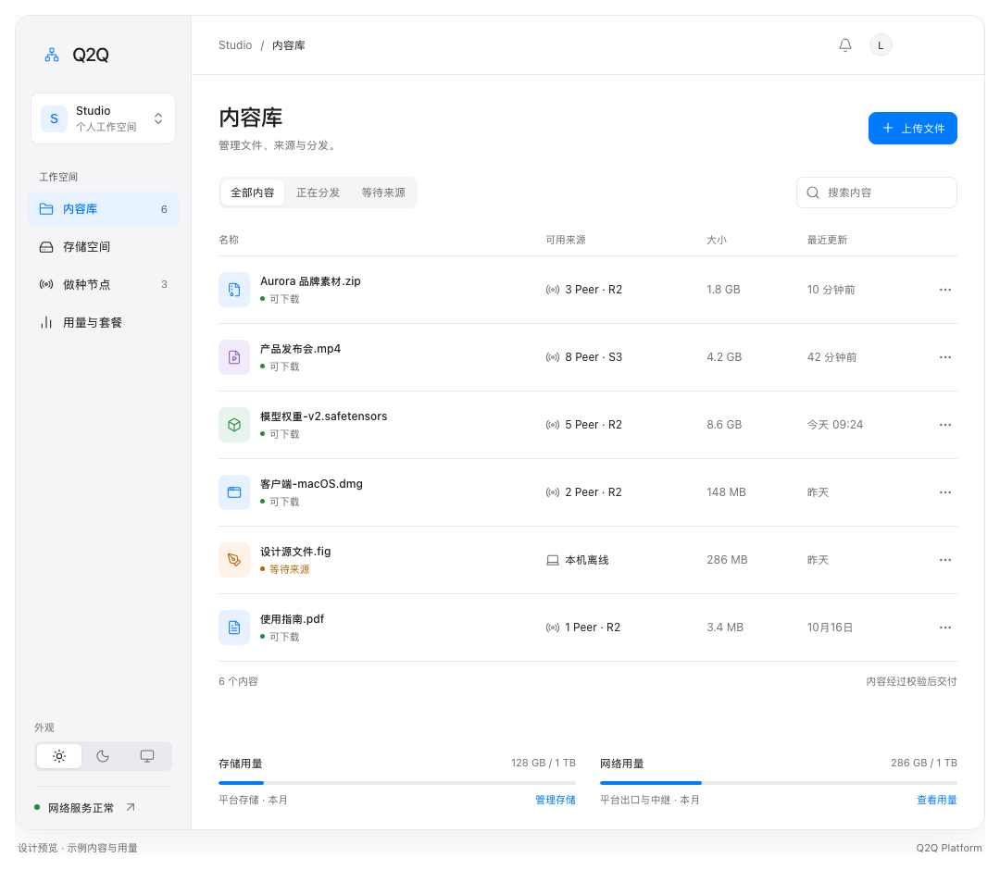
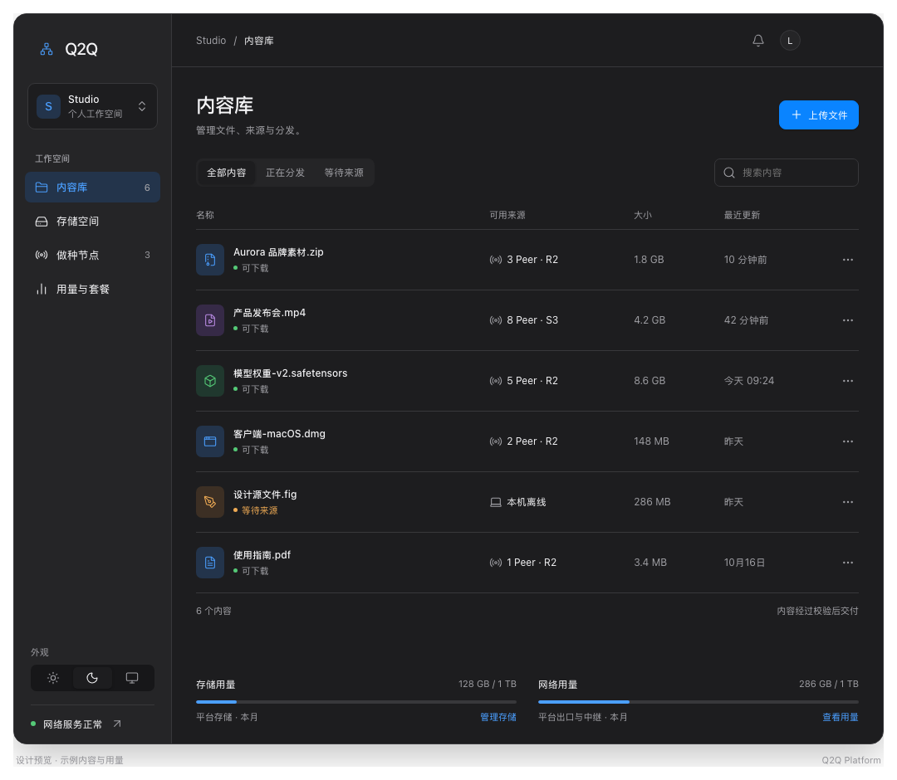

# 平台界面设计基准

状态：**用户已确认，后续实现以此版为基准。** 这是界面原型，不是已经接通服务的 SvelteKit 应用。

## 保存内容

- [prototype.html](prototype.html)：可直接在浏览器打开的独立预览，支持主题切换、导航、内容筛选、详情和上传交互。
- [prototype.fragment.html](prototype.fragment.html)：批准版本的原始界面源文件，保留完整样式与交互，作为后续实现对照。
- [light.png](light.png)：浅色桌面基准。
- [dark.png](dark.png)：深色桌面基准。
- [narrow.png](narrow.png)：窄屏布局基准。

HTML 预览通过固定版本 CDN 加载 Lucide 与提示框依赖，需要联网；PNG 可以离线查看。预览数据均为示例，选择文件只会更新本地展示，不上传字节，不创建真实分享或导出真实种子。

## 浅色

## 深色

## 不应随意改变的设计

- **以内容库为主界面。** 不用大面积图表或指标卡取代文件列表。
- **接近 Finder 的侧栏与列表结构。** 左侧工作空间、内容库、存储空间、做种节点、用量与套餐；右侧轻量工具栏和主要内容。
- **视觉克制。** Apple 系统字体栈、浅灰侧栏、细分隔线、适当留白、小圆角、轻阴影；蓝色只强调选中项、主要操作和少量链接。
- **列表信息层级稳定。** 文件图标、文件名与可用状态为主；来源、大小、最近更新时间及更多操作为辅。来源是否可用同时用文字和颜色表达。
- **上传是主操作。** 页面右上角为上传入口；详情和上传使用紧凑弹窗，保持内容库主界面简洁。
- **资源用量放在页面底部。** 存储与网络分别展示用量、配额及管理入口，使用细进度条。
- **主题是三种选择。** 浅色、深色、跟随系统；默认跟随系统。两套颜色共享同一布局、组件和信息层级。
- **窄屏自然重排。** 侧栏变为顶部导航，搜索单独换行，辅助列按空间收起，用量区域纵向排列。

## 关键视觉参数

以下为已批准原型的参考值，实现时优先保持视觉比例：

| 项目 | 原型参考 |
| --- | --- |
| 系统字体 | `-apple-system, BlinkMacSystemFont, Segoe UI, sans-serif` |
| 基础字号 | 14 px；辅助信息 11–12 px；主标题 25 px |
| 字重 | 400 / 500，避免普遍加粗 |
| 侧栏宽度 | 190 px；中等宽度收为 165 px |
| 内容区水平间距 | 29 px；中等宽度 20 px；窄屏 16 px |
| 顶部工具栏 | 约 64 px |
| 按钮圆角 | 8 px |
| 弹窗圆角 | 16 px |
| 浅色背景 / 侧栏 | `#ffffff` / `#f5f5f7` |
| 深色背景 / 侧栏 | `#1d1d1f` / `#252527` |
| 浅色文本 / 次级文本 | `#1d1d1f` / `#6e6e73` |
| 深色文本 / 次级文本 | `#f5f5f7` / `#a1a1a6` |
| 浅色 / 深色强调色 | `#007aff` / `#4b9fff` |

完整配色、间距与响应式规则以原型源文件为准。不同系统的字体渲染可以存在差异，不能因此擅自更换整体布局或视觉语言。

## 实现约定

- 在 `apps/platform` 建设正式 SvelteKit 应用，使用 **shadcn-svelte + Lucide**。此 HTML 用于设计对照，不将原型脚本当作生产应用逻辑。
- 将原型的语义颜色转换为统一设计变量，保留外观设置、偏好持久化及首屏防闪烁。
- 使用真实接口替换示例内容、节点和用量；原型中的样例配额、套餐和交互提示不代表已确定的业务规则。
- 实现内容库后先按浅色、深色与窄屏基准逐项对照，再扩展页面；新增页面沿用相同组件、间距和文字层级。
- 调整已批准的整体布局、强调色、密度或导航结构前，与用户确认，并同步更新本目录，避免设计与实现各自演变。

## 后续确认的界面调整

- 外观、语言等偏好集中到独立的设置页，侧栏底部保留设置入口。
- 侧栏底部显示账户头像、昵称及登录状态；长昵称截断，头像不可用时显示首字母。
- 点击账户区域打开包含设置和退出登录的账户菜单，底部账户栏与可滚动导航分离。
- 原始截图继续作为内容库视觉基准，上述调整适用于当前应用实现。

### 自适应侧栏

- 手机（小于 768px）：顶部只保留导航按钮和当前位置，侧栏使用左侧抽屉，避免导航、项目及账户堆到正文上方。
- 平板和桌面共用同一个侧栏组件。平板（768–1023px）默认收起为 72px，桌面（1024px 及以上）默认展开为 232px；顶部按钮均可切换。
- 展开时在原位平滑改变宽度，文字渐显，图标位置和导航高度保持不变，正文同步移动。手动选择在当前页面会话内优先于宽度默认值，跨平板/桌面断点不再替换侧栏或打开抽屉。
- 收起状态直接使用同一项目菜单和底部账户菜单；手机抽屉有遮罩和焦点管理，支持关闭按钮、Escape、点击外部关闭，导航后收起；切换到平板及以上尺寸时解除抽屉模态状态。
- 侧栏内容独立滚动，账户区固定在底部；处理动态视口高度、安全区和减少动态效果偏好。

### 品牌一致性

平台侧栏、平板图标栏、手机抽屉和登录页共用 Brand 组件，直接导入 docs 的浅深色 Logo；站点图标同样复用 docs。Logo 旁的 Q2Q 使用 docs 首页对应的浅深色标题渐变，不再使用 Lucide 图标代替品牌 Logo。

### 内容库列表密度

- 首页「最近文件」与内容库共用同一个文件列表组件和列布局，桌面行高约 44px，名称列优先，状态、大小和更新时间列收紧并保持对齐。
- 列表保持平面背景、细分隔线和整行的克制悬停反馈，不给每行添加卡片圆角或额外留白；窄屏继续隐藏辅助列。

### 项目切换与创建

侧栏顶部仅保留当前项目切换器：菜单列出项目并标记当前项，选择即切换；底部提供「创建项目」。创建使用适配窄屏的独立弹窗，含名称、取消、提交状态及错误提示。成功后自动切换并关闭弹窗及移动端导航。

## 文件详情页结构调整

用户确认采用单列任务布局：顶部合并文件名、状态与基础信息，删除入口收进更多菜单；轻量流程条表达上传、生成种子、发布依赖。待处理阶段突出可执行操作；种子就绪后其元数据默认折叠。网络设置归入发布区域，优先展示当前版本和分享操作，历史版本、上传记录默认收起，未完成清理和上传异常保留展开入口。延续现有主题、字号、边框与控件，不改变内容库主界面。本轮尚无更新后的浏览器截图。
