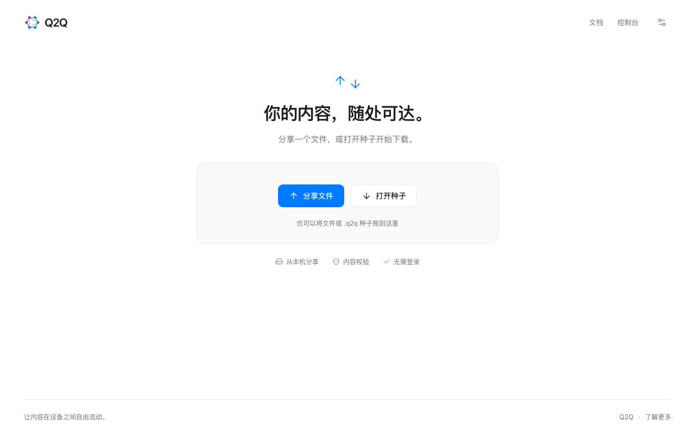
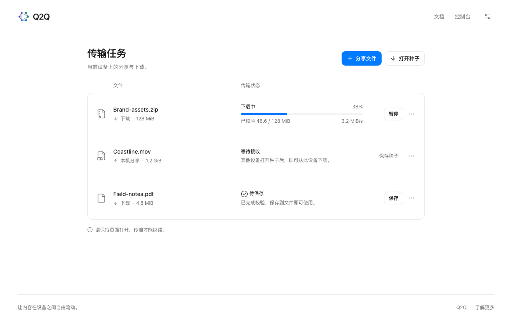
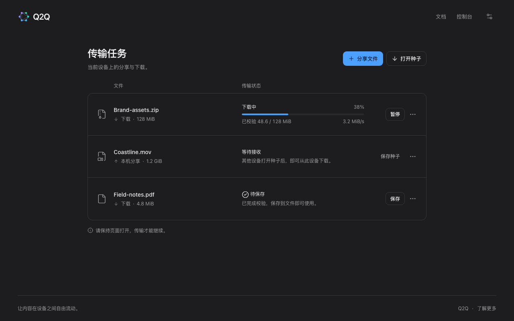
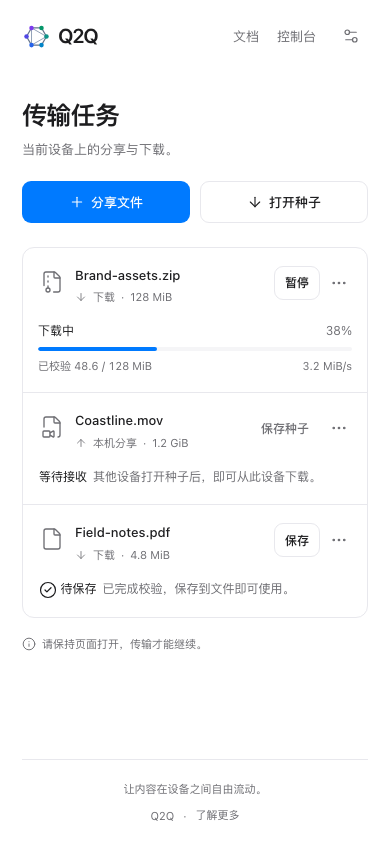

# Q2Q 主站设计预览

状态：**用户已确认的静态设计基准**。不是已接入 SDK 的主站，不表示分享、下载、P2P、保存或恢复已实现。页面中的文件、连接数、来源、速度及进度全部是示意数据。

## 预览

[prototype.html](prototype.html) 是独立预览，不依赖构建、CDN 或网络服务。顶部设计工具可切换首次打开、传输中、暂停、待保存和失败，以及桌面/手机和浅深色。设置提供主题与中英文预览；分享/打开种子展示样例确认，任务支持演示暂停/继续、保存状态和详情。

预览不会选择、读取、上传或下载用户文件；不会执行真实 Auth、SDK 或 API 请求。文档和控制台链接会打开相应站点。主题/语言只在这次预览页面内切换，不修改实际应用偏好。

在仓库根目录运行：

```sh
python3 -m http.server 5190 --bind 127.0.0.1 --directory apps/www/design
```

然后访问 [本地设计预览](http://127.0.0.1:5190/prototype.html)。这只是静态设计服务，不是 platform 或 web 的 dev server。

可指定 `?state=active&theme=dark&view=mobile`。`capture=1` 隐藏设计工具，截图按浏览器真实宽度排版；它仅用于视觉记录，不能脱离本目录的说明作为实际产品功能证明。

## 设计约定

- **无账户入口。** 主站只做本机分享与种子下载，第一阶段无平台账号 Auth；顶部只保留品牌、文档、控制台和设置。需要账号的云端文件、项目、存储和订阅在 platform 完成。SDK 的 Peer 身份认证仍独立保留。
- **空状态突出两条路径。** 简短标题、一处拖放区、分享文件/打开种子两个文字按钮。无需侧栏、统计卡片、注册入口或大型宣传插图。
- **有任务后以任务为中心。** 欢迎区收起，主操作放进工具栏；文件、进度和常用操作在同一行，详情按需打开。
- **共享视觉。** 沿用 platform 的 Q2Q Logo、系统字体、蓝色强调、浅深色语义配色、细边框与圆角。Logo 直接复制共享品牌资源，图标来自已安装的 Lucide，许可证在 assets 中。
- **状态真实区分。** 下载中、已暂停、等待接收、待保存和失败使用不同文案。本机分享不显示“文件下载百分比”；下载完成仍需保存到用户文件位置。
- **手机自然重排。** 390px 与 320px 下无横向滚动；文件和操作在上方，进度在下方，不缩小整张桌面表格。
- **不将原型脚本移作传输内核。** 后续正式应用沿用 platform 的 SvelteKit、TypeScript、Tailwind、shadcn-svelte、Lucide，放在 apps/www；状态和传输由 @q2q/client-web 管理。

## 截图

### 浅色 · 首次打开



### 浅色 · 传输任务



### 深色 · 传输任务



### 手机 · 传输任务



另保留 dark-empty.png、mobile-empty.png、mobile-dark.png。

## 验证记录

2026-10-28：Chromium 148 中检查 5 种状态 × 4 种宽度（320/390/768/1280px），未发现页面横向溢出；分享确认、暂停/继续、详情、浅深色和中英文切换可操作，无页面脚本异常。已查看桌面及手机截图。该检查只针对设计稿，不是 SDK、网络传输、原生文件保存或浏览器兼容性验收。

用户确认本稿后，已恢复 apps/www 的正式实现并接入 SDK HTTP 下载子集。原型中的分享/P2P 仍为目标设计，不作为已实现能力展示。实际能力与验证见 [应用说明](../README.md)。
