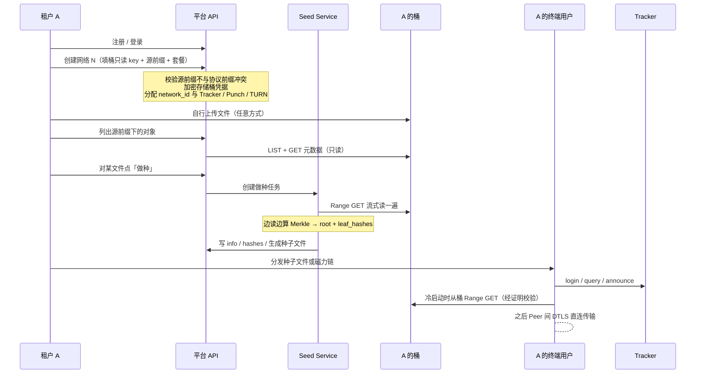

# PaaS MVP 设计

| 状态 | 最后更新 |
| --- | --- |
| 草案（Draft） | 2026-10-14 |

> 本文定义托管形态的 MVP：平台提供**注册登录 / 网络管理 / 种子管理**三块功能，控制面服务（Tracker / Punch / TURN）**不持有持久业务状态、不理解网络语义**。数据面完全沿用 `p2p-technical.md`，本文不重复定义。
>
> 与 `p2p-selfhosted.md` 的关系：那份方案把网络的权威状态放进创建者自己的对象存储桶。本文**不采用**该存储模型——MVP 的权威状态由平台自己的存储维护，客户桶只承载文件字节（作为 CDN 源）与做种的读取来源。但 self-hosted 方案中的若干**协议层改进**与存储后端无关，本文予以沿用，清单见 1.2 节。

## 1. 引言

### 1.1 范围

本文覆盖：

1. 平台的三个功能模块：注册登录、网络管理、种子管理；
2. 控制面三个服务（Tracker / Punch / TURN）的无状态边界；
3. 平台自身的数据模型与接口；
4. 「什么状态存在哪里」的完整清单。

本文不覆盖：数据面协议（见 `p2p-technical.md` §4）、计费与定价（沿用 `p2p-selfhosted.md` 第 8 / 9 章，本文只在 7.3 节说明它与本模型的关系）、多区域部署细节。

### 1.2 与既有文档的关系

| 来源 | 本文的处理 |
| --- | --- |
| `p2p-technical.md` 数据面（Merkle / chunk / 双 DataChannel / ICE / DTLS） | **完全沿用** |
| `p2p-technical.md` 控制面协议（Tracker REST / Punch RPC / JWT 模型） | 沿用，仅按 6.2 节简化 |
| `p2p-selfhosted.md` 桶存储模型（`network_id = s3://bucket`、创建者主权、descriptor / JWKS） | **不采用**，见 1.1 节 |
| `p2p-selfhosted.md` §4.4 无状态 login challenge | **沿用**——纯协议改进，与存储后端无关 |
| `p2p-selfhosted.md` §5.5 admission authority 与有界撤销 | **沿用**——这是 Punch 保持业务无关的机制 |
| `p2p-selfhosted.md` §5.3 `punch.healthz` | 沿用 |
| `p2p-selfhosted.md` 第 8 章计量（桶出向流量 + A/B 对照） | **沿用**，理由见 7.3 节 |

### 1.3 规范性语言

本文按 RFC 2119 / RFC 8174 的语义使用 **必须**（MUST）、**不得**（MUST NOT）、**应当**（SHOULD）、**可以**（MAY）。

### 1.4 术语

- **租户（Tenant）**：在平台注册的客户，即网络创建者。与 P2P 协议里的 **Peer** 是两套完全不同的身份，不得混用（见 4.1 节）。
- **网络（Network）**：由 `network_id` 标识的命名空间，由租户创建。
- **资源（Resource）**：一个已做种的文件，`resource_id` 即 `info_hash`（沿用既有设计）。
- **源前缀（Source Prefix）**：租户在自己桶里存放待做种文件的位置，创建网络时填写。

## 2. 架构总览

```mermaid
graph TB
    subgraph 平台
        WEB[控制台]
        API[平台 API]
        DB[(平台数据库)]
        SEED[Seed Service]
        KMS[KMS]
    end
    subgraph 控制面
        T[Tracker<br/>内存索引 + 签票]
        P[Punch<br/>Binding + 信令]
        R[TURN<br/>转发]
    end
    subgraph 客户侧
        BUCKET[(租户的桶<br/>文件字节)]
        SDK[客户端 SDK]
    end

    WEB --> API
    API --> DB
    API --> SEED
    API --> KMS
    SEED -->|只读: LIST + GET| BUCKET
    SEED -->|写 info / hashes| API
    API -->|下发运行配置| T
    T -->|签 capability| P
    SDK -->|login / announce / query| T
    SDK -->|join / signal| P
    SDK <-->|relay| R
    SDK -->|Range GET| BUCKET
```



### 2.1 组件职责

| 组件 | 职责 | 持久状态 |
| --- | --- | --- |
| 控制台 | 注册登录、网络管理、种子管理的 Web 界面 | 无 |
| 平台 API | 租户与网络的 CRUD、做种任务编排、凭据管理 | 有（平台 DB） |
| 平台 DB | 租户、网络、资源、做种任务、桶凭据引用 | **权威** |
| Seed Service | 读租户桶算 Merkle，产出 `info` / `hashes` / 种子文件 | 无（产物交给平台存储） |
| Tracker | 内存索引「谁有哪些文件」；签发 capability | 无（见 3.1） |
| Punch | 维护 Binding、转发信令 | 无（见 3.2） |
| TURN | 转发数据 | 无（见 3.3） |
| KMS | 签票私钥、租户桶凭据的加密 | 有 |

### 2.2 一次完整流程



## 3. 控制面服务的无状态边界

这是本文的核心主张：**三个控制面服务都不持有持久业务状态，也都不理解网络语义**。它们各自只有一份来自平台的、可缓存可重建的运行配置。

### 3.1 Tracker：内存索引 + 签票

Tracker 只做两件事：

1. **在内存里维护「谁有哪些文件」**——即 `(network_id, resource_id) → [peer_id]` 的邻接表，条目带过期时间；
2. **签发 capability**——`punch` 与 `connect` 票据，用控制集群的 admission authority 私钥。

它**不**持久化身份、**不**持久化资源索引、**不**知道某个网络属于哪个租户、桶在哪、套餐是什么——这些都属于平台（4.2 节）。`network_id` 对它只是一个**隔离维度**：内存索引按它分桶，`iss` 原样写进票据，不被解析。

#### 3.1.1 内存索引的恢复窗口

Peer **应当**周期性重发 `announce` 以刷新自己的条目（既有设计 §7.2.1）。因此索引是**软状态**：进程重启后它会随 Peer 的重发自然重建。

代价是**重启后存在一个恢复窗口**，其长度约等于 announce TTL，期间 `query` 返回的结果不完整甚至为空。这是本模型明确接受的取舍：

- 它换来的是 Tracker 可以随意重启、扩缩容、崩溃后自愈，不需要任何状态迁移；
- 期间的正确性不受影响——冷启动由 `cdn_list`（租户的桶）兜底，Peer 拿不到候选只是无法走 P2P，不会拿到错误数据。

平台**应当**把「Tracker 重启后 X 分钟内 query 命中率下降」纳入监控，并**不得**在此期间触发自动扩容判断（否则会因为命中率低而误判为容量不足）。

#### 3.1.2 去掉 `register`

既有设计的 `POST /peers`（register）目的是把 `public_key` 存进 Tracker，供后续 login 验签。Tracker 不留身份库之后这一步没有必要：

```text
login 时客户端携带 public_key
Tracker 校验 SHA-256(public_key) == peer_id
再用该 public_key 验签 challenge
```

公钥与身份的绑定是**自校验**的，不需要任何预先存储。因此本文**删除 `register` 接口**。副作用是 Tracker 无法判断「这个 peer_id 是不是本网络的成员」——即**没有准入控制**，见第 8 章未决问题 1。

`DELETE /peers/{peer_id}`（revoke）同样依赖持久状态，MVP 暂不提供，见 3.4 节。

### 3.2 Punch：Binding 与信令

Punch 维护 Binding（`peer_id → 地址`）并转发 WebRTC 信令，仅此而已。它：

- **不**知道网络、租户、桶、资源索引的存在；
- 只验证 capability 的签名是否来自本控制集群的 admission authority、`aud` 是否为自己的 `punch_id`、`nbf` / `exp` 是否有效、`jti` 是否未消费（沿用 `p2p-selfhosted.md` §5.5）；
- 把票据里的 `iss` / `network_id` 当作**不透明命名空间键**，仅用于隔离 Binding 与连接记录，**不得**用于查找任何网络配置或配额。

Binding 是内存状态，Punch 重启后 Peer 需重新 `join`。这与 Tracker 的恢复窗口是同一类取舍。

### 3.3 TURN：纯转发

TURN 只转发字节，天然无状态。授权沿用 coturn 的 REST 短期凭据：平台持有一个 `turn_secret`，Tracker 按 `"expiry_timestamp:peer_id"` + `HMAC(turn_secret, username)` 生成凭据，**不需要与 TURN 服务器交互、不产生任何存储**。

### 3.4 状态总表

| 数据 | 频率 | 存放 | 丢失后果 |
| --- | --- | --- | --- |
| 租户 / 用户 | 极低频 | 平台 DB | 平台不可用（**必须**备份） |
| 网络配置、桶凭据引用 | 极低频 | 平台 DB | 同上 |
| 资源元数据（info / hashes / 种子） | 低频 | 平台存储 | 种子失效（**必须**备份） |
| 做种任务 | 中频 | 平台 DB | 任务丢失，可重跑 |
| Peer 身份（public_key） | — | **不存**（3.1.2 自校验） | 无 |
| 资源索引（谁有哪些文件） | 高频 | **Tracker 内存** | 恢复窗口内 query 不完整（3.1.1） |
| Binding / 在线状态 | 高频 | **Punch 内存** | Peer 需重新 join |
| 已消费 `jti` | 每次连接 | **Punch 内存** | 同 Binding 生命周期 |
| TURN 凭据 | 每次回退 | **无**（HMAC 自包含） | 无 |
| login challenge | 每次 login | **无**（自包含 JWT） | 无 |
| 限流计数 | 每请求 | Tracker 本地内存 | 计数清零（可丢失） |
| **`revoked_keys`** | 极低频 | **未定**（见下） | 吊销失效 |

**唯一躲不掉的持久状态是吊销。** 私钥泄露后要让某个 `peer_id` 失效，需要一份持久、且所有 Tracker 实例都能看到的 `revoked_keys`。它与「Tracker 无状态」直接冲突。MVP 的处理见第 8 章未决问题 2——本文**不**默默略过这一点：在吊销能力落地之前，泄露的私钥在该私钥签发的票据有效期内（connect 60 s / punch-binding 5 min）仍可被使用，且无法提前终止。

## 4. 平台功能

### 4.1 注册登录

平台自身的账号体系，与 P2P 协议里的 Peer 身份是**两套东西**：

| | 平台租户 | P2P Peer |
| --- | --- | --- |
| 是谁 | 购买服务的客户（网络创建者） | 租户的终端用户 |
| 标识 | 邮箱 / 平台用户 ID | `peer_id = base32(SHA-256(public_key))` |
| 凭证 | 密码 / OAuth / MFA | Ed25519 私钥（本地生成，平台永不持有） |
| 存在哪 | 平台 DB | 不存（3.1.2） |

**这两套身份不得合并。** 平台**不得**代 Peer 生成或托管密钥——那会让平台有能力冒充任意 Peer，直接摧毁数据面的端到端安全（既有设计 §8.2）。SDK 在终端用户设备上本地生成密钥对。

MVP 至少提供：邮箱注册 / 登录、密码重置、会话管理。租户内多用户（角色与权限）可延后。

### 4.2 网络管理

创建网络的输入：

| 字段 | 说明 |
| --- | --- |
| `name` | 展示名 |
| `bucket_endpoint` / `bucket_name` | 租户桶的位置 |
| `bucket_readonly_key` | **只读**凭证（见 7.1 节） |
| `source_prefix` | 待做种文件所在位置，如 `uploads/` |
| `plan` | 套餐，决定分配与配额 |

平台在创建时**必须**做的校验：

1. **协议前缀保留**。源前缀**不得**是 `resources/`、`peers/`、`announcements/`、`revocations/`、`trackers/` 之一。虽然 MVP 不在租户桶里写协议对象，但保留这些前缀可以为将来留出余地，也避免租户误把自己的业务文件放进去后产生混淆。
2. **连通性验证**。用给定的只读 key 实际 LIST 一次源前缀，失败则拒绝创建——宁可当场报错，也不要等做种时才失败。
3. **允许填根前缀**，但控制台**应当**提示「这将授予平台整个桶的读权限」。

创建后平台分配 `network_id`（本文采用平台生成的标识，形如 `net_<random>`，不再是桶 URI），并按套餐把该网络指派给 Tracker / Punch / TURN。

**分配的准确含义**（三者不同，容易搞混）：

| 服务 | 「分配」实际是什么 | 落点 |
| --- | --- | --- |
| Tracker | 指派哪些实例**负责**这个网络的下发配置 | 运行配置 |
| Punch | **不是分配实例**——Punch 不认识网络。套餐差异体现在 Tracker 签发 capability 时可选哪些 `punch_id` / region | Tracker 签发逻辑 |
| TURN | 给 region 列表与配额 | `login` 响应的 `turn_servers` + relay 凭据配额 |

网络管理还提供：列表、详情（显示分配到的服务、在线 Peer 数等统计）、删除（**必须**显式二次确认，并说明是否一并删除资源元数据）。

### 4.3 种子管理

三步：**列出 → 做种 → 分发**。

#### 4.3.1 列出

平台用只读 key LIST 源前缀，展示对象（key、大小、最后修改时间、是否已做种）。大桶**必须**分页。

#### 4.3.2 做种

点击后创建异步任务（大文件需要分钟级）：

| 步骤 | 说明 |
| --- | --- |
| 1 | 流式 Range GET 读源对象一遍 |
| 2 | 边读边算 Merkle → `root` 与 `leaf_hashes` |
| 3 | 拼 canonical `info`，得 `resource_id = SHA-256(canonical info)` |
| 4 | 写 `info`、`hashes` 到**平台自己的存储**（不是租户桶） |
| 5 | 生成种子文件：`tracker_list` 指向分配到的 Tracker，`cdn_list` 指向租户桶的**原始对象**，`proof_list` 指向平台的 hashes 端点 |

要点：

- **文件本体不动**。不复制、不移动到租户桶的其他位置，也不搬进平台存储。`cdn_list` 直接指向租户上传的原始对象。省掉一次完整复制，对大文件是数量级差异。
- **可并行**。各 block 的叶子哈希互相独立，**应当**并发分段 Range GET 后逐层合并。
- **幂等**。同一份内容算出的 `root` 相同 ⇒ `resource_id` 相同，重复做种是安全的。平台**应当**用对象 ETag / LastModified 判断文件是否被改动过，改动后需重做。
- **小文件可以内联** `leaf_hashes` 进种子文件（既有设计 §5.1），省掉 `hashes` 对象与 `proof_list`。

任务状态：pending / running / done / failed，带进度（已处理字节）与失败原因。

#### 4.3.3 分发

已做种资源提供：下载种子文件、复制磁力链、查看统计（被下载次数、活跃 Peer 数等，来自遥测）。

**语义澄清**：做种完成后，租户的桶就是 `cdn_list` 指向的**虚拟 Peer**（既有设计 §5.1：CDN 被当作拥有全部 block 的虚拟 Peer），全网零 seeder 也能工作。所以按钮的语义是「让这个文件可被 P2P 分发」，平台并不养一个真的 seeder。UI 文案**应当**照此撰写。

## 5. 数据模型

平台侧（示意，非完整 DDL）：

```text
tenants(id, name, created_at)
users(id, tenant_id, email, password_hash, created_at)

networks(
  id, tenant_id, name,
  network_id,                 平台分配，形如 net_<random>
  bucket_endpoint, bucket_name,
  bucket_credential_ref,      加密后的只读 key 引用，不存明文
  source_prefix,
  plan,
  created_at
)

resources(
  id, network_id,
  resource_id,                即 info_hash
  name, size, block_size, root,
  source_object_key,          租户桶里的原始对象
  hashes_ref,                 平台存储中的叶子哈希列表
  leaf_hashes_inline,         小文件内联时直接存这里
  created_at
)

seeding_jobs(
  id, resource_id, network_id,
  source_object_key, source_etag, size,
  status, progress_bytes, error,
  created_at, finished_at
)
```

`bucket_credential_ref` **必须**是 KMS 信封加密后的引用，**不得**明文落库，且在界面上**只展示一次**。

## 6. 接口

### 6.1 平台 API

面向控制台，与 P2P 协议无关（这不是 Peer 调用的接口）：

| 方法 | 路径 | 作用 |
| --- | --- | --- |
| `POST` | `/auth/register` | 租户注册 |
| `POST` | `/auth/login` | 登录，返回平台会话 |
| `GET` / `POST` | `/networks` | 网络列表 / 创建 |
| `GET` / `DELETE` | `/networks/{id}` | 详情 / 删除 |
| `GET` | `/networks/{id}/objects` | 列出源前缀下的桶对象 |
| `POST` | `/networks/{id}/seed` | 对某个对象触发做种 |
| `GET` | `/networks/{id}/jobs` | 做种任务列表与进度 |
| `GET` | `/networks/{id}/resources` | 已做种资源列表 |
| `GET` | `/resources/{id}/torrent` | 下载种子文件 |
| `GET` | `/resources/{id}/stats` | 资源统计 |

### 6.2 Tracker API 相对既有设计的变化

| 变化 | 说明 |
| --- | --- |
| **删除** `POST /peers`（register） | 无身份库，公钥自校验（3.1.2） |
| **暂不提供** `DELETE /peers/{peer_id}`（revoke） | 依赖持久 `revoked_keys`，见第 8 章未决问题 2 |
| `GET /sessions/challenge` 改为自包含 JWT | 沿用 `p2p-selfhosted.md` §4.4，Tracker 不存 nonce |
| `POST /sessions` 携带 `public_key` | 替代 register 的作用 |
| `PUT /peers/{peer_id}/resources`（announce） | 语义不变，落内存索引 |
| `GET /resources/{resource_id}/peers`（query） | 语义不变，读内存索引 |
| `POST /connections/relay` | 不变，验 connect JWT 本体（无状态） |
| 所有票据 `iss` = `network_id` | Tracker 不解析它，只作隔离维度 |

## 7. 安全边界

### 7.1 租户桶的权限

MVP 只需要**只读**：Seed Service 读源文件、客户端读文件字节。

| 用途 | 权限 | 谁持有 |
| --- | --- | --- |
| 列出与读取源前缀 | LIST + GET | Seed Service（服务端组件） |
| 客户端下载字节 | 公开读，或平台用只读 key 签**预签名 URL** | 客户端（短期 URL） |

平台**不得**要求租户桶的写权限。这比要求读写的方案更容易被客户接受，也把风险面限死在「读」上。

### 7.2 平台不持有 Peer 私钥

见 4.1 节。SDK 在终端设备上本地生成 Ed25519 密钥对，平台永远拿不到。

### 7.3 计量的可信基准仍然成立

`p2p-selfhosted.md` §1.1 把「元数据存哪」和「计量基准」捆在了一起，但两者其实是正交的：**桶出向流量由云厂商计量**这件事只取决于文件字节在不在客户桶里，不取决于元数据在哪。

本文模型下文件字节仍在租户桶 ⇒ 第 8 章的计量方案（桶出向流量 + A/B 对照）**原样成立**。这是本模型相对标准托管方案的关键优势，**不得**在实现中丢掉——一旦把文件字节也搬进平台存储，这个基准就没了。

### 7.4 威胁

| 威胁 | 缓解 |
| --- | --- |
| 平台 DB 被攻破 | 所有网络的元数据集中在此，**必须**加密 + 备份 + 审计；这是本模型相对 self-hosted 最大的风险集中点 |
| 桶只读 key 泄露 | KMS 信封加密、只展示一次、支持轮换 |
| 平台冒充 Peer | 不可能——不持有 Peer 私钥（4.1 节） |
| 恶意 Peer 投递损坏数据 | Merkle 校验 + 失败计数（沿用既有设计） |
| 未授权 Tracker 使用 PaaS Punch | Punch 只信任本控制集群 admission authority；外部 Tracker 签不出被接受的 capability |
| **私钥泄露的 Peer 无法吊销** | 未决问题 2；当前只能靠短票据窗口（connect 60 s / binding 5 min）自然收敛 |

## 8. 未决问题

1. **要不要准入控制**？去掉 `register` 之后（3.1.2），任何知道 `network_id` 与 Tracker 地址的人都能加入网络。公开分发场景这是特性；企业客户则可能要求「只有我的员工能加入」。若需要，最小改动是在 `login` 时校验一个平台签发的**加入凭证**——但那会引入 Tracker 对平台的依赖或一份可缓存的准入配置，需要单独设计。
2. **吊销怎么落地**？`revoked_keys` 是唯一与「Tracker 无状态」冲突的持久状态。候选方向：(a) 平台 DB 存 + Tracker 定期拉取缓存（引入一个可接受的「配置」而非「状态」）；(b) 短期不做，仅靠短票据窗口。倾向 (a)，因为它只是配置分发，不破坏 3.1 节的结论。
3. **规模量纲用什么决定分配**？建议用「并发在线 Peer 峰值 + 资源数」，而不是月活跃 Peer 数——后者适合计费，不适合容量规划。
4. **多实例 Tracker 怎么路由**？MVP 建议单实例；多实例时同一 `resource_id` 的 announce 与 query 落在同一实例才有完整视图，需要按 `(network_id, resource_id)` 做一致性哈希或直接按网络指派实例。
5. **一个租户可以有多个网络吗**？MVP 建议允许，数据模型已按此设计（4.2 节），但控制台复杂度会上升。
6. **Tracker 重启恢复期内如何避免误判**（3.1.1 的监控约束）。

## 9. 参考资料

- `p2p-technical.md`：数据面与控制面协议的完整定义（v2）。
- `p2p-selfhosted.md`：自托管网络提案（v3）。本文不采用其存储模型，但沿用 §4.4、§5.3、§5.5、第 8 章。
- RFC 2119 / RFC 8174：规范性语言。
- coturn TURN REST API：短期凭据机制。
