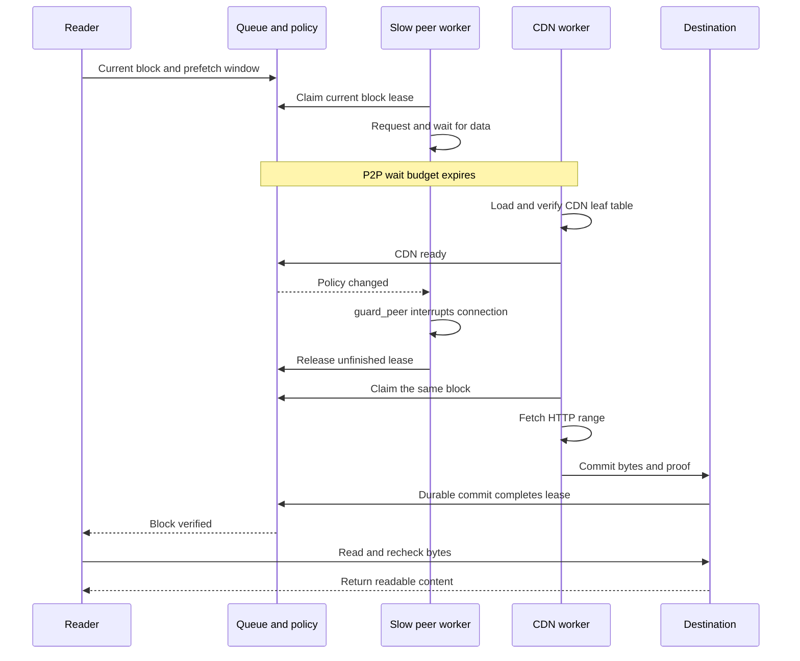

# CDN fallback

The Rust SDK can download verified blocks over HTTP(S) when P2P is unavailable. Full-file downloads try P2P first, then use CDN sources to fill remaining blocks. On-demand VOD also supports urgent fallback for the current read block. An unavailable Track or Punch does not prevent CDN cold start.

## Configure the seed

`cdn_list` contains URLs serving the exact complete file. Each block maps to an HTTP `Range` request.

Verification also needs a complete leaf hash table, supplied by either:

- `leaf_hashes` embedded in the seed; or
- `proof_list`: HTTP(S) URLs serving the raw leaf hashes in block order, exactly 32 bytes per block.

The SDK prefers a valid embedded table. Otherwise it tries the proof URLs in order and rebuilds the Merkle root locally before accepting a table. A missing or invalid table stops CDN fallback. Hash-table and CDN URLs are outside `info`, so changing them does not change `info_hash`.

```rust
seed.cdn_list = vec!["https://cdn.example.com/video.mp4".into()];
seed.proof_list = vec!["https://cdn.example.com/video.mp4.hashes".into()];

let transfer = client.download(&seed, "video.mp4").await?;
transfer.wait().await?;
```

## HTTP requirements

For each block the server must return `206 Partial Content` with an exact `Content-Range`, including the expected total file length. `200 OK` is accepted only when one block request covers the whole file. Responses must contain exactly the requested bytes and use an uncompressed representation.

Each request has a 20-second deadline and a 5-second connection timeout. Redirects are limited to three. The SDK currently fetches the entire hash table, bounded by 65,536 blocks, or 2 MiB of leaf hashes.

## Verification and recovery

HTTP data is checked against the seed's Merkle root before it reaches the destination. Successful blocks use the same durable receipts, progress counters and resume logic as P2P data. A bad source cannot make unverified content appear complete.

The `max_download_peers` builder setting also bounds concurrent CDN block requests (default 4, range 1–16). A failed worker returns its block to the queue. After the current mirror's workers stop, the next mirror supplies any missing blocks. Disk or receipt-write failures stop the transfer.

`Transfer::subscribe_progress()` exposes `active_peers` for WebRTC connections and `active_cdn_requests` for HTTP data or hash-table requests. Dropping or cancelling the transfer cancels its HTTP requests. Preserve the destination and its matching checkpoint under the Client's `storage_dir/checkpoints` to resume later.

Full-file downloads do not race CDN against slow peers or switch back to P2P automatically. Hash tables are not fetched in ranges.


## VOD urgent-block handoff

`client.open(...).await` uses a different activation policy from full-file downloads. The current read block gives P2P `min(2 seconds, read_timeout / 2)`. When peers are exhausted, CDN may fill the whole read/prefetch window. An urgent block does not have to wait for the full 15-second discovery deadline before attempting CDN.



This is a lease handoff. Only a verified CDN leaf table permits interruption of the slow connection holding the urgent block. CDN cannot claim the block until its previous lease is released. Other peers continue. A bad table cannot force healthy peers to stop; a bad CDN block tries the next mirror while healthy peers can still supply content.

VOD permits up to max_download_peers workers for each source class, rather than one combined connection quota. Each block has one owner throughout fetching and disk submission.

Track is queried once. A later window can reconnect known candidates but does not rediscover holders. After leaf-table loading fails, this reader does not reload that source; reopening can retry. See [Scheduling](./scheduling) for cancellation and window behavior.

## Shared HTTP executor

CDN bytes and proof tables use standalone [q2q-http](./http). A Client shares one connection pool and total HTTP budget: `client::builder().http_request_limit(16)` sets the cap (default 16), while max_download_peers still limits workers within each transfer. Concurrent transfers share the cap; separate Clients do not. The 20-second total request deadline includes admission. Track control requests retain a separate client.

Core still owns Merkle verification, mirror policy, Q2Q checkpoints and verified progress. Its strict Range requests never silently fall back to ordinary whole-file downloads.
