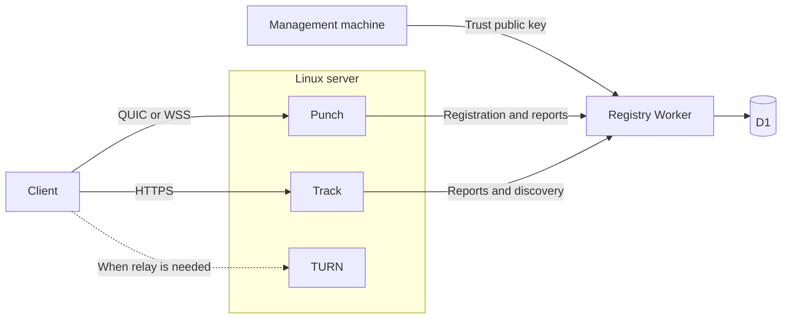

# Single node

First establish Registry, then deploy TURN, Punch and Track on one Linux server. Registry uses Cloudflare Workers and D1; coturn is the TURN example. Clients use Track to discover sources, Punch to establish connections, and TURN when a direct connection is unavailable. Registry maintains node registration and discovery; it does not carry file data.

The management machine prepares all keys, certificates, configurations and tokens. The Linux server runs published images with Docker Compose and receives only runtime files; it needs no Rust or build tools. Examples use `v0.5.0` images and management tools from the corresponding source release.

Before configuring services, read [Security](./security) to understand the separate roles of signing keys, Punch identity, node tokens, HTTPS and the TURN secret.



## 1. Prepare addresses and tools

### Choose domains and entry points

Assume the server's public IP is `203.0.113.10`. Replace the example domains and IP, then configure DNS, firewalls and security groups:

| Service | External endpoint | Access and exposed ports |
| --- | --- | --- |
| Registry | `https://registry.example.com` | A domain in a Cloudflare zone routes directly to the Worker; no server-side reverse proxy |
| Track | `https://track.example.com` | HTTPS on TCP 443 forwards every HTTP path to local `127.0.0.1:8080` |
| Punch | `quic://punch.example.com:4433` | The same instance directly serves QUIC on `4433/udp` and WSS on `4433/tcp`, with TLS provided by Punch |
| TURN | `turn:turn.example.com:3478` | Direct TURN access on `3478/udp`, `3478/tcp` and relay range `49160–49200/udp` |

Track, Punch and TURN domains resolve to the server's public IP. Use DNS-only records for Punch and TURN, with transport ports reaching the services directly.

The server's reverse proxy handles only Track HTTPS. Choose Caddy, Nginx or another proxy, provision a valid certificate for the Track hostname, and preserve methods, paths, query parameters, bodies and authentication headers. Track port 8080 listens only on loopback. HTTP-01 certificate issuance also needs TCP port 80. Step 6 provides proxy examples once the backend is ready.

### Install preparation tools on the management machine

The management machine needs Git, Node.js 24, Rust stable, OpenSSL and a Cloudflare account. The server needs Docker Engine, the Compose plugin (usable by the deployment account) and a reverse proxy such as Caddy or Nginx for Track HTTPS. This Compose example uses Linux host networking. The published Q2Q example images support `linux/amd64`; check the server architecture first.

On the management machine, obtain matching release sources and install two preparation tools. `q2q-keygen` handles keys and JWTs; `q2q-punch-server` is used here only to generate Punch certificates, not to run a service:

```sh
git clone https://github.com/mivinci/Q2Q.git
cd Q2Q
git checkout punch/v0.5.0
export PATH="${CARGO_HOME:-$HOME/.cargo}/bin:$PATH"
cargo install --locked --path crates/q2q-keygen
cargo install --locked --path crates/q2q-punch-server
npm ci
npx wrangler login

export Q2Q_DEPLOY_DIR="$HOME/.q2q-deploy/single-node"
umask 077
install -d -m 700 "$HOME/.q2q-signing" \
  "$Q2Q_DEPLOY_DIR/identity" "$Q2Q_DEPLOY_DIR/secrets"
```

Steps 2–5 run entirely on the management machine. Run npm/Wrangler commands from the repository root; save other files through absolute paths. Restore `Q2Q_DEPLOY_DIR` and PATH when opening a new terminal.

`$HOME/.q2q-signing` holds signing private keys, claims and identity import sources. `$Q2Q_DEPLOY_DIR` is the runtime directory to distribute. Keep them separate so the Registry signing key stays off the server. For other image versions, use management tools from the corresponding source release.

## 2. Establish Registry trust

Generate an Ed25519 signing key dedicated to Registry tokens on the management machine:

```sh
q2q-keygen keypair \
  --kid registry-signing-1 --format jwk \
  --private-key "$HOME/.q2q-signing/signing-1.private.jwk.json" \
  --public-key "$HOME/.q2q-signing/signing-1.public.jwks.json"
```

Keep the private key here. Install only its public JWKS in Registry. Outputs cannot overwrite existing files; use new filenames for renewal and rotation.

Create Registry's separate database from the management machine:

```sh
(cd apps/registry && npx wrangler d1 create q2q-registry)
```

Configure `apps/registry/wrangler.jsonc` for your own instance: replace its existing resource ID with the new database ID in `d1_databases[0].database_id`, and set your domain in the top-level configuration below. Use a separate database from Platform:

```json
"routes": [{ "pattern": "registry.example.com", "custom_domain": true }]
```

The domain must belong to a zone in your Cloudflare account. Apply migrations, configure the verification public keys, then deploy. If Wrangler prompts to create the Worker when setting its first secret, continue with the service name from the configuration file:

```sh
npm run db:migrate:remote --workspace @q2q/registry
(cd apps/registry && npx wrangler secret put REGISTRY_JWKS \
  < "$HOME/.q2q-signing/signing-1.public.jwks.json")
npm run deploy --workspace @q2q/registry
curl --fail https://registry.example.com/health
```

Continue once `/health` returns liveness information. It does not check D1 writes or node reachability; registration and transfer steps below exercise those paths. Registry and Platform use separate D1 databases.

## 3. Prepare TURN relay

Track needs a TURN endpoint and shared secret to issue temporary relay credentials, so prepare this dependency first. This example uses coturn; another implementation must support the compatible temporary credential mechanism.

On the management machine, generate a random TURN shared secret and store it in configuration readable only by the deployment account:

```sh
openssl rand -hex 32
```

Write `$Q2Q_DEPLOY_DIR/turnserver.conf` on the management machine, replacing the IP, domain and secret:

```ini
listening-port=3478
realm=turn.example.com
use-auth-secret
static-auth-secret=REPLACE_WITH_TURN_SECRET
external-ip=203.0.113.10
min-port=49160
max-port=49200
fingerprint
no-multicast-peers
no-cli
```

Save this file for distribution with the other runtime files. Track configuration in step 5 uses the same secret; TURN and Track will start later on the server.

## 4. Prepare Punch identity on the management machine

A new node needs its own identity key and certificate. Create a local initialization-only configuration pointing to the staging directory, then explicitly generate and import the key:

```sh
cat > "$HOME/.q2q-signing/punch-1.init.toml" <<EOF
bind = "127.0.0.1:4433"
punch_id = "punch-1"
[identity]
cert = "$Q2Q_DEPLOY_DIR/identity/cert.pem"
key = "$Q2Q_DEPLOY_DIR/identity/key.pem"
EOF

q2q-keygen keypair --kid punch-1 --format pem \
  --private-key "$HOME/.q2q-signing/punch-1.private.pem" \
  --public-key "$HOME/.q2q-signing/punch-1.public.pem"
q2q-punch-server "$HOME/.q2q-signing/punch-1.init.toml" --init-identity \
  --identity-key "$HOME/.q2q-signing/punch-1.private.pem"
```

The command creates `identity/cert.pem` and `identity/key.pem`, prints the raw 32-byte public key as Base64, then exits without listening. Use that output in the signed Punch claims below.

Keep the initialization configuration and PEM import source on the management machine. Distribute the certificate and runtime private key from the staging directory; runtime configuration uses container paths. Back up this identity and retain it across upgrades and restarts.

For an existing Punch migrating to Registry, securely back up its original certificate and key on the management machine and arrange them in the staging layout. Confirm both existing identity files are present before using an initialization configuration pointing at them with `--init-identity` to read the public key, without generating or importing another identity.

## 5. Complete configuration and node credentials

On the management machine, save `$HOME/.q2q-signing/punch-1.claims.json`, replacing `public_key` with the Base64 output above:

```json
{
  "iss": "q2q-registry",
  "aud": "q2q-registry",
  "sub": "punch-1",
  "service_type": "punch",
  "scope": ["nodes:write:self"],
  "advertise_url": "quic://punch.example.com:4433",
  "public_key": "REPLACE_WITH_PUNCH_BASE64_PUBLIC_KEY",
  "identity_version": 1
}
```

Save `$HOME/.q2q-signing/track-1.claims.json` alongside it:

```json
{
  "iss": "q2q-registry",
  "aud": "q2q-registry",
  "sub": "track-1",
  "service_type": "track",
  "scope": ["nodes:write:self", "discovery:punch:read"],
  "advertise_url": "https://track.example.com",
  "identity_version": 1
}
```

Punch's `sub` must match its configured `punch_id`; Track takes its node ID from the token. Use each service's client-facing endpoint for `advertise_url`. Omit `iat`, `exp` and `jti` from input files; the tool generates them.

Issue separate 90-day tokens on the management machine:

```sh
q2q-keygen token \
  --key "$HOME/.q2q-signing/signing-1.private.jwk.json" \
  --claims "$HOME/.q2q-signing/punch-1.claims.json" \
  --days 90 --output "$Q2Q_DEPLOY_DIR/secrets/punch-1.token"
q2q-keygen token \
  --key "$HOME/.q2q-signing/signing-1.private.jwk.json" \
  --claims "$HOME/.q2q-signing/track-1.claims.json" \
  --days 90 --output "$Q2Q_DEPLOY_DIR/secrets/track-1.token"
```

Continue on the management machine. Write `$Q2Q_DEPLOY_DIR/punch.toml` with container paths rather than the management paths used in step 4:

```toml
bind = "0.0.0.0:4433"
punch_id = "punch-1"

[identity]
cert = "/etc/q2q/identity/cert.pem"
key = "/etc/q2q/identity/key.pem"

[registry]
url = "https://registry.example.com"
token_file = "/etc/q2q/secrets/punch-1.token"
region = "hk"
accepting_new_connections = true
```

Write `$Q2Q_DEPLOY_DIR/track.toml`, using the same TURN secret as step 3:

```toml
bind = "127.0.0.1:8080"
turn_url = "turn:turn.example.com:3478"
turn_secret = "REPLACE_WITH_TURN_SECRET"

[state]
backend = "memory"

[registry]
url = "https://registry.example.com"
token_file = "/etc/q2q/secrets/track-1.token"
region = "hk"
accepting_new_connections = true
```

Write `$Q2Q_DEPLOY_DIR/compose.yml`. Linux host networking preserves the listener addresses above; identity and credentials are mounted read-only:

```yaml
services:
  coturn:
    image: coturn/coturn:latest
    user: "0:0"
    restart: unless-stopped
    network_mode: host
    command: ["-c", "/etc/coturn/turnserver.conf"]
    volumes:
      - ./turnserver.conf:/etc/coturn/turnserver.conf:ro
  punch:
    image: ghcr.io/mivinci/q2q-punch-server:v0.5.0
    restart: unless-stopped
    network_mode: host
    volumes:
      - ./punch.toml:/etc/q2q/punch.toml:ro
      - ./identity:/etc/q2q/identity:ro
      - ./secrets/punch-1.token:/etc/q2q/secrets/punch-1.token:ro
  track:
    image: ghcr.io/mivinci/q2q-track-server:v0.5.0
    restart: unless-stopped
    network_mode: host
    volumes:
      - ./track.toml:/etc/q2q/track.toml:ro
      - ./secrets/track-1.token:/etc/q2q/secrets/track-1.token:ro
```

In this example coturn runs as container root to read restricted configuration. If selecting another container user, adjust file ownership accordingly. Select a TURN image version or digest according to your release policy.

Prepare the chosen reverse proxy configuration on the management machine and save it in the staging directory. Merge it into the server configuration after distribution. Save this Caddy example as `track.Caddyfile`:

```text
track.example.com {
    reverse_proxy 127.0.0.1:8080
}
```

For Nginx, save the following as `track.nginx.conf`; merge it into a `server` block with the hostname and HTTPS certificate configured at deployment:

```nginx
location / {
    proxy_pass http://127.0.0.1:8080;
    proxy_set_header Host $host;
}
```

Before distribution, confirm this directory contains all files below and all example domains, IPs, TURN secrets and public-key placeholders have been replaced:

```text
single-node/
├── compose.yml
├── punch.toml
├── track.toml
├── turnserver.conf
├── track.Caddyfile or track.nginx.conf
├── identity/
│   ├── cert.pem
│   └── key.pem
└── secrets/
    ├── punch-1.token
    └── track-1.token
```

The Registry signing private key, claims, initialization configuration and PEM import source remain outside this runtime directory.

## 6. Distribute files and start services

All runtime files are now ready on the management machine. Prepare the receiving directory on the server. The example uses account `deploy`; substitute your deployment account:

```sh
# Run on the server
sudo install -d -m 700 -o deploy -g deploy /srv/q2q
```

Distribute the runtime directory from the management machine:

```sh
scp -rp "$Q2Q_DEPLOY_DIR/." deploy@203.0.113.10:/srv/q2q/
```

On the server, pull images and start TURN, Punch and Track in that order. Confirm each dependency is ready before proceeding:

```sh
cd /srv/q2q
chmod 600 identity/*.pem secrets/*.token turnserver.conf track.toml
docker compose -f compose.yml config --quiet
docker compose -f compose.yml pull
docker compose -f compose.yml up -d coturn
docker compose -f compose.yml logs --tail=50 coturn

docker compose -f compose.yml up -d --no-deps punch
docker compose -f compose.yml logs --tail=50 punch
```

Once Punch logs `Registry reporting active`, start Track:

```sh
docker compose -f compose.yml up -d --no-deps track
docker compose -f compose.yml logs --tail=50 track
```

Confirm `Registry Punch discovery refreshed` and `Registry Track reporting active`. Merge the prepared proxy fragment into the server's proxy configuration, validate and reload the chosen service. For example, Caddy uses `sudo systemctl reload caddy` and can manage the hostname certificate; configure a valid certificate first with Nginx.

```sh
curl --fail https://track.example.com/health
```

Track rate limits use the source address seen by its backend; requests sharing a proxy egress share that quota. Punch QUIC/WSS remain directly available on UDP/TCP 4433, outside the Track HTTP proxy.

Compose restart policies recover containers. Enable Docker at boot and persist `/srv/q2q/identity`. For later image/mount changes, use `pull` and `up -d` to recreate the target service.

## 7. Inspect state and transfer a file

First verify that clients can complete a real transfer through this network. Platform is an optional observation interface, not a prerequisite for file transfer.

### Verify file transfer

Prepare a matching `q2q` CLI on two verification clients. Install it from matching sources on the management machine with `cargo install --locked --path crates/q2q`, or use a compatible published client. Prepare a real file named `sample.bin` on the publisher machine, then start publishing:

```sh
Q2Q_HOME="$HOME/.q2q-publisher" q2q publish ./sample.bin \
  --seed ./sample.q2q --track https://track.example.com
```

Send `sample.q2q` to another machine and download there:

```sh
Q2Q_HOME="$HOME/.q2q-downloader" q2q download ./sample.q2q \
  --output ./received.bin --track https://track.example.com
sha256sum ./received.bin
```

Compare with `sha256sum ./sample.bin` on the publisher. Keep the publishing process running and check actual bindings and signalling in Punch's log. To exercise TURN, repeat from a network that requires relay; a successful direct download verifies only the direct path.

### Optional: connect the Platform status page

If Platform is already deployed, save `$HOME/.q2q-signing/platform-1.claims.json` on the management machine to issue a separate backend-only display token:

```json
{
  "iss": "q2q-registry",
  "aud": "q2q-registry",
  "sub": "platform-1",
  "service_type": "platform",
  "scope": ["nodes:read:display"]
}
```

```sh
q2q-keygen token \
  --key "$HOME/.q2q-signing/signing-1.private.jwk.json" \
  --claims "$HOME/.q2q-signing/platform-1.claims.json" \
  --days 90 --output "$HOME/.q2q-signing/platform-1.token"
(cd apps/platform && npx wrangler secret put REGISTRY_NODES_TOKEN \
  < "$HOME/.q2q-signing/platform-1.token")
```

Set `REGISTRY_URL=https://registry.example.com` in the `vars` section of `apps/platform/wrangler.jsonc`, then publish through Platform's deployment process. For Platform's own database, OAuth and deployment, use `apps/platform/README.md` in the repository. Log in to `/nodes`, refresh, and check that `punch-1` and `track-1` are online. Track metrics are currently `null`; offline metrics are historical snapshots. Clients do not depend on Platform being available.

## 8. Schedule renewal and updates

Before expiry, issue a new token file with the same node ID, endpoint, public key and `identity_version`. Prepare the new file on the management machine, securely replace the mounted server token and restart its service with Compose: Punch and Track read credentials at startup. Update Platform credentials through Worker secrets. Normal renewal leaves an old token usable until its original expiry.

For a changed Punch endpoint/key or Track endpoint, increase that node's `identity_version`, issue a new token, and update the deployment. Registry rejects older versions and different descriptions at the same version. A Punch restart or identity update requires clients to establish bindings again; include that in maintenance planning.

Rotate a signing key in this order:

1. Generate a key with a new `kid` on the management machine, using new filenames.
2. Merge the old and new public JWKS `keys` arrays and update Registry's `REGISTRY_JWKS`, trusting both keys.
3. Issue tokens with the new private key, update services individually, and confirm reporting, discovery and display recover.
4. After every old token has expired, remove the old public key from JWKS and update Registry again.

Individual token revocation is not supported. If a signing private key leaks, removing its `kid` invalidates all credentials signed by it; reissue and install tokens for affected services.

For `401`/`403`, fix credentials and restart the service. For `409`, check identity version and description. Honor `Retry-After` on `429`. Network and temporary Registry failures retry with backoff; original node leases last at most 90 seconds, and rejected reports do not renew them. Track's `discovery_unavailable` means discovery is not ready or has expired; `no_available_punch` means its valid snapshot contains no assignable node.

### Subsequent Registry deployments

For subsequent deployments, use the repository's Registry GitHub Actions workflow: commit the real database ID and domain configuration, then configure the `CLOUDFLARE_API_TOKEN` secret and `CLOUDFLARE_ACCOUNT_ID` variable in the repository's Actions settings. The API token must cover the target account's Worker deployment, D1 binding and custom-domain configuration permissions. Relevant changes merged into `main` deploy after checks, tests and packaging succeed; PRs do not deploy. A manual run on `main` also deploys. Complete database creation, migrations and `REGISTRY_JWKS` configuration above first, and apply any new remote migrations separately before deployment.

Continue with [Cluster deployment](./deploy-cluster) when you need more nodes.
