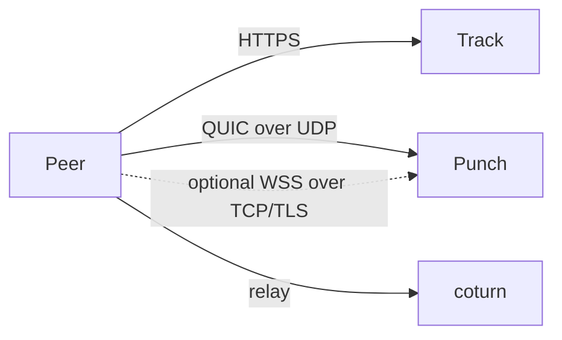
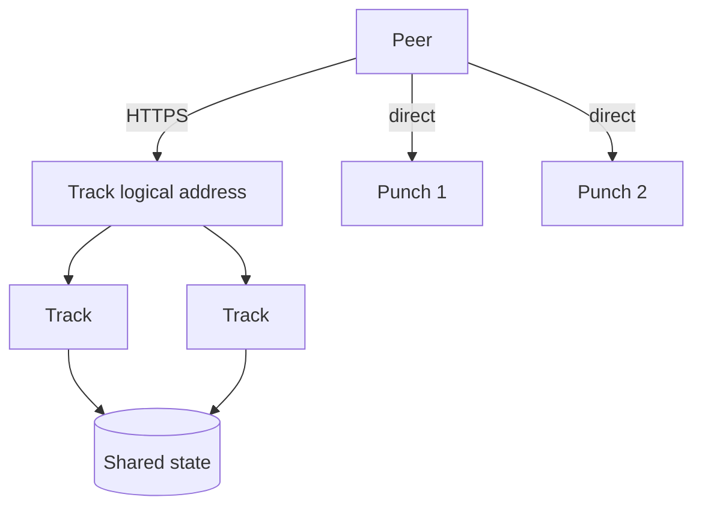

# Deploy

Track and Punch are ordinary servers: they listen on a port, read a TOML
file, and hold no state that has to survive a restart except Punch's identity
keypair.

They do **not** need to run on the same machine, and they do not talk to each
other on the request path — a Punch verifies tickets on its own, without
asking Track. The only coupling is operational: Track needs to know which Punch
nodes exist.

## Single node

The simplest deployment: one Track, one Punch, and coturn for the cases
where a direct connection cannot be established.



### Images

Both services publish an image on every release:

```sh
ghcr.io/mivinci/q2q-track-server:v0.1.0
ghcr.io/mivinci/q2q-punch-server:v0.1.0
```

Each image is Alpine plus a single static binary. `deploy/` in the repository
has a compose file and configuration you can start from.

### Bootstrap order

This is the one thing that cannot be done in a single `up`: a Punch's
public key must exist before Track can publish it, because clients use it to
verify the server's certificate.

```sh
docker compose up -d punch
docker compose logs punch | grep punch_public_key
# paste the key into track.toml, under [[punch]] public_key
docker compose up -d track coturn
```

Keep the identity directory mounted. If the Punch starts without a
persisted keypair it mints a new one, and every client that learned the old key
will reject it.

Builds containing the new initialization command can prepare the identity offline without opening listeners:

```sh
q2q-punch-server ./punch.toml --init-identity
# Or import an existing Ed25519 PKCS#8 PEM private key:
q2q-punch-server ./punch.toml --init-identity --identity-key ./punch-private.pem
```

Both commands use the configured `[identity]` paths and print the raw identity public key as standard Base64 to stdout. Import requires new destination files; ordinary initialization can load an existing complete identity. A partial identity causes an error and is preserved. Initialize first, publish the public key and issue its bound Registry token, then start the server. Generate and store token-signing keys separately from Punch identity keys.

With `[registry]` configured, startup requires an existing persistent identity. Run `--init-identity`, issue a Punch token bound to its public key, configure the credential, then start normally. Older published images may not include these features yet.

```toml
[registry]
url = "https://registry.example.com"
token_file = "/etc/q2q/secrets/registry.token"
region = "hk"
accepting_new_connections = true
```

Use either `token_file` or `Q2Q_REGISTRY_TOKEN`; the environment variable still requires `[registry].url`. Credentials are read once at startup, so restart after renewal. The node ID and persistent public key must match the token; Registry verifies its signature and expiry. Remote URLs require HTTPS; HTTP is allowed only on loopback for local development.

Punch reports immediately, then approximately every 30 seconds with jitter. Network and temporary server failures retry with backoff; 429 respects `Retry-After`. A 401/403 stops reporting with a diagnostic while Punch keeps serving. Shutdown cancels an in-flight report; Registry marks the node offline when its lease expires, within 90 seconds.

QUIC/WebSocket counts use actual connection permits, including handshakes, with a capacity of 1024 each. Binding and signalling counts exclude expired entries. Signalling sessions are not WebRTC file transfers; the unlimited session capacity is reported as `null`. Metrics are sampled individually, not as one globally atomic snapshot. `accepting_new_connections = false` advertises that the node should receive no new Peer assignments; it does not disconnect existing clients.

### Track Punch sources

Track selects one Punch source at startup: the existing `[[punch]]` static entries (with file reload), or Registry via `[registry]`. The two sources cannot be configured together. The Registry token must identify the Track service and grant `discovery:punch:read`; add `nodes:write:self` to show Track's online status in Platform. Provide it with a token file or `Q2Q_REGISTRY_TOKEN`; restart Track after renewal.

```toml
[registry]
url = "https://registry.example.com"
token_file = "/etc/q2q/secrets/track.token"
region = "hk"
accepting_new_connections = true
```

Registry mode immediately reports Track's own state and fetches Punches; the two background tasks then run independently about every 30 seconds with jitter. Track currently reports `metrics: null`. A report failure does not block discovery; a 401/403 stops only Track's state reporting. A 401/403 during discovery stops discovery requests. Temporary network failures retain unexpired data; leases last at most 90 seconds, and shutdown cancels in-flight requests.

Track fetches all discovery pages, validates Punch endpoints, keys and leases, and swaps the in-memory snapshot atomically. Peer requests use that snapshot and do not call Registry. Cached entries remain usable only until their original lease or the Track token expires. A cold start without a snapshot, or an expired snapshot, returns `503 discovery_unavailable`. A valid snapshot without an assignable node returns `503 no_available_punch`; nodes draining new assignments remain available for existing Peer queries. A node is not assigned new Peers when both transport capacities are known and full. Restart after fixing credentials.

Registry mode uses Rendezvous hashing over the Peer ID and Punch ID to distribute new Peers. Track replicas choose the same node for the same eligible set, regardless of list order. Removing a node changes only the assignments that selected it. Nodes currently have equal weight; capacity metrics exclude nodes whose two transports are both full, without capacity weighting or geographic routing. Static TOML mode retains the first configured node. Track does not migrate existing bindings; clients must establish a binding with their newly assigned Punch.

### Things that bite later

- **`bind` must be `0.0.0.0`.** The default is loopback, which inside a container
  is unreachable from outside.
- **Punch's QUIC and WSS listeners share one port.** `punch.toml` has one
  `bind`; the service listens on that address over both UDP and TCP. Map both
  `4433:4433/udp` and `4433:4433/tcp`. Track only needs
  `url = "quic://host:4433"`; the SDK derives the WSS fallback at
  `wss://host:4433/`. Both transports use the same persisted Ed25519 identity.
  Each process allows up to 1,024 concurrent WSS connections and 32 per source
  IP, based on the address seen by Punch's TCP listener. Behind a reverse proxy or SNAT,
  clients sharing the proxy's egress IP share that 32-connection quota. TLS
  plus the WebSocket upgrade must finish within 10 seconds, followed by a valid
  `join` or `connect` within 10 seconds.
- **TURN secret must match.** Track signs relay credentials with
  `HMAC-SHA1(secret, "<expiry>:<user>")` and coturn verifies with the same
  secret. If they differ, direct connections still work and only relaying fails
  — the fault surfaces much later, on the networks that need relaying most.

## Cluster

The two services scale in **opposite** directions, which is the main thing to
understand before adding machines.



**Track is stateless.** Any instance can serve any request, so it sits behind an
ordinary load balancer and scales horizontally. There is one requirement: the
online records, `session_key`s and file index must live in shared storage. A
`session_key` held only in one instance's memory breaks as soon as the next
heartbeat lands somewhere else.

TURN credentials are the exception that needs no storage at all — they are
computed from a shared secret, so every instance produces the same answer.

**Punch is sharded, not stateless.** A peer is bound to one Punch,
and whoever wants to reach it connects to *that* instance. All signalling for a
connection therefore happens inside one instance, and instances never need to
talk to each other. That is why a Punch can keep its state in memory.

Two consequences:

- **No load balancer in front of Punch.** Peers connect directly to the instance
  address Track gave them. A balancer could not route it anyway: the peer id is
  inside an encrypted QUIC connection, invisible to anything in between.
- **Assign peers by `peer_id`**, with consistent hashing, so that adding an
  instance moves about 1/N of the peers. A peer that returns to the same instance
  may even still have a live binding.

### Why not shard Track the same way

Track's requests have two different keys: `announce` and `heartbeat` are keyed by
`peer_id`, while `query` is keyed by `info_hash`. Shard by the first and every
query becomes a broadcast to all instances; shard by the second and an announce
carrying several files has nowhere to go. Consistent hashing solves partitioning,
which is not the problem here — the problem is one high-frequency read path that
needs to see everything. Shared storage is the simpler answer.

### Failure behaviour

Recovery is cheap because identities are self-signed. If Track restarts and loses
its index, a peer's next heartbeat fails with an unknown session and it simply
announces again — a fresh ticket, no negotiation. If a Punch restarts, its
peers re-join the same way.

For multiple Track instances, configure each with the same Redis primary:

```toml
[state]
backend = "redis"
url = "redis://redis.example.internal:6379/"
```

The default is `memory`, suitable for a single Track process. The Redis backend
stores sessions and the file index, including sequence checks and TTLs. It uses
multi-key atomic updates on one primary; Redis Cluster is not supported.

### Open work

- Punch reporting, Track reporting and Track Registry discovery are supported. Track can also use
  the static TOML Punch list.
- Track rate limits are still per instance. Punch divides its configured quota
  by `cluster_size`, but Track needs shared rate-limit state to enforce one
  cluster-wide quota.
- The shared Redis state has been checked with separate connections and Track
  routers. A deployment with two separate Track processes behind a load
  balancer still needs an end-to-end check.
