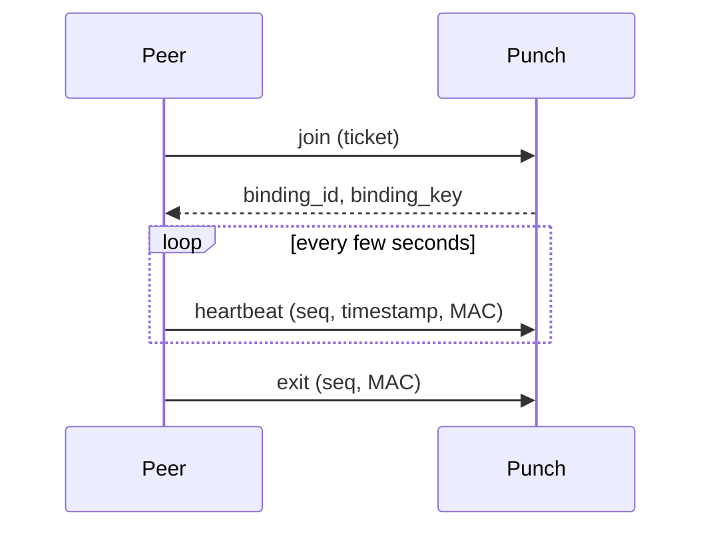
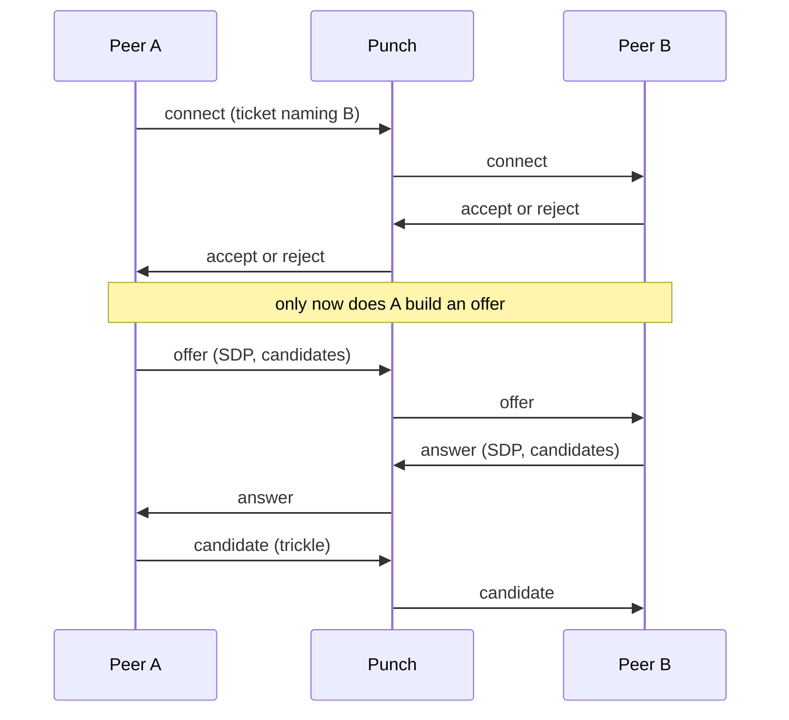

# Punch

A Punch does two things: it keeps a live channel open for each peer
assigned to it, and it relays signalling between a peer that wants to connect and
one that is bound here.

It does **not** parse the SDP it carries — an SDP is an opaque string to it. It
does not issue connection credentials; peers sign those themselves. And it does
not ask Track anything while serving a request, so a Track outage does not stop
signalling.

## QUIC, and why

The control channel is QUIC rather than TCP, for two reasons:

1. **Connection migration.** Peers are phones and home connections. Switching
   between Wi-Fi and cellular normally kills a TCP connection; QUIC is identified
   by a connection id rather than by address, so the same connection survives.
2. **It is UDP already.** Half of this server's job is helping a peer keep its NAT
   mapping alive, which only periodic UDP packets can do. QUIC is UDP, so no
   second path is needed.

QUIC remains the preferred transport. Punch listens for UDP/QUIC and TCP/WebSocket on
the same `bind` address. Direct WSS requires the TLS setting below. The SDK derives `wss://host:port/` from Track's
`quic://host:port` address, tries QUIC first, and falls back to WebSocket over
TLS when the QUIC link cannot be established. Track needs no separate WSS URL.

Heartbeats use reliable QUIC streams so a transient lost packet does not end a
long-running publication. On WSS, heartbeats are ordinary bounded WebSocket
frames. Everything else (`join`, `exit`, and all signalling) also uses reliable
messages on both transports. Both endpoints use the same Punch identity key
published by Track, so the fallback does not weaken server authentication.

This fallback covers Punch's binding and signalling control plane and uses the
WebSocket root path (`/`). Peer file data still uses WebRTC DataChannels and its
own ICE path; WSS alone does not make a transfer work when UDP is blocked. See
[Deploy](./deploy-single-node) for the listener configuration. Supporting file transfers on UDP-blocked networks
requires a separate data-plane path such as TURN over TCP/TLS.

## WebSocket TLS configuration

`websocket_tls` defaults to `false`: the TCP listener accepts plain WS behind a reverse proxy that terminates public TLS. QUIC TLS and the persistent node identity are unaffected.

```toml
bind = "0.0.0.0:4433"
websocket_tls = false
```

The proxy serves WSS with a browser-trusted certificate and forwards plain WebSocket traffic, including the Upgrade handshake. Keep the plaintext upstream on loopback, a private network, or a trusted tunnel. TCP and UDP currently share `bind`; when QUIC is public, restrict upstream TCP access separately with a firewall.

For direct native SDK WSS fallback, set `websocket_tls = true` to retain TLS using the existing Punch identity. Existing deployments requiring direct WSS must explicitly enable this setting when upgrading. The native SDK still derives a WSS URL and pins the Punch public key supplied by Track: it cannot connect directly to plain WS or accept an ordinary proxy certificate as the node identity. Separate browser WSS discovery and node authentication remain part of the Web SDK design.

## Bindings

A peer becomes reachable by joining: it presents a self-signed ticket naming this
server, and gets back a `binding_id` and a `binding_key`. From then on:



Heartbeats use `HMAC(binding_key, binding_id || seq || timestamp || generation)`.
Exit uses the same fields prefixed with the ASCII bytes `punch.exit`, so a
heartbeat MAC cannot authorise an exit. Both operations check the clock window,
strictly increasing sequence numbers and nondecreasing generation, and update
the current binding atomically.

A peer is reachable only while both its binding and standing channel are live.
Expiry, exit and transport closure revoke that channel's standing identity.
Rejoining replaces the old binding; cleanup of the old channel cannot remove
the replacement.

The exit MAC format requires a matching SDK/CLI and Punch server update; older
exit MACs are rejected. The heartbeat MAC format remains compatible.

## Signalling

Setting up a connection has two phases, and their order is deliberate.



**Consent comes first.** A is not allowed to send an offer until B has accepted.
A refusal therefore costs no ICE gathering, no STUN query, and no relay
allocation — B just says no. In a large swarm most attempts are refused, so this
saves real work.

`connect` requires a ticket every time (it is what authorises waking someone
else). After that the channel is the credential: `answer`, `candidate` and
`cancel` are checked against the connection record rather than re-verifying a
ticket each time, which is also why relayed candidates are not constrained by the
ticket's expiry.

## Server authentication

A client must be able to tell whether it is talking to the real Punch. The
anchor is the public key Track publishes alongside the address — the client checks
that the certificate in front of it carries exactly that key.

Address and key are tracked separately on purpose: an address changes whenever the
deployment changes, while the key is the server's long-lived identity. Which is
why the keypair has to be persisted — a server that mints a new one on every start
is a server no client will trust.

## Signalling channels

Two kinds, because they have different lifetimes:

- **Standing** — the peer bound here, opened at `join`. If it closes, the peer is
  unreachable and connect requests get a distinguishable "target offline" error.
- **Ephemeral** — the asker's, opened with a connection and closed with it. The
  response to the first offer carries a `signal_key`; if the channel breaks, the
  asker reconnects and presents the connection id plus that key to resume. Anything
  that arrived while it was away is replayed.

Heartbeats serve a different purpose from checking whether the standing channel
is alive. They refresh the NAT mapping and TTL: QUIC carries them in reliable
streams over UDP, while WSS carries them as frames over the TLS WebSocket
connection. Punch treats a failed heartbeat and a dropped channel as separate
signals.

A connect/offer ticket must match the connection ID, target and content hash.
The initial offer also requires the authenticated initiator channel: a target
cannot use a forwarded ticket to impersonate its sender.
Signalling for each connection is serialised through route changes. If delivery
to a disconnected initiator fails, Punch buffers the message for resume, up to
64 messages and 16 KiB of serialised signal data per connection. Failed delivery that cannot be buffered returns
`signal_delivery_failed` instead of success. Resume replays buffered messages;
there is no application-level acknowledgement for a lost resume response.

QUIC and WSS handshakes run independently with a 10-second deadline, a limit of
1,024 concurrent connections per transport and 32 per IP. QUIC additionally
bounds concurrent requests and their read/write deadlines.

## Running it

See [Deploy](./deploy-single-node). A Punch needs:

- a `punch_id` and persistent public key matching its Registry token
- a persisted identity keypair
- inbound **UDP and TCP** on the configured `bind` port for QUIC and WSS
- `cluster_size` set to the number of instances, so the rate limit is split
  rather than multiplied
