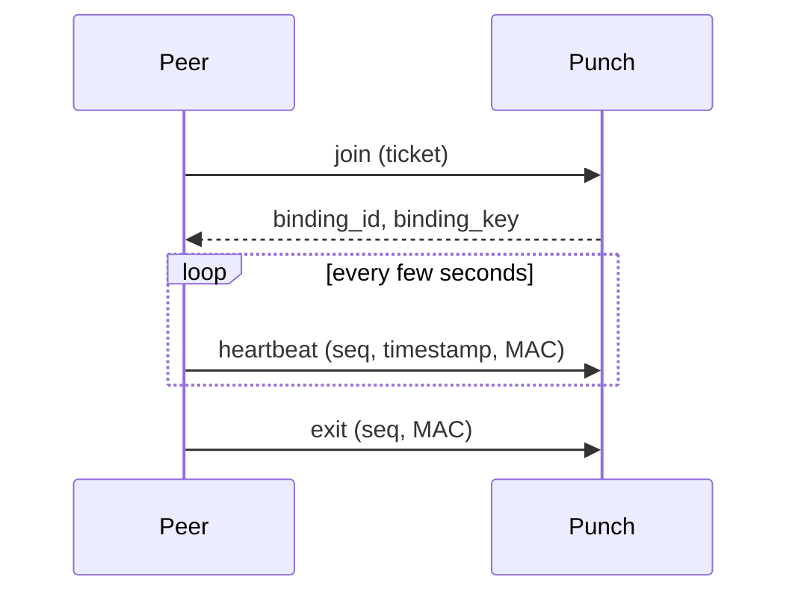
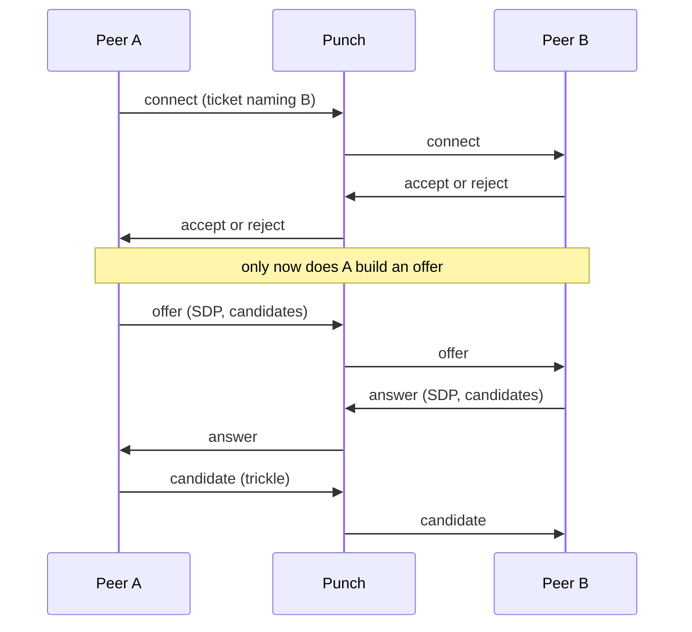

# Punch

A Punch does two things: it keeps a live channel open for each peer
assigned to it, and it relays signalling between a peer that wants to connect and
one that is bound here.

It does **not** parse the SDP it carries — an SDP is an opaque string to it. It
does not issue connection credentials; peers sign those themselves. And it does
not ask Track anything while serving a request, so a Track outage does not stop
signalling.

## QUIC, and why

The control channel is QUIC rather than TCP, for two reasons:

1. **Connection migration.** Peers are phones and home connections. Switching
   between Wi-Fi and cellular normally kills a TCP connection; QUIC is identified
   by a connection id rather than by address, so the same connection survives.
2. **It is UDP already.** Half of this server's job is helping a peer keep its NAT
   mapping alive, which only periodic UDP packets can do. QUIC is UDP, so no
   second path is needed.

QUIC remains the preferred transport. A deployment can also publish a WSS
endpoint for networks that block UDP: the SDK tries QUIC first and falls back to
WebSocket over TLS when the QUIC link cannot be established. Track publishes
this optional endpoint as `websocket_url`; existing configurations without it
continue to use QUIC only.

Heartbeats ride QUIC datagrams — small, frequent, and a lost one is simply
followed by another. On WSS, heartbeats are ordinary bounded WebSocket frames.
Everything else (`join`, `exit`, and all signalling) uses reliable messages on
both transports. Both endpoints use the same Punch identity key published by
Track, so the fallback does not weaken server authentication.

This fallback covers Punch's binding and signalling control plane. Peer file
data still uses WebRTC DataChannels and its own ICE path; WSS alone does not make
a transfer work when UDP is blocked. See [Deploy](./deploy) for the optional
listener and [the WSS fallback plan](../../../todos/punch-websocket-fallback.md)
for the remaining data-plane work and acceptance boundary.

## Bindings

A peer becomes reachable by joining: it presents a self-signed ticket naming this
server, and gets back a `binding_id` and a `binding_key`. From then on:

Every message after `join` is authenticated with `HMAC(binding_key, binding_id ||
seq || timestamp || generation)`, plus a sequence number that must move forward
and a timestamp that must be close to the server's clock. A `generation` counter
handles network changes: it only ever increases, so a rejoin after switching
networks cannot be confused with a replay.

The channel itself is the credential. When it drops, the binding is gone — which
is why the list of "reachable" peers is exactly the set of peers with a live
channel, not a separate table.

## Signalling

Setting up a connection has two phases, and their order is deliberate.

**Consent comes first.** A is not allowed to send an offer until B has accepted.
A refusal therefore costs no ICE gathering, no STUN query, and no relay
allocation — B just says no. In a large swarm most attempts are refused, so this
saves real work.

`connect` requires a ticket every time (it is what authorises waking someone
else). After that the channel is the credential: `answer`, `candidate` and
`cancel` are checked against the connection record rather than re-verifying a
ticket each time, which is also why relayed candidates are not constrained by the
ticket's expiry.

## Server authentication

A client must be able to tell whether it is talking to the real Punch. The
anchor is the public key Track publishes alongside the address — the client checks
that the certificate in front of it carries exactly that key.

Address and key are tracked separately on purpose: an address changes whenever the
deployment changes, while the key is the server's long-lived identity. Which is
why the keypair has to be persisted — a server that mints a new one on every start
is a server no client will trust.

## Signalling channels

Two kinds, because they have different lifetimes:

- **Standing** — the peer bound here, opened at `join`. If it closes, the peer is
  unreachable and connect requests get a distinguishable "target offline" error.
- **Ephemeral** — the asker's, opened with a connection and closed with it. The
  response to the first offer carries a `signal_key`; if the channel breaks, the
  asker reconnects and presents the connection id plus that key to resume. Anything
  that arrived while it was away is replayed.

Note that heartbeats are a separate path from the standing channel: keeping the
channel alive is the transport's job, while heartbeats exist to keep the NAT
mapping alive and refresh the TTL. Conflating them would make it impossible to
tell "the channel dropped but the mapping is still there" from "both are gone".

## Running it

See [Deploy](./deploy). A Punch needs:

- a `punch_id` that matches what Track lists
- a persisted identity keypair
- inbound **UDP** on its QUIC port; optionally, a **TCP/TLS** WebSocket listener
  when publishing `websocket_url` in Track
- `cluster_size` set to the number of instances, so the rate limit is split
  rather than multiplied
