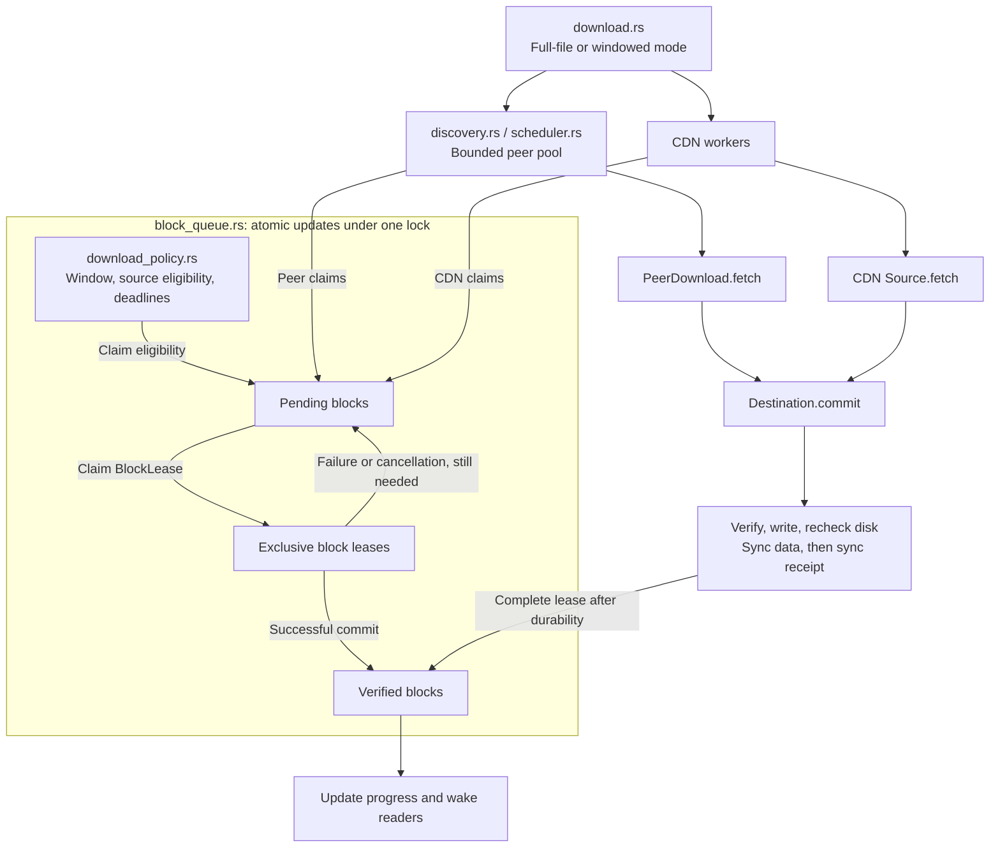

# Scheduling

Scheduling determines which blocks are needed, which sources may claim them and when they count as complete. See [Transport](./transport) for the overall structure and [Wire protocol](./wire) for peer messages.

## Policy, queue and execution



- **Policy** performs no network I/O. It tracks the window, source availability, urgent deadlines and source errors.
- **Queue** tracks pending, leased and completed blocks. Policy and block state change atomically under the same lock; network and disk I/O do not hold that queue lock.
- **Execution** starts, cancels and joins workers. `discovery.rs` manages refreshed candidates and bounded connections; `scheduler.rs` runs each peer; `download.rs` organizes CDN workers.
- **Destination** retains the lease through verification and durability, preventing two sources from writing the same block during a handoff.

## From fetch to completion

A peer worker repeats this sequence:

```text
Claim block lease
  → Request / receive pieces and proof
  → Verify length and Merkle proof
  → Write destination and recheck disk bytes
  → Sync destination data
  → Append proof receipt and sync it
  → Complete lease, update progress, notify waiters
  → Have / BlockDone
  → Claim next block
```

CDN workers use the same commit boundary without peer acknowledgements. Source failure releases the unfinished lease. An empty pending queue with blocks still in flight makes workers wait for notifications; it does not mean the file is complete.

Disk-write or receipt-write failure stops the transfer and prevents later queued writes. Blocking commits already started retain their lease, destination lock and task count after network cancellation. A full-file transfer waits for those operations before starting its CDN phase.

## Full-file and VOD modes

| Behavior | `download` / `resume_download` | `open` on-demand reads |
| --- | --- | --- |
| Initial demand | All unverified blocks | First read/seek establishes the window |
| Order | Sequential missing blocks, failures returned to the front | Current block, then forward prefetch |
| Peer retries | Refresh candidates and retry after cooldown | Refreshed pool; windows may reconnect known candidates |
| CDN activation | Candidates exhausted or control plane failed | No peers, or current read block exceeds its peer budget |
| Queue handoff | Join peer/disk work, then create a CDN queue from verified bits | Peer and CDN share one queue |
| Mirror failures | Wait for that mirror's workers to retire before the next mirror | Try mirrors for the current block |
| Completion | All blocks durable, followed by final sync | Reading a window is not completion; final file sync publishes Completed |

`max_download_peers` defaults to 4, with a range of 1–16. It bounds peer concurrency and CDN worker count separately. VOD can run both source classes concurrently, so it is not a combined connection limit. Each worker holds at most one block; there is no adaptive byte budget.

Discovery has a 15-second deadline and peer connection attempts a 45-second deadline. Sources may hold part of the file: each connection claims only blocks present in its initial Bitfield or later Have messages. A connection with no useful work waits at most three seconds before yielding its slot. Candidates refresh every five seconds, including while existing workers run, and retries use a five-second cooldown. The SDK keeps at most 32 candidates from the current Track page. Full downloads stop after ten seconds without progress once no connections remain; VOD keeps discovery active until completion or cancellation, while application reads retain read_timeout. Rarest-first, endgame duplicate requests and adaptive throughput scheduling are not implemented.

## VOD read window

```rust
use std::{io::SeekFrom, time::Duration};
use tokio::io::{AsyncReadExt, AsyncSeekExt};

let mut file = client.open(&seed, "video.mp4")
    .prefetch_blocks(8)
    .read_timeout(Duration::from_secs(30))
    .await?;
file.seek(SeekFrom::Start(offset)).await?;
let n = file.read(&mut buffer).await?;
```

Prefetch defaults to 8 blocks, range 0–64; 0 requests only the current block. At block 20 with prefetch 2, demand is `20 → 21 → 22`. Seeking to block 100 changes it to `100 → 101 → 102`. Old queued requests are withdrawn; old in-flight blocks may still finish and remain cached. Failed leases outside the new window are not requeued.

Seeking to or beyond EOF creates no prefetch work. EOF returns 0; negative positions or u64 overflow return InvalidInput. Cancelling a single read while it waits for a missing block does not advance the cursor further. Composed operations such as read_exact/read_to_end may already have consumed earlier blocks. Seeking discards the previous read wait. Each missing-block wait is bounded by read_timeout and returns TimedOut on expiry, while downloads already started can still finish.

The current read block gives P2P `min(2 seconds, read_timeout / 2)`. After that budget, a validated CDN leaf table permits interruption of the peer holding that urgent block. The lease must be released before CDN claims it; other peers continue. See [CDN fallback](./cdn#vod-urgent-block-handoff) for the sequence.

## Progress and cancellation

`progress()` and `subscribe_progress()` count durable verified blocks, with verified bytes/blocks, active peers, active CDN requests and lifecycle state. Watch notifications coalesce; slow consumers do not backpressure downloads.

Cancellation stops network tasks. Counters may still update during blocking disk cleanup. A VOD source error may affect only one read; disk-write failures publish Failed. A disk recheck detecting external modification returns InvalidData; reopening revalidates and can repair the destination. Finishing a partial read window does not complete the whole file, and dropping an incomplete reader publishes Cancelled.
