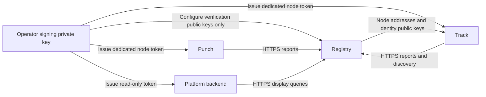

# Security

Q2Q needs several keys and credentials because it answers three different questions: **is the content correct, who is the other endpoint, and which services may join this network?** Each mechanism has its own purpose; a single key or token cannot replace them all.

This page explains the mechanisms and trust boundaries. For installation and configuration order, see [single-node deployment](./deploy-single-node) and [cluster deployment](./deploy-cluster).

## 1. Seed identifies content; Merkle proofs verify it

The Seed info dictionary includes the file length, block size and Merkle root. SHA-256 of its canonical encoding produces the `info_hash`. Downloaded content must match this identity.

Peers supply blocks and Merkle proofs. The receiver checks length and proof before committing data; CDN fallback data must also pass content verification. A source returned by Track, a signal forwarded by Punch or a successful HTTPS response is not evidence that file bytes are correct.

This establishes consistency with the selected content. **The current Seed format has no publisher signature, and an `info_hash` does not establish a publisher's real-world identity.** Obtain the Seed or magnet link through a trusted channel. If an attacker replaces both the entry-point hash and the file, Merkle verification cannot determine which file the user originally intended.

## 2. Registry authorizes service identities

Registry is the operator's node directory. It accepts Punch/Track reports, supplies Punch discovery to Track and provides read-only display data to Platform. It carries no file data and issues no Peer connection tickets.

### Signing and verification keys

The operator signs Registry JWTs with a dedicated Ed25519 private key and configures only the public JWKS in Registry. Registry checks signatures, `kid`, issuer, audience, validity, service type and permissions.

Keep the signing private key on the management machine: its holder can issue service credentials for this Registry. Each node needs only its own token; Registry needs only verification public keys. For rotation, first trust both old and new public keys, replace service credentials, then remove the old public key.

### Grant each service only the permissions it needs

| Service | Registry permissions | Purpose |
| --- | --- | --- |
| Punch | `nodes:write:self` | Report its own state |
| Track | `nodes:write:self`, `discovery:punch:read` | Report itself and discover Punch servers |
| Platform backend | `nodes:read:display` | Read node display data |

The node ID, type, advertised address, Punch public key and `identity_version` come from signed claims; report bodies cannot override them. Changing an address or identity key requires a higher identity version and a new token. Lower versions and conflicting descriptions at the same version are rejected, preventing an old credential from rolling an accepted identity back.

Nodes normally report every 30 seconds. Leases last at most 90 seconds and cannot exceed JWT expiry. Expired nodes leave discovery. During Registry failures, Track uses only unexpired cached state; a failed refresh cannot indefinitely extend trust in old identities. A lease records a recent report, not an active test of client reachability.

Registry JWTs are bearer credentials: their holder can use their permissions until expiry. Store them in service-account-readable files or Worker secrets, away from source control, logs and browsers. Ordinary renewal does not immediately revoke the old token; there is currently no immediate revocation list for individual `jti` values.

## 3. TLS protects links; identity checks establish endpoints

| Link | Identity and transport protection | Deployment configuration |
| --- | --- | --- |
| Peer → Track | HTTPS with normal hostname certificate verification | Track HTTPS frontend forwarding to a loopback/private backend |
| Services → Registry | HTTPS plus Registry JWT | Registry custom domain, trusted public keys and dedicated service tokens |
| Peer → Punch | TLS over QUIC/WSS; the client matches the certificate public key against Track's expected key | Persistent Punch certificate/private key and the same public key registered in Registry |
| Peer ↔ Peer | WebRTC DTLS plus signed identity confirmation over DataChannel | SDK handshake; deploy reachable discovery, signaling and TURN services |

After Track HTTPS terminates at the reverse proxy, the examples reach the backend over loopback or a trusted private network. Use TLS for that leg if it crosses an untrusted network; public HTTPS does not automatically encrypt the proxy-to-backend connection.

Punch identity is not established by DNS alone. Clients verify the expected public key supplied by Track, so restarts must load the persistent identity. An ordinary HTTP proxy terminating Punch TLS with a different certificate breaks this match; the deployment guide exposes Punch QUIC/WSS ports directly to the instance.

Registry and Track remain trusted control-plane components. A compromised directory or Track can misdirect discovery, hide sources or harm availability. Content verification does not prevent these behaviors, and TLS does not hide control information from the service processing it.

## 4. Peers prove identity with their own keys

Each Peer keeps an Ed25519 private key locally; its `peer_id` derives from the public key. Peers sign their own short-lived tickets. Services verify signatures, purpose/target, validity and relevant connection fields. These tickets are distinct from operator-issued Registry JWTs.

After WebRTC channels open, both endpoints exchange random challenges and signatures. Signatures bind roles, public keys, content hash, connection ID, challenges and both DTLS certificate fingerprints. The file protocol starts only after verification. Merely substituting a DTLS fingerprint in forwarded signaling is insufficient to impersonate the expected Peer. See [Transport](./transport) for the handshake.

A self-signed identity proves possession of a key, not a verified person or an authorized application account. Applications still need their own user, publishing and content-access policies. Knowing a `peer_id` or completing cryptographic identity verification is not itself permission to access private content.

## 5. Session keys reduce signing work and constrain replay

After initial authentication, short-lived session state supports frequent interactions:

- **Track `session_key`**: returned after announce and used for HMAC on applicable requests. The service checks timestamps, sequences and session state. Sequence handling permits bounded reordering; it does not promise exactly-once execution.
- **Punch `binding_key`**: returned after join and used for binding heartbeat/exit authentication. Heartbeat and exit use distinct MAC message domains and check time windows, sequences and generation.
- **Connection tickets and signaling state**: tickets bind the target Peer, content and connection identifier. Subsequent signaling uses authenticated channels and connection records, rather than treating a forwarded ticket as a general credential for either endpoint.

These keys protect their sessions. They do not register services with Registry or replace Merkle verification. See [Track](./track) and [Punch](./punch).

## 6. TURN credentials authorize relay usage

Track and the TURN service share a TURN secret. Track derives temporary usernames/passwords with an expiry, and Peers use those credentials to request relaying. TURN verifies them with the same shared secret. The values on Track and TURN must therefore match; clients should not receive the long-term secret.

The TURN secret is independent of Registry's signing key and Punch's identity key. Deployment examples use coturn; another TURN implementation must support the temporary credential mechanism used by Track.

The relay carries DTLS-encrypted Peer traffic, but its operator can still observe metadata such as addresses, traffic volumes and timing. A `turn:` URL does not itself mean all client-to-relay protocol exchanges use TLS. Verify TURN/TCP, TURN/TLS and restricted-network reachability for the actual deployment.

## 7. Where deployment credentials belong

| Configuration or key | Location | Why it is separate |
| --- | --- | --- |
| Registry signing private key | Management machine, restricted and backed up | Can issue service identities; not distributed to nodes |
| Registry public JWKS | Registry Worker | Verifies operator-issued tokens without private keys |
| Punch certificate and identity private key | That Punch's persistent directory/volume | Maintains the identity expected by clients |
| Node Registry token | File readable by the corresponding service account | Limits node ID, identity description, permissions and validity |
| Platform read-only token | Platform Worker secret | Backend reads status without exposing machine credentials to browsers |
| TURN shared secret | Restricted Track and TURN configuration | Issues/verifies temporary relay credentials |
| Peer private key | That client's local identity storage | Signs tickets and proves data-channel identity |
| Track/Punch session keys | Corresponding client and service session state | Authenticates frequent interactions for that session lifetime |
| Redis credentials | Track configuration when using shared state | Protects session/index storage; restrict Redis to private access |

Signatures, encryption and content proofs do not guarantee availability or traffic anonymity. Connection limits, request bounds, timeouts and rate limits provide additional resource protection, not a complete defense against denial-of-service attacks. Include credential renewal, identity backups, restricted network access and real transfer verification in deployment operations.
