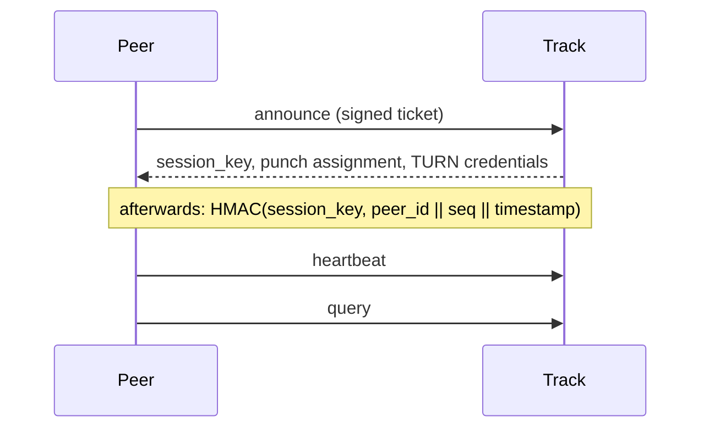

# Track

Track answers one question: *who has this file, and how do I reach them?* It also
hands out credentials for the relay, for the cases where a direct connection
cannot be made.

It never carries file data, never sees an SDP, and never takes part in
authorising a connection — peers sign their own tickets for that.

## Workers implementation status

`apps/track` implements Track with TypeScript, Hono, Zod and Peer/File Durable Objects.
HTTP contracts, pagination and local control-plane acceptance with the unchanged Rust SDK
have passed, including automatic readonly Registry RPC discovery. A local 8 MiB P2P download without CDN sources passed full-file hash verification,
and a short 1,000-Peer engineering baseline passed. Cloud capacity validation and production
deployment remain pending. Native Rust deployment remains supported. See the
[Workers rollout guide](./deploy-workers-track) for configuration, staging and rollback.

Workers Track calls the named Registry `PunchDiscovery` entrypoint through its `REGISTRY`
Service Binding. It neither registers itself nor needs a Registry JWT. Environment labels
must match; public JWT authentication remains enforced. The discovery DO refreshes complete
pages through alarms about every 30 seconds. Failures retain only unexpired snapshots with
backoff; expired data returns 503 and its lease is never extended. The platform displays
and counts only Punch nodes.

Workers queries authenticate and consume seq before carrying an internal file/requester/
fixed-time/deadline context across DO reads. No session key is sent to FileIndex. Each
request verifies at most 64 authoritative candidates and makes at most 80 internal RPCs;
that budget can produce short or empty pages before the native 512-entry scan limit.
Continue using next_cursor. DO failure or timeout returns 503; retry with a new seq and
the same input cursor.

Local SDK acceptance covers publishing, heartbeat, pagination and withdrawal, not P2P
content downloads or production capacity. Heartbeat/query return unknown_session after
session loss; publishing again explicitly reannounces. They do not automatically reconnect.

## What it holds

Two indexes, both soft state with a TTL:

- **Online index** — which peers are reachable, their public keys, and the
  symmetric `session_key` issued at announce time
- **File index** — which peers hold which `info_hash`, and whether they hold it
  completely

Everything expires on its own. A peer that stops sending heartbeats is swept
without anyone having to deregister it.

## Sessions

`announce` is the only request that carries a full self-signed ticket. Track
verifies it, then issues a random `session_key` that the peer uses for everything
after:



HMAC instead of a signature because a heartbeat every few seconds does not want
an Ed25519 verification plus 96 bytes of key and signature each time.

The stored session sequence must strictly increase. Both heartbeat and query consume
sequence numbers; a query can consume its sequence before a later discovery or cursor
error, so retries must use a new sequence. Heartbeats renew the session TTL, not the
individual file-holding TTLs.

The SDK coalesces holding renewals within one `ControlSession`. It requests a 300-second
TTL, renews at half-life and batches up to 128 holdings, prioritizing the earliest expiry.
Other publication timers reuse the updated lease. Complete and partial state remain
separate. Withdrawal stops local renewal intent even when the remote delete fails.
Initial publication, completion upgrades and withdrawals still send individual requests;
bursts and shared NAT prefixes can still hit admission limits.

`seq` is an unsigned 64-bit JSON integer. JavaScript clients must preserve it without
rounding through `Number`; its MAC encoding, and that of `timestamp`, is exactly eight
big-endian bytes after the UTF-8 Peer ID. Ticket timestamps must fit the signed 64-bit
range used by canonical bencode. Unsupported numeric ranges are rejected rather than
rounded. Expired or excessively long-lived tickets return HTTP 401; a structurally
valid key that fails cryptographic verification returns `bad_signature`.

## Endpoints

| Endpoint | Purpose |
| --- | --- |
| `PUT /peers/{peer_id}/files` | Announce: go online, declare holdings |
| `POST /peers/{peer_id}/heartbeat` | Stay online: refresh the TTL, prove possession of `session_key` |
| `GET /files/{info_hash}/peers` | Query: who holds this file |
| `GET /health` | Public service identity and liveness |

TURN credentials are returned by announce; there is currently no separate relay-credentials endpoint.

Field-level details live in the design document.

## Candidate queries

`GET /files/{info_hash}/peers?limit=8` asks for **at most** eight candidates. Fewer peers, expired holdings/sessions, retired Punch servers or the selection scan budget may produce a shorter response. This is not a quality or capacity guarantee. Omit limit for 10; HTTP values are clamped to 1–50. The requester is excluded. Complete and partial holders are eligible; the SDK prefers complete holders after discovery.

Each fresh query picks a random Peer ID as its starting point and walks the ordered index circularly. This spreads selection beyond the fixed first IDs. It is not uniform random sampling, a bandwidth score or measured load balancing. Track currently has no peer throughput, latency, upload-capacity or success-rate measurements.

`next_cursor` is an opaque continuation. Pass it back unchanged, with the same content hash and requester, to continue the same circular walk; omit it to start a newly rotated query. A fixed index is visited once without repeats, including across the wrap boundary. Existing raw Peer ID cursors remain accepted as legacy lexical continuations. New cursors are versioned, bounded to 1024 bytes and bound to the file/requester; they are not snapshot tokens. Concurrent arrivals, expiry and Punch reloads can change the live results between pages.

Native selection filters before filling the requested count. It scans at most 512 live storage candidates per request, in batches of 64; storage itself filters expired records. An empty/short page can still have next_cursor when more scanning remains. Continue until next_cursor is null when explicitly traversing pages. Each query uses one current Punch configuration snapshot for filtering and endpoint resolution.

### Rust SDK

The original `session.query(&hash)` keeps Track's default. For a chosen count or continuation:

```rust
use q2q_core::client::QueryOptions;
let page = session.query_with_options(&hash, QueryOptions {
    limit: Some(8),
    cursor: None,
}).await?;
if let Some(cursor) = page.next_cursor {
    let next = session.query_with_options(&hash, QueryOptions {
        limit: Some(8),
        cursor: Some(cursor),
    }).await?;
}
```

High-level downloads and VOD request twice max_download_peers by default (8 candidates for 4 connections, up to 32 by default). Override this independently with `client::builder().peer_query_limit(12)` (1–50); retained candidates use the same cap. Actual connections still obey max_download_peers. Initial discovery and five-second refreshes both send the configured limit. Refreshes start new rotated queries; automatic discovery does not enumerate every page. Local invalid limits fail before network I/O; Builder adds `BuildError::InvalidPeerQueryLimit` for exhaustive matches.

## Assigning a Punch

Every peer is told which Punch to use, and a query returns the Punch of *each
candidate* — resolved from the current list at query time, not from a snapshot
taken when that peer announced.

That distinction is the whole point. An address is deployment state: instances
move, get replaced, get retired. If Track handed out a recorded address, it would
keep pointing at whatever was true when the peer last announced. So the index
stores only the `punch_id`, which is stable, and the address and public key are
filled in per query.

Two things follow from resolving late:

- Clients must not cache the list. It is re-read for every query.
- A peer whose Punch has been retired is simply not returned — there is no
  point offering a candidate nobody can reach.

## Limits

Requests are limited by network prefix, not by identity: `/24` for IPv4, `/64`
for IPv6. Anyone can mint an identity for free, so limiting by `peer_id` would
accomplish nothing, while limiting by single address would let an attacker walk
through their own prefix collecting fresh quotas.

Announce is the expensive one — it verifies a signature and writes both indexes —
so it gets a much smaller bucket than query.

## Running it

See [Deploy](./deploy-single-node). Track needs:

- a Registry endpoint and a Track token granting Punch discovery and state reporting
- the same TURN shared secret as coturn
- inbound TCP on its advertised port, reachable by clients

The Workers implementation is manually deployed at `https://track.q2q.app`. Public SDK
control-plane and no-CDN 8 MiB P2P smoke tests with full-file SHA256 passed using two
local peers and live Registry/Punch. Cross-NAT, forced TURN and cloud capacity remain
unverified; automatic deployment has not been enabled.


## Publishing the native Track image

The native Track version comes from `crates/q2q-track-server/Cargo.toml`. A release PR updates that package version and `Cargo.lock`; the version must be newer than existing `track/v*` tags and images. After it is merged into `main`, the native service image workflow waits for Rust CI on the same commit, checks that the image tag is unused, verifies the built binary's `--version`, creates the corresponding `track/vX.Y.Z` Git tag and publishes the versioned image and `latest`. The service health endpoint and Registry heartbeat both report the Cargo version.

Track and Punch versions are detected and published independently. Workers Track follows its [own deployment process](./deploy-workers-track). Servers must pull the new native Track image and restart; the workflow refuses to overwrite an existing version image. If the Git tag was created but the versioned image was not pushed, the same workflow run can be retried.
