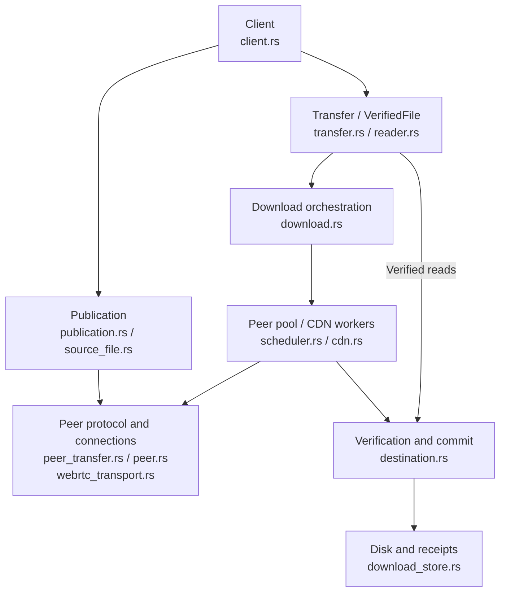

# Transport

This page describes the current Rust SDK data plane: authenticated peer connections, block transfer and delivery of verified bytes. See [Wire protocol](./wire) for message formats, [Scheduling](./scheduling) for work assignment and [CDN fallback](./cdn) for HTTP sources.

## SDK architecture

The diagram groups runtime responsibilities. Arrows represent calls or data interactions; the `download.rs` execution layer consists of functions and background tasks, rather than a separate service or public engine type.

The shared `control.rs` / `online.rs` modules sit outside this diagram and provide Track discovery, Punch sessions and heartbeat maintenance for publication and download tasks. The block queue and source policy are expanded in [Scheduling](./scheduling).

Track and Punch do not authenticate file bytes. Peer identity is confirmed through signatures on the connection, and content is verified against the Seed's Merkle root. Track discovers holders; Punch relays connection signals. File bytes arrive over peer data channels or HTTP.

## Establishing an authenticated connection

1. Query Track for complete holders on the current page, deduplicate candidates and exclude the local peer.
2. Request connection consent through Punch, then exchange SDP and ICE candidates after acceptance.
3. `webrtc-rs/webrtc` establishes ICE / DTLS / SCTP connectivity and opens two DataChannels.
4. Exchange random challenges and Ed25519 signatures on the reliable control channel before starting the file protocol.

The signed transcript binds the initiator/responder roles, both public keys, `info_hash`, connection ID, both nonces and both DTLS certificate SHA-256 fingerprints. Expected keys come from the connection ticket or Track candidate and are checked against peer_id. Identity frames are limited to 512 bytes and the exchange to 10 seconds. Invalid stages, versions, signatures or fingerprints fail the connection.

## Two data channels

| Channel | Configuration | Purpose |
| --- | --- | --- |
| `q2q-control` | Reliable, ordered, created by the initiator through DCEP | Identity, bitfields, requests, proofs, acknowledgements and cancellation |
| `q2q-data` | Explicit negotiated stream 1 on both sides, unordered, `max_retransmits = 0` | Binary pieces |

Each channel has a 256 KiB send buffer limit with backpressure. Missing pieces are recovered through the file protocol's `piece_nack` messages.

The current dependency has limitations when restoring retransmission settings for remotely announced DCEP channels, so both peers configure the data channel explicitly. The control channel retains its DCEP handshake to ensure the remote endpoint is ready for the first identity frame. Applications do not manage these channels.

## Content verification boundary

Verification operates on blocks, 256 KiB by default. Each block is sent as 1024-byte pieces, with a shorter final piece where needed. A connection requests one block at a time.

After receiving the bytes and proof, Destination verifies length and the Merkle proof before writing. It serializes destination writes, rechecks disk bytes, syncs the data and syncs the receipt. Only then does it complete the block lease, grow progress and send `have` / `block_done`. See [Scheduling](./scheduling#from-fetch-to-completion) for the order.

VerifiedFile reads completed blocks and checks disk bytes against authenticated leaf hashes. The destination may already have its final allocated length; applications should use SDK reads rather than treating sparse zero bytes as downloaded content.

## Lifecycle and current scope

Publication manages announcements, holding renewal, uploads and withdrawal. Active publications and downloads share one heartbeat task per control session. The last user releasing its lease stops that task. Callers using the lower-level `Client::connect()` alone must still maintain heartbeats themselves.

Dropping a transfer or reader cancels network tasks. Blocking disk jobs already started can finish and retain the destination lock until they do. Block proofs are stored in `.q2q.resume`; resume reads and verifies the disk bytes again. A complete file can resume offline.

The SDK supports fixed files and VOD with a single read cursor. Each Client has one active publication, serving one downloading peer at a time. Discovery uses the current Track page without pagination or refresh. Files are limited to 65,536 blocks, or 16 GiB with the default block size. Live indexes, partial-file seeding and browser adaptation are not implemented yet.
