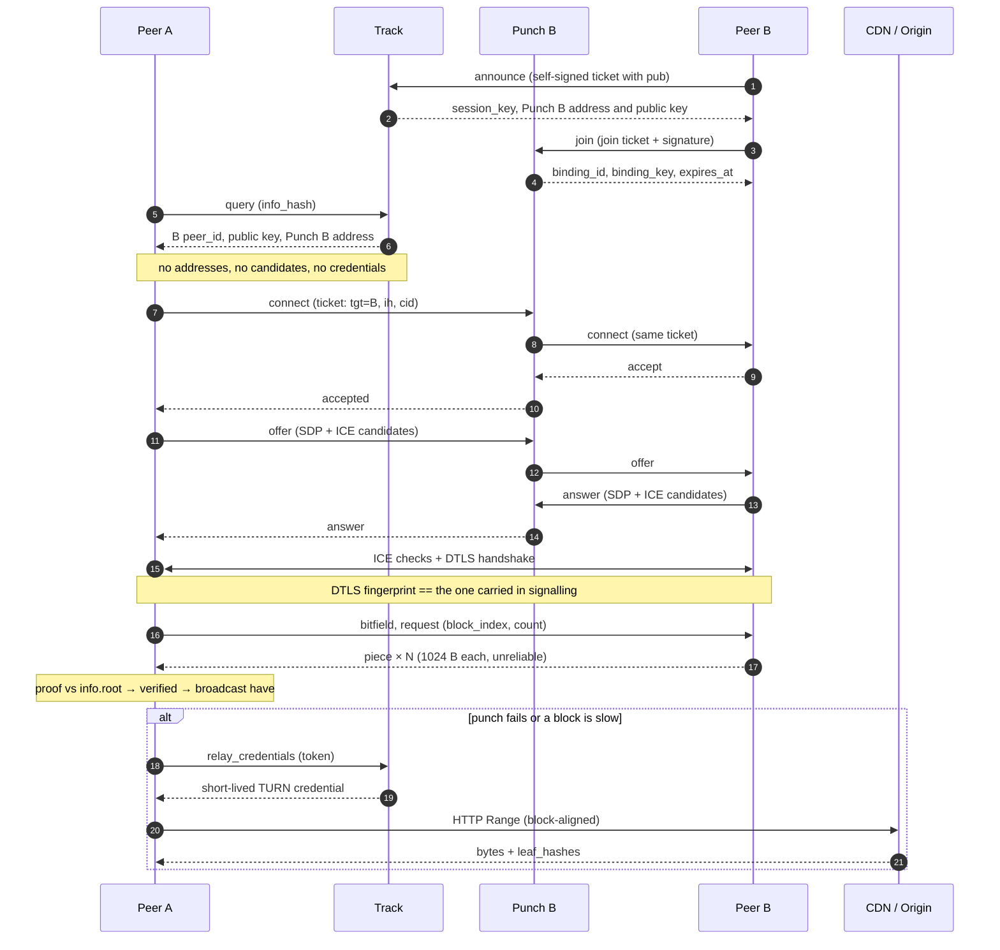

# What is Q2Q

Q2Q is a framework for moving large files and streams between peers, with a CDN
as the fallback rather than the primary path. Three kinds of programs take part:

| | Runs where | Does what |
| --- | --- | --- |
| **Track** | a server you host | Keeps the online index and the file index, assigns peers to a Punch, issues TURN credentials |
| **Punch** | a server you host | Holds a binding for each online peer, and relays signalling between two peers that want to connect |
| **Peer** | the client | Downloads and uploads; also the thing that decides, per block, whether to use CDN or P2P |

Track and Punch are the *control plane*: they help peers find each other
and set up a connection, but never carry file data and never see the content.

The two planes are independent, and both are built on the same network-free core:

Peers then talk to those servers like this:

## How a download happens

1. **Seed** — the publisher builds an info dict (file length, block size, the
   Merkle root) and gets an `info_hash`. The resulting `.q2q` seed file is shared
   with peers.
2. **Announce** — a peer tells Track "I am online, and I hold this file". Track
   records it with a TTL and assigns the peer to a Punch.
3. **Query** — the downloading peer asks Track who holds the file. Track returns
   candidates: peer id, their public key, and the Punch *that peer* is on.
4. **Connect** — the asker goes to that Punch and asks to be connected to
   the holder. The holder explicitly accepts or refuses.
5. **Offer / answer** — only after acceptance do the two exchange SDP and trickle
   ICE candidates, through the same Punch.
6. **Data** — once a channel is up, blocks are requested, verified against Merkle
   proofs, and written in place. Individual blocks fall back to CDN whenever P2P
   is slower or unavailable.

## Why it is shaped like this

**Identity is self-signed.** A peer generates a keypair locally; its `peer_id` is
derived from the public key. Nobody registers, nobody is revoked, and no server
has to be asked whether an identity is real. The cost: there is no revocation
mechanism, so authorisation is expressed as short-lived tickets that the peer
signs for itself.

**Consent comes before the offer.** A Punch asks the target peer whether
it wants the connection *before* any SDP exists. A refusal therefore costs no ICE
gathering, no STUN query, and no relay allocation — which matters because most
connection attempts in a large swarm are refused.

**Two sources, chosen per block.** Every block independently picks CDN or P2P. A
peer that just joined can download the whole file from the CDN while
simultaneously becoming a source for others.

**Verification is end to end.** Content is addressed by a Merkle root signed into
the seed. A peer that lies about a block fails its proof and is dropped, so
neither a malicious peer nor a malicious Punch can corrupt a download.

## Terms

| Term | Meaning |
| --- | --- |
| `peer_id` | `base32(SHA-256(public_key))` plus a checksum — the stable name of a peer |
| `info_hash` | SHA-256 of the canonical info dict; identifies the content |
| `binding` | A Punch's record that a peer is reachable on a live channel |
| `signal_key` | Symmetric key for one connection attempt; lets the asker resume after a network change |
| `cid` | One-shot id inside a ticket; consumed when used, which is what stops replays |

## Next

- [Deploy](./deploy) — how to run Track and Punch
- [Track](./track) — the discovery service
- [Punch](./punch) — bindings and signalling
