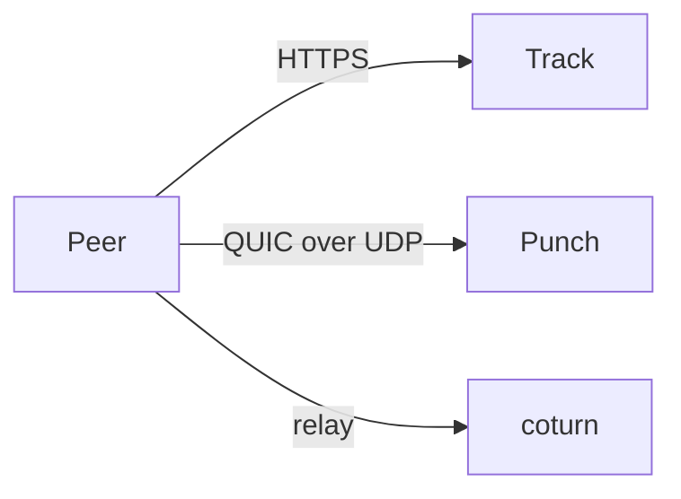
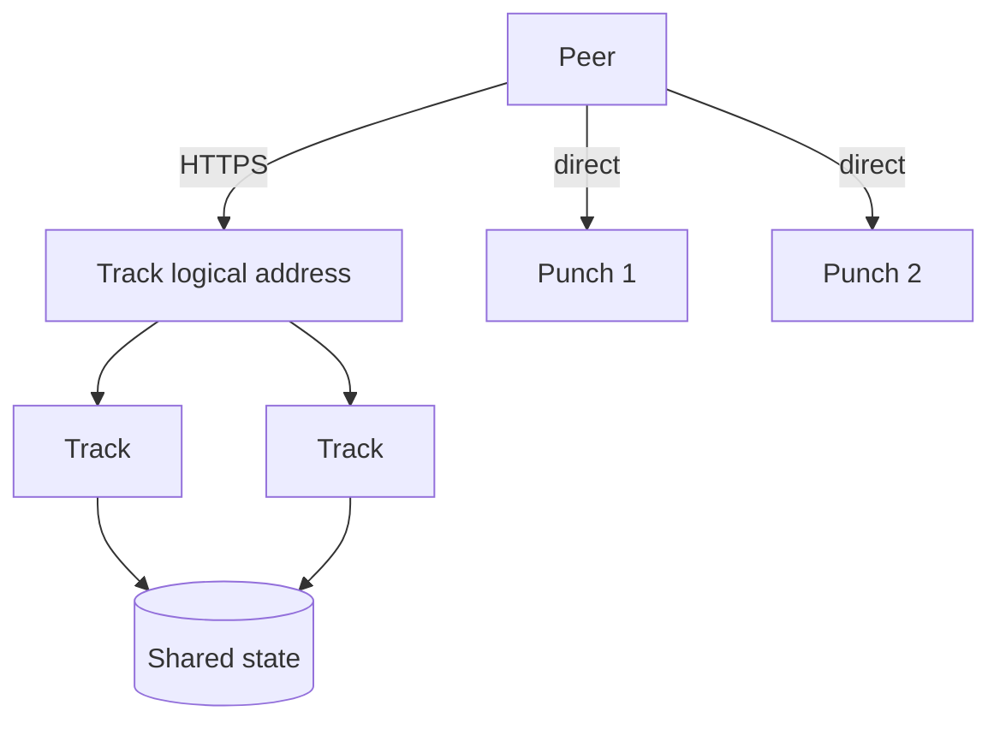

# Deploy

Track and Punch are ordinary servers: they listen on a port, read a TOML
file, and hold no state that has to survive a restart except Punch's identity
keypair.

They do **not** need to run on the same machine, and they do not talk to each
other on the request path — a Punch verifies tickets on its own, without
asking Track. The only coupling is operational: Track needs to know which Punch
nodes exist.

## Single node

The simplest deployment: one Track, one Punch, and coturn for the cases
where a direct connection cannot be established.



### Images

Both services publish an image on every release:

```sh
ghcr.io/mivinci/q2q-track-server:v0.1.0
ghcr.io/mivinci/q2q-punch-server:v0.1.0
```

Each image is Alpine plus a single static binary. `deploy/` in the repository
has a compose file and configuration you can start from.

### Bootstrap order

This is the one thing that cannot be done in a single `up`: a Punch's
public key must exist before Track can publish it, because clients use it to
verify the server's certificate.

```sh
docker compose up -d punch
docker compose logs punch | grep punch_public_key
# paste the key into track.toml, under [[punch]] public_key
docker compose up -d track coturn
```

Keep the identity directory mounted. If the Punch starts without a
persisted keypair it mints a new one, and every client that learned the old key
will reject it.

### Things that bite later

- **`bind` must be `0.0.0.0`.** The default is loopback, which inside a container
  is unreachable from outside.
- **Punch is UDP.** Map `4433:4433/udp`; a TCP mapping silently does nothing.
- **TURN secret must match.** Track signs relay credentials with
  `HMAC-SHA1(secret, "<expiry>:<user>")` and coturn verifies with the same
  secret. If they differ, direct connections still work and only relaying fails
  — the fault surfaces much later, on the networks that need relaying most.

## Cluster

The two services scale in **opposite** directions, which is the main thing to
understand before adding machines.



**Track is stateless.** Any instance can serve any request, so it sits behind an
ordinary load balancer and scales horizontally. There is one requirement: the
online records, `session_key`s and file index must live in shared storage. A
`session_key` held only in one instance's memory breaks as soon as the next
heartbeat lands somewhere else.

TURN credentials are the exception that needs no storage at all — they are
computed from a shared secret, so every instance produces the same answer.

**Punch is sharded, not stateless.** A peer is bound to one Punch,
and whoever wants to reach it connects to *that* instance. All signalling for a
connection therefore happens inside one instance, and instances never need to
talk to each other. That is why a Punch can keep its state in memory.

Two consequences:

- **No load balancer in front of Punch.** Peers connect directly to the instance
  address Track gave them. A balancer could not route it anyway: the peer id is
  inside an encrypted QUIC connection, invisible to anything in between.
- **Assign peers by `peer_id`**, with consistent hashing, so that adding an
  instance moves about 1/N of the peers. A peer that returns to the same instance
  may even still have a live binding.

### Why not shard Track the same way

Track's requests have two different keys: `announce` and `heartbeat` are keyed by
`peer_id`, while `query` is keyed by `info_hash`. Shard by the first and every
query becomes a broadcast to all instances; shard by the second and an announce
carrying several files has nowhere to go. Consistent hashing solves partitioning,
which is not the problem here — the problem is one high-frequency read path that
needs to see everything. Shared storage is the simpler answer.

### Failure behaviour

Recovery is cheap because identities are self-signed. If Track restarts and loses
its index, a peer's next heartbeat fails with an unknown session and it simply
announces again — a fresh ticket, no negotiation. If a Punch restarts, its
peers re-join the same way.

### Not built yet

- A shared-storage backend for Track's state (the trait exists; only an
  in-memory one is implemented)
- A registration interface, so Punch nodes can announce themselves instead of
  being listed in a config file
- Cluster-wide rate limiting (each instance currently enforces `1/N` of the quota
  via `cluster_size`)
