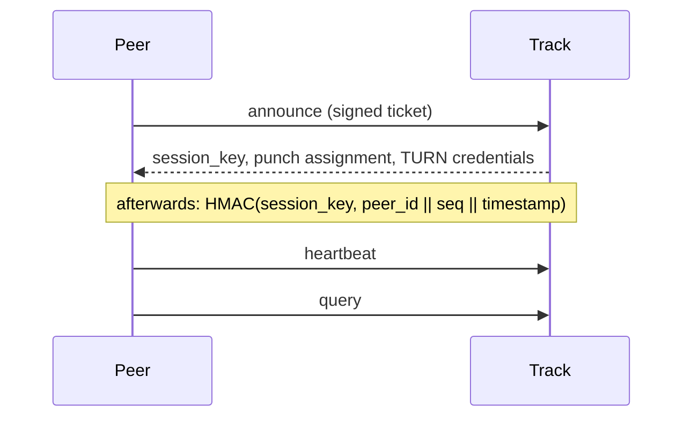

# Track

Track answers one question: *who has this file, and how do I reach them?* It also
hands out credentials for the relay, for the cases where a direct connection
cannot be made.

It never carries file data, never sees an SDP, and never takes part in
authorising a connection — peers sign their own tickets for that.

## What it holds

Two indexes, both soft state with a TTL:

- **Online index** — which peers are reachable, their public keys, and the
  symmetric `session_key` issued at announce time
- **File index** — which peers hold which `info_hash`, and whether they hold it
  completely

Everything expires on its own. A peer that stops sending heartbeats is swept
without anyone having to deregister it.

## Sessions

`announce` is the only request that carries a full self-signed ticket. Track
verifies it, then issues a random `session_key` that the peer uses for everything
after:

HMAC instead of a signature because a heartbeat every few seconds does not want
an Ed25519 verification plus 96 bytes of key and signature each time.

## Endpoints

| Endpoint | Purpose |
| --- | --- |
| `PUT /peers/{peer_id}/files` | Announce: go online, declare holdings |
| `POST /peers/{peer_id}/heartbeat` | Stay online: refresh the TTL, prove possession of `session_key` |
| `GET /files/{info_hash}/peers` | Query: who holds this file |
| `POST /connections/relay` | Ask for TURN credentials |

Field-level details live in the design document.

## Assigning a Punch

Every peer is told which Punch to use, and a query returns the Punch of *each
candidate* — resolved from the current list at query time, not from a snapshot
taken when that peer announced.

That distinction is the whole point. An address is deployment state: instances
move, get replaced, get retired. If Track handed out a recorded address, it would
keep pointing at whatever was true when the peer last announced. So the index
stores only the `punch_id`, which is stable, and the address and public key are
filled in per query.

Two things follow from resolving late:

- Clients must not cache the list. It is re-read for every query.
- A peer whose Punch has been retired is simply not returned — there is no
  point offering a candidate nobody can reach.

## Limits

Requests are limited by network prefix, not by identity: `/24` for IPv4, `/64`
for IPv6. Anyone can mint an identity for free, so limiting by `peer_id` would
accomplish nothing, while limiting by single address would let an attacker walk
through their own prefix collecting fresh quotas.

Announce is the expensive one — it verifies a signature and writes both indexes —
so it gets a much smaller bucket than query.

## Running it

See [Deployment](./deploy). Track needs:

- a Punch list (or, later, a registration interface)
- the same TURN shared secret as coturn
- inbound TCP on its advertised port, reachable by clients
