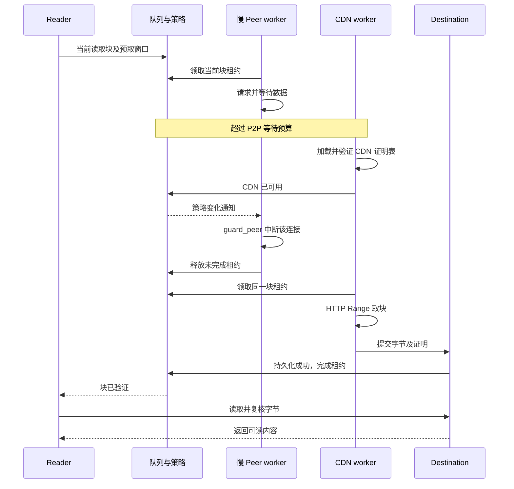

# CDN 回退

Rust SDK 在 P2P 不可用时，可以通过 HTTP(S) 下载并校验剩余块。整文件下载采用 P2P 优先：先尝试当前 Track 查询到的完整节点，再使用 CDN。按需 VOD 还支持当前读取块的紧急回退。Track 或 Punch 不可用时也能从 CDN 冷启动。

## 配置种子

`cdn_list` 指向同一份完整文件，每个 block 映射成一个 HTTP Range 请求。内容校验还需要完整叶子哈希表，来源为以下之一：

- 种子内联的 `leaf_hashes`；
- `proof_list` 中的 HTTP(S) 地址，内容是按 block 顺序拼接的原始叶子哈希，每块恰好 32 字节。

客户端优先使用通过种子校验的内联列表。否则依次尝试 proof_list，在本地重建 Merkle 根并与 info.root 比较，通过后才接受。缺少有效列表时 CDN 回退会报错。CDN 和哈希表地址都不在 info 中，修改它们不会改变 info_hash。

```rust
seed.cdn_list = vec!["https://cdn.example.com/video.mp4".into()];
seed.proof_list = vec!["https://cdn.example.com/video.mp4.hashes".into()];

let transfer = client.download(&seed, "video.mp4").await?;
transfer.wait().await?;
```

## HTTP 要求

服务器应返回 `206 Partial Content`，并给出精确的 `Content-Range`，包括文件总长度。只有单个块请求覆盖整个文件时才接受 `200 OK`。响应必须是未压缩的原始字节，长度必须与请求完全一致。

每次请求总限时 20 秒，连接限时 5 秒，最多跟随 3 次重定向。当前会完整拉取叶子表，最多 65536 个块，对应 2 MiB 哈希数据。

## 校验、进度与恢复

HTTP 数据在写入目标文件前必须通过 Merkle 校验。成功的块复用 P2P 的持久化证明、进度和续传流程；HTTP 状态码或正确的 Content-Range 都不能代替内容校验。

`max_download_peers` 同样限制 CDN 并发块请求数，默认 4，范围 1–16。失败任务归还未完成的块，当前镜像的任务全部退出后，再由下一个镜像补齐剩余块；磁盘或检查点写入失败会停止整个传输。

`Transfer::subscribe_progress()` 中的 `active_peers` 表示 WebRTC 节点，`active_cdn_requests` 表示 HTTP 数据或哈希表请求。Drop 或 cancel 会取消 HTTP 请求。保留目标文件及 Client `storage_dir/checkpoints` 中对应的检查点即可之后续传。

整文件下载不与慢速 Peer 竞速，也不自动切回 P2P。当前不分段拉取哈希表。远程叶子表按每次传输获取和验证；已完成块的证明会保留在检查点中。


## VOD 紧急块回退

`client.open(...).await` 的读取窗口与整文件下载使用不同的启动策略。当前读取块先给 P2P `min(2 秒, read_timeout / 2)`；没有 Peer 时，CDN 可以填充整个读取/预取窗口。它无需等待完整的 15 秒发现阶段结束才尝试当前紧急块。



这是一场租约交接：CDN 证明表验证成功后，才允许中断持有紧急块的慢连接；归还租约前 CDN 不能领取同一块。其他 Peer 不会被一起停止。坏 CDN 表不能迫使健康 Peer 退出；坏 CDN 块会尝试下一个镜像，健康 Peer 仍可继续提供内容。

VOD 的 Peer 和 CDN 各自最多运行 max_download_peers 个 worker，不是二者共用一个总连接配额。每块同时只有一个持有者，网络获取和磁盘提交期间都持有租约。

当前只查询一次 Track；窗口变化可以重连已有候选，但不会重新发现。证明表加载失败后，本读取句柄不会重新加载该来源；重新 open 可以重试。调度与取消细节见 [调度](./scheduling)。
