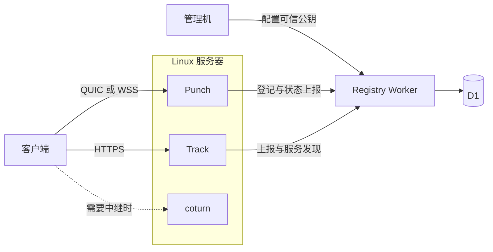

# 单机部署

本指南在一台 Linux 服务器上运行 Track、Punch 和 coturn，并使用 Cloudflare Workers + D1 部署 Registry。完成后，客户端通过 Track 发现来源，通过 Punch 建立连接，在无法直连时使用 TURN 中继。Registry 负责登记节点与提供发现列表，不参与文件传输。



## 1. 准备地址与工具

先为服务确定以下地址；后文使用这些示例值，请替换为自己的域名和公网 IP。

| 服务 | 示例地址 | 网络要求 |
| --- | --- | --- |
| Registry | `https://registry.example.com` | Cloudflare 域名和 Workers／D1 账户权限 |
| Track | `https://track.example.com` | HTTPS 入口，转发到本机 `127.0.0.1:8080` |
| Punch | `quic://punch.example.com:4433` | 同一地址开放 `4433/udp` 与 `4433/tcp` |
| TURN | `turn:turn.example.com:3478` | `3478/udp`、`3478/tcp` 及 `49160–49200/udp` 中继端口 |
| Linux 服务器 | `203.0.113.10` | 上述 Track、Punch 和 TURN 域名指向此公网 IP |

Punch 和 TURN 域名使用仅 DNS 解析，并按表开放防火墙与安全组端口；不要让普通 HTTP 代理接管这些 UDP／TCP 端口。

准备管理机上的 Node.js 24、Rust stable 和 Cloudflare 登录；服务机需安装 Rust、coturn 和用于 HTTPS 的 Caddy。管理机保存 Registry 签发私钥，服务机只接收自己的 token。在两台机器上使用同一份 Q2Q 源码版本。

在管理机的仓库根目录安装依赖、构建签发工具并登录 Cloudflare：

```sh
npm ci
cargo build --release --locked -p q2q-keygen
npx wrangler login
install -d -m 700 "$HOME/.q2q-signing"
```

下文管理机命令从仓库根目录执行，用 `target/release/q2q-keygen` 调用工具。服务机上构建并安装服务与 CLI：

```sh
cargo build --release --locked \
  -p q2q-keygen -p q2q-punch-server -p q2q-track-server -p q2q
sudo install -m 755 target/release/q2q-keygen target/release/q2q-punch-server \
  target/release/q2q-track-server target/release/q2q /usr/local/bin/
sudo install -d -m 700 -o "$(id -un)" -g "$(id -gn)" \
  /srv/q2q /srv/q2q/identity /srv/q2q/secrets
```

后续服务配置放在 `/srv/q2q`，由这个部署账户运行。身份目录需持久保存，服务管理器也应使用相同账户和路径。

## 2. 建立 Registry 的信任根

在管理机生成专用于 Registry token 的 Ed25519 签发密钥：

```sh
target/release/q2q-keygen keypair \
  --kid registry-signing-1 --format jwk \
  --private-key "$HOME/.q2q-signing/signing-1.private.jwk.json" \
  --public-key "$HOME/.q2q-signing/signing-1.public.jwks.json"
```

私钥留在管理机；接下来只将公共 JWKS 交给 Registry。输出文件不能覆盖，重新签发或轮换时使用新文件名。

在管理机创建 Registry 的独立数据库：

```sh
(cd apps/registry && npx wrangler d1 create q2q-registry)
```

仓库中的 Registry 配置已指向官方实例。自建时，把返回的数据库 ID 填入 `apps/registry/wrangler.jsonc` 的 `d1_databases[0].database_id`，并将顶层域名配置替换为自己的域名：

```json
"routes": [{ "pattern": "registry.example.com", "custom_domain": true }]
```

域名需位于当前 Cloudflare 账户的 zone 内。接着应用全部迁移、安装可信公钥并发布 Worker：

```sh
npm run db:migrate:remote --workspace @q2q/registry
(cd apps/registry && npx wrangler secret put REGISTRY_JWKS \
  < "$HOME/.q2q-signing/signing-1.public.jwks.json")
npm run deploy --workspace @q2q/registry
curl --fail https://registry.example.com/health
```

`/health` 返回存活信息后再继续。它不检查 D1 写入或节点连通性；后面的登记与传输步骤会验证这些路径。Registry 的 D1 与 Platform 的数据库分别配置。

后续可交给仓库的 Registry GitHub Actions 自动部署：提交真实数据库 ID 和域名配置，在仓库 Actions 设置中配置 secret `CLOUDFLARE_API_TOKEN` 与 variable `CLOUDFLARE_ACCOUNT_ID`。有相关变化合并到 `main` 后，检查、测试与打包通过即部署；PR 不部署。在 `main` 手动运行该工作流也会部署。数据库创建、迁移和 `REGISTRY_JWKS` 配置仍需按上述步骤先完成，新增远程迁移也需在部署前单独应用。

## 3. 先准备 TURN 中继

生成一段随机的 TURN 共享 secret，并保存到仅部署账户可读的配置中：

```sh
openssl rand -hex 32
```

在服务机为 coturn 写入 `/srv/q2q/turnserver.conf`，将 IP、域名及 secret 换成实际值：

```ini
listening-port=3478
realm=turn.example.com
use-auth-secret
static-auth-secret=REPLACE_WITH_TURN_SECRET
external-ip=203.0.113.10
min-port=49160
max-port=49200
fingerprint
no-multicast-peers
no-cli
```

让 coturn 使用此配置启动，例如在独立终端中执行：

```sh
chmod 600 /srv/q2q/turnserver.conf
turnserver -c /srv/q2q/turnserver.conf
```

将这份 secret 留给第 6 步的 Track 配置。Track 用它签发临时 TURN 凭据，coturn 用相同值校验。它与 Registry 的签发密钥、节点 token 分别保存。

## 4. 为 Punch 准备持久身份

在服务机写入 `/srv/q2q/punch.toml`：

```toml
bind = "0.0.0.0:4433"
punch_id = "punch-1"

[identity]
cert = "/srv/q2q/identity/cert.pem"
key = "/srv/q2q/identity/key.pem"

[registry]
url = "https://registry.example.com"
token_file = "/srv/q2q/secrets/punch-1.token"
region = "hk"
accepting_new_connections = true
```

显式生成 Punch 专用的 PEM 密钥，再导入持久身份目录：

```sh
q2q-keygen keypair --kid punch-1 --format pem \
  --private-key /srv/q2q/identity/punch-1.private.pem \
  --public-key /srv/q2q/identity/punch-1.public.pem
q2q-punch-server /srv/q2q/punch.toml --init-identity \
  --identity-key /srv/q2q/identity/punch-1.private.pem
```

初始化只准备身份并退出。把标准输出中的 Base64 公钥带回管理机，用于下一步签发 token；不要把 PEM 文件正文填进 claims。备份生成的 `cert.pem` 和 `key.pem`，将导入源私钥按自己的备份策略保管。

## 5. 签发并安装节点 token

在管理机保存 `$HOME/.q2q-signing/punch-1.claims.json`，将 `public_key` 替换为上一步的 Base64 输出：

```json
{
  "iss": "q2q-registry",
  "aud": "q2q-registry",
  "sub": "punch-1",
  "service_type": "punch",
  "scope": ["nodes:write:self"],
  "advertise_url": "quic://punch.example.com:4433",
  "public_key": "REPLACE_WITH_PUNCH_BASE64_PUBLIC_KEY",
  "identity_version": 1
}
```

再保存 `track-1.claims.json`：

```json
{
  "iss": "q2q-registry",
  "aud": "q2q-registry",
  "sub": "track-1",
  "service_type": "track",
  "scope": ["nodes:write:self", "discovery:punch:read"],
  "advertise_url": "https://track.example.com",
  "identity_version": 1
}
```

Punch 的 `sub` 必须匹配配置中的 `punch_id`；Track 的节点 ID 由其 token 提供。`advertise_url` 填各服务面向客户端的地址。保持 `iat`、`exp`、`jti` 不在输入文件中，它们由工具生成。

在管理机分别签发 90 天凭据：

```sh
target/release/q2q-keygen token \
  --key "$HOME/.q2q-signing/signing-1.private.jwk.json" \
  --claims "$HOME/.q2q-signing/punch-1.claims.json" \
  --days 90 --output "$HOME/.q2q-signing/punch-1.token"
target/release/q2q-keygen token \
  --key "$HOME/.q2q-signing/signing-1.private.jwk.json" \
  --claims "$HOME/.q2q-signing/track-1.claims.json" \
  --days 90 --output "$HOME/.q2q-signing/track-1.token"
```

通过 SSH 等安全通道把两个 token 放入服务机的 `/srv/q2q/secrets/`，保留上面的文件名；限制为运行服务的账户可读：

```sh
chmod 600 /srv/q2q/secrets/punch-1.token /srv/q2q/secrets/track-1.token
```

## 6. 按依赖顺序启动 Punch 与 Track

先在服务机启动 Punch：

```sh
q2q-punch-server /srv/q2q/punch.toml
```

确认日志出现 `Registry reporting active`，再写入 `/srv/q2q/track.toml`。填入第 3 步使用的 TURN secret：

```toml
bind = "127.0.0.1:8080"
turn_url = "turn:turn.example.com:3478"
turn_secret = "REPLACE_WITH_TURN_SECRET"

[state]
backend = "memory"

[registry]
url = "https://registry.example.com"
token_file = "/srv/q2q/secrets/track-1.token"
region = "hk"
accepting_new_connections = true
```

这个配置完全通过 Registry 发现 Punch，不添加 `[[punch]]`。在另一个终端启动 Track：

```sh
chmod 600 /srv/q2q/track.toml
q2q-track-server /srv/q2q/track.toml
```

确认日志出现 `Registry Punch discovery refreshed` 和 `Registry Track reporting active`。将以下站点加入 Caddy 配置并重载 Caddy：

```text
track.example.com {
    reverse_proxy 127.0.0.1:8080
}
```

```sh
sudo systemctl reload caddy
curl --fail https://track.example.com/health
```

Track 按后端实际看到的来源地址归组限流；经同一个代理出口进入的请求会共享该来源的配额，部署时需按入口流量评估这一限制。

Punch 的客户端地址仍是 `quic://punch.example.com:4433`。客户端用已登记的身份公钥验证其证书，并从同一主机与端口推导 WSS 回退地址；让 UDP、TCP 都直接到达这个 Punch 实例。

投产时，将上述 coturn、Punch 和 Track 启动命令交给服务管理器，配置开机启动与故障重启。保持运行账户、配置路径、身份目录和 secret 文件权限一致。

## 7. 查看状态并验证文件传输

如果已经部署 Platform，可在管理机保存 `platform-1.claims.json`，为其后端签发独立的只读 token：

```json
{
  "iss": "q2q-registry",
  "aud": "q2q-registry",
  "sub": "platform-1",
  "service_type": "platform",
  "scope": ["nodes:read:display"]
}
```

```sh
target/release/q2q-keygen token \
  --key "$HOME/.q2q-signing/signing-1.private.jwk.json" \
  --claims "$HOME/.q2q-signing/platform-1.claims.json" \
  --days 90 --output "$HOME/.q2q-signing/platform-1.token"
(cd apps/platform && npx wrangler secret put REGISTRY_NODES_TOKEN \
  < "$HOME/.q2q-signing/platform-1.token")
```

在 Platform 的 Worker 变量中配置 `REGISTRY_URL=https://registry.example.com` 并发布更新。Platform 自身的数据库、OAuth 和部署流程见仓库的 `apps/platform/README.md`。登录 `/nodes` 后刷新状态，检查 `punch-1`、`track-1` 是否在线。Track 的指标为 `null`；离线节点显示上次上报的历史快照。Platform 不在客户端连接的依赖链上。

接着在发布端启动一个实际文件的服务：

```sh
Q2Q_HOME="$HOME/.q2q-publisher" q2q publish ./sample.bin \
  --seed ./sample.q2q --track https://track.example.com
```

把 `sample.q2q` 交给另一台机器，在下载端运行：

```sh
Q2Q_HOME="$HOME/.q2q-downloader" q2q download ./sample.q2q \
  --output ./received.bin --track https://track.example.com
sha256sum ./received.bin
```

与发布端 `sha256sum ./sample.bin` 的结果比较。发布进程需保持运行；同时检查 Punch 的实际绑定和信令日志。若要验证 TURN，另选确实需要中继的网络完成一次传输；直连下载成功只验证了直连路径。

## 8. 安排续签与更新

在 token 到期前，用相同的节点 ID、地址、公钥和 `identity_version` 签发新文件。安全替换服务机的 token 后重启对应服务；Punch 和 Track 在启动时读取凭据。Platform 的凭据通过 Worker secret 更新。普通续签后，旧 token 仍可使用到其原到期时间。

修改 Punch 地址／公钥或 Track 地址时，提高该节点的 `identity_version` 并签发新 token，再更新部署。Registry 拒绝旧版本及同版本不同描述。Punch 重启或身份更新会使客户端需要重新建立绑定，将其纳入维护安排。

轮换签发密钥时，依次完成：

1. 在管理机用新的 `kid` 生成新密钥，使用新文件名。
2. 将旧、新公共 JWKS 的 `keys` 数组合并，更新 Registry 的 `REGISTRY_JWKS`，让两把公钥同时受信。
3. 用新私钥重新签发各服务 token，逐个更新并确认上报、发现和状态页恢复。
4. 所有旧 token 到期后，从 JWKS 移除旧公钥并再次更新 Registry。

第一版不支持撤销单个 token。签发私钥泄漏时，移除对应 `kid` 会使该密钥签发的全部凭据失效，需要重新签发并更新相关服务。

遇到 `401`／`403` 时，修正凭据并重启对应服务；遇到 `409` 时核对身份版本与描述；`429` 按 `Retry-After` 等待。网络或临时 Registry 故障会自动退避重试，节点原租约最长 90 秒，失败上报不续期。Track 返回 `discovery_unavailable` 时先检查发现是否就绪；`no_available_punch` 表示当前有效快照没有可分配节点。

需要增加节点时，继续阅读[集群部署](./deploy-cluster)。
