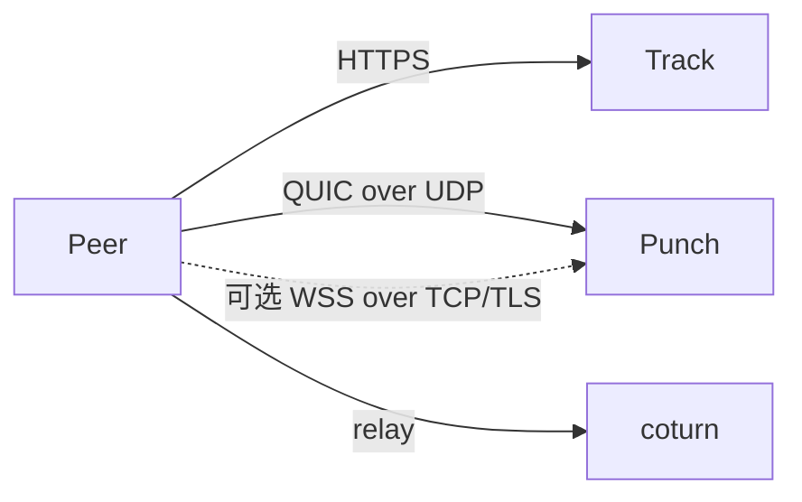
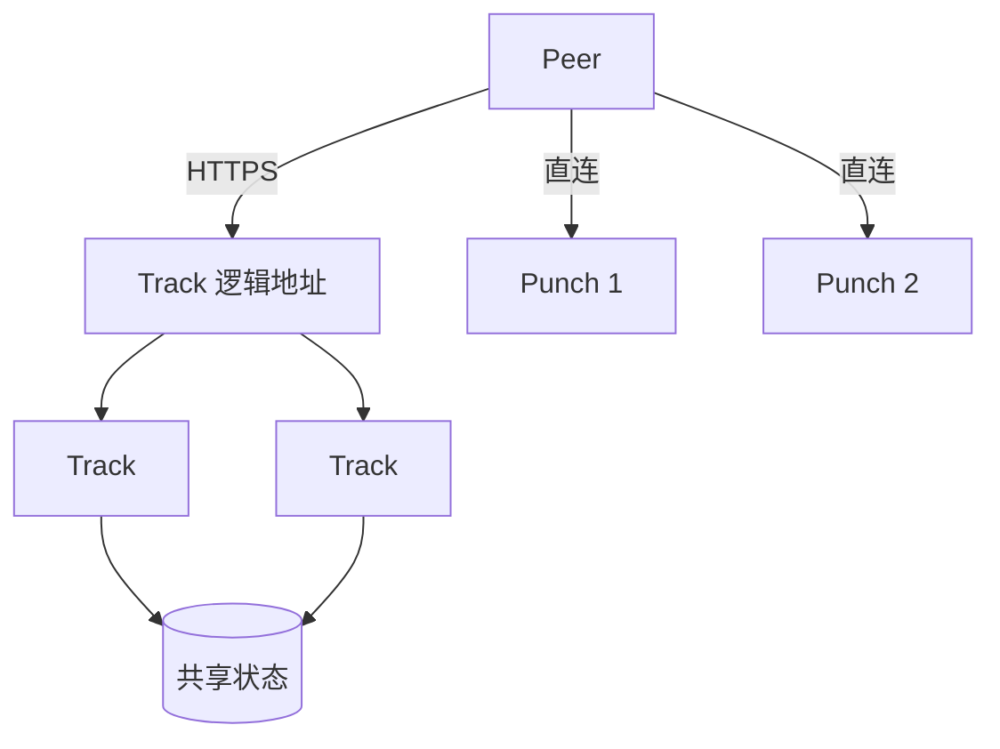

# 部署

Track 和 Punch 是普通服务：监听端口、读取 TOML 配置。除 Punch 的身份密钥对外，服务本身没有必须跨重启保留的本地状态。

两个服务不必部署在同一台机器上，处理请求时也不互相调用：Punch 会自行校验 ticket，不需要查询 Track。两者唯一的运维关联是 Track 需要知道可用的 Punch 节点。

## 单节点部署

最简单的拓扑是一台 Track、一台 Punch；如果 Peer 之间无法直连，再由 coturn 提供 TURN 中继。



### 容器镜像

每个版本都会发布以下两个镜像：

```sh
ghcr.io/mivinci/q2q-track-server:v0.1.0
ghcr.io/mivinci/q2q-punch-server:v0.1.0
```

镜像基于 Alpine，每个镜像只包含一个静态编译的可执行文件。仓库的 `deploy/` 目录提供了可供起步的 Compose 文件和配置。

### 初始化顺序

Punch 的公钥必须先生成，才能在 Track 中发布；客户端会用该公钥验证 Punch 的证书，因此无法一次性启动全部服务。

```sh
docker compose up -d punch
docker compose logs punch | grep punch_public_key
# 将公钥填入 track.toml 的 [[punch]] public_key
docker compose up -d track coturn
```

请持久化挂载 Punch 的身份目录。如果 Punch 没有找到已保存的密钥对，就会新建一对；已获知旧公钥的客户端会拒绝新身份。

包含新初始化命令的构建也支持先离线准备身份，不启动监听：

```sh
q2q-punch-server ./punch.toml --init-identity
# 或导入已有 Ed25519 PKCS#8 PEM 私钥：
q2q-punch-server ./punch.toml --init-identity --identity-key ./punch-private.pem
```

两种方式使用配置中的 `[identity]` 路径，标准输出为身份公钥的标准 Base64。导入时目标文件必须不存在；普通初始化可读取已有完整身份。只有一半身份文件时会报错，保留现有文件。初始化完成后再发布公钥、签发绑定该身份的 Registry token，最后启动服务。token 签发密钥与 Punch 身份密钥分别生成和保管。

配置 `[registry]` 后，启动必须加载已有持久身份。先运行 `--init-identity`，用输出的公钥签发 Punch token，再配置凭据并正常启动。已发布的旧镜像可能尚不包含这些功能。

```toml
[registry]
url = "https://registry.example.com"
token_file = "/etc/q2q/secrets/registry.token"
region = "hk"
accepting_new_connections = true
```

`token_file` 与环境变量 `Q2Q_REGISTRY_TOKEN` 二选一；使用环境变量仍需配置 `[registry].url`。token 只在启动时读取，更新后需重启。节点 ID 和持久公钥必须与 token 一致；签名和有效期由 Registry 验证。远程地址必须使用 HTTPS，仅回环地址允许 HTTP 用于本地开发。

服务启动后立即上报，成功后每约 30 秒上报一次并加入随机抖动。网络故障和服务端暂时错误自动退避重试；429 遵守 `Retry-After`；401／403 停止上报并记录诊断，Punch 继续提供服务。退出时取消正在进行的上报，Registry 按最长 90 秒租约判断离线。

QUIC／WebSocket 连接数来自实际连接配额（包含握手），每种连接的容量为 1024；绑定和信令会话只统计未过期记录。信令会话不等于正在传输文件的 WebRTC 连接，未限制的会话容量上报为 `null`。指标逐项采样，并非同一时刻的全局快照。`accepting_new_connections = false` 表示不接收新的 Peer 分配，不会主动断开已有连接。

### Track 的 Punch 来源

Track 启动时选择一种 Punch 来源：保留 `[[punch]]` 静态配置（支持文件热重载），或配置 `[registry]` 使用 Registry。两种配置不能同时出现。Registry token 必须绑定 Track 身份并含 `discovery:punch:read`；若要让 Platform 显示 Track 在线状态，还需 `nodes:write:self`。通过 token 文件或 `Q2Q_REGISTRY_TOKEN` 提供，更新 token 后重启 Track。

```toml
[registry]
url = "https://registry.example.com"
token_file = "/etc/q2q/secrets/track.token"
region = "hk"
accepting_new_connections = true
```

Registry 模式启动后立即上报自身状态并刷新 Punch 列表；之后两个后台任务分别约每 30 秒带抖动运行。Track 的 `metrics` 当前为 `null`。自身上报失败不会阻塞 Punch 列表刷新，401／403 只停止自身状态上报；发现刷新遇到 401／403 时则停止发现请求。网络故障保留尚未过期的数据，节点租约最长 90 秒，退出时取消请求。

Track 先完整读取所有发现分页，校验 Punch 地址、公钥与租约，再一次性替换内存快照；每个查询只读内存，不逐请求访问 Registry。只在原租约与 token 有效期内使用缓存。冷启动没有快照或租约全部过期时返回 `503 discovery_unavailable`。有效快照中没有可分配节点时，announce 返回 `503 no_available_punch`；已停止接收新分配的节点仍可用于查询已有 Peer。两个传输容量都有明确上限且都已满的节点不再分配新 Peer。修复凭据后需重启 Track。

Registry 模式使用基于 Peer ID 和 Punch ID 的 Rendezvous 哈希分配，新 Peer 会分散到不同节点；可用节点集合相同时，各 Track 实例的选择一致，列表重排也不影响选择。节点退出只改变原本选择该节点的分配结果。当前各节点等权，容量指标用于排除双传输都满载的节点，不做按容量加权或地理位置路由。静态 TOML 模式保留按配置顺序选择第一项的行为。既有绑定不会由 Track 自动迁移，重新分配后客户端仍需向目标 Punch 建立绑定。

### 常见问题

- **`bind` 必须设为 `0.0.0.0`。** 默认值是 loopback，在容器中无法从外部访问。
- **Punch 的 QUIC 与 WSS 共用端口。** `punch.toml` 只需设置一个 `bind`；服务分别在该地址的 UDP 与 TCP 上监听 QUIC 和 WSS。防火墙或 Docker 映射需同时开放 `4433/udp` 与 `4433/tcp`。Track 只需配置 `url = "quic://host:4433"`，SDK 会推导根路径 `wss://host:4433/` 作为回退地址。两种传输共用已持久化的 Punch Ed25519 身份。
- **WSS 连接配额。** 每个进程最多接受 1,024 条并发连接，同一来源 IP 最多 32 条。来源地址按 Punch TCP 监听器实际看到的对端地址计算；经过反向代理或 SNAT 时，共用代理出口 IP 的客户端会共同占用这 32 条配额。TLS 握手和 WebSocket Upgrade 需在 10 秒内完成，连接建立后还需在 10 秒内发送有效的 `join` 或 `connect`。
- **TURN secret 必须一致。** Track 使用 `HMAC-SHA1(secret, "<expiry>:<user>")` 签发中继凭据，coturn 使用同一个 secret 校验。配置不一致时，直连仍可工作，只有中继会失败；问题通常会在确实需要中继的网络中才暴露。

## 集群部署

Track 和 Punch 的扩展方式**正好相反**，这是增加节点前要理解的关键区别。



**Track 是无状态服务。** 任意实例都可以处理任意请求，因此可以放在常规负载均衡器后面横向扩展。前提是在线记录、`session_key` 和文件索引存放在共享状态中。若 `session_key` 只保存在某个实例的内存里，下一次心跳被转发到另一个实例时就会失败。

TURN 凭据是例外，不需要存储：它们由共享 secret 计算，因此每个实例都会得到相同的凭据。

**Punch 采用分片，而非无状态扩展。** Peer 会绑定到一个 Punch，其他 Peer 也需要连接到这个实例。一次连接的全部信令都在同一实例内处理，实例之间不必通信，因此 Punch 可以把状态保存在内存中。

由此有两个部署结论：

- **不要在 Punch 前放负载均衡器。** Peer 会直接连接 Track 返回的实例地址。负载均衡器也无法据此路由：peer ID 位于加密的 QUIC 连接内，中间设备看不到它。
- **按 `peer_id` 分配 Peer。** 使用一致性哈希时，新增一个实例大约只会迁移 `1/N` 的 Peer。若 Peer 回到原来的实例，原有 binding 甚至可能仍然有效。

### 为什么不以相同方式分片 Track

Track 有两类请求键：`announce` 和 `heartbeat` 按 `peer_id` 索引，`query` 按 `info_hash` 索引。按第一种键分片会让每个 query 都广播到所有实例；按第二种键分片则无法妥善处理一次携带多个文件的 announce。此处需要解决的不是分区，而是一个需要读取完整索引的高频请求路径，因此共享存储更简单。

### 故障恢复

身份使用自签名，恢复流程较简单。如果 Track 重启后丢失索引，Peer 的下一次心跳会因 session 未知而失败，随后重新 announce 并获取新的 ticket。Punch 重启后，Peer 也会以相同方式重新 join。

多个 Track 实例应连接到同一个 Redis 主节点：

```toml
[state]
backend = "redis"
url = "redis://redis.example.internal:6379/"
```

默认的 `memory` 后端适用于单个 Track 进程。Redis 后端保存 session 和文件索引，并处理序列号检查与 TTL。它依赖单个主节点上的多键原子更新，暂不支持 Redis Cluster。

### 尚待完成

- **Punch 上报、Track 状态上报和 Track 服务发现已支持 Registry 模式。** Track 也可继续只使用 TOML 静态节点列表。
- **Track 限流仍是实例级别。** Punch 会按 `cluster_size` 平分配置的配额；Track 尚无共享限流状态来保证整个集群共用一个配额。
- **Redis 共享状态已用独立连接和 Track router 检查。** 仍需通过负载均衡器连接两个独立 Track 进程完成端到端验证。
