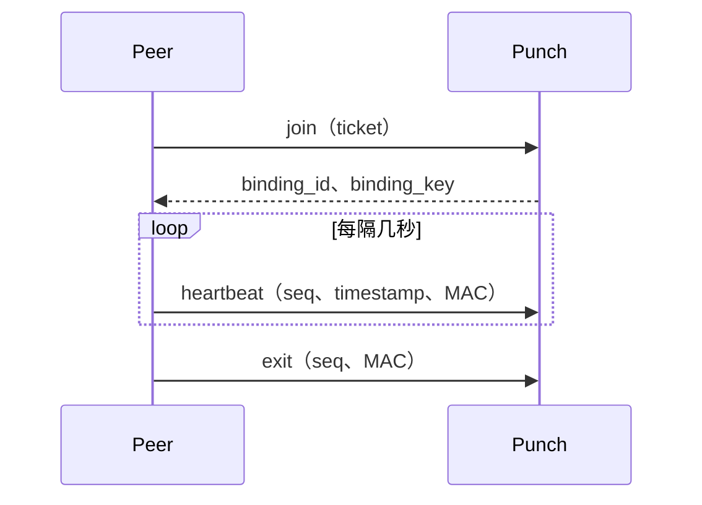
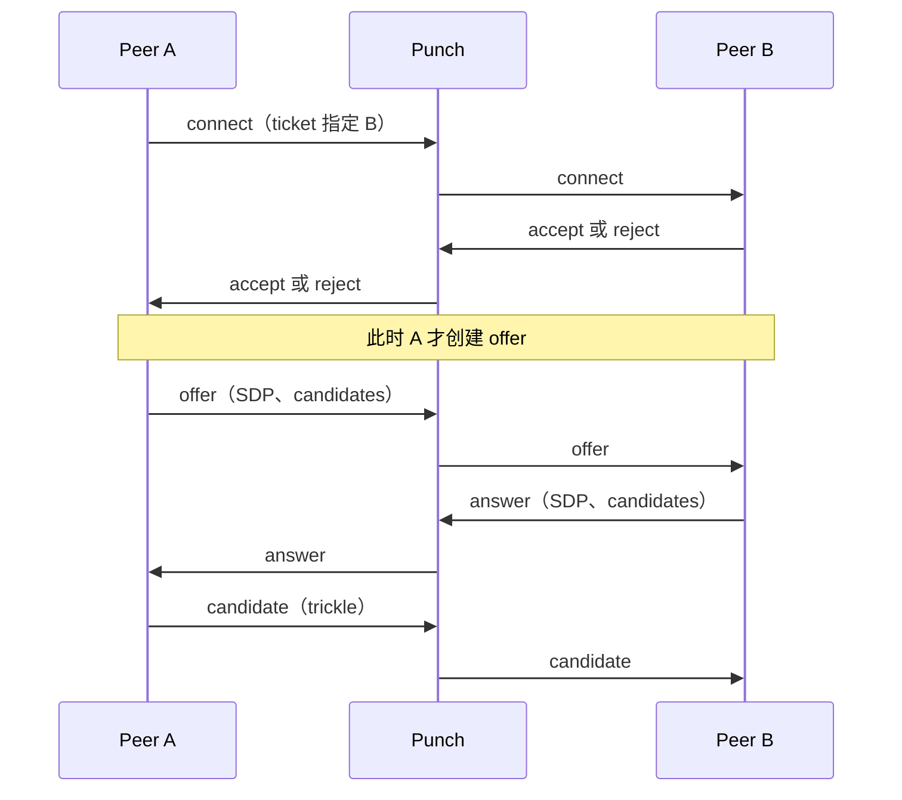

# Punch 服务

Punch 主要负责两件事：为分配到它的 Peer 维持在线通道，并在发起连接的 Peer 与绑定在此处的目标 Peer 之间转发信令。

Punch 不解析经手的 SDP，只把它视作不透明字符串；它不签发连接凭据，凭据由 Peer 自行签名。处理请求时也无需访问 Track，因此 Track 故障不会中断 Punch 上的信令服务。

## 为什么使用 QUIC

控制通道使用 QUIC 而非 TCP，主要有两个原因：

1. **连接迁移。** Peer 可能运行在手机或家庭网络中。Wi-Fi 与蜂窝网络切换通常会中断 TCP 连接；QUIC 使用连接 ID 标识连接，而不只依赖网络地址，因此可以继续使用原连接。
2. **底层就是 UDP。** Punch 的一项职责是帮助 Peer 保持 NAT 映射，这需要定期发送 UDP 数据包。QUIC 基于 UDP，无需再维护另一条 UDP 通道。

QUIC 仍是首选传输。Punch 在同一个 `bind` 地址上分别监听 UDP/QUIC 与 TCP/WSS。SDK 从 Track 下发的 `quic://host:port` 派生 `wss://host:port/`，先尝试 QUIC，只有链路无法建立时才回退到 TLS 上的 WebSocket。Track 无需单独配置 WSS 地址。

QUIC 心跳通过 datagram 发送，数据小、频率高；丢失时下次再发即可。WSS 上的心跳则使用有界 WebSocket 控制帧。其他消息（`join`、`exit` 和全部信令）在两种传输上都使用可靠消息。两种方式都复用 Track 下发的 Punch 公钥验证服务身份。

WSS 只覆盖 Punch 绑定和信令控制面，握手使用根路径 `/`。文件数据仍通过 WebRTC DataChannel 和 ICE 传输；仅启用 WSS 不代表 UDP 被阻断时文件也能传完。要在这种网络中完成传输，还需单独验证 TURN/TCP 或 TURN/TLS 数据通路。

## 在线绑定

Peer 通过 `join` 上线：它提交一张指向当前 Punch 的自签名 ticket，并获得 `binding_id` 和 `binding_key`。之后的交互如下：

`join` 之后的每条消息都用 `HMAC(binding_key, binding_id || seq || timestamp || generation)` 验证。序列号必须递增，时间戳也必须接近服务器时钟。`generation` 计数器只增不减；网络变化后重新 join 时，服务端就能区分新连接和重放消息。

连接通道本身就是在线凭据。通道关闭后 binding 随之失效。因此，“可连接 Peer”就是当前仍有在线通道的 Peer 集合，无需另建一张状态表。

## 信令流程

建立连接分两个阶段，顺序不能颠倒：

**先征求同意。** 只有 Peer B 接受后，Peer A 才能发送 offer。拒绝时无需开始 ICE 收集、STUN 查询或分配中继资源。在大型 Peer 网络中，多数连接尝试都会被拒绝，因此提前询问可以减少实际工作。

每次 `connect` 都必须携带 ticket（它授权发起方唤醒目标 Peer）。此后，连接通道就是凭据：`answer`、`candidate` 和 `cancel` 根据连接记录校验，无需每次重新验证 ticket。这也使转发中的 candidate 不受 ticket 过期时间限制。

## 服务端身份验证

客户端必须确认连接到的是真正的 Punch。Track 会连同 Punch 地址一起发布其公钥；客户端会检查 Punch 证书中包含的公钥是否完全匹配。

地址和公钥分开管理：部署变更时地址可能改变，而公钥代表服务长期身份。因此必须持久化密钥对；如果 Punch 每次启动都重新生成密钥，客户端就不会再信任它。

## 两类信令通道

两类通道的生命周期不同：

- **常驻通道（Standing）。** Peer 在 `join` 时建立并持续绑定。通道关闭后，该 Peer 不可达；连接请求会收到可区分的“目标离线”错误。
- **临时通道（Ephemeral）。** 发起方在创建连接时建立，连接结束后关闭。首个 offer 的响应会携带 `signal_key`；通道中断后，发起方可以带连接 ID 和该密钥重新连接并恢复，离线期间积压的消息会重放。

心跳的作用与常驻通道的存活检测不同：它负责维持 NAT 映射并刷新 TTL。QUIC 将心跳作为 datagram 发送；WSS 则通过 TLS WebSocket 连接发送控制帧。Punch 会分别判断心跳是否有效、通道是否断开。

## 运行服务

部署步骤见[部署指南](./deploy)。Punch 需要：

- 与 Track 配置一致的 `punch_id`
- 已持久化的身份密钥对
- 在对外声明的同一端口上接收 **UDP 和 TCP**，分别用于 QUIC 与 WSS
- 将 `cluster_size` 设为实例总数，以便拆分限流配额，而不是让每个实例都获得完整配额
