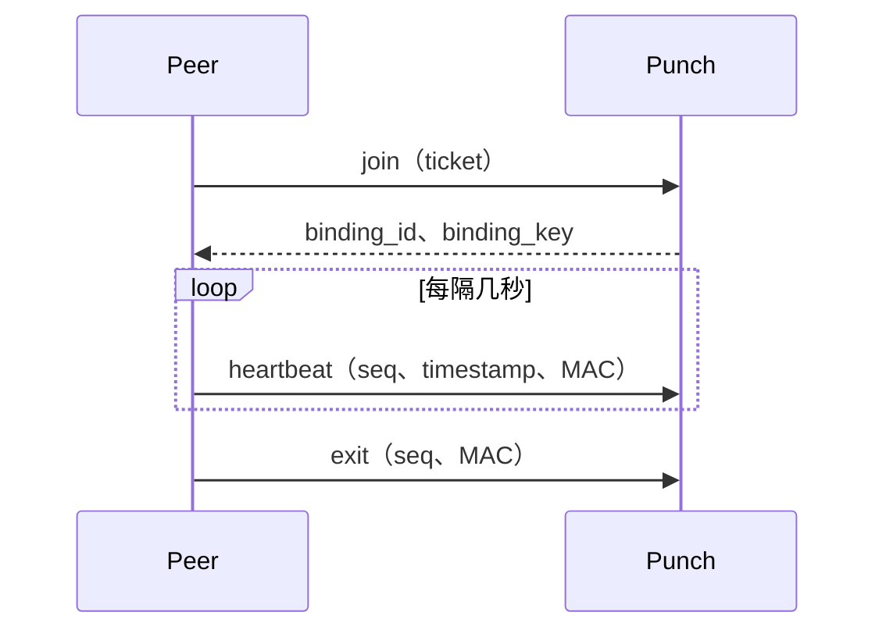
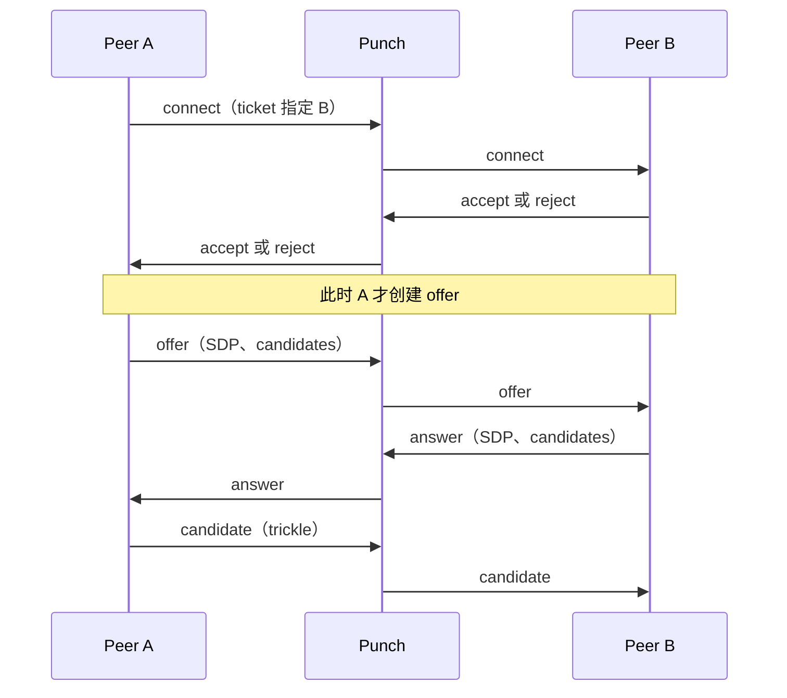

# Punch 服务

Punch 主要负责两件事：为分配到它的 Peer 维持在线通道，并在发起连接的 Peer 与绑定在此处的目标 Peer 之间转发信令。

Punch 不解析经手的 SDP，只把它视作不透明字符串；它不签发连接凭据，凭据由 Peer 自行签名。处理请求时也无需访问 Track，因此 Track 故障不会中断 Punch 上的信令服务。

## 为什么使用 QUIC

控制通道使用 QUIC 而非 TCP，主要有两个原因：

1. **连接迁移。** Peer 可能运行在手机或家庭网络中。Wi-Fi 与蜂窝网络切换通常会中断 TCP 连接；QUIC 使用连接 ID 标识连接，而不只依赖网络地址，因此可以继续使用原连接。
2. **底层就是 UDP。** Punch 的一项职责是帮助 Peer 保持 NAT 映射，这需要定期发送 UDP 数据包。QUIC 基于 UDP，无需再维护另一条 UDP 通道。

原生 SDK 优先 QUIC；浏览器使用 WebSocket。Track 下发 `endpoints` URL 列表，显式给出 QUIC 与 WSS 入口；原生连接器不再从 QUIC 地址猜测 WSS 地址。列表按规范排序表示身份集合，而非连接优先级。原生建连在总计 20 秒预算内依次尝试可用入口，仅网络/传输失败可回退，认证失败不降级；代理握手返回 HTTP 401/403 同样视为认证失败，不尝试其他端点。

QUIC 使用 Track 提供的节点公钥校验证书；原生和浏览器 WSS 均校验公共 CA、域名与有效期。QUIC 心跳走可靠双向 stream，WebSocket 心跳走有界帧；票据、MAC 和 Peer 身份/DTLS 指纹绑定不变。

WebSocket 入口可使用独立端口、路径与 query，例如 `wss://signal.example.com:8443/punch/ws?region=hk`。WS 仅允许 loopback 测试，公网应使用 WSS。它只承载控制面信令，文件数据仍走 WebRTC；UDP 受限时还需单独验收 TURN/TCP 或 TURN/TLS。

## WebSocket TLS 配置

`websocket_tls` 默认 `false`：TCP listener 接收明文 WS，适合放在终止公网 TLS 的反向代理后面。QUIC 的 TLS 与持久化节点身份不受此开关影响。

```toml
bind = "0.0.0.0:4433"
websocket_tls = false
```

反向代理对外提供受浏览器信任的 WSS 证书，向 Punch 转发明文 WebSocket，并保留 Upgrade 握手。明文上游应限制在本机、私网或可信隧道内；当前 TCP/UDP 共用 `bind`，如需公网 QUIC，应通过防火墙单独限制 TCP 上游的访问。

`websocket_tls = true` 仍可让 Punch 直接终止 TLS，但其自签节点证书不满足 SDK 的公信 WSS 校验。推荐用公共 CA 证书的反向代理，并将完整 WSS 入口列入签名 `endpoints`。代理不持有 Punch 身份私钥；QUIC 持久身份与公钥校验不变。

## 在线绑定

Peer 通过 `join` 上线：它提交一张指向当前 Punch 的自签名 ticket，并获得 `binding_id` 和 `binding_key`。之后的交互如下：



心跳使用 `HMAC(binding_key, binding_id || seq || timestamp || generation)`；exit 在相同字段前加上 ASCII 字节 `punch.exit`，因此心跳的 MAC 不能用于退出。两者都检查时间窗口、严格递增的序列号与不回退的 generation，并在同一个临界区内完成当前 Binding 的校验与更新。

Peer 可连接需要同时具备有效 Binding 和常驻通道。过期、exit 或通道关闭都会撤销 standing 身份。重新 join 会替换旧 Binding，旧通道随后清理时不会误删新 Binding。

exit 的 MAC 格式需要配套更新 SDK/CLI 与 Punch 服务端；旧格式会被拒绝。心跳的 MAC 格式保持兼容。

## 信令流程

建立连接分两个阶段，顺序不能颠倒：



**先征求同意。** 只有 Peer B 接受后，Peer A 才能发送 offer。拒绝时无需开始 ICE 收集、STUN 查询或分配中继资源。在大型 Peer 网络中，多数连接尝试都会被拒绝，因此提前询问可以减少实际工作。

每次 `connect` 都必须携带 ticket（它授权发起方唤醒目标 Peer）。此后，连接通道就是凭据：`answer`、`candidate` 和 `cancel` 根据连接记录校验，无需每次重新验证 ticket。这也使转发中的 candidate 不受 ticket 过期时间限制。

## 服务端身份验证

客户端必须确认连接到的是真正的 Punch。Track 会连同 Punch 地址一起发布其公钥；客户端会检查 Punch 证书中包含的公钥是否完全匹配。

地址和公钥分开管理：部署变更时地址可能改变，而公钥代表服务长期身份。因此必须持久化密钥对；如果 Punch 每次启动都重新生成密钥，客户端就不会再信任它。

## 两类信令通道

两类通道的生命周期不同：

- **常驻通道（Standing）。** Peer 在 `join` 时建立并持续绑定。通道关闭后，该 Peer 不可达；连接请求会收到可区分的“目标离线”错误。
- **临时通道（Ephemeral）。** 发起方在创建连接时建立，连接结束后关闭。首个 offer 的响应会携带 `signal_key`；通道中断后，发起方可以带连接 ID 和该密钥重新连接并恢复，离线期间积压的消息会重放。

心跳的作用与常驻通道的存活检测不同：它负责维持 NAT 映射并刷新 TTL。QUIC 通过可靠 stream（底层仍是 UDP）发送心跳；WSS 则通过 TLS WebSocket 连接发送控制帧。Punch 会分别判断心跳是否有效、通道是否断开。

connect/offer 票据必须匹配连接 ID、目标 Peer 和内容哈希。首次 offer 还必须来自已认证的发起方通道，目标 Peer 不能用收到的转发票据冒充发起方。每个连接的信令在路由切换期间按序处理。向断线发起方投递失败时，Punch 会缓冲消息供 resume 补发，每个连接最多 64 条且序列化信令总量不超过 16 KiB；无法投递或缓冲时返回 `signal_delivery_failed`。resume 响应本身丢失后的应用层确认暂未实现。

QUIC 与 WSS 握手独立并发处理，握手期限为 10 秒，每种传输最多 1,024 条连接、每 IP 最多 32 条。QUIC 另有限制并发请求数及请求读写期限。

## 运行服务

部署步骤见[部署指南](./deploy-single-node)。Punch 需要：

- 与 Registry token 一致的 `punch_id` 和持久身份公钥
- 已持久化的身份密钥对
- 在对外声明的同一端口上接收 **UDP 和 TCP**，分别用于 QUIC 与 WSS
- 将 `cluster_size` 设为实例总数，以便拆分限流配额，而不是让每个实例都获得完整配额


## 发布 Punch 镜像

Punch 的程序版本以 `crates/q2q-punch-server/Cargo.toml` 为准。准备发版 PR 时，将该包版本更新为新的稳定版本（如 `0.6.1`），同步 `Cargo.lock`，并确认版本高于已有 `punch/v*` tag 和镜像版本。普通代码修改不会自动发布镜像。

版本 PR 合并到 `main` 后，原生服务镜像发布工作流等待同一提交的 Rust CI 成功，再检查目标镜像 tag 不存在、构建镜像并核对容器的 `--version`。随后创建 `punch/v0.6.1` Git tag，发布 `v0.6.1` 和 `latest` 镜像。Punch 心跳通过 Cargo 包版本上报 `0.6.1`，管理页面因此显示该版本。

如果发布在创建 Git tag 后失败而版本镜像尚未推送，可重跑同一次工作流；相同 tag 必须指向同一提交。如果版本镜像已经推送，保护检查会拒绝覆盖，需先检查 Registry 和失败步骤，再按已有镜像恢复 `latest`。服务器需要自行拉取新镜像并重启。旧版镜像不受改动影响。
