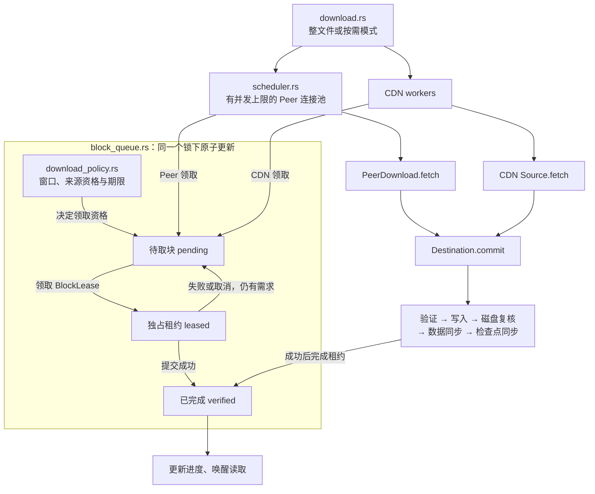

# 调度

调度回答三个问题：当前需要哪些块、哪个来源可以领取、什么时候才算完成。整体结构见 [传输层](./transport)，Peer 消息见 [消息编码](./wire)。

## 策略、队列和执行



- **策略**不执行网络 I/O，负责窗口、来源可用性、紧急期限和来源错误。
- **队列**保存待取、在途、已完成状态，并发领取时独占一个块。策略与块状态在同一把锁下更新，网络和磁盘 I/O 不持有这把队列锁。
- **执行层**创建、取消和等待 worker；Peer 连接池由 `scheduler.rs` 实现，CDN worker 由 `download.rs` 组织。
- **Destination**持有块租约直到校验和持久化完成，防止来源切换时两个任务同时写同一块。

## 从取块到完成

Peer worker 持续执行以下循环：

```text
领取块租约
  → Request / 接收 pieces 和 proof
  → 验证长度与 Merkle 证明
  → 写入目标并从磁盘复核
  → 同步目标数据
  → 追加证明检查点并同步
  → 完成租约、更新进度、通知等待者
  → Have / BlockDone
  → 领取下一块
```

CDN 使用同一个提交入口，提交后不发送 Peer 确认。来源错误会让未完成租约归还；队列暂时为空而仍有在途块时，worker 等待通知，不把“没有可领任务”误判成完成。

磁盘或检查点失败会停止传输，并阻止后续排队提交。网络任务取消时，已经开始的阻塞提交仍拥有租约、目标锁和任务计数；整文件下载进入 CDN 阶段前会等待这些操作结束。

## 整文件与 VOD

| 行为 | `download` / `resume_download` | `open` 按需读取 |
| --- | --- | --- |
| 初始需求 | 所有未验证块 | 首次 read/seek 建立当前窗口 |
| 排序 | 未完成块顺序取，失败块归还到队首 | 当前块，然后前向预取块 |
| Peer 重试 | 当前候选逐一尝试，失败时补充新候选 | 共用连接池；窗口变化后可重连已有候选 |
| CDN 启动 | Peer 候选耗尽或控制面失败 | 无 Peer 或当前读取块超过等待预算 |
| 队列衔接 | 等待 Peer/磁盘任务退出，再按已验证位图建 CDN 队列 | Peer 与 CDN 共用同一个队列 |
| 镜像失败 | 当前镜像 worker 全部退出后换镜像 | 当前块依次尝试镜像 |
| 完成 | 全部块持久化并最终同步 | 窗口读完仍可继续；全文件同步后才 Completed |

`max_download_peers` 默认 4，范围 1–16，分别限制 Peer 并发和 CDN worker 数。VOD 两类来源可以同时运行，这个参数不是二者相加后的总连接上限。每个 worker 最多持有一个块，不是按字节自适应调整的预算。

Peer 建连上限 45 秒，发现阶段上限 15 秒。Peer 来源需持有完整文件；当前不会基于部分块可用性做 rarest-first、endgame 或自适应吞吐调度。

## VOD 的读取窗口

```rust
use std::{io::SeekFrom, time::Duration};
use tokio::io::{AsyncReadExt, AsyncSeekExt};

let mut file = client.open(&seed, "video.mp4")
    .prefetch_blocks(8)
    .read_timeout(Duration::from_secs(30))
    .await?;
file.seek(SeekFrom::Start(offset)).await?;
let n = file.read(&mut buffer).await?;
```

预取数量默认 8，范围 0–64；0 表示只取当前块。例如当前位置在 block 20，预取设为 2，则需求为 `20 → 21 → 22`。seek 到 block 100 后，新需求为 `100 → 101 → 102`：旧窗口里尚未开始的任务被撤下，在途块仍可完成并缓存；失败的旧窗口租约不会重新入队。

seek 到 EOF 或其后不建立预取任务；EOF 返回 0，负位置或 u64 溢出返回 InvalidInput。取消等待中的 read 不前移游标；seek 会丢弃旧读取等待。每次缺块等待受 read_timeout 限制，超时返回 TimedOut，后台已开始的取块仍可完成。

当前读取块优先给 P2P `min(2 秒, read_timeout / 2)`。预算耗尽后，只有 CDN 证明表通过验证才允许中断持有该块的慢连接，归还租约并由 CDN 领取；其他 Peer 继续工作。时序见 [CDN 回退](./cdn#vod-紧急块回退)。

## 进度和取消

`progress()` 和 `subscribe_progress()` 只统计持久化成功的块，包含 verified bytes/blocks、active peers、active CDN requests 和状态。watch 通知会合并，慢消费者不会阻塞取块。

取消终止网络任务，阻塞磁盘操作清理期间计数仍可能更新。VOD 来源错误可以只影响某次读取；磁盘错误发布 Failed。部分文件读完不等于全文件完成，Drop 仍未完成的读取句柄会发布 Cancelled。
