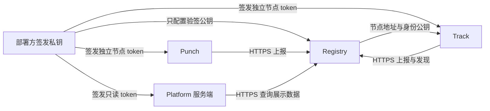

# 安全机制

部署 Q2Q 时需要准备几类密钥和凭据，因为系统要分别回答三个问题：**返回的内容对不对、连接的对端是谁、哪些服务可以加入这套网络**。这三件事使用不同机制，不能用一份密钥或一个 token 代替。

本文介绍这些机制的作用与信任边界；实际安装和配置顺序见[单机部署](./deploy-single-node)与[集群部署](./deploy-cluster)。

## 1. 内容由 Seed 确定，由 Merkle 证明校验

Seed 的 info 字典包含文件长度、块大小和 Merkle 根等信息，规范编码后的 SHA-256 得到 `info_hash`。下载内容必须符合这份内容身份。

Peer 提供数据块及其 Merkle 证明，接收方校验长度和证明后才提交数据；CDN 回退得到的数据也须通过内容校验。Track 返回一个来源、Punch 转发一段信令，或 HTTPS 请求成功，都不构成文件内容正确的依据。

这解决的是“下载结果是否与选定的内容一致”。**当前 Seed 格式不包含发布者签名，`info_hash` 也不证明发布者的现实身份。** 用户仍需通过可信渠道获得 Seed 或磁力链接；攻击者若同时替换了入口中的内容哈希与文件，Merkle 校验不会替用户判断哪个才是原本想要的文件。

## 2. Registry 决定哪些服务身份可信

Registry 是部署方维护的节点目录。它接收 Punch／Track 上报，向 Track 提供 Punch 发现列表，向 Platform 提供只读展示数据。它不传输文件，也不为 Peer 签发连接票据。

### 签发私钥与验签公钥

部署方使用独立的 Ed25519 私钥签发 Registry JWT，只把公共 JWKS 配置到 Registry。Registry 检查签名、`kid`、issuer、audience、有效期，以及服务类型和权限。

因此部署指南要求签发私钥留在管理机：拥有它就能为这套 Registry 签发服务凭据。普通节点只需要自己的 token，不需要签发私钥；Registry 也只需要验签公钥。轮换时先让 Registry 同时信任新旧公钥，再更新各节点凭据，最后移除旧公钥。

### 每个服务只取得所需权限

| 服务 | Registry 权限 | 用途 |
| --- | --- | --- |
| Punch | `nodes:write:self` | 上报自己的状态 |
| Track | `nodes:write:self`、`discovery:punch:read` | 上报自身并读取 Punch 目录 |
| Platform 服务端 | `nodes:read:display` | 读取节点展示数据 |

节点 ID、类型、对外地址、Punch 公钥和 `identity_version` 来自签名 claims，上报正文不能覆盖。更换地址或身份公钥时须提高身份版本并重新签发；同版本不同描述及低版本更新会被拒绝。这样，持有旧凭据的进程不能把目录中的新身份回滚为旧身份。

节点通常每 30 秒上报，租约最长 90 秒，且不超过 JWT 的到期时间。过期节点退出发现列表。Track 在 Registry 故障时只使用尚未过期的缓存，不能靠失败的刷新无限延长旧身份的可用期。节点租约表示最近收到上报，不等于主动探测过其客户端网络连通性。

Registry JWT 是 bearer 凭据：持有者可以在它的权限和有效期内使用它。将它存为仅服务账户可读的文件或 Worker secret，避免进入源码、日志和浏览器。普通续签不会立即撤销旧 token；目前没有按单个 `jti` 管理的即时撤销列表。

## 3. TLS 保护链路，身份验证决定连接谁

| 链路 | 身份与链路保护 | 部署时对应的配置 |
| --- | --- | --- |
| Peer → Track | HTTPS，使用通常的域名证书验证 | 为 Track 配置 HTTPS 入口；反向代理转发到本机或私网后端 |
| 服务 → Registry | HTTPS 加 Registry JWT | Registry 自定义域名、可信公钥和各服务独立 token |
| Peer → Punch | QUIC／WSS 上的 TLS，客户端核对 Punch 证书公钥与 Track 下发的公钥 | 持久保存 Punch 证书和私钥；Registry 登记相同身份公钥 |
| Peer ↔ Peer | WebRTC DTLS，加 DataChannel 上的签名身份确认 | SDK 自动握手；部署方提供可用的发现、信令和 TURN 网络 |

Track 的 HTTPS 在反向代理处终止后，示例通过回环或受信私网访问后端；若上游经过不可信网络，还需为该段配置 TLS。公网 HTTPS 不会自动加密反向代理到后端的连接。

Punch 的身份不是只凭 DNS 名称判断。客户端使用 Track 提供的预期公钥校验它，所以服务重启时需要加载原有持久身份。普通 HTTP 代理若终止 Punch 的 TLS 并换上另一张证书，会破坏这个身份匹配；部署指南让 Punch 的 QUIC／WSS 端口直接到达实例。

Track 和 Registry 仍是控制面的信任来源：恶意或被攻陷的目录／Track 可以误导发现、隐藏来源或影响可用性。内容校验不能阻止这些行为，TLS 也不意味着服务运营者无法看到其处理的控制信息。

## 4. Peer 用自己的密钥证明身份

Peer 在本地持有 Ed25519 私钥，`peer_id` 从其公钥派生。Peer 自行签发短时 ticket，服务检查票据的签名、用途／目标、有效期及相关连接字段。这份 ticket 与部署方签发的 Registry JWT 是两种不同的凭据。

在 WebRTC 数据通道建立后，双方还会交换随机挑战和签名。签名绑定双方角色、公钥、内容哈希、连接 ID、随机挑战及双方 DTLS 证书指纹，验证通过后才进入文件协议。这样，控制面转发的信令不能仅靠替换 DTLS 指纹就冒充预期 Peer。具体握手见[传输层](./transport)。

自签身份说明对方持有某把私钥，不说明它是某个已实名用户或已获业务授权的账号。应用仍需定义自己的用户、内容访问和发布权限；不能把知道 `peer_id` 或通过密码学身份验证直接等同于有权访问私有内容。

## 5. 会话密钥减少重复签名，并约束重放

完成初始认证后，系统使用短期会话状态处理频繁交互：

- **Track `session_key`**：Track 在 announce 后发给 Peer，后续相应请求使用 HMAC。服务检查时间戳、序列号和会话状态；序列处理允许有限乱序，不表示每个请求都只可能执行一次。
- **Punch `binding_key`**：Punch 在 join 后发给 Peer，用于绑定心跳与退出认证。心跳／退出使用不同的 MAC 消息域，并检查时间窗口、序列号和 generation。
- **连接票据与信令状态**：连接票据绑定目标 Peer、内容和连接标识，后续信令根据已认证通道及连接记录处理，避免把转发的票据当成任意一方的通用凭据。

这些密钥保护各自的会话，不负责 Registry 服务登记，也不能替代文件的 Merkle 校验。详情见 [Track](./track) 和 [Punch](./punch)。

## 6. TURN 凭据只授权使用中继

TURN 服务与 Track 共享一份 TURN secret。Track 用它签发带有效期的临时用户名／密码，Peer 使用这些临时凭据申请中继，TURN 服务用相同 secret 验证。因此两端的值必须一致，客户端不应取得长期共享 secret。

TURN secret 与 Registry 签发私钥、Punch 身份私钥互相独立。部署指南以 coturn 为示例；使用其他 TURN 实现时，需支持与 Track 兼容的临时凭据机制。

中继承载的是 Peer 间的 DTLS 加密传输，TURN 运营者仍可观察连接地址、流量规模和时间等元数据。使用 `turn:` 本身不代表客户端到中继的所有协议交互都由 TLS 保护；TURN/TCP、TURN/TLS 和受限网络下的可达性应按实际部署验证。

## 7. 部署时每份凭据放在哪里

| 配置或密钥 | 保存位置 | 为什么单独配置 |
| --- | --- | --- |
| Registry 签发私钥 | 管理机，受限权限并备份 | 能签发服务身份，不分发给节点 |
| Registry 公共 JWKS | Registry Worker | 验证部署方签发的 token，无需私钥 |
| Punch 证书和身份私钥 | 对应 Punch 的持久目录／卷 | 维持客户端预期的服务身份 |
| 各节点 Registry token | 对应服务账户可读的文件 | 限制节点 ID、身份描述、权限和有效期 |
| Platform 只读 token | Platform Worker secret | 服务端获取状态，浏览器不接触机器凭据 |
| TURN 共享 secret | Track 与 TURN 的受限配置 | 签发／校验临时中继凭据 |
| Peer 私钥 | 对应客户端的本地身份存储 | 签发 Peer 票据并证明数据通道身份 |
| Track／Punch 会话密钥 | 对应服务与客户端的会话状态 | 认证频繁交互，随会话生命周期管理 |
| Redis 凭据 | 使用共享状态的 Track 配置 | 保护会话和索引存储；Redis 应限制私网访问 |

最后，签名、加密和内容证明不保证服务永远可用，也不提供流量匿名性。连接数、请求大小、超时和限流是补充的资源保护措施，不能据此宣称已经解决所有拒绝服务攻击。部署时同时安排凭据续签、身份备份、受限网络访问与真实传输验收。
