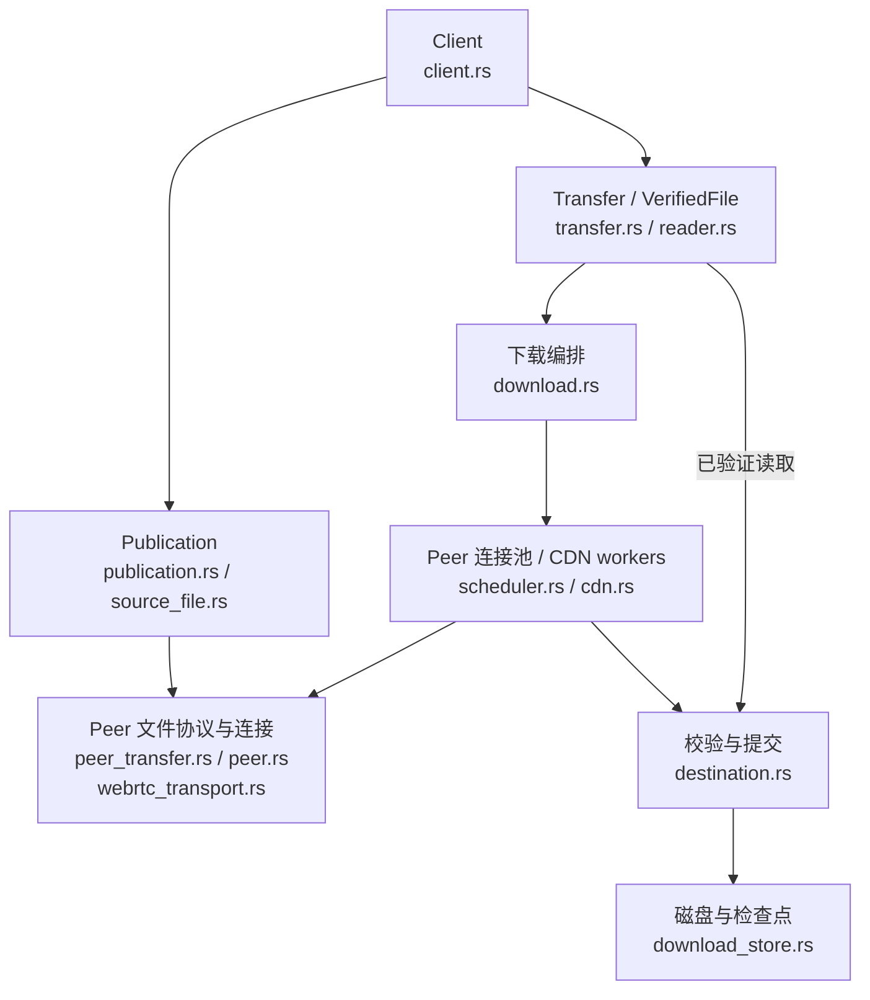

# 传输层

本文说明当前 Rust SDK 的数据面实现：建立已认证的 Peer 连接、传输文件块，并把通过校验的内容交给应用。消息格式见 [消息编码](./wire)，任务分配见 [调度](./scheduling)，HTTP 来源见 [CDN 回退](./cdn)。

## SDK 整体架构

下面按运行职责画图，连线表示调用或数据交互。`download.rs` 是执行层模块，内部通过函数和后台任务组织下载；图中节点不都对应独立的服务或公开类型。

共享的 `control.rs` / `online.rs` 位于图外，为发布和下载提供 Track 查询、Punch 会话与心跳维护。块队列与来源策略在 [调度](./scheduling) 中展开。

数据面不依赖 Track 或 Punch 为内容真实性背书：Peer 身份通过连接上的签名确认，内容通过 Seed 中的 Merkle 根验证。Track 做发现，Punch 转发连接信令；文件字节经 Peer 数据通道或 CDN 获取。

## 从发现到已认证连接

1. 客户端查询 Track，取得当前页的完整文件持有者，去重并排除自身。
2. 下载方通过 Punch 请求连接，接收方同意后交换 SDP 与 ICE candidate。
3. `webrtc-rs/webrtc` 建立 ICE / DTLS / SCTP 连接，并打开两条 DataChannel。
4. 双方在可靠控制通道交换随机挑战及 Ed25519 签名，验证完成后才进入文件协议。

签名绑定发起方/接收方角色、双方公钥、`info_hash`、连接 ID、双方随机挑战和双方 DTLS 证书的 SHA-256 指纹。期望公钥来自连接票据或 Track 候选并按 peer_id 验证。身份消息每条最多 512 字节，整个确认阶段限时 10 秒；错误阶段、版本、签名或指纹均导致连接失败。

## 两条数据通道

| 通道 | 配置 | 用途 |
| --- | --- | --- |
| `q2q-control` | 可靠、有序，由发起方通过 DCEP 创建 | 身份确认、bitfield、请求、证明、确认和取消 |
| `q2q-data` | 双方显式配置 negotiated stream 1，无序、`max_retransmits = 0` | 二进制 piece |

发送缓冲上限为每条通道 256 KiB，超过时由底层施加背压。piece 丢失由文件协议中的 `piece_nack` 补齐。

当前依赖版本对远端 DCEP 通道的重传参数恢复存在限制，因此数据通道由双方显式配置；控制通道保留 DCEP 握手，确保远端就绪后再发送身份消息。这是 SDK 的传输适配细节，不要求应用管理通道。

## 文件块的信任边界

文件按 block 校验，默认 block 为 256 KiB；每个 block 按 1024 字节 piece 传输，末尾可更短。一个连接同时只请求一个 block。

收到整块字节及证明后，`Destination` 先验证长度和 Merkle 证明，再串行写入目标、从磁盘复核、同步数据并同步检查点。完成后才增长进度、释放块租约并发送 `have` / `block_done`。详细顺序见 [调度](./scheduling#从取块到完成)。

`VerifiedFile` 只读取已完成的块，读取时还会核对磁盘字节与已认证叶子哈希。目标文件可能已预分配长度，应用应使用 SDK 读取接口，不能把稀疏文件中的零字节当成已下载内容。

## 生命周期与当前范围

`Publication` 负责宣告、文件持有续租、上传和撤销；活跃发布及下载共用控制会话的一个心跳任务。最后一个使用者释放后，心跳任务停止；低层 `Client::connect()` 的调用者仍需自行维护心跳。

Drop 下载或读取句柄会取消网络任务。已经开始的阻塞磁盘操作可以完成，目标锁在操作结束前继续持有。每块证明保存在 `.q2q.resume`，恢复时重新读取并验证磁盘内容，完整文件可离线恢复。

当前支持固定文件的下载和单游标 VOD。每个 Client 只能发布一个文件，每个发布句柄一次服务一个下载 Peer；候选来自当前 Track 页，暂不分页或刷新发现。最多 65,536 个 block，默认块大小对应 16 GiB。直播索引、部分文件做种和浏览器适配尚未实现。
