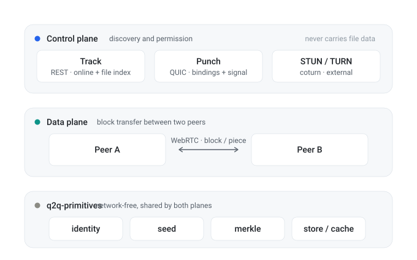
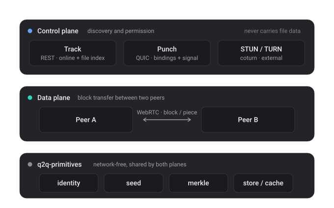
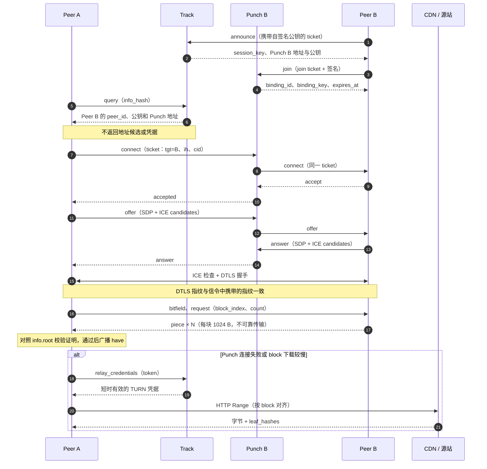

# Q2Q 是什么？

Q2Q 用于在 Peer 之间分发大文件和点播视频，优先走 P2P；Peer 不可用时再由 CDN 回退。网络中有三类程序共同参与：

| 角色 | 运行位置 | 职责 |
| --- | --- | --- |
| **Track** | 你部署的服务器 | 维护在线索引和文件索引、为 Peer 分配 Punch、签发 TURN 凭据 |
| **Punch** | 你部署的服务器 | 为在线 Peer 维护连接，并在请求连接的 Peer 与目标 Peer 之间转发信令 |
| **Peer** | 客户端 | 下载和上传文件，并按 block 决定使用 CDN 还是 P2P |

Track 和 Punch 属于**控制面**：它们帮助 Peer 发现彼此并建立连接，但不传输文件数据，也看不到文件内容。

控制面与数据面彼此独立，底层共用一套不依赖网络的 core：

Peer 与服务器之间的交互如下：

## 下载流程

1. **生成种子**：发布方根据文件长度、block 大小和 Merkle 根构造 info，并得到 `info_hash`。然后将 `.q2q` 种子文件分享给 Peer。
2. **宣告在线**：Peer 告知 Track 自己在线并持有文件。Track 记录带 TTL 的会话和文件信息，并为 Peer 分配 Punch。
3. **查询来源**：下载方询问 Track 哪些 Peer 持有目标文件。Track 返回候选 Peer 的 ID、公钥和对应的 Punch 地址。
4. **请求连接**：下载方通过目标 Peer 所属的 Punch 请求连接；目标 Peer 可以明确接受或拒绝。
5. **交换 offer/answer**：目标 Peer 接受后，双方才通过同一个 Punch 交换 SDP 和 trickle ICE candidates。
6. **传输数据**：数据通道建立后，双方请求、校验并写入文件块。P2P 较慢或不可用时，单个 block 可回退到 CDN。

## 设计取舍

**身份由 Peer 自行签名。** Peer 在本地生成密钥对，`peer_id` 由公钥派生。无需注册，也不需要服务器为身份背书。代价是没有身份撤销机制，因此 Peer 通过自签的短时有效 ticket 表达授权。

**先征求同意，再发送 offer。** Punch 会先询问目标 Peer 是否愿意连接，随后才开始交换 SDP。拒绝请求无需 ICE 收集、STUN 查询或分配中继资源；在大型网络中，多数连接尝试会被拒绝，这能减少不必要的工作。

**每个 block 独立选择来源。** 每个 block 都可以单独选择 CDN 或 P2P。刚加入网络的 Peer 可以先从 CDN 下载，同时成为其他 Peer 的来源。

**端到端校验。** 内容由签名种子中的 Merkle 根确定。Peer 返回的 block 若证明无效就会被拒绝，因此恶意 Peer 或恶意 Punch 都无法篡改下载内容。

## 术语

| 术语 | 含义 |
| --- | --- |
| `peer_id` | `base32(SHA-256(public_key))` 加校验码；Peer 的稳定标识 |
| `info_hash` | 规范化 info 字典的 SHA-256；内容标识 |
| `binding` | Punch 记录的 Peer 在线连接状态 |
| `signal_key` | 单次连接尝试使用的对称密钥；允许请求方在网络变化后恢复连接 |
| `cid` | ticket 中的一次性 ID；使用后即被消费，用于阻止重放 |

## 接下来

- [部署](./deploy)：运行 Track 和 Punch
- [Track](./track)：来源发现服务
- [Punch](./punch)：连接绑定与信令服务
