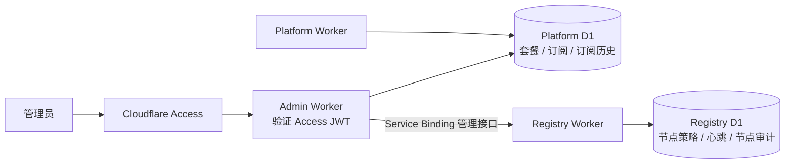

# Q2Q 管理后台

状态：共享 UI、Admin 只读基础版、数据库套餐目录及统一权限/配额读取代码已实现；套餐/订阅管理写操作与审计已实现；账号访问管理代码已实现；Punch 节点写操作已实现；线上迁移、Access 配置与部署尚未执行。后续按阶段确认后推进。

## 目标与现状

在 `admin.q2q.app` 提供运营管理入口，集中管理套餐定义、项目订阅、用户关联信息和网络节点。使用 `apps/admin`、SvelteKit、Cloudflare Workers 与 Cloudflare Access，复用 [共享 UI 计划](shared-ui.md)。技术栈与 platform 保持一致：Svelte 5、SvelteKit、TypeScript、Tailwind 4、shadcn-svelte、Lucide、npm workspaces 和 Cloudflare Workers；整体布局直接复用同一个 AppShell。

用户身份由 platform 的 Better Auth 维护，订阅绑定项目；套餐目录已迁入平台 D1，由 `@q2q/plans` 供两个应用复用。Registry 保存 Punch 心跳、持久分配策略及权威审计；凭据撤销尚未实现。当前实现范围以下文实施记录为准。

第一版不接真实支付、不远程执行服务器命令、不管理用户文件内容，也不把 Cloudflare 账户、Worker Secrets 或 DNS 管理搬进后台。TURN 暂无 Registry 心跳协议，不能直接录入并显示为在线。

## 页面与使用路径

侧栏：概览、用户、项目、套餐、网络节点、操作记录。底部展示管理员身份、主题和退出入口，不展示 platform 的项目切换器或用户套餐。

| 页面 | 主要内容与操作 |
| --- | --- |
| `/` | 项目数量、各套餐项目数、存储已用/预留、节点心跳状态；每项标注统计时间和数据来源，首版不展示未经计量的流量收入 |
| `/users`、`/users/[id]` | 按用户 ID/邮箱/姓名查询，查看基础资料、创建时间、登录提供方、账号状态、所属项目与角色及关联项目用量；支持禁用/恢复账号和撤销全部登录会话，套餐调整跳转到项目；首版不编辑 OAuth 绑定或冒充登录 |
| `/projects`、`/projects/[id]` | 项目 owner/成员、有效套餐、订阅来源/状态、存储已用/预留、订阅变更历史；从详情执行人工套餐调整 |
| `/plans`、`/plans/[id]` | 查看和直接编辑 Free/Creator/Team 的功能与额度，查看变更记录；首版不任意新增 plan ID |
| `/nodes`、`/nodes/[id]` | 分页查看 Punch 的声明地址、公钥、版本、最近心跳、可用指标及策略历史；执行停止新分配/恢复 |
| `/audit` | 按操作者、对象、操作类型、时间筛选操作记录，查看脱敏后的变更前后值、原因和结果 |

列表采用服务端分页、搜索和筛选；详情页承载编辑操作。避免在列表里放可误触的额度或节点状态开关。

人工调套餐流程：查找项目 → 查看当前使用与套餐 → 选择套餐及有效期 → 展示变更后的额度与超额影响 → 填写原因 → 确认提交。成功后展示真实生效结果与审计记录链接。降级不自动删除文件，沿用平台的恢复、导出和清理路径。

节点停止流程：进入详情 → 查看服务类型和当前状态 → 选择停止新分配并填写原因 → 确认 → Registry 将该节点标记为不接受新分配，保留身份供旧会话续期。页面明确说明：这不终止现有连接，不停止服务器进程，也不立即清除 Track 已缓存的发现结果。

## UI 风格与 Platform 对齐

- Admin 沿用 platform 现有视觉语言：Svelte、shadcn-svelte、Lucide 及共享 UI 包，不另建一套后台主题。
- 颜色、字体、字号层级、间距、圆角、边框、阴影与按钮 variant 使用 platform 的现有样式和共享 token；保持简洁、接近 Apple 原生的表现。
- 侧栏、页面标题、内容宽度、详情元数据、菜单、确认弹窗及移动端抽屉与 platform 保持一致；导航和业务内容按 admin 职责配置。
- 支持浅色、深色及跟随系统，保存主题偏好，默认跟随系统。共享主题修改须同时检查两个应用。
- 表格与表单根据管理任务安排信息密度，沿用统一的控件尺寸、焦点状态、错误提示、加载/空状态和危险操作确认方式，不为后台另设一套交互规范。
- 文案沿用平台中英文国际化方式；共享组件从应用接收文案，避免包内绑定某一应用的翻译字典。
- 验收时对照 platform 检查桌面与移动端、浅色与深色，以及菜单、表单、弹窗、空状态和错误状态；提供实际页面截图供用户 review。

## Access 与应用权限

- Cloudflare Access 为 `admin.q2q.app` 配置精确允许的管理员身份，首版采用人工维护的身份白名单，默认不允许整个邮箱域。
- Admin 服务端验证 `Cf-Access-Jwt-Assertion` 的签名、允许算法、issuer、对应应用 audience 和有效期；公钥从配置的 Access 团队证书端点获取并缓存。不能只信任邮箱头或客户端传入的身份。
- 登录主体使用验证后的 Access issuer + subject 标识；邮箱只用于展示。首版只有一个管理员角色，暂不建立后台自助邀请/授权系统。
- 所有页面与写入口统一鉴权；关闭生产 `workers.dev` 和预览 URL。即使通过其他入口访问，缺少有效 Access JWT 仍须拒绝。
- 写操作只接受 POST 等写方法，校验同源/CSRF，服务端验证字段与权限。错误、重试和页面刷新不重复执行变更。
- 本地与生产均校验 Access，不提供模拟管理员开关；身份校验失败时拒绝访问。
- 自动化服务身份不继承交互管理员权限；将来确有需求时单独设计权限和入口。

## 服务与数据边界

- Admin 绑定平台 D1，用于平台业务查询和受控写入；平台 D1 同时保存 `registry_request` 请求意图和结果缓存，不新增 Admin 数据库。平台业务变更与对应历史记录写在同一个平台 D1 事务中。
- Registry 保有节点策略和运行状态的权威管理权。Admin 不直接改 Registry 心跳表，通过私有 Service Binding 管理入口调用；公开 `fetch` 路由不暴露该管理入口，现有 platform 只读 token 不获得管理权限。
- 管理入口使用命名 RPC `PunchManagement`；绑定调用者仅配置为 Admin Worker。操作携带请求 ID 和已验证的操作者身份，Registry 自行校验字段并持久化结果。
- 套餐数据访问与验证规则需供 platform/admin 复用，放入职责明确的服务端共享包；不放入 `@q2q/ui`，不让 Admin import platform 私有源文件。
- 数据库迁移按归属管理：平台业务及 Admin 请求意图表归 platform，Registry 表归 registry。部署流水线必须先迁移兼容结构，再发布依赖它的应用。

## 用户管理

- 用户详情展示账号状态、禁用时间与原因，项目列表展示角色、套餐和存储已用/预留；这些用量属于项目，不重复汇总为用户独占资源。
- 支持禁用/恢复账号与撤销全部登录会话，两类写操作均须填写原因、确认提交并记录审计，支持请求幂等与并发冲突处理。
- 禁用状态以 platform D1 中持久字段为权威，覆盖 Better Auth 登录/新会话签发和平台所有受保护的服务端入口；不能只隐藏前端页面或删除当前 session。具体 hook 与会话撤销方式在实现时核对当前 Better Auth API。
- 禁用与删除用户现有全部 session 在同一数据库事务提交；登录与禁用的并发仍须由账号状态检查兜底，禁用后新建的 session 不能取得平台访问权限。
- 禁用保留用户、项目和文件，不改变项目成员关系或套餐，不中断其他成员的正常访问。确认页列出该用户作为 owner 的项目，提示恢复前其本人无法继续管理这些项目。
- 禁用不等于撤回已经签发的下载授权、停止独立 CLI/Peer 连接或取消已提交的后台处理任务；这些资源沿用各自生命周期，界面明确说明账号禁用的作用范围。
- 恢复仅解除账号禁用状态，不恢复已撤销的 session；用户重新通过 OAuth 登录。
- 撤销全部登录会话保留账号可登录状态，删除该用户现有平台 session，使其后续请求重新认证；不撤销身份提供方自身的登录或 OAuth 授权。操作后的正常重新登录允许创建新 session。
- 不提供密码重置、修改 OAuth 绑定、冒充登录或一键删除用户。删除账号需另行确定项目归属、团队 owner 转移和文件清理规则。

## 套餐定义与订阅

- 保留 `free`、`creator`、`team` 三个稳定标识，以数据库套餐目录保存功能、单文件限制、总存储额度、revision 及更新时间。当前尚未正式发布、没有服务用户，不引入套餐版本绑定或草稿发布流程。
- 已发布套餐允许直接修改；保存后，所有使用该套餐的项目在后续服务端权限及配额校验中采用新定义。保存前展示受影响项目数量、额度变化与超额影响，记录修改原因及前后值。
- 项目无订阅或订阅失效时使用当前 Free 套餐定义。修改 Free 套餐会影响这些项目，确认页必须明确提示影响范围。
- 迁移时以现有代码额度初始化套餐目录，保留已有订阅的 planId；无订阅项目继续走 Free。迁移后缺失有效目录时返回可解释的服务错误，不能静默放宽限制。
- 编辑校验功能 key、整数范围、容量单位和平台实际处理上限。未知功能、负数和超出已支持能力的额度不可保存；尚未定义的流量/保留期等额度显示“未配置”，不能解释为无限。
- 订阅保存来源（人工、模拟，预留支付）、状态、planId、生效/到期时间、操作者和原因。人工授权不伪装成付费购买，也不写成模拟订阅；原有模拟流程迁移后仍受显式环境开关控制。
- 服务端统一解析状态与时间；到期后回退 Free。读取权限和上传 SQL 使用一致的生效条件，不能只靠后台定时任务改状态。
- 上传预留额度仍在 INSERT 中原子判断，改为在同一 SQL 中读取有效订阅对应套餐或 Free 套餐；不能先读额度再写预留。套餐直接编辑、并发降级、到期与上传必须覆盖回归验证。
- 套餐编辑和订阅调整带 revision，过期页面提交返回冲突并要求刷新。相同请求 ID 重试返回原结果。

## 节点策略与运行状态

- 新增独立持久化节点管理策略，按 node ID 保存服务类型、启用/停止新分配状态、备注、revision 和更新时间；心跳不得覆盖管理状态。
- 在线/过期由服务端时间与心跳 `expires_at` 计算，管理状态另列展示；没有心跳显示“尚未上报”，不能用管理启用推断在线。
- Registry 的心跳接收、展示和发现查询整合策略；停止新分配首先作用于 Punch discovery。Workers Track 使用该标记筛选新 Peer，已有会话继续按身份与租约续期。
- 首版兼容现有合法 token 节点的注册行为；管理策略默认允许，停止时强制标记不接受新分配，保留身份供旧会话续期。未知节点入网审批、拒绝列表清理等后续再设计。
- 首版不允许在后台直接编辑节点地址、公钥、identity_version：这些字段与现有签名 token 的 claims 绑定。修改它们需要完整身份和凭据轮换流程，不能只改数据库。
- 首版凭据继续由现有离线工具签发，私钥不上传后台。在线签发、单 token 撤销、身份轮换和密钥轮换列为后续独立阶段；页面不提供无法兑现的“撤销凭据”按钮。
- TURN 的资源清单、凭据与状态采集另行设计，初版节点页仅支持 Registry 已有的 Punch。

## 操作记录与失败恢复

- 所有写操作记录唯一请求 ID、Access 主体、对象、动作、原因、变更前后值、时间与结果；不保存 JWT、OAuth token、服务 token 或私钥。
- 同库变更与历史记录通过事务原子提交；跨 Registry 调用先记录待执行操作，由 Registry 以请求 ID 幂等执行并同库写审计。
- Admin 遇到超时显示“结果待确认”，通过请求 ID 查询实际结果后更新本地记录；不能把超时直接显示为操作失败，也不能盲目重复修改。
- 首版审计支持分页查看，不在管理界面提供修改/删除；记录保留期及归档方案在上线前确定。应用级审计不宣称能防止数据库管理员直接改库。

## 部署准备

- Access 团队域、身份提供方、允许的管理员、Admin 应用 audience 与域名策略。
- Admin Worker 自定义域名、平台 D1 绑定与到 Registry 的 Service Binding。
- Access JWT issuer/audience 属于配置；私钥及令牌仍使用 Worker Secrets，不写入仓库或浏览器。
- 独立 admin CI，按应用路径部署；共享 UI/服务端包变更触发对应消费方检查，生产数据库迁移及首次上线顺序明确记录。
- 首次开放前验证：未登录、非白名单、伪造/过期/错误 audience JWT、旁路域名、跨站写请求均被拒绝；正常管理员可完成查询及一次可追踪的写操作。

## 执行阶段

每阶段完成后汇报结果与下一阶段内容，用户确认后继续。

1. [x] 完成共享 UI 第一批提取，见 [shared-ui.md](shared-ui.md)。
2. [x] 搭建 Admin Worker、Access 验证和导航，接入只读用户/项目/订阅/节点查询，完成独立 CI；此阶段不提供写按钮。
3. [x] 套餐目录数据库迁移与共享 entitlement 解析，改造原子配额 SQL，接回 platform 与模拟套餐流程；先保证现有行为兼容。
4. [x] 实现套餐直接编辑与保存、项目人工订阅调整、同库审计、幂等和并发冲突处理。
5. [x] 实现用户禁用/恢复与撤销全部登录会话，接入统一账号状态校验；验证禁用用户的旧会话、新登录、直接 API 请求均无法访问，恢复后必须重新登录，其他项目成员仍正常访问。
6. [x] 仅为 Punch 实现 Registry 内部管理接口、节点持久策略、停止新分配/恢复及跨服务操作结果确认；Track Worker 的部署由 Cloudflare/CI 管理。
7. [ ] 完成代码层 UI、安全与业务边界 review、部署说明和上线配置核对；按用户要求跳过云环境浏览器交互与截图，实际 Access/OAuth 及页面验收留待部署后。

后续阶段：真实支付、细分管理员角色、凭据签发/撤销与轮换、TURN 资源、可信流量计量、告警和批量操作。它们不作为第一版上线前置条件。

## 只读基础版实施记录

- 新增 `apps/admin`，与 platform 共用 AppShell、主题、Brand、基础组件、主题切换和语言选择器。导航、管理员账号区及业务数据由各应用提供。
- Access JWT 在全局服务端 hook 验证；缺少配置、无断言、无效断言均拒绝访问，无开发管理员旁路。生产关闭 workers.dev 和预览 URL。
- 已实现概览、用户/项目搜索与分页、用户/项目详情及关联记录分页、套餐只读目录、Registry 分页心跳查询；操作记录页明确标注尚未接入。
- 将现有代码套餐目录、单文件上限及 entitlement 读取提取为 `@q2q/plans`，供两边共用，保持现有规则。该只读基础版当时尚未包含数据库目录与时间生效规则，后续实施结果见下节。
- 已新增独立 Admin CI；共享 UI/plans 通过 npm 依赖闭包触发两个应用，平台 migrations 也触发 Admin。部署需要显式配置 Access 团队域和 audience，不使用默认身份配置。
- 本地验证：两个应用 Svelte 类型检查和生产构建通过；Access 校验 12 项、Admin SQLite 查询 3 项、platform 存储配额 14 项及成员邀请 7 项回归通过；验证共享包变更只影响实际消费方。
- 按用户要求未做浏览器交互或截图验证。未执行线上部署，未宣称生产 Access 策略已验证。配置步骤见 [Admin README](../apps/admin/README.md)。

## 套餐目录与权限配额实施记录

- 新增平台 migration `0017_plan_catalog.sql`，初始化 Free/Creator/Team 的现有额度与功能，保留订阅记录与 planId；套餐可原地编辑，预留 revision 用于后续并发编辑校验。
- `@q2q/plans` 统一读取并校验数据库定义，只保留稳定标识、翻译 key 和上传协议绝对上限在代码中。未配置的产品限额仍为 null，不表示无限。目录不完整或不合法时返回 503，不回退代码额度。
- 生效订阅统一按 active/simulated 及开始/结束时间解析；开始包含边界、结束不包含边界，空时间表示对应方向无时间边界。未生效、到期及其他状态均使用当前 Free 定义。
- 上传预留在同一 SQL 中读取当前套餐的存储能力、单文件上限、总额度及已用/预留空间。邀请创建和接受也以同一规则读取协作能力，移除硬编码 Team 判断。
- platform 的套餐页、模拟切换后读取，以及 admin 的套餐目录、项目列表、概览、详情已接入共享数据源；账号禁用和所有管理编辑入口仍未实施。
- 本地 SQLite 验证：21 项存储配额检查、8 项成员邀请检查、6 项 Admin 查询检查通过，涵盖旧订阅迁移、目录修改即时生效、到期边界、并发修改与缺失配置。platform 与 admin 类型检查和生产构建均通过。
- 发布前必须先应用兼容迁移；两个 CI 在部署前验证目录表存在，避免新应用先于 schema 发布。迁移操作与线上部署尚未执行，步骤见 Admin README。

## 套餐与订阅写操作实施记录

- 新增 `/plans/[id]` 编辑页、项目详情人工调套餐表单及 `/audit` 列表/详情，使用现有共享组件与主题。提交前展示修改摘要、影响和原因，保存后可跳转对应操作记录。
- 新增 migration `0018_admin_operations.sql`：订阅 revision、自动推进旧写入口 revision 的触发器、平台 D1 操作审计表及提交状态校验。业务修改与审计由同一 D1 batch 提交；无跨库事务假设。
- 管理员身份仅从 Access 校验结果获取，动作入口额外校验同源。额度、功能、UTC 时间、修改原因和请求编号由服务端验证。人工调整统一标记 provider=manual，不伪装成模拟或付费来源。
- 套餐 revision、订阅 revision 以及人工调整的所选/Free 套餐 revision 均参与冲突判断。相同操作者、请求编号和内容的重复提交返回原结果；请求编号复用到其他内容或身份被拒绝。
- 操作结果不确定时保留请求编号与原表单，允许查询审计或原样重试。审计支持操作者/对象/请求编号、动作及 UTC 日期过滤，保存原因、前后值与套餐快照，不提供修改/删除入口。
- 新增事务/并发/重试/回滚与审计回归 15 项、请求边界与未知结果处理 3 项；Admin 完整回归、两应用类型检查和生产构建均通过，platform 的 21 项配额与 8 项邀请回归通过。未进行浏览器交互和线上部署。
- 下一项为账号禁用/恢复和撤销全部会话；节点管理仍待后续确认。

## 账号访问管理实施记录

- 用户列表与详情展示账号状态、禁用时间/原因、有效平台会话和 owner 项目数量；新增禁用/恢复及撤销全部登录会话表单，复用确认摘要、原因、审计和幂等机制。
- 新增 migration `0019_user_access.sql`，保留现有账号、会话和操作记录，为用户访问修订号、禁用状态及会话版本提供默认值。账号状态修改、版本推进、会话删除和审计同库提交；删除失败时整体回滚。
- 当前 Better Auth 数据库 hook 使用服务端版本签发会话，版本字段禁止客户端输入并隐藏返回；关闭 cookie 会话缓存。数据库触发器验证插入/更新时的版本和禁用状态，全局请求 hook 再检查会话、账号、到期时间与版本。
- 恢复不复活已撤销会话，需重新登录；单独撤销后账号仍可登录。新版本会话允许正常重新签发，旧版本在并发场景中不能恢复访问。
- 保留项目、文件、成员及套餐，其他成员访问不受影响；已授权的在途请求、下载授权、独立连接与后台任务不追溯取消。平台账号控制不变更管理员的 Access 资格或身份提供方授权。
- 已验证 11 项账号访问回归及当前安装 Better Auth 的真实 SQLite 会话写入，包含旧数据迁移、其他成员隔离、并发签发、恢复/撤销、回滚和审计。平台的配额/邀请回归通过，完整 Admin 回归、两应用类型检查和生产构建均通过；未进行浏览器或线上 OAuth/Access 验收，未执行远端迁移及部署。
- 下一项为 Registry 节点持久管理策略和管理入口，待用户确认后实施。

- 时间兼容补充：真实 Better Auth SQLite 写入使用 ISO 文本，历史/本地数据也可能为毫秒数。账号校验与有效会话计数由 `@q2q/accounts` 共用转换规则，覆盖毫秒到期边界；Admin 日期展示兼容两种格式，避免真实账号列表日期解析失败。

## 节点管理范围调整

用户确认 Track 已迁至 Cloudflare Workers，远端 main 已有 `apps/track`。下一项仅管理 Punch 的发现策略与审计；Track Worker 的部署和实例生命周期不作为节点管理功能。已同步 `799c68d` 并按 Workers Track 的发现与续期行为完成适配。

## Punch 管理实施记录

- 已同步远端 main `799c68d`（Workers Track / Registry RPC），保留此前全部本地改动；解决 CI 脚本、platform 工作流/包配置及锁文件四处冲突。同步前 stash 保留为备份。
- 仅管理 Punch。新增 `@q2q/punch-management` 契约、Registry 私有 `PunchManagement` 入口，以及独立策略和审计表；公网管理路由/管理 JWT 权限不新增，Track 的只读入口不获得写权限。
- 停止/恢复按策略 revision 原子提交，同请求幂等并绑定原操作者。HTTP 与 RPC 共用新分配标记规则，心跳和租约不覆盖管理状态；Workers Track 已有缓存最长 60 秒，连接、进程与凭据不被撤销。
- Admin 新增节点详情及确认表单，展示管理状态与心跳状态、身份只读信息。平台 D1 `registry_request` 先持久保存意图，Registry 成功后存储结果；超时/断链保持待确认，可查询实际审计或由原操作者原样重试。
- 新增 Registry migration `0003_punch_management.sql`、平台 migration `0020_registry_requests.sql`。CI 检查表存在，Admin 主分支发布等待同提交 Registry 成功；远端迁移与部署尚未执行。
- Registry 策略、HTTP/RPC 权限与过滤回归通过，Workers Track 发现兼容检查通过；Admin 结果跟踪回归覆盖重复请求、响应丢失、不可用、冲突及不匹配响应。最终完整检查记录在收尾时更新，未做浏览器验证。
- 下一项为整体 review、部署配置与上线准备，待用户确认。

- 新 Track 续期也依赖发现目录：管理停用不删除活跃节点身份，而是强制 accepting_new_connections=false。界面使用“停止新分配”，已有会话仍可续期，新 Peer 无法选中该节点；身份变化/租约过期继续按原规则失效。

## 整体 review 与部署准备

- 已核对 Access 全局鉴权、写操作同源检查与操作者来源、字段验证、revision、同库原子审计及跨 Registry 待确认/原样重试边界；未增加认证旁路。
- Admin 和 platform 共用 AppShell、主题与基础控件。共享确认弹窗补充视口高度限制、滚动及摘要换行，避免长操作原因遮挡确认按钮。
- 修正 Admin CI 总超时为 30 分钟，留出检查、构建及等待 Registry 的时间；共享等待脚本改动纳入 Admin 影响检测，等待日志改为通用 RPC 消费者表述。
- 部署步骤统一在 [Admin README](../apps/admin/README.md)：Access 白名单与 audience、GitHub 配置、绑定核对、备份和兼容迁移、发布顺序、失败恢复及部署后验收。无独立 Admin D1，无管理 JWT。
- 部署前先完成数据库迁移；新 Platform 发布成功前不开放后台写操作，以免旧平台尚未执行账号访问控制。CI 不自动应用迁移。
- 本轮进行代码 review 和 Svelte 静态检查，未新增或重跑测试套件，未执行远端迁移、Access 修改或部署；浏览器截图、线上身份及业务验收仍待维护者在可用环境完成。因此阶段 7 不标记为全部完成。
