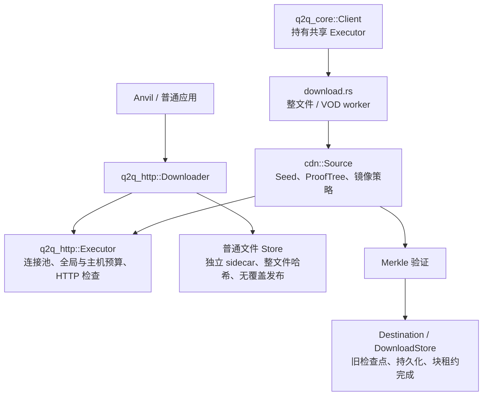

# 通用 HTTP/CDN 下载能力

状态：已按确认方案完成实现与 Linux 本地验收，提交 PR 进行远端 CI 验证；各平台结果以 PR 检查为准。

## 目标与已确定的边界

新增独立 crate `q2q-http`，为 Anvil 等应用提供通用 HTTP 下载，不要求 Q2Q Seed、节点身份、Track、Punch 或 WebRTC。依赖方向为 `q2q-core → q2q-http`，库使用调用方的 Tokio runtime，不启动后台服务。

库提供两个入口：Executor 执行一次有界、可流式消费的 HTTP 请求；Downloader 在同一执行机制上提供多文件准入、Range、校验、重试、恢复和发布。普通整文件哈希不能代替 Q2Q 的 Merkle 根，暂存范围也不等于已经验证的 Q2Q 块。

完整公共 API、示例与使用限制维护在 [中文 HTTP 指南](../docs/zh/guide/http.md)、[英文指南](../docs/en/guide/http.md) 和 [crate README](../crates/q2q-http/README.md)，本记录维护架构决策、实施与验证状态。

## 实际模块与调用关系

| q2q-http 模块 | 职责 |
| --- | --- |
| executor.rs | 共享 reqwest 连接池、全局/host:port 请求预算、逐跳重定向、期限及响应检查 |
| downloader.rs | 文件准入、镜像/重试、范围调度、进度、取消和 worker 清理 |
| store.rs | 稳定目标锁、暂存文件、原子恢复记录、持久化顺序与目标发布 |
| checksum.rs / error.rs | SHA-1/SHA-256、错误分类与脱敏 |

响应对象由 `send().await` 返回，调用方选择 chunk、collect_exact 或 collect_bounded。请求额度保持到经过校验的 EOF、错误或 Drop。收集不能提高原先设定的响应大小上限。普通文件的 Range 收集受块大小限制，大文件完整 GET 流式写盘。

## q2q-core 的具体接线

`client::Builder::build()` 创建 Executor 并保存到 Client，构建不联网。`http_request_limit` 默认 16，为正数，独立于每个 Transfer 的 max_download_peers。core 的证书调试开关继续传到 Executor，默认保持 TLS 验证。

整文件和 Reader/VOD 路径从 Client 克隆 Executor，传给 cdn_all / cdn_window，再传给 Source::load；Source 的镜像句柄共享同一连接池和请求额度。后台任务持有自己的克隆，Client 释放不会提前拆除仍在使用的下载资源。不同 Client 不共享进程级预算。

叶子表调用链：Source::load → Executor 完整 GET（确切叶子表长度）→ core 解析并重建 ProofTree → 与 Seed 根匹配。有合法内联叶子表时不发该请求。

文件块调用链：WorkQueue::claim_cdn → Source::fetch → Executor 严格 Range → core Merkle 验证 → Destination::commit → DownloadStore 同步数据与证明 → BlockLease::commit。HTTP 成功不能提前增加 verified_bytes，不能先走普通 Downloader 的 .part 文件再复制到 Q2Q 目标。

Executor 不做隐藏重试，包括关闭 reqwest 的默认协议 NACK 重试。普通 Downloader 拥有有界重试策略；core 继续使用原有整文件/VOD 来源策略。服务器忽略 core 的局部 Range 时明确失败，不执行普通 Downloader 的完整 GET 回退。ActiveCdnRequest 保留逻辑操作统计，不能解释为精确套接字数量。

取消请求、响应读取或额度等待会释放 HTTP 资源并归还 core 块租约；已开始的 core 阻塞提交仍由既有 Destination/TaskScope 管理。Merkle 验证失败、磁盘错误和其他来源错误继续按原边界处理。旧 Seed、wire、Q2Q 检查点和公开下载签名保持；新增 BuildError::Http 会影响穷举匹配。

Track 的 control.rs 仍使用独立 HTTP 客户端，避免内容下载占满预算后阻塞控制面；因此 core 的 reqwest 依赖保留。此次共享的是 CDN 内容与证明表的数据下载执行器。

## 普通文件的校验、恢复与发布

DownloadRequest 需要目标、地址、明确长度及 SHA-1/SHA-256，元数据获取、安装与解包归应用。未知长度元数据可以用 Executor 有界读取，不伪造长度进入文件 API。

文件间并发和大文件 Range 共用全局预算，磁盘/哈希另有上限。一个文件的 Range 失败时取消该轮其他请求并等待 worker/阻塞 I/O 退出，再决定重试、镜像切换或完整 GET；一个文件失败不停止无关任务。

普通暂存范围只有接收/持久化意义，最终整文件哈希匹配前不提供可信读取或共享。进度分别统计网络接收、暂存唯一字节、校验字节及任务状态，失败重置范围时同步更正暂存进度。

恢复记录使用独立版本及 .q2q-http.resume 后缀，绑定规范化目标、大小、哈希、区间布局、来源摘要及强 ETag，不存授权 URL。数据同步后才提交范围记录；坏检查点不静默覆盖。跨进程使用稳定 .q2q-http.lock 和操作系统排他锁，取消/崩溃由实际资源生命周期释放锁，不以文件存在判断忙。

相同来源、强 ETag 未变的部分范围可以恢复；缺少/变化的验证信息、切换镜像时保守重下，最终仍校验整个文件。暂存损坏导致哈希不符时在有界策略内重下；完整目标不匹配则明确拒绝覆盖。普通完整 GET 不恢复未完成前缀。

发布在同目录使用硬链接建立目标，避免先检查再 rename 的覆盖竞态；不支持硬链接的文件系统返回存储错误，不降级为覆盖。Unix 同步目录，Windows 的断电持久性需按系统语义评估。发布已成功时不因晚到取消改报取消；崩溃留下的已发布目标经重新校验后可清理属于同一请求的 sidecar。

## 默认值与明确限制

独立 Downloader 默认 8 个活跃文件、16 个 HTTP 请求、每 host:port 8 个、2 个磁盘/哈希任务；8 MiB 起尝试 Range，默认块大小 1 MiB、每文件 4 个范围 worker。最多 65536 个范围、单块 8 MiB 和 16 个范围 worker。默认块大小对应至 64 GiB，可在上限内调整。

Executor 默认收集上限 8 MiB、总期限 20 秒（包含准入等待、重定向及响应读取）、连接期限 5 秒、3 次重定向，使用系统证书库并保持验证。core 每 Client 总 HTTP 上限为 16、单任务上限沿用 max_download_peers；多任务受到新增总额度约束，属于明确资源行为变化。

本轮不增加 CLI 下载子命令、GUI、Minecraft 解析、无哈希文件模式、部分可信读取或任意传输/存储插件接口。Windows/macOS 的实际结果需由相应平台 CI/运行给出，不用 Linux 本地通过替代。

## 实施清单

- [x] 独立 q2q-http、两个 API 层与示例，不依赖 P2P crate。
- [x] core Client、整文件、VOD、叶子表和镜像接入同一 Executor。
- [x] 普通文件、批量准入、SHA-1/SHA-256、进度、取消、重试与无覆盖发布。
- [x] Range、忽略 Range 回退、独立恢复记录、强 ETag、目标锁及磁盘失败隔离。
- [x] 中英文指南、crate README、架构约定与三平台 CI 配置。
- [x] 最终本地回归与检查结果记录。

## 验证记录

- 最终 `cargo test --workspace --all-features --locked --offline`：474 项通过，15 项按原配置忽略，包含外部环境与手动基准测试，未把忽略项视为通过。
- `cargo clippy --workspace --all-targets --all-features --locked --offline -- -D warnings`、`cargo fmt --all -- --check` 和差异空白检查通过。
- 中英文文档构建通过；有原站点的大 bundle 提示，未影响构建。
- 新库包含 14 项文件下载/恢复测试、7 项 Executor 测试及 2 项文档编译测试。覆盖包括取消、丢弃 wait、强退进程后恢复、ETag 变化、坏检查点、暂存损坏、磁盘故障禁止后续写入、无覆盖发布、响应上限和混合读取 API 边界。
- core 新增跨来源与叶子表共用 Client 额度及取消隔离验证，原有 CDN、VOD、Peer、检查点和部分共享回归通过。
- 本地批量场景：128 个 1 KiB 文件和 4 个 1 MiB 文件，共 4,325,376 字节，同一个 Downloader 使用 4 个活跃文件、4 个 HTTP 请求上限完成；验证内容及请求峰值，没有把此功能规模检查当作生产性能基准或 RSS 测量。
- 仓库外独立 Rust consumer 仅依赖 q2q-http，离线编译通过；正常依赖树没有 core、primitives、Track、Punch 或 WebRTC。
- 真实 HTTPS：使用新增示例和 resume API 下载 Mojang 官方 1.21.1 client.jar，共 26,836,906 字节，整文件 SHA-1 与官方预期 30c73b1c5da787909b2f73340419fdf13b9def88 匹配，并以独立 sha1sum 再次核对。最初发现内置证书列表不信任环境代理 CA，改为系统证书库后通过，全程未关闭 TLS 校验。
- Windows/macOS/Linux CI 已配置，但远端尚未执行；不能声称 Windows/macOS 行为已验证。目标发布依赖支持硬链接的文件系统，Unix 有父目录同步，Windows 断电语义未在本机验证。

尚未发布版本或修改 Anvil 实现。Anvil 可以在后续工程阶段直接引用此 crate；正式公共 API 和接入示例以上述指南及源码为准。
