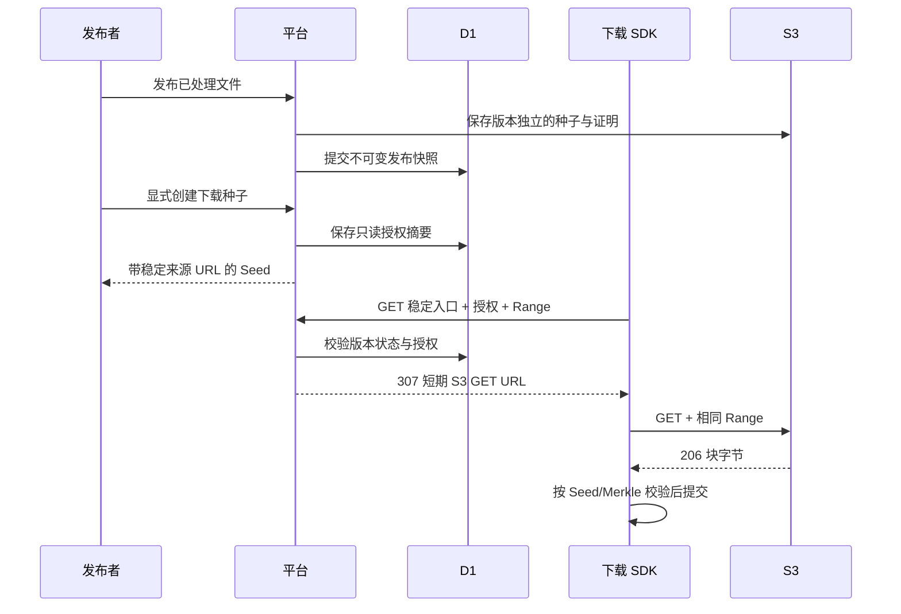

# 内容发布与下载授权

本文是下一阶段的实施方案，尚未实现。处理完成不等于发布；已有种子下载仅提供带内嵌证明的处理产物。

## 第一版范围

1. 固定不可变的发布版本，提供发布与撤回操作。
2. 显式导出带下载授权的种子，SDK 无需网站 Cookie 即可下载。
3. 平台稳定入口校验授权，签发短期 S3 GET 链接，数据由 S3 直接返回。
4. 用真实 q2q SDK 完成下载及内容校验。

本阶段不接官方做种节点、Track announce、计费、匿名公开搜索或跨项目去重。

## 版本与权限

- 发布版本使用独立 ID；快照固定项目、文件、上传会话、info_hash、原对象键、存储配置身份、版本号/ETag、大小及种子摘要。
- 第一版由文件创建者或项目 owner 发布、撤回和管理下载授权；成员可查看发布状态，不能因能够查看文件而自动获得对外分享权限。
- 发布本身不开放匿名读取。导出下载种子是单独的显式操作，界面说明「拥有此种子的人可在授权有效期间下载」。
- 已发布版本不原地替换内容。撤回后如需重新发布，生成新发布 ID，不恢复旧授权。
- 使用调用方生成的 UUID 作为发布幂等键；重复提交返回相同版本。第一版同一文件最多一个处于 creating/published 的版本，失败可重试、撤回后可新建。

### 发布与产物保存

处理任务的产物可能因重试而清理，因此不能直接作为发布版本的永久引用：

1. D1 登记 creating 意图并固定来源快照，与文件删除互斥。
2. 将已验证的 Seed 和证明表保存到发布版本独立的不可复用对象键，记录大小与摘要。
3. 确认快照和产物后条件提交 published。失败保留可重试状态，不对外返回半完成版本。
4. 撤回只改变发布状态；原文件、产物和已下载内容不是同时删除。

删除原文件前必须检查发布引用；creating/published 引用禁止删除，已撤回版本还需等待已签发链接的最长有效期。独立产物清理和孤立对象扫描另列后续任务，不把跨 D1/S3 操作视为事务。

## 下载授权

建议第一版采用可撤销的随机 bearer 授权：

- 作用域只包含一个发布版本的读取，不能列文件、上传或访问其他版本。
- 原始随机 secret 仅在创建授权并导出种子时使用；数据库保存不可逆摘要、授权 ID、创建者、时间及撤销状态。
- 每次导出下载种子创建一份独立授权。授权列表支持辨识和撤销；不通过 GET 请求创建授权，也不要求数据库可恢复原始 secret。
- 建议默认长期有效、可主动撤销，发布界面明确展示这一规则；若后续支持到期时间，由授权记录控制，不改内容协议。该默认值属于本方案建议，尚未写入产品长期约定。
- 种子的 cdn_list 使用固定的版本与授权入口 URL；不写 S3 长期密钥，不把短期签名 URL 作为长期来源。
- 带授权的种子本身具有读取权限。应用日志、错误、进度展示和 Referrer 不能泄漏完整授权 URL；下载相关响应使用 private/no-store，避免缓存授权跳转。
- 撤销授权或撤回发布后，平台立即停止签发新链接。已签发的 S3 链接在过期前仍可能有效；已经下载的字节或其他节点的副本不能被远程收回。

## 数据路径

### S3 与请求约束

- GET 签名有效期建议不超过 5 分钟；稳定入口每次请求重新授权，禁止缓存 307。原文件字节不经过页面 Worker。
- 入口仅服务已固定的对象，不接受客户端指定 bucket、endpoint 或对象键。
- 有版本号时固定 versionId。没有版本号时使用唯一对象键，签发前 HEAD 核对 ETag 和大小；HEAD 与 GET 不具备原子版本锁定，最终依靠 Seed 根校验拒绝被替换的字节，不能宣称已消除该竞态。
- 支持单段 Range 并检查越界、多段及非法值；签名条件与 SDK 实际发送的头保持一致。测试重定向后 Range 不丢失、206/Content-Range 正确。
- 平台读取 S3 元数据时继续拒绝跟随签名请求的重定向；客户端只访问由服务端固定配置生成的目标。

## 种子与 SDK

- 复用 q2q-core 的 Seed 编解码，经 @q2q/wasm 添加来源列表；不在 TypeScript 重写 bencode。
- 导出前后 info 字典和 info_hash 必须一致。带不同授权的种子可以具有不同编码，内容身份仍相同。
- 第一版保留内嵌叶子表，SDK 不依赖外部证明地址。后续外置证明时，proof_list 使用同一版本/授权体系，不能固化短期 S3 URL。
- 当前 SDK 的 cdn::Source 对各块使用原始来源 URL，允许最多 3 次重定向，使用 identity 编码并校验响应范围和内容。验证后才能认为平台 307 入口兼容。
- 审计并禁止重定向携带包含 secret 的 Referer，检查敏感 URL 的日志与错误脱敏。
- 若短期链接过期，后续块或有界重试应重新请求稳定入口；授权已撤销时明确失败，不能无限重试或偷偷切回匿名访问。

## 接口草案

| 接口 | 职责 |
| --- | --- |
| POST /api/files/:id/publications | 幂等创建发布版本 |
| GET /api/files/:id/publications | 查询文件的发布版本 |
| GET /api/publications/:id | 查询版本及状态，要求项目成员 |
| DELETE /api/publications/:id | 撤回版本，保留快照与审计信息 |
| POST /api/publications/:id/download-grants | 创建只读授权并返回下载种子，要求管理权限 |
| GET /api/publications/:id/download-grants | 查询授权元数据，不返回原始 secret |
| DELETE /api/publications/:id/download-grants/:grantId | 撤销授权 |
| GET /api/publications/:id/content?grant=… | 稳定数据入口；读取授权绑定版本后签发短期 S3 URL |

GET 数据入口不依赖网站登录态；版本管理接口沿用会话、成员关系、写操作 Origin 校验。GET 种子处理产物的现有接口保留，不与导出下载授权混用。

## 实施与验收顺序

- [ ] 发布版本表、状态转换、幂等及文件删除引用保护
- [ ] 独立发布产物保存、来源快照固定与发布/撤回界面
- [ ] 下载授权、Wasm 来源装配与稳定 GET 入口
- [ ] SDK 重定向、Range、Referer 与过期重试兼容性
- [ ] 本地平台 + 测试 S3 + 真 SDK 下载，逐字节和根校验
- [ ] 覆盖重复发布、跨项目/跨账号访问、撤销、撤回、快照变化及处理中失败恢复

所有授权和发布写操作在实际实施与验证前都不标记完成；本阶段不会自动发布已有测试文件或创建分享授权。
