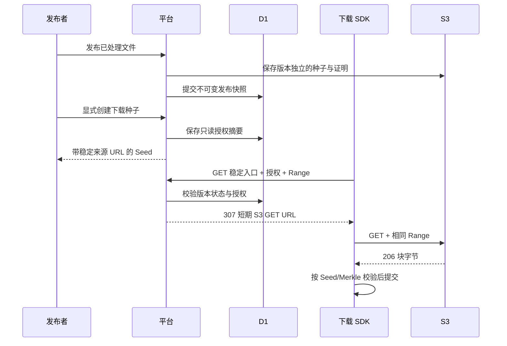

# 内容发布与下载授权

本文是发布阶段的实施方案。版本模型、独立发布产物、发布界面与回收已接线；下载授权和稳定入口已实现，真实 SDK 联机验证待完成。处理完成不等于发布，发布也不会自动创建下载授权。

## 第一版范围

1. 固定不可变的发布版本，提供发布与撤回操作。
2. 显式导出带下载授权的种子，SDK 无需网站 Cookie 即可下载。
3. 平台稳定入口校验授权，签发短期 S3 GET 链接，数据由 S3 直接返回。
4. 用真实 q2q SDK 完成下载及内容校验。

本阶段不接官方做种节点、Track announce、计费、匿名公开搜索或跨项目去重。

## 版本与权限

- 发布版本使用独立 ID；快照固定项目、文件、上传会话、info_hash、原对象键、存储配置身份、版本号/ETag、大小及种子摘要。
- 第一版由文件创建者或项目 owner 发布、撤回和管理下载授权；成员可查看发布状态，不能因能够查看文件而自动获得对外分享权限。
- 发布本身不开放匿名读取。导出下载种子是单独的显式操作，界面说明「拥有此种子的人可在授权有效期间下载」。
- 已发布版本不原地替换内容。撤回后如需重新发布，生成新发布 ID，不恢复旧授权。
- 使用调用方生成的 UUID 作为发布幂等键；重复提交返回相同版本。第一版同一文件最多一个处于 creating/published 的版本，失败可重试、撤回后可新建。

### 发布与产物保存

处理任务的产物可能因重试而清理，因此不能直接作为发布版本的永久引用：

1. D1 登记 creating 意图并固定来源快照，与文件删除互斥。
2. 将已验证的 Seed 和证明表保存到发布版本独立的不可复用对象键，记录大小与摘要。
3. 确认快照和产物后条件提交 published。失败保留可重试状态，不对外返回半完成版本。
4. 撤回只改变发布状态；原文件、产物和已下载内容不是同时删除。

删除原文件前必须检查发布引用；creating/published 引用禁止删除，已撤回版本还需等待已签发链接的最长有效期。独立产物清理和孤立对象扫描另列后续任务，不把跨 D1/S3 操作视为事务。

## 下载授权

建议第一版采用可撤销的随机 bearer 授权：

- 作用域只包含一个发布版本的读取，不能列文件、上传或访问其他版本。
- 原始随机 secret 仅在创建授权并导出种子时使用；数据库保存不可逆摘要、授权 ID、创建者、时间及撤销状态。
- 每次导出下载种子创建一份独立授权。授权列表支持辨识和撤销；不通过 GET 请求创建授权，也不要求数据库可恢复原始 secret。
- 建议默认长期有效、可主动撤销，发布界面明确展示这一规则；若后续支持到期时间，由授权记录控制，不改内容协议。该默认值属于本方案建议，尚未写入产品长期约定。
- 种子的 cdn_list 使用固定的版本与授权入口 URL；不写 S3 长期密钥，不把短期签名 URL 作为长期来源。
- 带授权的种子本身具有读取权限。应用日志、错误、进度展示和 Referrer 不能泄漏完整授权 URL；下载相关响应使用 private/no-store，避免缓存授权跳转。
- 撤销授权或撤回发布后，平台立即停止签发新链接。已签发的 S3 链接在过期前仍可能有效；已经下载的字节或其他节点的副本不能被远程收回。

## 数据路径

### S3 与请求约束

- GET 签名有效期建议不超过 5 分钟；稳定入口每次请求重新授权，禁止缓存 307。原文件字节不经过页面 Worker。
- 入口仅服务已固定的对象，不接受客户端指定 bucket、endpoint 或对象键。
- 有版本号时固定 versionId。没有版本号时使用唯一对象键，签发前 HEAD 核对 ETag 和大小；HEAD 与 GET 不具备原子版本锁定，最终依靠 Seed 根校验拒绝被替换的字节，不能宣称已消除该竞态。
- 支持单段 Range 并检查越界、多段及非法值；签名条件与 SDK 实际发送的头保持一致。测试重定向后 Range 不丢失、206/Content-Range 正确。
- 平台读取 S3 元数据时继续拒绝跟随签名请求的重定向；客户端只访问由服务端固定配置生成的目标。

## 种子与 SDK

- 复用 q2q-primitives 的 Seed 编解码，经 @q2q/wasm 添加来源列表；不在 TypeScript 重写 bencode。
- 导出前后 info 字典和 info_hash 必须一致。带不同授权的种子可以具有不同编码，内容身份仍相同。
- 第一版保留内嵌叶子表，SDK 不依赖外部证明地址。后续外置证明时，proof_list 使用同一版本/授权体系，不能固化短期 S3 URL。
- 当前 SDK 的 cdn::Source 对各块使用原始来源 URL，允许最多 3 次重定向，使用 identity 编码并校验响应范围和内容。验证后才能认为平台 307 入口兼容。
- 审计并禁止重定向携带包含 secret 的 Referer，检查敏感 URL 的日志与错误脱敏。
- 若短期链接过期，后续块或有界重试应重新请求稳定入口；授权已撤销时明确失败，不能无限重试或偷偷切回匿名访问。

## 接口草案

| 接口 | 职责 |
| --- | --- |
| POST /api/files/:id/publications | 幂等创建发布版本 |
| GET /api/files/:id/publications | 查询文件的发布版本 |
| GET /api/publications/:id | 查询版本及状态，要求项目成员 |
| DELETE /api/publications/:id | 撤回版本，保留快照与审计信息 |
| POST /api/publications/:id/download-grants | 创建只读授权并返回下载种子，要求管理权限 |
| GET /api/publications/:id/download-grants | 查询授权元数据，不返回原始 secret |
| DELETE /api/publications/:id/download-grants/:grantId | 撤销授权 |
| GET /api/publications/:id/content?grant=… | 稳定数据入口；读取授权绑定版本后签发短期 S3 URL |

GET 数据入口不依赖网站登录态；版本管理接口沿用会话、成员关系、写操作 Origin 校验。GET 种子处理产物的现有接口保留，不与导出下载授权混用。

## 实施与验收顺序

- [x] 发布版本表、状态转换、幂等创建意图及文件删除引用保护
- [x] 独立发布产物保存、来源快照固定与发布/撤回界面
- [x] 强制终止后的孤立发布尝试扫描回收实现
- [x] 隔离环境验证清理失败、遗留尝试、延迟 S3 写入、租约替换及扫描轮转
- [ ] 真实 Worker 中断与 Cron 调度联机验证
- [x] 下载授权、Wasm 来源装配与稳定 GET 入口实现
- [x] 真实浏览器导出、授权撤销与旧种子拒绝下载验证
- [x] 隔离数据库验证下载授权跨账号权限及并发撤回
- [ ] 真实多账号会话与跨项目 HTTP 验证
- [x] SDK 重定向、Range、Referer 与逐块重新访问稳定入口
- [ ] 真实短期签名过期重试验证
- [x] 本地平台 + 测试 S3 + 真 SDK 下载，逐字节和根校验
- [ ] 覆盖重复发布、跨项目/跨账号访问、撤销、撤回、快照变化及处理中失败恢复

所有授权和发布写操作在实际实施与验证前都不标记完成；本阶段不会自动发布已有测试文件或创建分享授权。

## 版本模型阶段进度

- migration 0010 增加发布快照和状态约束：快照字段不可更新，撤回为终态，同一文件仅一个 creating/published 版本，published 必须具有独立产物键。
- 创建接口只登记 creating 意图并返回 202，没有自动执行产物复制，也不表示内容已发布；此接口暂未暴露为页面操作。查询和撤回接口已接线。
- 创建与删除通过 D1 条件写互斥；删除同时检查发布状态、清理状态和 lastSignedUntil，文件详情反映引用保护原因。
- 处理重试清理产物时跳过仍被有效版本引用的对象；后续独立发布产物复制仍需提交与清理逻辑。
- 尚未执行本阶段 API 行为、并发或跨账号验证；没有对保留的测试文件执行发布或撤回。
- migration 0010 已应用到本地数据库，平台类型检查、页面生产构建、消费端 Wrangler dry run 与 diff 检查通过；未运行本阶段行为测试或远端 CI。

## 独立产物与界面阶段进度

- migration 0011 增加租约、失败码和逐次产物记录；已应用本地数据库。
- 发布消费者固定 S3 身份和来源快照，校验种子 SHA-256，通过 Rust/Wasm 解析及验证 inline 叶表，生成独立证明；产物保存后通过租约条件提交 published。
- 文件详情增加发布、状态轮询、重新派发创建任务和撤回入口，提供中英文文案。失败版本可重新创建；撤回不可逆转，同一内容再次发布使用新版本。
- 正常失败清理本次未提交产物；正常撤回清理已提交产物。D1 返回丢失时先读取提交结果，再决定清理。
- 强制终止遗留的尝试保留产物日志和 cleanupPending 删除保护，自动扫描回收尚未实现；这项需要在发布完整验收前补齐。
- 类型检查、生产构建与消费者 dry run 通过；尚未执行发布/撤回行为测试，没有操作保留的测试文件，也未创建下载授权。

## 中断回收阶段进度

- migration 0012 增加回收完成时间和最近扫描时间，已应用本地数据库；消费 Worker 配置每五分钟触发扫描。
- 过期创建租约先标记失败并清空租约令牌，超过十分钟未领取的创建意图同样失败，旧消费者不能再提交 published。
- 每轮最多处理 25 条记录，按最近检查时间轮转。当前 published 产物、有效租约、尚有效的下载链接都不回收。
- 成功删除后保留对象键墓碑并继续轮转清理，覆盖延迟 PUT；墓碑尚未压缩，会增加长期日志存储和扫描量。失败时保留删除保护，下一轮重试。
- 页面显示等待清理状态，已撤回版本可以直接重试清理，无需再次确认撤回。
- 未运行本阶段行为测试，未触发本地 Cron，也未发布或撤回保留的测试内容。后续需验证并发、异常及回收，再进入下载授权。
- 本轮类型检查零错误/警告，页面生产构建、消费者 Wrangler dry run 及 diff 检查通过；未部署远端 Cron。

## 发布与回收回归验证

- `platform:check:processing` 扩展为真实 Wasm + 内存 SQLite + 模拟 S3 的 16 组检查，全部通过（7 组原有处理测试、9 组发布/回收测试），已接入现有平台 CI 命令。
- 覆盖独立产物复制和重复投递、D1 提交响应丢失、发布中撤回、种子篡改与来源变化、过期任务封锁、删除失败重试、延迟 PUT 后再次回收、有效租约与下载链接保护、撤回终态、租约替换、30 条记录跨轮扫描和存储身份隔离。
- 模拟中断通过构造持久化遗留记录实现；尚未强制终止真实 Worker，也未触发真实 Cron。测试不访问外部服务、凭据或保留的测试内容。
- API 跨账号权限、真实浏览器发布/撤回及真实队列并发仍待验证；上述结果不代表这些场景已通过。

## 下载授权实现进度

- migration 0013 增加下载授权表，数据库仅保存随机 256-bit secret 的 SHA-256；身份字段不可改，撤销为终态。已应用本地数据库。
- 文件创建者/项目 owner 可以创建、列出和撤销授权；创建和撤销的 SQL 同时复查成员权限，创建还要求版本 published。列表不返回 secret。
- 稳定 GET 入口验证版本和授权，通过条件写预留最长五分钟的删除保护，再验证 S3 固定来源并返回 307。签名有效期为四分钟，并限制签名操作耗时，保证不超过删除保护窗口。Range 支持单段范围，不把 Range 绑定到签名，SDK 重定向后需继续携带 Range。
- 发布版本种子接口仅供管理者读取，验证独立产物大小与摘要。浏览器通过 @q2q/wasm 的 seed_with_source 装配 cdn_list，保留 info 和内嵌证明；没有在 TypeScript 重写 bencode。
- 每次导出独立创建授权，弹窗明确持有种子即持有读取权限；导出失败/响应丢失时，授权仍可在列表辨识并撤销，但不能恢复 secret。页面提供撤销入口，未实现授权自动到期。
- 平台响应统一 Referrer-Policy: no-referrer，授权与下载响应不缓存。部署访问日志的 query 脱敏及 SDK Referer/错误日志仍待审计。
- 尚未执行本阶段授权行为测试、浏览器导出或真实 SDK 下载，也未对保留测试文件创建发布和授权。
- 本轮平台类型检查零错误/警告，页面生产构建、浏览器 Wasm 资源打包、消费者 Wrangler dry run 和 diff 检查通过。

## 浏览器与 SDK 联机结果

- 本地浏览器成功发布保留的 9 MiB 测试内容，并在用户单独确认后导出一份带授权种子。测试后已通过页面撤销本轮唯一授权；保留原文件、处理产物和发布版本供查看。
- 使用真实 q2q CLI/SDK 经平台稳定入口和测试 S3 完成下载（36 个块、4 路 HTTP、约 6 秒），SDK 校验完成，cmp 逐字节一致。原文件及下载结果 SHA-256 均为 d2ee4703cd9698945ca7b9fe1689ea3095597eac1a0afd8dba00cac7894fdc43。
- 本轮使用 HTTP/CDN fallback，未启用 P2P；指定的本地 Track 地址不可用，不将本轮结果作为 Track/Punch 验证。
- 授权撤销后，旧种子稳定入口返回 404 且无跳转；真实 CLI 再次下载退出码为 1，没有无限重试，错误中没有输出授权 URL。
- SDK 关闭 reqwest 自动 Referer，新增稳定入口 307 回归：Range 与 identity 头保留，不发送 Referer，两个块均重新请求原入口。5 组 CDN 单元回归通过。
- 真实签名过期、跨账号权限、并发撤回、部署访问日志 query 脱敏及真实 Cron 仍未验证。

## 授权权限与并发收尾

- 授权存储逻辑从 Cloudflare env 接线中拆出到 download-grant-store.ts，以实际 SQL + 内存 SQLite + 模拟 S3 验证，不模拟权限查询结果。
- 平台回归扩展至 21 组，全部通过。新增文件创建者/项目 owner 与普通成员/其他项目 owner 的权限差异、跨版本授权绑定、摘要保存且列表不暴露 secret、撤销幂等与终态、成员移除/撤回插入在权限检查与写入之间、签名预留与撤回的两种顺序、非法 Range、签名超时窗口。
- SDK CDN 回归 6 组通过：模拟签名目标过期返回 403 后，下一块重新访问稳定入口取得新地址。该结果不替代真实 S3 四分钟过期验证。
- 未知异常日志只输出路由模板和错误类别，不记录 Request、URL 或原始异常。SvelteKit 3 的业务/框架错误保持默认消息和状态。Cloudflare 部署配置关闭默认 invocation logs，保留应用结构化日志；本地 workers/preview 命令使用 warn 日志级别。
- 部署后的 CDN、代理、Logpush 等外部访问日志仍需部署侧检查，不能由应用代码证明已脱敏。本轮没有使用真实多账号会话，也没有触发真实 Cron。
- 当前跨账号及竞态结论限于隔离 SQL 测试；现有浏览器/真实 S3 下载结果见上一节。本轮未改动保留文件及其授权状态。
- 本轮最终类型检查零错误/警告，页面生产构建、消费者 Wrangler dry run 和 diff 检查通过；未部署远端日志配置，未创建 PR。
