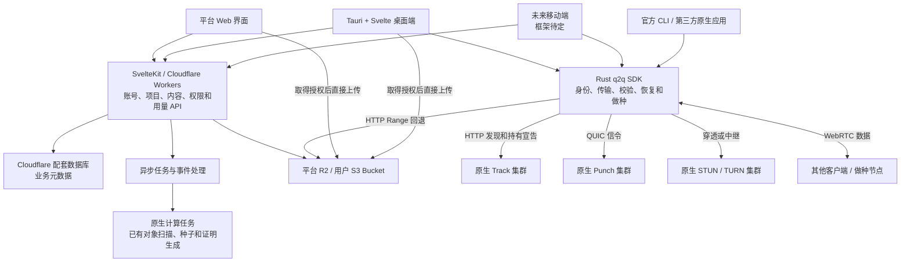

# 平台与客户端技术方案

状态：总体方案，尚未开始平台或 GUI 实现。产品目标见 [product-direction.md](product-direction.md)；本文记录技术选型、职责边界与后续拆解，不提前固定服务目录、接口字段或全部基础设施。

## 1. 已确定的方向

| 范围 | 选择 |
| --- | --- |
| 开放平台 | SvelteKit 全栈应用，部署到 Cloudflare Workers，优先使用 Cloudflare 配套服务 |
| 桌面客户端 | Tauri，Rust 应用层直接依赖现有 q2q SDK；界面使用 Svelte，与平台共享适合复用的前端部分 |
| 移动客户端 | 待定；可以后续单独使用 Flutter，复用 Rust SDK，暂不绑定框架或桥接方案 |
| 原生网络服务 | Track、Punch、STUN/TURN 等使用真实的独立原生集群部署 |
| Web UI 组件 | 统一使用 shadcn；Svelte/SvelteKit 界面采用 shadcn-svelte |
| 图标 | 统一使用 Lucide 的 Svelte 组件 |
| 视觉与主题 | 尽量贴近 Apple 原生界面；支持浅色、深色及跟随系统 |
| 核心传输逻辑 | 继续放在 Rust SDK，供 CLI、桌面端、未来移动端及第三方应用复用 |

平台建设、桌面客户端接入可分阶段推进，移动端不作为第一阶段的前置条件。

## 2. 总体结构

下图是目标部署与调用关系，表示拟建设的系统边界，不代表全部服务已经存在。



平台管理账号、项目、内容与资源；SDK 执行传输，原生集群提供发现、信令和中继。平台与原生集群之间的项目配置、授权及事件接线需要新增设计，不将现有自签 Peer 身份当作平台账号或项目授权。

## 3. 平台：SvelteKit 与 Cloudflare

SvelteKit 承担平台页面、服务端业务逻辑和 API，通过 Cloudflare adapter 部署到 Workers。优先使用同一平台生态，以下是建议的初期职责分配，具体产品、配额和数据结构在实施时确定：

| 服务 | 建议职责 |
| --- | --- |
| D1 | 用户、项目、内容版本、存储连接、套餐及配额等业务记录 |
| R2 | 平台提供的对象存储，以及种子、证明等内容辅助对象 |
| Queues | 上传完成通知、异步处理和事件汇总 |
| Durable Objects | 有明确需求时用于实时协调、连接或并发状态；不默认承担所有状态 |
| KV | 适合最终一致性的配置或缓存；不作为强一致授权与计量的唯一依据 |

D1 不直接承接所有 Peer 心跳、逐 piece 进度或原始高频流量事件。现有 Track 的实时共享状态继续由原生集群维护；不为统一云生态而重写已有传输协议或状态后端。

Workers 处理业务请求、任务编排及受限凭据签发。大文件字节优先由客户端直接上传到存储；已有大对象的完整哈希、种子及证明生成安排在原生任务执行环境，具体任务调度方式待定。网页上传不意味着浏览器已经能够运行现有 Rust SDK 或参与 P2P 做种。

## 4. 原生网络集群

保持既有组件职责：

- **Track**：HTTP 发现、会话、内容持有索引及续租。多实例使用共享状态；现有 q2q-track 的 Redis feature 继续作为可复用能力，不把这些实时索引迁入平台业务数据库。
- **Punch**：QUIC/UDP 信令及连接协调，按节点地址连接。客户端根据 Track 返回的信息找到目标 Punch，保留现有节点分配和路由边界，不套用普通 HTTP 负载均衡方式。
- **STUN/TURN**：原生部署的穿透与中继设施，复用已有服务及凭据机制；区域、容量和流量观测在集群方案中细化。
- **原生计算任务**：按需执行远端对象扫描、种子/证明生成等工作；任务重试、对象版本绑定及资源预算另行设计。

平台能够管理这些集群的配置和观测，但不要求平台请求逐跳代理 Peer 数据，也不把现有原生服务直接打包为 Workers。具体节点供应商、区域、编排方式、扩缩容和运维拓扑未确定。

## 5. 桌面客户端：Tauri + Svelte + Rust SDK

```text
Svelte 界面
    ↓ Tauri commands / channels
Rust 应用层（任务管理、账号接入及平台适配）
    ↓
q2q SDK（传输、恢复、校验、调度、共享与资源控制）
```

- Tauri 的 Rust 层直接依赖 SDK；Svelte 通过明确的命令与订阅接口操作任务，不直接管理网络连接或每个 piece。
- Rust 层持有 Client、Transfer、Publication 和 VOD 等句柄，管理任务生命周期。界面订阅已有总进度、逐 Peer 快照与错误，不复制一套传输状态机。
- 文件字节、证明校验和网络任务留在 Rust，界面只接收任务状态与必要元数据。
- 平台和桌面端复用适合共享的 Svelte 组件、样式及 API 类型。平台使用 SvelteKit 服务端能力，桌面端打包静态前端；不将平台的服务端代码直接嵌入 WebView。
- 本机文件选择、持久身份、账号凭据、上传/下载任务、带宽设置、做种开关及系统集成由桌面应用层接线。
- 关闭窗口、退出应用和停止做种的语义分别定义；是否驻留托盘、是否需要独立后台进程，留待桌面生命周期方案确定，不承诺窗口关闭后自动长期运行。

SDK 继续保持独立于 Tauri 的库，现有 CLI 继续可用。需要补充通用能力时优先完善 SDK 公共接口，平台账号及 UI 特有逻辑放在相应应用层。

## 6. 界面组件、图标与主题

用户已确认的平台界面基准及原型见 [apps/platform/design/README.md](../apps/platform/design/README.md)。后续实现先对照该版本，避免偏离已批准的布局和视觉。

适用于平台 Web 界面与 Tauri 的 Svelte 前端；未来移动端的具体组件实现随框架选型确定。

- **UI 组件统一使用 shadcn-svelte**，通过共享的设计变量与组件样式形成一致体验。
- **图标统一使用 Lucide**，保持尺寸、线宽与交互状态一致；有文字说明的装饰图标和独立图标按钮分别处理可访问名称。
- **视觉尽量贴近 Apple 原生界面**：清晰的内容层级、克制的色彩、适当留白、细腻边界与圆角，以及适度的动效。保持信息易读和操作明确，具体视觉规范在界面设计时细化。
- **主题提供三种设置：浅色、深色、跟随系统**，默认跟随系统。用户显式选择浅色或深色后优先遵从该选择；只有跟随系统时响应系统外观变化。
- 保存主题偏好，重新打开页面或应用后恢复；平台 Web 与桌面分别持久化，账号跨设备同步留待实际需求确定。
- 颜色通过语义化设计变量定义，覆盖背景、文本、边框、交互状态、图表、弹层和滚动区域等；浅深色保持同一套布局和组件行为。
- 处理首次加载的主题初始化，避免明显的浅深色闪烁；主题切换同时考虑桌面窗口背景和系统栏可适配部分。

## 7. 移动端预留

移动端框架暂不确定，可以在后续选择 Flutter，通过生成式 Rust 桥接等方式调用 SDK，也可以继续评估其他方案。本阶段不要求先提供通用 C ABI，也不为尚未选择的框架拆出一套核心逻辑。

未来需要单独验证：

- Rust SDK 及其 WebRTC、QUIC、文件和身份依赖在 Android/iOS 的构建与运行。
- 系统文件选择结果与 Rust 文件读取之间的适配、持久授权和沙箱访问。
- 前台下载、取消、恢复、网络切换与应用重启。
- 后台下载、锁屏与做种的操作系统限制，以及必要的原生服务接线。

跨端 UI 不等于传输和后台能力已经跨端。移动端可以先提供前台下载与可恢复任务，再按平台能力定义后台行为；不直接承诺手机长期在线做种。

## 8. 存储、内容和授权接线

平台托管存储优先使用 R2；用户自带存储通过 S3 兼容接口接入，两者在内容、来源和任务模型上共用业务流程。首个供应商及具体适配实现待细化。

- 对象上传使用受限的直接上传授权，平台确认完成后登记不可变内容版本及来源。
- 本地文件可复用 Rust 核心能力生成种子和证明；已有远端对象由任务执行环境处理，不能仅凭对象地址或上传成功标记认定内容已验证。
- 用户的长期 Bucket 凭据留在受控的存储连接管理边界，不进入种子或下载端；具体加密保存、轮换、撤销和最小权限机制待设计。
- 短期存储地址和访问令牌需要刷新机制，不能把会过期的下载地址当作长期内容身份。刷新来源仍需绑定原内容版本，恢复时继续验证到同一内容根。
- 平台账号、项目权限、分享授权、Peer 身份和种子校验分别设计；原生集群如何验证平台受限授权及隔离项目索引，需要明确协议兼容与自部署模式。

## 9. 观测与计量

Rust SDK 的总进度及逐 Peer 字节用于客户端展示和故障分析。原生网络服务与存储侧分别提供中继、出口和容量等可计量数据，平台聚合为项目用量。

计量需要区分 Peer 直传、TURN 中继、对象存储下载和平台实际承担的费用，不将逐 piece UI 事件上传到业务数据库，也不直接用客户端自报流量结算。事件标识、重试去重、配额执行位置及计费周期待后续方案确定。

## 10. 建议的实施拆解

以下是待细化的任务，不表示已批准开始实现：

- [ ] 业务与授权模型：用户、项目、内容、来源、分享、设备及存储连接的职责和授权边界。
- [ ] 共享界面基础：shadcn-svelte、Lucide、接近 Apple 原生的设计变量，以及浅色/深色/跟随系统设置和持久化。
- [ ] 平台基础：SvelteKit/Workers 工程、业务数据库与迁移、账号及项目最小闭环。
- [ ] 存储闭环：一种 S3 兼容存储、直接上传、对象版本、种子/证明任务及下载授权刷新。
- [ ] 原生集群接入：保持现有 Track/Punch 协议边界，细化平台授权、项目隔离、节点配置和运维观测。
- [ ] 桌面最小客户端：Tauri + Svelte，通过 SDK 完成发布、下载、续传、做种及进度展示，再接入平台项目。
- [ ] 用量和配额：汇总原生服务与存储计量，定义网络/存储配额，再推进计费。
- [ ] 移动端验证：在核心交付流程稳定后评估框架、Rust 桥接、文件访问与后台策略。

实施时继续保持目录扁平、按职责拆分、解释必要的并发与生命周期边界。新增 crate、平台目录或公共桥接层在具体任务中决定。

## 参考

- [SvelteKit 部署到 Cloudflare Workers](https://developers.cloudflare.com/workers/framework-guides/web-apps/sveltekit/)
- [Cloudflare R2 直接上传](https://developers.cloudflare.com/r2/objects/upload-objects/)
- [Tauri 前端配置](https://v2.tauri.app/start/frontend/)
- [Tauri 移动插件开发](https://v2.tauri.app/develop/plugins/develop-mobile/)
- [flutter_rust_bridge 平台支持](https://cjycode.com/flutter_rust_bridge/guides/cross-platform/overview)
