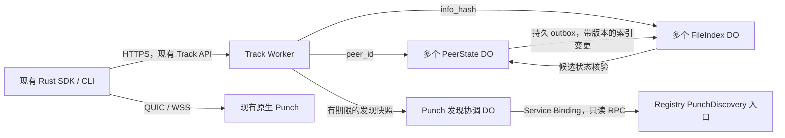

# TypeScript Workers Track：设计与执行项

状态：第一阶段协议基线、第二阶段 SQLite DO 状态后端已完成并通过本地验证；第三阶段 HTTP、候选查询与真实 SDK 本地验收已完成。第四阶段 Registry RPC、发现刷新、独立 CI 与平台 Punch 筛选已实现并通过本地验证；远端 CI 与生产部署未执行。用户已确认 TypeScript Workers Track、统一域名下的自动多实例入口、服务端按 Peer / 内容分片，以及只读 Service Binding RPC 发现 Punch、无需注册自身和 Registry JWT。通过共同协议样例和行为测试约束 Rust/TS 一致性。

## 目标与范围

- 新增 `apps/track`，使用 TypeScript + Hono + Zod，部署在 Cloudflare Workers，状态使用 SQLite-backed Durable Objects。
- Hono 负责 HTTP 路由、中间件及统一错误响应；Zod 负责请求、配置和 RPC 边界数据校验。沿用 Registry 的技术栈，不另写一套 HTTP 路由框架。
- 保留原生 `q2q-track-server` 的自托管部署方式；现有 SDK、Punch 和 TURN 服务继续使用当前协议。
- 首版不引入业务 Wasm，不把 Rust 状态代码搬到 JS/Wasm 边界来回调用。
- 一致性依据是可执行的协议样例、状态场景和真实 SDK 互通测试；并非共享一份业务实现。
- 按阶段实施并记录验证结果；部署、生产域名切换和生产状态迁移仍需对应授权。

## 已核对的代码与差异

| 当前入口 | 需要保留的行为 |
| --- | --- |
| `crates/q2q-track/src/wire.rs` | 请求/响应字段、默认值与查询数量上下限 |
| `crates/q2q-track/src/auth.rs`、`q2q-primitives/src/identity.rs` | Peer ID、自签票据的 canonical bencode、Ed25519、HMAC 与时间窗口 |
| `crates/q2q-track/src/state.rs`、`redis.rs` | announce 原子更新、会话替换、序列号推进、两种独立 TTL |
| `crates/q2q-track/src/selection.rs` | 排序、环形轮换、游标校验、过滤与扫描预算 |
| `crates/q2q-track-server/src/api.rs` | HTTP 状态码、错误体、TURN 凭据、鉴权与状态推进的实际顺序 |
| `crates/q2q-track-server/src/registry.rs`、`directory.rs` | Registry 分页快照、失效策略、Punch 分配与身份变更处理 |

现有文档有旧表述，实施时不能直接照抄：规范说有限乱序窗口，但存储最终只接受严格递增的序列号；查询也会消耗序列号。规范仍有独立 TURN 凭据接口的描述，而当前服务在 announce 响应里返回 TURN 凭据。首版先刻画实际行为，差异单独记录；安全缺陷单独修复并同步两端，不通过移植静默改变协议。

### 第一阶段固定的兼容基线

- 票据版本为 2。签名输入是按字节排序的 bencode 字典，`pub` 和 `ih` 是原始二进制，缺失或 null 的可选字段不编码；字符串按 UTF-8 字节数计长。
- Peer ID 是公钥 SHA-256 的无填充大写 Base32，加现有六字符校验码；不能直接替换成标准带 HRP 的 Bech32 编码。
- 票据要求 `iat <= exp`，到 `now == exp` 时过期；当前寿命检查针对 `exp - now <= 600`，并未要求 `iat <= now` 或 `exp - iat <= 600`。共同样例明确记录未来 iat 和很早的 iat 的现有行为，不静默改变。
- session MAC 使用标准带 padding 的 Base64；时间容差包含 ±60 秒端点。鉴权层暂时允许距最高序列不足 8 的旧请求通过 MAC 检查，但存储层原子推进时仍只接受严格更大的序列号。
- query 在认证之后、发现快照/游标选择之前消耗序列号；后续处理失败也可能已消耗 seq，重试必须使用新 seq。heartbeat 续约会话，不能续约持有 TTL；announce 的 ttl 受配置限幅，ttl=0 的现有行为需保留并在后续 HTTP 场景中验证。
- reannounce 更换 session key 并将该会话序列号重置为 0，但保留未被 del 的持有记录及原持有期限；complete 只决定本次 add 的状态。同一文件 del/add 同现时先删后加。
- 原生 JSON 语法错误为 400，字段提取/类型错误通常为 422，方法错误为 405；坏 hash 为 `bad_request` / 400，缺会话为 `unknown_session` / 401。不能把 Hono/Zod 的默认响应直接视为协议。共同 HTTP 样例由原生 Router 实际执行，Workers HTTP 对照留在阶段三。
- 当前 TS 使用 `lossless-json` + Zod，完整保留 JSON 数字 token，内部使用 BigInt；输出继续为 JSON 数字。此依赖解决 u64 精度和重复键检测，无需手写 JSON parser。重复未知字段也拒绝，比 Rust 忽略未知字段的路径更严格，这一差异明确保留。
- seq 的范围为完整 u64；票据时间受 canonical bencode 的 i64 上限约束。SQL 使用等长 8 字节大端 BLOB 表示 seq，不能存进 SQLite 有符号整数或先转 Number；阶段二已在实际 workerd SQLite 中验证完整范围的存取及排序。

本轮对原生实现的显式修复：序列号窗口比较改用无溢出的差值；票据验签前拒绝超过 bencode 范围的时间，防止输入触发 serializer panic；Track 将无效曲线点与验签失败统一为 `bad_signature`，避免 Web Crypto 与 Dalek 的错误分类差异；补齐 `lifetime_too_long` 的 HTTP 401 映射，原先会误入 500。上述变化由共同样例锁定，不修改合法客户端的请求格式。

共同样例在 `tests/fixtures/track/v1.json`：包含确定性的 Peer ID、票据/签名字节、MAC 输入、TURN HMAC-SHA1、JSON u64 边界、原生 HTTP 行为和三组状态轨迹。常规测试只读，重生成需要显式执行并审查差异。状态轨迹现由 Rust MemoryState 和实际 workerd 中的 SQLite PeerStore 分别消费；跨 DO 索引行为用独立故障场景验证，完整 HTTP 查询兼容仍留待阶段三。

## 架构提案

一个 Track Worker 服务绑定一个对外域名，Cloudflare 调度其多个运行实例；不手动创建同名服务副本、不为各运行实例分别绑定域名。Worker 实例不共享内存，持久状态通过同一组 DO namespace 访问。

Worker 负责 HTTP 路由、请求大小限制、基础解析、来源策略和前置限流。Peer DO 管理会话与权威持有状态，File DO 管理来源索引，Punch 发现协调 DO 管理快照刷新。Workers Track 不向 Registry 注册或上报自身，也不为短生命周期 Worker 实例创建节点。`/health` 只表示服务存活，不代表数据库和 Registry 已就绪。

### 分片与定位

| 状态 | 稳定名称示意 | 请求来源 |
| --- | --- | --- |
| PeerState | `peer:<peer_id>` | announce / heartbeat 的路径、query 请求者和候选的 peer_id |
| FileIndex | `file:<canonical_info_hash>` | query 的路径、announce 的 add/del 列表 |
| Punch 发现协调 | 部署配置中的固定快照对象名 | 后台刷新 Punch 列表；不是 Registry 节点身份 |

通过 namespace 的 `idFromName()` / `getByName()` 定位同一逻辑对象。不同 Worker 实例对同一规范化名称得到同一对象引用，Cloudflare 管理实际位置和路由；生产和预发布使用独立 namespace。内容键采用 `info_hash`，不能使用平台内部文件 UUID。

SDK 继续访问统一 Track URL，不维护 Workers 实例列表或客户端一致性哈希环。这里是稳定对象键路由，不是我们自行维护物理节点哈希环。公开名称须经过格式与长度校验、鉴权及限流；未授权请求不得通过任意对象名制造持久状态。

Peer 数增长由多个 Peer DO 分担，文件数增长由多个 File DO 分担。单 Peer 和单热门文件仍有容量上限；首版默认每文件一个 DO。热门文件的后续扩展可在服务端按持有者 peer_id 分桶，但需要版本化的桶目录、迁移与双读策略、有限扇出以及跨桶游标，不能直接改变取模数而丢失已有来源。是否启用由压测结果决定。

## 状态与事务

建议的状态归属：

- Peer DO：当前 session、公钥、session key、最高序列号、Punch 身份和会话到期时间；权威文件持有记录，包含 complete、独立持有 TTL、每文件变更版本；持久 outbox 与重试计划。
- File DO：按 peer_id 排序的候选索引，包含持有版本、complete 和持有 TTL；已应用版本或删除墓碑，拒绝重复及过时变更。
- Punch 发现协调 DO：完整验证后的 Punch 快照及有效截止时间、刷新和退避计划；区分可分配与仍可服务已有会话的节点。
- 各 DO：本地 schema 版本及必要的清理计划。对象重建不重置持久变更版本。

关键操作：

1. **Announce**：完成票据验证与 Punch 选择后，在 Peer DO 的一次 SQLite 事务内替换会话、先 del 再 add，并记录同事务 outbox。同一个 hash 同时出现在 del/add 时，以 add 为准；未在 add 中的旧持有记录不擅自续期。新会话与索引版本分开管理，重新 announce 不得让仍有效的未变更持有记录全部失效。
2. **索引投递**：事务提交后投递 outbox，File DO 按每个 Peer/文件的持久单调版本幂等应用；新旧 session 的延迟消息也不能覆盖更新状态。删除用版本墓碑防止旧 add 复活；墓碑回收必须给出安全条件。丢失响应可重试，部分成功不删除未确认事件。内部变更仅通过可信绑定/RPC 提交，不开放公开索引写接口。
3. **Heartbeat**：在 Peer DO 异步验 MAC 后，事务内重新比较 session key、有效期与序列号，成功才推进序列号和会话 TTL。心跳不广播给每个 File DO，不续约文件持有 TTL，避免持有文件数放大心跳写入量。
4. **Query**：请求者 Peer DO 先完成鉴权及原子序列推进，生成仅供内部调用的认证上下文；不把 session key 发送给 File DO。File DO 获取候选后，按有界批次核验各候选 Peer DO 的当前在线状态、文件持有版本/TTL、complete 和 Punch 身份。过期、已删除、版本不匹配或无法核验的候选不返回；不使用无限期缓存证明在线。一次请求使用固定时间与同一 Punch 快照，但不承诺跨所有对象的全局快照。
5. **过期与恢复**：读取路径校验 TTL，正确性不依赖 alarm 准时执行。Peer outbox 和各对象清理由可重试 alarm 分批推进；确认状态和重试计划持久化，禁止每个事件创建无界后台任务。

DO 请求在 `await` 处可能交错，不能把“单个 DO”当成所有业务天然无并发。数据库事务内不执行 Web Crypto、Registry fetch 或其他异步网络操作；异步验证之后通过条件更新或事务重读确认状态仍有效。

### 跨分片的可见性与失败语义

原生实现的 announce 在一个存储事务中更新多个文件；Peer DO + 多个 File DO 没有跨对象事务，不能继续宣称具有相同的多文件原子可见性。权威状态和 outbox 原子提交，来源索引通过可靠投递最终收敛；新增来源可能短暂不可见，旧索引必须经过权威状态核验后才能返回。

采用“Peer 权威事务提交 + 索引最终收敛”，不承诺跨文件原子可见。成功响应前等待本次索引事件确认，并在 Peer DO 内重查本次会话仍有效；超过期限返回 `storage_unavailable` / 503，不返回无法确认的 session key。超时不等于撤销已提交的 Peer 状态或部分索引，后台恢复仍可能继续。这是相对原生事务的显式部署行为差异，需要在文档和真实 SDK 故障测试中验证。

执行规则与恢复约定：

| 情形 | 确定的行为 |
| --- | --- |
| 解析/鉴权/准入失败、本地事务回滚 | 不替换会话，不新增 outbox，也不修改权威持有记录 |
| Peer 事务已提交、File 只更新一部分 | 已提交状态保留，outbox 驱动重试；查询按权威状态筛选，新增记录可能暂时不可见 |
| File 已应用但 ack 丢失 | 重投相同事件；相同版本和相同内容幂等成功，相同版本不同内容报内部一致性错误 |
| 旧 add 在新 del 后抵达 | File 版本水位拒绝旧写；即使索引滞后，候选权威核验也不得返回已删除记录 |
| 旧请求正在等待时发生 reannounce | 会话与持有版本分别管理；旧请求不能返回当前 session key，也不能通过旧事件覆盖新持有状态 |
| announce 响应丢失，客户端重试 | 按现有协议创建新会话；不把票据 cid 擅自当作 HTTP 幂等键。未变更的持有记录和待投递有效版本继续保留 |
| 对象重建或投递进程退出 | 从持久 outbox 和版本水位恢复；不依赖未等待的 Promise 或 isolate 内存 |
| 候选 Peer DO 超时/不可用 | 不将其当作已确认在线的来源；允许短页，游标须保留未处理位置 |

每文件 revision 从 Peer DO 的持久单调计数分配，失败事务不发布事件；会话重建不重置 revision，计数耗尽时拒绝写入，禁止回绕。事件至少包含 Peer ID、规范化 info_hash、revision、upsert/delete、complete、持有到期时间。File 先完成本地持久事务再确认。首版保留删除版本水位，不自动删除这些水位或整个 Peer 对象的计数；安全回收协议是独立执行项，必须证明旧事件无法再提交后才能启用。

内部 query 认证上下文限定 requester、info_hash、认证时间和请求截止时间，只通过可信 RPC 参数传递，不接受客户端自行提交的上下文，也不包含 session key。它表示请求在某个时刻已认证，不宣称该请求与所有候选处于同一个分布式事务。

初始验证配置采用请求总期限 5 秒、候选状态核验并发最多 8、每次最多 64 个候选核验和总内部 RPC 预算 80；它们是待压测的保护默认值，不是性能承诺。业务 HTTP 入口在阶段三接入 2 MiB 正文上限；Peer 本地事务在提交前检查 outbox 条数/字节配额及权威持有容量。超过准入额度明确返回 503，并保持旧状态；具体存储额度与边界验证见下方第二阶段记录。重试使用有界并发、带抖动的退避及单次 alarm 工作预算。

查询的候选核验增加跨 DO 调用：按请求设置候选扫描、RPC 次数、并发、总耗时和重试预算，不假设可为 512 个候选无条件逐一请求。达到预算允许短页/续页；基础扫描上限仍不得超过原生约束。持久投递积压量也要设准入与背压，不能靠无限 outbox 承接无限负载。

## HTTP 与密码学兼容

首版实现现有四个接口：

| 接口 | 行为 |
| --- | --- |
| `PUT /peers/{peer_id}/files` | 自签票据建立/替换会话，提交持有变更，返回 Punch 和 TURN 凭据；跨分片可见性见上文 |
| `POST /peers/{peer_id}/heartbeat` | 校验 MAC、时间及序列号，续约会话 |
| `GET /files/{info_hash}/peers` | 认证后发现候选，支持数量和游标 |
| `GET /health` | 与原生 Track 保持服务标识及公开信息边界 |

- 用 Web Crypto 的 Ed25519、SHA-256、HMAC-SHA-256、HMAC-SHA-1 和安全随机数；先在实际 Workers 运行时验证算法支持及边界行为。
- 票据签名字节严格复现 Rust canonical bencode，包含字段名、字节序、UTF-8、可选字段省略规则；不能用 `JSON.stringify` 代替。
- 会话 MAC 输入是 Peer ID 的 UTF-8 字节，后接 seq 和 timestamp 各自的 8 字节大端整数；TURN 凭据保持现有 username 与 Base64 格式。
- 序列号为 Rust `u64`，不能直接经过 `JSON.parse` 的 Number 后再转 BigInt。阶段一确认无损整数解析/输出方案，保留现有 JSON 数字协议；不自行用正则解析 JSON，也不通过改成字符串偷偷破坏兼容。
- Hono 接收正文时先做大小限制和无损整数解析，再交给 Zod 校验；Zod 校验不能恢复已经舍入的数字。u64 不使用 `z.coerce.number()`，查询参数也须先校验十进制语法和范围，再转 BigInt，避免宽松转换改变协议。
- 序列号在 SQL 中采用 8 字节大端 BLOB，避免 JS Number 和 SQLite 有符号整数边界；时间和 TTL 先按协议无损校验，限幅后的存储时间再转换为可精确表示的整数。
- 覆盖超过 `2^53`、有符号 64 位边界及 u64 上限的样例；票据编码实际支持范围以 Rust 实现刻画为准。不静默舍入或放宽签名验证。
- 使用 Web Crypto 验证 MAC，不自行以普通字符串比较实现密码学验证。
- 错误码、HTTP 状态码、字段缺省行为与原生实现对照；不把响应 detail 的内部诊断字符串当成稳定协议。业务响应设置 `no-store`，避免 CDN 缓存认证结果。

查询保留默认 10、限制 1–50、过滤自身、完整/部分持有者、每批 64、最多 512 个存储已判断在线候选、环形轮换及旧游标兼容。跨 DO 核验另受 RPC/耗时预算限制。固定随机输入运行共同样例；生产使用安全随机起点。保留严格 Punch 身份过滤可能导致短页的行为，不声称候选必然填满。热门文件分桶前另行设计版本化游标和旧游标处理，不在首版提前承诺透明迁移。

## Registry 通信与授权

### Workers Track 的内部发现

- Registry 新增具名 `PunchDiscovery` WorkerEntrypoint，仅导出读取 Punch 发现列表的方法，暂定 `getPunches()`；返回有界分页、服务时间和有效期限等快照信息，不暴露写节点或通用数据库方法。
- Track 的 `REGISTRY` Service Binding 指向此具名入口，发现协调 DO 通过 `env.REGISTRY.getPunches(...)` 调用。请求由 Workers 平台内部路由，不经 Registry 的公网域名；部署显式绑定对应环境，生产/预发布不能串用。
- **绑定配置就是内部入口的调用授权。** 此入口不要求 Track 再携带 JWT；Workers Track 不需要 Registry token 的签发、轮换、续期，也不需要 Registry 机器节点身份。
- Workers Track 不调用 `PUT /v1/nodes/self`，Registry 中不登记这个托管 Track 或各入口实例。运行状态通过固定 `/health` 和 Cloudflare 可观测能力查看；可达性、发现就绪和完整业务可用性分别说明。
- 内部方法仍做参数、分页、返回数据和资源预算校验。只返回发现必需的节点身份、地址、公钥、有效期限和接入状态；不返回 token、原始 claims 或数据库内部字段。

### 保留原生服务的公网鉴权

- 原生 Punch 继续通过 HTTPS + JWT 注册和上报；原生 Track 继续使用既有 JWT HTTP 发现接口及其注册行为。本设计不删除或绕过这些接口的认证。
- RPC 和 HTTP 入口复用 Registry 的发现数据查询与字段投影逻辑，保持 Punch 身份版本、接入状态、分页及过期语义；只有调用授权方式不同。
- 具名 RPC 入口不映射成匿名 HTTP 路由，不通过伪造 header、来源 IP 或任意 URL 声称是内部请求。持有此 binding 的部署可调用全部导出方法，因此该入口只包含只读发现能力。
- binding 缺失、目标入口配置错误或调用失败时报告明确的发现不可用；不自动回退到公网匿名调用，也不顺手给 Track 增配写权限。

### 快照刷新和运行管理

- 发现协调 DO 用 alarm 驱动约 30 秒的刷新节奏；不依赖每分钟 Cron 达成 30 秒语义。各 Peer/File DO 分别调度自己的 outbox 和清理，持久化下一次计划，允许重复执行。
- 快照可在 Worker 内缓存至明确截止时间，冷启动经协调 DO 获取；协调 DO 合并并发刷新、保留失败退避，避免每个入口实例重复拉取，以及每个候选核验都访问中央对象。
- RPC 刷新在事务外完成，全部分页校验成功后整体发布快照；每个请求只使用一份有效快照。有效期限由 Registry 快照和节点有效期约束，不再包含 Track JWT 到期这一条件。
- 刷新失败可继续使用尚未过期的快照；首次尚无快照或快照过期时，需要发现数据的操作明确返回 `discovery_unavailable` / 503。新增分配仍单独区分无可用 Punch；不能无限使用旧列表。恢复后原子发布新快照。
- TURN shared secret 等真正需要的秘密仍由 Workers secrets 提供；去掉 Registry JWT 不影响客户端票据、session MAC 或 TURN 的认证。

### 平台节点展示

- 平台“服务节点”页面只展示 Punch，节点总数和在线数也只统计 Punch。
- 展示在线状态、区域、最后上报时间、是否接受新连接，以及 QUIC/WSS 连接数和容量；沿用平台后端的展示字段白名单。
- 平台后端在返回页面数据及汇总前过滤服务类型，避免只在浏览器隐藏 Track 卡片而仍计入总数。若上游分页混合类型，过滤后正确遍历或使用受校验的 Punch 类型筛选接口。
- 原生 Track 的 Registry 记录及注册能力仍可保留，平台页面不显示；托管 Track 的状态由固定健康检查和 Cloudflare 可观测能力查看。

### 限流、日志与对象资源

- HTTP 前置按可信来源 IP 限流；需要跨实例严格 IP 额度时按可信 IP 路由至对应限流状态，不能用不同 Peer DO 的独立额度冒充同一 IP 的总额度。记录规则对应关系和重启语义，不把每个 Worker isolate 的内存桶当成全局限流。
- 记录请求量、延迟、状态数、扫描量、存储错误和发现失败；日志不得输出会话密钥、TURN secret、票据/MAC 原文或完整认证查询 URL。
- 防止匿名 heartbeat、随机文件 query 在构造对象时产生永久 schema/状态写入：不存在会话的读取和空来源查询不得为了返回空结果创建业务记录；schema 迁移与首次合法写入路径单独设计验证。
- 原始正文大小、JSON 嵌套、列表长度、outbox/持有容量、批量 SQL 参数数和对象版本水位增长都要受预算约束；容量拒绝必须发生在本地事务变更前。对象/墓碑回收不能破坏重放防护。

代码保持扁平，暂定 `index.ts`、`api.ts`、`auth.ts`、`peer-state.ts`、`file-index.ts`、`selection.ts`、`directory.ts`，按实际职责增减。协议 fixture 放在 `tests/fixtures/track/`，供 Rust 和 TS 测试共同读取；不为这一用途新增通用业务包。复用现有 workspace TypeScript 配置和依赖，新增依赖先核对必要性。

## 执行项与验收

### 1. 固定协议与兼容样例

- [x] 梳理实际 HTTP、票据、Peer ID、时间、TTL、序列号和错误行为，登记文档与代码差异。
- [x] 完成跨分片可见性、announce 确认/超时/失败及重试规范；明确与原生多文件事务的差异及 SDK 的恢复要求，再进入状态实现。
- [x] 固定对象命名、权威状态归属、每文件版本、删除墓碑、内部认证上下文、RPC 预算和 outbox 背压策略；存储容量数值留作阶段二配置和边界验收，不在未压测前声称生产承载量。
- [x] 建立共同 fixture 格式：固定时间、随机输入、请求/状态轨迹、期望签名字节/响应/最终状态；只使用测试密钥。
- [x] Rust 原生实现读取并验证 fixture；TS 密码学与整数解析最小验证读取同一份样例。
- [x] 确定完整 u64 解析/输出及 SQL 表示，验证 Web Crypto 与 Rust 对合法、畸形密钥/签名的接受边界；实际 SQL 绑定验收留在阶段二。
- [x] 验收：本阶段样例的序列化、密码学和整数边界无未解释差异；畸形曲线点错误分类、重复未知键的严格性及原生边界修复均已显式记录。

第一阶段结束时的验证记录：

- `npm run check --workspace @q2q/track` 通过。
- Node 中 53 组共同协议检查通过，同样 53 组检查在本地 workerd 中通过；workerd 由测试临时启动并销毁，未访问生产服务。
- `cargo test --offline -p q2q-primitives -p q2q-track -p q2q-track-server`：172 项通过、4 项忽略。忽略项为显式 fixture 重生成和三个需要外部 Redis 凭据的测试；不声称已完成外部 Redis 验证。
- 最后的 HTTP 寿命超限状态码修复后，原生共同 fixture 和 `shared_http_contract` 再次通过；Rust 两个 Track 包的 all-targets Clippy（`-D warnings`）通过。
- 更新中英文 Track 指南的序列号/数值边界说明，修正英文指南里未实现的独立 relay 端点描述。
- 第一阶段结束时尚未运行 DO 状态、分片故障恢复、真实 SDK 下载、性能压测或生产部署；后续验证另行记录。

### 2. Workers 工程与持久状态

- [x] 新建 `apps/track` 的 workspace、Wrangler 配置、DO schema 迁移及本地命令；独立 dev 端口 8791，保留当前平台 dev。
- [x] 接入 Hono 健康路由/错误处理和 Zod 协议、RPC 请求及配置 schema，复用现有 workspace 依赖版本；验证无损整数解析与 schema 的衔接。业务 HTTP 路由在阶段三实现。
- [x] 实现 PeerState/FileIndex/发现协调 DO 的稳定对象定位，验证不同入口访问相同 key 得到相同状态，独立 namespace 数据隔离；发现对象目前只提供持久快照边界，Registry RPC 刷新仍在阶段四。
- [x] 实现 Peer 本地 announce + outbox 事务、序列号推进、独立 TTL、File 索引幂等版本及有界清理和背压。
- [x] 固定 outbox 条数/字节数、持有记录和 SQL 参数预算的配置默认值；验证拒绝发生在替换旧会话前，空读不产生持久业务记录。
- [x] 明确 schema 迁移和版本水位容量管理；首版保留墓碑/计数，未知未来 schema 拒绝读取和覆写；后续回收必须验证延迟消息不能复活旧持有。
- [x] 在实际 DO 本地运行时覆盖并发 heartbeat/query 鉴权推进、reannounce 竞态、事务回滚、部分投递、丢失 ack、RPC 超时、对象驱逐和 alarm 重投。
- [x] 验收：旧会话不能推进新会话；相同序列并发至多一次成功；本地事务失败不留下部分权威状态，跨对象失败符合阶段一规范；重建后 outbox 可恢复，旧事件不覆盖新状态。

第二阶段实现与验证记录：

- `PeerState` / `PeerStore` 保存权威会话、持有记录、单调版本与持久 outbox；每文件保留最新待投递事件，删除确认时比较 revision，避免旧 ack 删除新事件。本次 announce 只等待自己的目标文件，历史上不相关的积压不会阻止无索引变更的重新上线。
- `FileIndex` / `FileStore` 保存版本和不可变事件内容，相同版本同内容幂等确认，不同内容报错；较旧版本不覆盖新版本。过期清理只标记退休，保留版本与原 payload，避免清理后的重复投递产生冲突或复活。
- 提交 outbox 前持久化恢复 alarm；alarm 处理前先安排保底唤醒，再做网络投递。每批最多 32 个事件，投递并发 4、实际未结束 RPC 上限 8；请求最多处理四批且受总期限约束。超时不等于取消远端写入，未结束 RPC 持续占用额度，幂等版本处理迟到结果。
- Wrangler 默认：每 Peer 4,096 个持有记录、512 个 outbox 事件/512 KiB UTF-8 payload，每 File 10,000 个成员版本水位，一次 announce 最多 128 个唯一变更，单次投递 1 秒、请求投递总预算 5 秒。SQL 逐行有界操作，单条绑定参数最多 8；每次过期清理最多 128 条。保护值不是生产容量结论，仍须阶段五压测。
- schema v1 通过 Wrangler SQLite namespace migration 和首次合法写入初始化；构造、未认证查询与空读不建业务表。未来 schema 不被旧代码覆盖。计数耗尽失败关闭，不回绕；永久水位也计入 File 容量限制。
- DO 内部方法使用 JS `#` 私有成员，实际 RPC 测试验证绑定不能调用投递私有方法。故障适配器与检查接口只在测试入口，生产 dry-run bundle 已确认不包含它们。
- 56 个 Node 测试通过：53 组协议检查、同样样例的 workerd 执行，以及两组 SQLite/RPC 集成测试。集成测试包含 23 个共享状态/故障场景，并另行验证多入口共享 namespace、独立 namespace 隔离、强制驱逐后会话/outbox/删除水位恢复。
- 类型检查与 Wrangler build dry run 通过；尚未部署，未启动或替换平台的本地 dev。Registry 真实 RPC、候选选择、业务 HTTP 和 SDK 下载验收仍在后续阶段。

### 3. HTTP、鉴权与候选选择

- [x] 实现四个接口、密码学、TURN 凭据、限流与请求边界。
- [x] 实现相同排序、旋转、游标版本、过期过滤、扫描预算和 Punch 身份过滤。
- [x] 实现候选权威状态的有界核验；测试失效会话、延迟 del、版本不匹配、跨 DO 故障/超时、RPC 预算耗尽及短页续查。
- [x] 用相同场景分别调用 Rust HTTP 服务和 Workers HTTP 服务，对比响应语义与状态演变；对随机输出固定熵或校验约束，不比较随机密钥本身。
- [x] 验收：现有 SDK 无修改完成 announce、heartbeat、分页查询及 unknown_session 后恢复；测试重放、畸形请求、超大整数和越权请求。

第三阶段实现与验证记录（2026-10-27）：

- 四个 HTTP 路由接上 Peer/File/Discovery DO；无损 JSON + Zod，2 MiB 正文上限，TURN HMAC，完整 u64 seq 经 HTTP 到 SQLite 验证。TURN URL/secret 缺失在写会话前失败，不设生产默认 secret。
- 原生 HTTP Router 与 Workers 共用 13 个边界样例，包含重复查询参数、可选加号/前导零、u64 溢出、方法与正文类型。新添原生生成的旋转/旧游标分页样例，TS 的候选顺序、complete 与游标字节完全一致。
- RateLimiter DO 跨入口共享原生相同的 IPv4 /24、IPv6 /64 网络前缀桶；announce 10/min burst 10，heartbeat/query 共用 60/min burst 60。仅以网络前缀哈希命名，空闲两分钟清理。此前按单 IP 实现的桶已在本阶段验收中修正，尚未部署生产。
- 查询鉴权原子推进 seq 后，生成仅内部使用的 requester/hash/固定 now/deadline 上下文，传至 File/Peer 核验；不含 session key。内部 RPC 仍由可信绑定授权，公开请求不能提交此上下文。不同 hash、过期上下文被拒绝。
- 查询核验并发为 1，最多核验 64 个候选、扫描 512 个索引项；总 RPC 预算 80，其中入口限流/鉴权/发现占 3，选择器最多 77。单次 RPC 与整个 HTTP 请求共用截止时间；预算耗尽保留最后已消费位置，lookahead 不消费。故障/超时返回 503，不发布未确认候选；重试须使用新 seq 和原游标。
- workerd HTTP 覆盖 64 个陈旧候选造成空页后续查到真实 Peer、延迟删除、权威版本不匹配、独立验证会话过期、候选 DO 故障/阻塞超时、File DO 故障、失败查询消耗 seq、上下文隔离、跨入口限流、415/413 边界。
- `npm run test:sdk --workspace @q2q/track` 自动构建并启动临时原生 Track/Punch 和 workerd。相同公开 SDK 测试分别走原生与 Workers HTTP，验两个发布者、心跳、limit=1 分页、撤回与退出；Workers 另注入会话失效，验证 unknown_session 后通过同一 Client 再次发布恢复。每轮重启 Punch 清空限流/Binding 状态；所有服务和测试身份目录在 finally 清理。
- **恢复边界：现有 heartbeat/query 不会自动重新 announce。** 本阶段验证的是调用公开发布入口触发显式重新 announce，未修改 SDK 行为，也未宣称自动恢复或跨实现会话无缝迁移。
- 68 项 Node/workerd 测试及独立 SDK 验收通过；原生共同协议/选择器 6 项、HTTP 合约 1 项通过。生成类型、TypeScript、Wrangler dry run、Rust 新 SDK 测试 Clippy 与 `git diff --check` 通过；生产 bundle 不含测试故障注入接口，未部署。此处不代表真实 P2P 内容下载、压测或生产验证完成。
- 第三阶段结束时 DiscoveryState 尚无 Registry 自动刷新，仅有可信内部 RPC/测试快照；后续发现与独立 CI 的实现及验证见第四阶段，生产就绪仍需上线验收。

### 4. Registry 只读 RPC 与独立 CI

- [x] Registry 新增具名 `PunchDiscovery` 只读 RPC 入口，复用既有发现查询/字段投影；为 Track 配置对应环境的 Service Binding。
- [x] Workers Track 仅接入发现，不实现自身注册、上报或 Registry JWT 配置；保留原生服务 HTTP 接口和鉴权。
- [x] 实现 30 秒刷新 alarm、并发刷新合并、退避及整体快照更新。
- [x] 覆盖无 JWT 的内部 RPC 成功、binding 缺失/错误、跨环境误绑定的配置检查、公网无凭据仍被拒绝、伪造内部 header 无效，以及只读入口不能写节点。
- [x] 覆盖节点迁址/换公钥、退役、暂停新接入、分页中断、首次无快照、缓存过期和 Registry 恢复。
- [x] 新增 Track 独立 CI，扩展 `.github/scripts/app-impact.py` 的应用与依赖判断；Track 变动只触发自身，公共依赖按实际影响触发。
- [x] 配置 PR 类型检查、兼容/状态测试与 Workers dry run；合并部署仅在目标环境就绪后启用，凭据缺失明确报错。
- [x] 为 Registry RPC 与 Track 分别配置相关 CI；共享发现实现或契约变更时验证双方，避免更新 Registry 后 Track 静默不兼容。远端执行结果待后续 PR 验证。
- [x] 平台后端和节点页仅展示、统计 Punch；覆盖混合 Track/Punch 分页、离线节点、无 Punch 但存在 Track、Registry 不可用和展示字段隔离。
- [x] 本地验收：内部发现不依赖 Track 注册/JWT；公网仍受认证；失败不延长过期快照；日志和响应不泄漏 secrets；其他应用的按需 CI 规则回归通过。

第四阶段实现与验证记录（2026-10-27）：

- `packages/punch-discovery` 保存共享 RPC/metrics schema；Registry 默认 Hono HTTP 入口保留，新 `src/worker.ts` 只导出具名只读 `getPunches({limit, after})`。HTTP/RPC 复用查询和字段白名单；RPC 附加 version/environment/server_time/expires_at，最多每页 200 节点、60 秒且不越过节点租约。
- Track 的绑定指向 `q2q-registry#PunchDiscovery`；两端当前源配置环境为 production。配置检查核对 service、entrypoint、环境；运行时也校验环境，缺失/错误 binding 不回退公网，不配置 JWT。
- 发现协调 DO 合并冷启动刷新；alarm 约 30 秒刷新，失败退避持久化、加抖动，最多约 30 秒；RPC 超时后仍保留活跃槽至原调用真正结束，避免失败重试产生重叠请求。最多 8 页/1,024 节点、默认 5 秒，完整校验后原子发布，失败不延长旧快照。
- 记录最多 4,096 个持久身份版本水位，拒绝版本回退或同版本更换地址/公钥；退役和强制驱逐后仍保留。此为保护配额，不是容量结论；未自动回收历史身份。满载判断与原生一致：只有 QUIC/WSS 两种传输都明确满载时才排除新分配；暂停接入仍保留既有会话的发现信息。
- 真实 workerd + D1 + Service Binding 覆盖 201 节点分页与并发冷刷新合并、无 JWT 读取、写方法拒绝、公网 401、伪造内部 header、只读字段隔离、错误入口/环境、分页中断/非法游标、超时活跃槽、缓存保留/到期、恢复、迁址/换 key、身份防回退与驱逐恢复。
- Track SDK 验收改为通过实际 Registry RPC 自动引导发现；仍与原生 Track 使用同一未修改公开 SDK 流程、实际原生 Punch，本轮通过。并非 P2P 内容下载验收。
- Track CI 声明 Registry 为仅测试的 workspace dev 依赖，真实 RPC 测试随 Registry 源码变化重跑；共享契约变更双方触发。Cargo 原生测试依赖闭包单独比较，CLI 等无关 Rust 变更不触发。Registry 自己的 CI 也运行真实只读 RPC/D1 测试，不依赖消费者检查先完成。
- `TRACK_DEPLOY_ENABLED` 默认不启用；启用前需配置目标 Registry、Track TURN secret、`TRACK_TURN_URL` 与 Cloudflare 凭据。PR 不接收部署凭据；缺失配置明确失败。未设置仓库变量、未部署、未修改生产域名或 secrets。
- 平台后端遍历并验证所有混合分页，在返回数据/汇总前筛选 Punch；总数和在线数仅含 Punch，原生 Track Registry 记录及 API 不删除。中英文文案同步。
- 本地 Track 74 项、Registry 22 项、平台节点 3 项、按需 CI 规则 6 项测试与实际 SDK 验收通过；三应用类型检查、平台 Svelte 检查 0 错误/0 警告，Registry/Track dry run 通过。CI 工作流已配置，远端 CI 尚未运行；生产验证及容量工作仍在下一阶段。

### 5. 性能、互通与上线准备

本地首轮工程门槛（2026-10-27，测前记录）：业务在线规模尚待用户确认，暂以 1,000 Peer、50 HTTP req/s 的 20 秒混合负载作为可复现的本地冒烟基线，而非生产 SLA。混合为 heartbeat 70%、query 25%、announce 5%，单客户端顺序执行 MAC/会话轮换，全局最多 32 个进行中请求；报告同时记录从计划到达时刻计算的延迟，避免排队隐藏尾延迟。门槛为零错误、计划到达 P95 < 250 ms / P99 < 1 s、结束后 outbox 无残留；对照 100/1,000 Peer、每 Peer 1/32 个持有、分散/热门文件、1/2 个共享 namespace 入口。

后续用户确认（2026-10-27）：首轮小规模上线以 **1,000 个在线 Peer** 为目标。此确认只确定在线规模，不代表批准部署、费用预算或将短时负载定义为生产 SLA；持续续约、每 Peer 文件数及共享网络前缀密度仍需纳入验收。

此处多个入口仍在同一个本地 workerd 进程中，不能作为 Cloudflare 地域扩展或峰值吞吐结论。SQL 计量使用实际 cursor.rowsRead/rowsWritten；观测调用/SQL 不计入业务计数，采样边界的后台 alarm 计入。Node harness CPU 单独记录，不能替代 workerd/Cloudflare 计费 CPU；云端 CPU/GB-s、长期成本和公网跨 NAT 验收仍需预发布环境。

- [ ] 测不同 Peer 数、每 Peer 文件数、热门文件查询和混合心跳负载，记录吞吐、P50/P95/P99、SQL 读写量、跨 DO 调用量、索引收敛延迟、积压、CPU、错误率与成本估计。
- [ ] 事先依据真实预期负载写明容量和尾延迟验收目标；验证入口多实例与多个状态 DO 的扩展效果，单测热点和协调 DO，不假设增加入口实例即可消除状态瓶颈。
- [ ] 依据压测决定热门文件是否需要 peer_id 分桶；若需要，先完成桶目录、迁移、删除/重试和跨桶查询设计及验证，再开放对应规模。
- [ ] 独立测试地址完成真实 SDK → Workers Track → 原生 Punch → 双 Peer 下载，并核对完整文件哈希；不把发现成功视为 P2P 下载成功。
- [x] 更新中英文 Track/部署文档，说明两种实现、配置、容量、运维及回滚限制。
- [ ] 提供具体上线与回滚步骤，再按用户授权切换生产。

第五阶段本地进展（2026-10-27，未完成云端验收）：

- 本轮最终验证：Track 76 项、Registry 22 项、平台节点 3 项、按需 CI 规则 6 项通过；独立 SDK 集成测试包含原生/Workers 控制面、显式恢复与 P2P 文件校验。Track 类型生成、TypeScript、Wrangler dry run、Rust SDK 测试 Clippy、文档构建与 diff 检查通过，生产 bundle 不包含测试观测或故障入口。文档构建有既有大 chunk 提示；没有远端 CI 结果。

- 新增可复现的真实 SQL/RPC 计量压测，报告与方法见 [benchmark README](../apps/track/benchmarks/README.md)。用户已确认首轮小规模上线目标为 1,000 个在线 Peer；现有 50 req/s 混合比例与尾延迟门槛仍属工程验收设定，文件数量、NAT 密度及持续续约负载须继续验证。五组 20 秒、50 req/s 场景均零错误、无 outbox 积压，计划到达 P99 为 10.91–19.01 ms。多个入口共享同一本地进程，不代表跨地域扩展。
- 实测发现热门查询错误选择到期索引，以及 heartbeat/已确认 announce 产生多余 alarm；改为按主键顺序查询、保留必要的重试与到期唤醒。补充实际 workerd SQL 读量、alarm 调度顺序和竞态回归。热门页读量回归只约束活跃数据，不承诺过期/删除密集场景的最坏扫描成本。
- 32 文件单独续约的 SDK 形状负载运行 240 秒、62,400 请求，P95/P99 为 10.29/56.18 ms、积压为零，但 2,732 次请求返回 429（4.38%），未通过零错误门槛。现有 SDK 300 秒 TTL/半期续约对每 Peer 产生约 12.8 announce/min，超过网络前缀 10/min 默认额度。未擅自提高配额；续约合并、TTL 与限流策略仍须单独确认和实施，不能宣称该长期工况已可上线。
- 两个公开 SDK Client 已经通过实际本地 Workers Track → Registry RPC/D1 → 原生 Punch → WebRTC 完成 8,388,731 字节无 CDN 下载；字节与完整 SHA256 均匹配。这里只验证本机双 Peer，不等于公网跨 NAT、IPv6 或 TURN 中继验收。
- 已提供中英文 [部署与回滚步骤](../docs/zh/guide/deploy-workers-track.md)，没有执行部署、修改生产域名、secrets 或仓库开关。首轮只保留单 FileIndex；更大规模与持续 churn 测试后再决定是否拆桶。
- 部分费用模型仅外推已观测 RPC、SQL 和 alarm 操作，不包含未知 Worker CPU、DO GB-s、存储和 Registry D1，也不是完整账单。云端遥测、长时/跨网络验收与明确业务负载仍未完成，因此阶段五保持未完成。
- 平台测试也显式依赖共享发现契约；契约变更同时触发 Track、Registry 与平台展示消费者检查，seed-processing 不受影响。

### 5a. SDK 续约合并（本地通过，云端待验收）

- 保留协议、300 秒 TTL 与网络前缀限流；共享 ControlSession 记录成功发布的持有及完整状态。
- 到期任务持有会话串行锁，检查其他任务是否已续约；需要续约时按最早到期优先合并当前持有，每批最多 128 条，成功响应后更新这些文件的到期时间。
- 发布/撤回与续约共用同一把会话锁；取消不能丢弃已提交 announce 的新会话 key；失败不延长本地租约，部分文件不得误报完整。撤回即移除本地续约意图，即使远端删除失败也不再续上停止服务的文件。
- 回归覆盖错峰定时、并发续约、撤回顺序、部分状态、批次边界和失败；真实 SDK 下载继续验证。首次发布/撤回突发、共享 NAT 与云端负载仍须独立验收，不因稳态请求减少而放宽限流。

本次续约合并验证（2026-10-27）：

- SDK 单元回归 153 项通过、3 项显式环境测试默认跳过；独立本地 harness 执行真实 Workers/Registry/Punch 集成，包含 32 个并发/陈旧续约调用、远端完整/部分标记、撤回与到期批次同时提交、真实 429 下不延长租约以及失败撤回停止本地续约。公开 SDK 8 MiB P2P/完整 SHA256 再次通过。
- 新批量续约工况：1,000 Peer × 32 热门文件、两个入口、300 秒 TTL，54 req/s，240 秒共 12,960 请求，零错误、无 outbox 积压、计划到达 P95/P99 为 12.58/23.78 ms。合成比例为 announce 13%、heartbeat 62%、query 25%，按批量化后的续约请求量调整，不是与旧 260 req/s 工况做同速吞吐比较。原始结果见 [报告](../apps/track/benchmarks/2026-10-27-sdk-batched-steady.json)。
- 同一会话 32 文件稳定续约约从 12.8 次/min 降到 0.4 次/min（实际压测约 0.42）；未提高限流或改变 TTL。本轮消除了该批量化工况的 429，但首次发布/完成升级/撤回突发、共享 NAT、多个租期以上的云端持续负载仍未完成验收，阶段五不提前勾选完成。
- Rust 全目标 Clippy、Track TypeScript、按需 CI 规则 6 项、文档构建和 diff 检查通过；文档大 chunk 提示仍存在。没有提交、PR、远端 CI 或生产部署。

## 切换与回滚边界

首版不复制原生 Redis 会话，也不把生产客户端在两套独立索引之间随机分流。预发布使用独立测试群组；正式切换使用同一对外 Track 地址时，客户端的旧会话会失效，需要验证 SDK 的重新 announce 与持有重报路径。切换期间可能短暂缺少候选，必须在上线说明中说明；仅新建会话不代表所有旧持有记录自动迁入。

回滚到原生 Track 同样可能触发重新 announce；不能承诺会话无缝恢复。需要无中断迁移时另做共享状态或同步方案。生产切换、DNS、Service Binding 和 secrets 配置不属于本次设计记录的执行动作。回滚原生服务时按其现有部署要求准备 Registry 机器凭据，不为 Workers Track 增加同一套凭据。

## 参考

- [现有 Track 文档](../docs/zh/guide/track.md)、[协议规范](../docs/zh/spec.md)、[Registry 设计](service-registry.md)。
- [Cloudflare SQLite-backed DO 存储](https://developers.cloudflare.com/durable-objects/api/sqlite-storage-api/)。
- [DO 限制](https://developers.cloudflare.com/durable-objects/platform/limits/)、[DO Alarms](https://developers.cloudflare.com/durable-objects/api/alarms/)。
- [DO namespace 与稳定名称](https://developers.cloudflare.com/durable-objects/api/namespace/)、[DO 协调与执行模型](https://developers.cloudflare.com/durable-objects/best-practices/rules-of-durable-objects/)。
- [Workers Web Crypto](https://developers.cloudflare.com/workers/runtime-apis/web-crypto/)。
- [Service Binding RPC](https://developers.cloudflare.com/workers/runtime-apis/bindings/service-bindings/rpc/)、[RPC 可见性与权限模型](https://developers.cloudflare.com/workers/runtime-apis/rpc/visibility/)。

## 部署配置准备（2026-10-27）

- 已确认 GitHub 现有 Cloudflare 凭据名称；已配置 `TRACK_TURN_URL=turn:turn-hk-1.q2q.app:3478`，`TRACK_DEPLOY_ENABLED=false`。未创建 Track Worker、未启用自动部署或切换流量。
- GitHub 新建 Secret 页面已打开供用户填写 `TRACK_TURN_SECRET`；不读取密钥值。CI 已接线通过 0600 临时 secrets 文件将其与代码原子部署为 Worker `TURN_SECRET`，缺失时部署前失败，退出清理临时文件。
- 远端 main 的 Registry 尚为旧入口；需要新版只读 RPC 先上线，再启用 Track。用户已保存 `TRACK_TURN_SECRET`，已通过 GitHub Secret 名称及更新时间确认存在；未读取值，尚未验证 TURN 中继鉴权。

### 私有初始化与 Cloudflare 直接配置（用户调整，2026-10-27）

- 用户明确要求先初始化 Worker，再直接在 Cloudflare 添加 TURN，之后才发 PR/合入 main 更新。已上传 `q2q-track`，首次版本 `92a5cc84-cfaa-4906-99e5-05c068feafe0`，4 个 SQLite DO namespace 已创建。无 routes、workers.dev=false、preview_urls=false；暂不绑定远端尚未上线的 Registry RPC，不提供生产业务。
- CI 已调整为 `wrangler deploy --keep-vars`，保留 Cloudflare 变量和 Secret，不再注入 GitHub TURN 配置。GitHub 副本仍保留但不使用；没有删除用户密钥。
- Cloudflare 控制台页面已打开，但浏览器需要用户重新登录。用户进一步授权由我直接写入 `TURN_URL`；`TURN_SECRET` 值仍由用户在 Cloudflare 填写。
- 自动部署保持关闭。新版 Registry RPC 需先上线，再启用 Track 完整绑定；未切换原生 Track 流量、未发 PR 或合并。

- 已写入并从 Cloudflare 版本元数据核实 `TURN_URL=turn:turn-hk-1.q2q.app:3478`，当前初始化版本 `eb56fd0c-5968-47bd-ae17-25ad8bcadce4`。`TURN_SECRET` 仍待用户直接配置。

### 手动更新与自定义域名冒烟（2026-10-27）

- 用户授权先手动更新 Registry、开放 Track 测试，并进一步明确先配置 `track.q2q.app`。远端 main 仍为旧入口，故未触发旧 CI，而是部署已验证的本地 Registry。更新前版本 `6fdfc843-6ed5-451b-9c16-a66e842350ce`，更新后 `ab0e062f-52d4-45a3-8828-a8f6cb56b6ab`；22 项 Registry 测试/类型检查通过，公网健康 200，未认证节点请求仍 401。
- 自定义域名配置前公开 DNS 为 NXDOMAIN，没有覆盖旧解析。完整 Track 绑定 `q2q-registry#PunchDiscovery`，版本 `f5b3b99a-e1d8-4a66-8d44-61bac5c13ca8`，`https://track.q2q.app/health` 200，workers.dev/preview 均关闭。已只读确认 Cloudflare TURN_URL 正确且 TURN_SECRET 绑定保留，未读取值。
- 本地公开 SDK 对线上完成发布、心跳、分页、撤回（17.97 秒），另完成 8,388,731 字节无 CDN WebRTC 下载、已验字节/完整 SHA256 校验及撤回后的空查询（31.24 秒）。记录见 [云端冒烟](../apps/track/benchmarks/2026-10-27-cloud-smoke.json)。没有注入线上会话失效。
- 两个 Peer 均在本机，故跨 NAT、IPv4/IPv6 覆盖、强制 TURN/实际共享密钥互通与云端持续容量仍未验收；不能据此宣称完整上线验收通过。未创建 PR 或合并，Track 自动部署仍 false。后续不要运行远端旧 Registry 工作流覆盖此版本，需先合入新代码并确认 Registry 部署后再启用 Track 自动部署。

### 移除临时部署开关（2026-10-27）

- 按用户要求移除 `TRACK_DEPLOY_ENABLED`，Track 的部署条件与其他 Worker 一致：相关改动、push/main 或 main 手动触发、检查通过。保留 PR 凭据隔离、按需影响判断和 `--keep-vars`。
- 清理 GitHub 同名仓库变量，运行时 TURN 仍由 Cloudflare 管理。此调整取代此前临时开关状态，工作流随 PR 合入 main 后生效。

- 用户要求清理 GitHub TURN 副本：已删除 `TRACK_TURN_URL` 仓库变量与 `TRACK_TURN_SECRET` Actions Secret。核实仅保留 Cloudflare account ID 变量和 API token Secret；Cloudflare Worker 中的 TURN_URL/TURN_SECRET 未改动。

## PR 前最终检查（2026-10-27）

- 发现并修复 Registry/Track 并行部署竞态：Track 的检查和部署拆为独立 job，main push 的部署等待同提交 Registry push 工作流成功；只赋予该 job actions:read，main 手动部署需确认已有兼容 Registry。无专用部署开关；PR 不获取 Cloudflare 凭据。
- 等待规则 4 项回归、按需触发 7 项回归通过；正文上限测试改为流式发送，避免提前 413 造成上传连接重置的本地测试波动，定向复测通过。
- 全新临时目录按 CI workspace 参数、官方 npm registry 执行 npm ci 成功，未改动用户 node_modules；Track 76 项、Registry 22 项、平台节点 3 项与独立 SDK 联调/P2P 通过。Rust 全工作区 cargo test、全目标 Clippy、fmt 通过。平台 Svelte 0 错误/0 警告，Workers 类型/dry run 通过，生产包无测试入口。
- Docs 完整构建与默认 11 页面浏览器自检通过，并对最终中英文 Workers Track 部署页做浏览器自检；大 chunk 提示存在。源码与锁文件检查通过。远端 CI 待 PR 创建后验证；PR 检查不会验证 main 的实际部署凭据权限。
