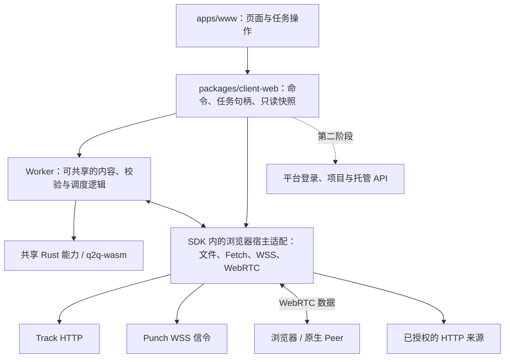

# Q2Q Web 客户端：设计与执行项

状态：2026-10-28，用户已确认主站 `q2q.app` 作为 Web 客户端与产品入口，打开即可体验上传、下载和分享；界面必须简洁、直观、友好，突出主要功能。本文包含界面方案与实施记录；SDK 的 HTTP 子集已实现，主站静态稿已获确认，apps/www 已接本机分享、种子导出、P2P/HTTP 下载与显式完成缓存分享，并通过本地实际页面哈希验收；公网 UI/跨设备/TURN 和线上部署仍未完成。

基线：main `d918cd9`，已同步合并的 webhook 并发修复 PR #94。产品总体方向见 [product-direction.md](product-direction.md)，现有平台视觉参考 [design/README.md](../apps/platform/design/README.md)。

## 1. 产品定位和站点分工

| 入口 | 主要职责 |
| --- | --- |
| `q2q.app` | 面向使用者的传输工具：分享本地文件、打开种子下载、查看进度、管理当前设备的任务 |
| `platform.q2q.app` | 控制台：项目、内容版本、持久存储、网络配置、用量与订阅 |
| `docs.q2q.app` | 接入文档、SDK 和协议说明 |
| Admin | 运营管理与套餐配置，保持现有边界 |

主站以传输任务为中心。产品介绍融入空状态、帮助和页尾；项目管理、套餐购买和运营指标留在控制台。Web 客户端也是以后桌面客户端交互设计的参考，但不因使用 Svelte 就假定任务运行时或文件权限可以直接共用。

首版需要跑通本机分享与浏览器下载，P2P 是验收内容；只有页面、云端上传或普通 HTTP 下载的阶段版本不能宣称完整 Web 客户端已完成。

## 2. 首次打开：两个入口，一张任务列表

### 桌面空状态

```text
Q2Q                                      文档   控制台   登录   ⋯

                    你的内容，随处可达。
              分享文件，或打开种子开始下载。

                [ 分享文件 ]  [ 下载文件 ]

               也可以把文件或 .q2q 种子拖到这里

              从本机分享 · 打开种子下载 · 内容校验
```

- 分享文件是主按钮，下载文件是同等可见的次按钮；按钮带文字，不让用户猜图标。
- 拖入普通文件进入分享确认；拖入 `.q2q` 先校验和预览再开始下载。后缀只决定入口，实际仍检查格式。取消文件选择不创建空任务。
- 首次无需创建项目、填写节点地址或登录。无需登录体验不等于对外承诺网络匿名性。
- 首版只支持单文件任务，可一次选择多个文件分别建立任务；文件夹、多文件打包、直播与磁力链元数据获取不进入首版必选范围。
- 空状态适当居中，不用大幅宣传图或过高留白撑满一屏。帮助说明保持一两句话。

### 有任务时

```text
Q2Q                                      文档   控制台   账户   ⋯

传输任务                                  [ 分享文件 ] [ 下载文件 ]
全部   下载   分享
─────────────────────────────────────────────────────────────
文件名                  状态与进度                  操作
archive.zip             下载中 · 38%                暂停   ⋯
                        ━━━━━━━──────
                        已校验 38 / 100 MiB · 速度
video.mp4               分享中 · 2 个连接           保存种子   ⋯
                        已发送 24 MiB
─────────────────────────────────────────────────────────────
```

这只是布局示意，名称、进度与速度均为设计数据。

- 有任务后收起大标题，操作移入列表工具栏，任务成为视觉中心。
- 数量少时默认全部；出现多种任务后再显示“全部 / 下载 / 分享”筛选。首版不增加搜索、排序面板和大面积统计卡片。
- 下载行显示文件名、当前阶段、进度、已校验字节和速度；分享行显示分享状态、发送量和连接数，不把发送量换算成“文件完成率”，也不把连接数叫作人数。
- 行内只留当前最常用的动作，其余放进更多菜单；任务详情用轻量侧面板或窄屏底部抽屉，关闭详情后回到原任务位置。
- P2P、HTTP、平台来源和错误细节放进详情；首页不展示 Peer ID、Track/Punch 地址或协议字段。

### 手机

```text
Q2Q                                    ⋯

[ 分享文件 ]          [ 下载文件 ]

传输任务
──────────────────────────────────────
archive.zip                         ⋯
下载中 · 38%
━━━━━━━━━━━━──────────────────────────
已校验 38 / 100 MiB              暂停
──────────────────────────────────────
```

手机与桌面共享同一任务模型；列表行自然重排，不缩成密集小字表格，也不引入常驻侧栏。主要功能不依赖 hover，拖拽之外始终保留文件选择按钮。

## 3. 三条主要路径

### 3.1 从本机分享

选择文件 → 确认文件名和大小 → 点击“开始分享” → 本地生成种子与证明 → 注册来源并等待接收方 → 保存 `.q2q` 种子发给对方。

- “选择文件”本身不把字节上传到云端；开始分享后，在线接收方可以从这个设备下载。
- 开始前简短说明“请保持页面打开，其他设备才能从本机下载”。传输期间在详情中保留这项说明，不反复弹确认。
- 分享状态使用“准备中 / 等待接收 / 分享中 / 已暂停 / 已停止”；没有接收方时不叫失败，不把种子生成完成当作文件已送达。
- 分享暂停或停止要释放上传资源并撤销可用性宣告；已有文件始终由用户保管。
- 首版优先导出实际可打开的 `.q2q`。分享链接只有在元数据解析、授权和过期语义接通后才显示，不能生成一个无法在另一台设备打开的空链接。

### 3.2 下载文件

选择 `.q2q` → 本地解析并展示文件名、大小 → 选择保存位置 → 点击“开始下载” → 查找来源 → 下载并校验 → 保存结果。

- 非法种子、没有可用来源、校验失败、磁盘空间不足分别给出可执行提示；输入文件名和种子字段按不可信文本处理。
- 没有来源时显示“等待可用来源”，允许重试、暂停和取消。网络断开与内容损坏不使用相同错误提示。
- 内容必须对照种子里的内容根校验；P2P、平台存储和其他 HTTP 来源执行相同校验规则。
- 进度区分接收、校验和保存。仅当目标写入及必要提交完成后才标记保存成功；文件名与大小相同不能代替内容验证。
- 下载完成后继续分享为明确的可选操作，默认不开启；只允许分享已校验、且满足当前存储提交语义的块。
- 首版不接受任意 URL 就直接代理或宣称可下载；来源来自有效种子和已授权的平台发布。

### 3.3 保存到平台（第二阶段）

本机分享和持久托管是不同动作。接通平台账号和授权后，在分享任务中增加次要操作“保存到平台”，选项目、展示配额并确认，再走平台上传、确认和发布流程。

- 不把“不登录也可本地分享”变成匿名占用平台存储。
- 沿用现有套餐、单文件和总存储限制，读取 Admin 当前目录；不在 Web 客户端写死 Free / Creator / Team 配额。
- 文件上传成功、种子处理完成和内容发布成功是不同阶段，保留明确进度和失败恢复。
- 在该路径实现前，控制台链接正常可用，但界面不显示一个假装能上传的“保存到平台”按钮。

## 4. 任务交互和视觉约束

| 项目 | 建议 |
| --- | --- |
| 结构 | 单页任务界面，无常驻侧栏；详情按需展开 |
| 视觉 | 沿用 Q2Q 品牌、shadcn-svelte、Lucide、系统字体和语义颜色；接近 Apple 原生的克制层级 |
| 密度 | 正文约 14px，次级信息保持可读；桌面任务行有适度间距，手机触控目标约 44px |
| 边框 | 列表整体细边框、圆角与普通卡片一致；行内细分隔，不给每行套多层卡片 |
| 操作 | 一个主要动作组；图标按钮的 hover 圆角与外框平行，阴影轻，菜单项有间隔 |
| 外观 | 浅色、深色、跟随系统；语言为简体中文与英文，偏好收进更多菜单/设置 |
| 响应式 | 320px 起不横向溢出；窄屏隐藏辅助字段但保留状态和动作，工具栏自然换行 |
| 可访问性 | 键盘可完成选择、确认、暂停和取消；有焦点、加载状态、错误关联和减少动态效果支持 |

用户关心的状态保持稳定：下载暂停只停止传输、不删除已保存数据；取消任务与删除本地缓存分别命名。清除历史不静默删除用户选定目录中的文件，也不撤销已建立的云端发布。任务在站内打开设置或详情时继续运行；刷新、关闭标签页和手机后台挂起要真实反映停止与恢复能力，不承诺后台常驻。

## 5. 实际能力与缺口

以下核对来自当前代码，不将旧规划当作已实现能力：

| 现有部分 | 可复用内容 | 本轮仍需补齐 |
| --- | --- | --- |
| `crates/q2q-wasm/src/lib.rs` | 种子解析、增量 SeedBuilder、证明导出、来源配置 | 没有完整下载器，也没有公开的浏览器块校验/Peer 协议绑定；需要按最小契约扩展 |
| Rust `q2q-core` | 已有原生下载、做种、校验、恢复和资源控制 | 依赖原生 Tokio、文件、QUIC、reqwest、webrtc-rs，不能直接视为可在浏览器运行 |
| Track Worker | HTTP 控制面、Peer 索引与票据 | 当前允许跨域响应不等于完整支持浏览器 JSON 请求；需核对 OPTIONS、方法、请求头与协议整数精度 |
| Punch | 已有 WebSocket 信令与原生互通基础 | 浏览器 `WebSocket`、认证帧、WSS 证书、SDP/ICE、Peer 身份绑定仍需真实验证 |
| 平台上传 API | 登录、项目权限、分片上传和配额 | 当前写请求要求同源；主站不能直接带平台 Cookie 跨域调用就假定可用 |
| 平台下载授权 | 持有有效 grant/secret 可以领取受限下载地址，撤销与版本约束已存在 | 浏览器请求经过跳转还需要平台和实际对象来源的 CORS、Range、响应头和授权刷新验证 |
| `packages/ui` | 通用控件、主题与视觉变量 | 可以按真实复用需求增加任务展示组件，运行时不放进 UI 包 |

现有技术方案里“内容发布尚未实现”等条目属于较早的阶段记录；当前平台已有发布、下载授权与测试计费代码。本方案按实际模块接线，不据旧文档重新建设这些功能。

## 6. 建议的工程边界

建议正式应用放在 `apps/www`，沿用 SvelteKit、TypeScript 和共享 UI，独立部署到 `q2q.app`。先单独设计 `packages/client-web`（包名 `@q2q/client-web`），主站消费 SDK 的任务契约；详细边界与执行项见 [web-sdk.md](web-sdk.md)。apps/www 已消费 SDK 的真实 HTTP 子集，不额外建立传输内核 crate。



- 页面只消费任务快照并发出命令，不在 Svelte 组件内维护块调度或 Peer 协议。
- JS/TS 负责浏览器 API 与 Worker 消息；种子、Merkle、内容身份、签名消息规范和协议编解码优先复用 Rust。不要同时维护一套 JS 与一套 Rust 的内容校验算法。
- 先审计 `q2q-core` 能抽出的运行时无关逻辑及多态接口，优先复用传输状态、调度和恢复规则。若原生依赖阻挡 Wasm 复用，先记录具体拆分方案和协议一致性用例，不在页面里另写完整 SDK。
- Web SDK 放在 `packages/client-web`，包名 `@q2q/client-web`；Node 独立包 `@q2q/client-node` 使用 napi-rs 绑定现有 Rust Client，同时服务主站与第三方浏览器接入，不依赖 Svelte 或主站账号体系；先定稿接口、生命周期及适配边界，再实现主站。
- Worker 与主线程按浏览器 API 实际可用范围分工，SDK 封装桥接；不假定 WebRTC、权限弹窗和存储 API 都能在同一种 Worker 中运行。
- 浏览器直接访问来源与 Peer，默认不把大文件字节代理经过主站 Worker；WebSocket 传递信令，不把它直接当成 P2P 文件通道。
- 网络连接、worker、文件句柄与流都有明确持有者。取消必须中断请求、停止调度并释放资源；有界缓冲与背压不随文件大小无限增长。
- SDK 公共 API 首稿见 [SDK 公共接口草案](web-sdk.md#3-公共接口草案)：本机分享使用 publish，下载使用 download，任务通过 subscribe 观察并通过 pause/resume/cancel/close 管理。Web 与 Tauri 可以使用不同 host adapter，不宣称两个运行时完全相同。

## 7. 浏览器保存和恢复

| 能力路径 | 处理方式 |
| --- | --- |
| 支持用户可见文件句柄和流式写入 | 用户点击开始时申请保存位置；按块写入，关闭流等提交完成后记录可恢复状态，不能把 write 返回视为最终文件已更新 |
| 只有 OPFS / IndexedDB 等站点存储 | 先检测配额，使用有界缓存；校验完成后提示保存。缓存不是用户下载目录中的最终文件 |
| 需要 Blob 导出的降级路径 | 只允许已验证的小文件上限，大文件在开始前说明不支持；不把整个任意大小文件读入内存 |
| 权限丢失、站点数据清除或来源文件失效 | 显示“重新选择文件”或“需要重新授权”，核对内容后恢复，不按文件名自动绑定 |

`showSaveFilePicker` 并非所有主流浏览器通用，OPFS 也受配额及清除站点数据影响，因此按能力检测选择路径，而非靠浏览器名称判断。具体首版文件上限在技术验证中用实测结果确定，不沿用云端套餐上限作浏览器承诺。依据：[保存位置 API](https://developer.mozilla.org/en-US/docs/Web/API/Window/showSaveFilePicker)、[OPFS](https://developer.mozilla.org/en-US/docs/Web/API/File_System_API/Origin_private_file_system)。

- 按 API 的真实可用范围在 host/Worker 中协调流式写入、内容校验和恢复元数据；块从接收、验证、持久提交到可共享分别确认，保持现有 SDK 的可信边界。
- 刷新后可恢复元数据不等于任务继续在线；文件权限、内容根、种子及检查点必须重新绑定。重新分享本机文件可能需要用户再次选择。
- OPFS 降级导出如果只能交给浏览器下载管理器，就显示“已提交保存”，不假装已经确认系统文件落盘。需要通过实际文件比对验收最终结果。
- Service Worker / PWA 安装不作为长期后台做种保证；首版以前台标签页任务为边界。
- DataChannel 的发送和接收有界，使用缓冲量与低水位通知控制背压；依据：[RTCDataChannel](https://developer.mozilla.org/en-US/docs/Web/API/RTCDataChannel)。

## 8. 主站与平台接入边界

维护者确认第一阶段主站不做平台账号 Auth，也不放登录/头像入口：本机分享和有效种子下载无需平台登录；云端文件、项目、存储和订阅在 platform 完成。以后确需主站托管能力再设计账号授权，不提前接会话。SDK 的 Peer 身份认证与用户登录是两件事。

- 平台现在使用自身 origin 和会话。增加主站接入时，单独确定回调、授权和当前项目选择；不直接扩大 Cookie 到整个父域，也不为了跨域提交而关闭 CSRF。
- 建议主站用同源业务入口承接平台能力，由受限的授权或 Service Binding 调用平台服务；用户身份与项目权限在平台重新校验。具体登录交换流程在该执行项中出设计后实施。
- Peer 身份、平台账号与内容访问 grant 分别处理。持有内容种子或哈希不等于持有私有文件下载权限。
- Track 的浏览器预检、Punch WSS 和 HTTP 来源逐个验证。新增主站域名时明确允许的方法和响应头；第三方来源必须支持浏览器读取，不能用 `no-cors` 隐藏失败。
- 分享 grant、签名地址、Peer 私钥不进入分析埋点、控制台错误、第三方脚本和服务端请求日志。复用已有短期授权、撤销与内容版本校验，不把 S3 长期密钥带到浏览器。

## 9. 执行项和验收

以下执行项按顺序推进，本轮不提前勾选实现或线上验收。

### W1. 独立 Web SDK 设计

- [ ] 完成 [web-sdk.md](web-sdk.md) 的 S1，设计 `packages/client-web` 的公共接口、任务句柄、快照、错误与生命周期。
- [ ] 明确 Rust/Wasm、Worker 和浏览器 host 的复用与多态边界，以及文件、存储和网络资源的持有者。
- [ ] 用独立于 Svelte 的调用示例审查分享、下载、暂停、取消、恢复和关闭流程。

验收：主站无需自己维护传输状态机；第三方网页可以使用同一 SDK。SDK 设计先于客户端实现，不以先搭页面代替接口设计。

### W2. 浏览器能力与原生互通验证

先完成 [SDK 实现前边界与实验](web-sdk.md#6-实现前必须补齐的边界)：文件提交/恢复、WSS 发现与双向认证、外置证明与规模。未通过的依赖不得以页面模拟结果代替。

- [ ] 对照实际 SDK 列出可复用的 Rust 内核、需要的 Wasm 导出和浏览器 host 接口，确定不重复实现传输状态机的边界。
- [ ] 在目标浏览器验证种子解析、分块读取、校验、保存与取消；记录 Chromium、Safari、Firefox 的实际结果、降级和未支持项。
- [ ] 验证 Track 的 OPTIONS/JSON 控制请求、浏览器 WSS 鉴权、Peer 身份与 DTLS/SDP 绑定、DataChannel 分帧及背压；不能只验证 WebSocket 能建立。
- [ ] 双浏览器互传、浏览器下载原生做种、原生下载浏览器做种；对收到的完整文件做内容哈希比对。
- [ ] 至少覆盖小文件、100 MiB 和流式路径的 1 GiB 样例；记录峰值内存、站点缓存用量和取消后的资源释放。不能通过的大小不进入能力宣传。

验收：证明与既有 Q2Q 网络能真正传输并校验内容；据实确定可发布的浏览器与大小范围。若互通或保存不成立，先解决依赖或调整明确的降级范围，不用假进度替代。

### W3. 工程与任务内核

- [ ] 按 [web-sdk.md](web-sdk.md) 的 S3–S5 建立独立 SDK 包，先在最小浏览器示例中跑通，不依赖主站。
- [ ] SDK 内完成 Worker/host 消息、命令、只读快照、取消与资源归属；扩展最小 Wasm 内容/协议接口。
- [ ] 建立原生与浏览器共用的种子、证明、认证消息和 Peer 数据协议 fixtures，覆盖大整数和非法输入。

验收：页面只接任务服务，重要协议行为有共用样例；增加网络适配不需要改页面状态机。

### W4. 客户端原型与 HTTP 下载接入

- [x] 在 `apps/www/design` 保存浅色、深色与手机静态稿，覆盖空状态、分享确认、下载、暂停/错误/待保存、详情与设置；所有文件与进度标为示意。待维护者确认，见 [设计预览](../apps/www/design/README.md)。
- [x] 确认无账号 Auth 的简洁布局，建立 `apps/www`，复用共享品牌、主题、语言及 shadcn-svelte UI。当前真实页面只展示已可用的打开种子入口。
- [x] HTTP 子集通过 SDK 任务接口接入真实行为；页面不复制下载、校验或 Peer 调度。
- [x] 完成 `.q2q` 选择/拖入、解析预览、Range 下载与逐块校验；下载完成后选择位置流式保存，无原生保存 API 时小于等于 32 MiB 可提交浏览器下载管理器。
- [ ] 接好来源 CORS、受限授权与刷新；校验失败不写入可共享的完成记录。
- [x] 接入真实进度、暂停、重试、取消和保存结果；先完成真实字节与 UI 的本地验收。
- [ ] 提供由项目维护的公网可校验演示种子；目前浏览器验收使用本地生成样例。

验收：可以在没有 Peer 的情况下从合法 HTTP 来源下载并校验；来源缺失、过期授权、内容变化和存储不足有不同反馈。这是开发里程碑，不是完整主站发布验收。

### W5. 本机分享与 P2P 下载

- [x] 将 SDK 的本地分享、保存种子、来源宣告、心跳和停止做种能力接入界面。2026-11-08 实际页面本地验收通过。
- [ ] 展示 SDK 的浏览器 WebRTC、Punch 信令及 TURN 回退状态；P2P 与 HTTP 共用内容校验及存储边界。
- [ ] 完成本机分享和下载两条 UI 路径，连接中断、无接收方与跨网络失败有可恢复状态。
- [x] 下载后继续分享为显式操作，默认关闭；发送/连接信息来自真实运行时。2026-11-08 完成缓存再发布、源缓存删除保护已接线并验收。

验收：两台设备完成一发一收，并完成原生双向互通；强制 TURN、来源离线及仅 HTTP 路径分别验证，不把同机成功当作跨网络成功。

### W6. 恢复、容量和页面生命周期

- [x] HTTP 子集持久化内容身份、SDK 已提交块及安全任务元数据；不保存可能带授权的原始种子/来源 URL，刷新后重新选择同一内容身份的种子，交给 SDK 重验。
- [ ] 覆盖刷新、文件重新选择、后台挂起、多标签页争用、磁盘/配额不足和缓存清理。
- [ ] 内部打开详情/设置不重建任务；暂停、停止和取消释放连接、Worker 任务与缓存预算。

验收：错误的同名文件无法恢复到旧任务；清历史不删除用户文件；内存不随文件体积增长；恢复页不谎报仍在后台传输。

### W7. 平台登录与持久托管（第二阶段）

- [ ] 先细化主站登录/授权交换、回跳后的本地文件接续，以及项目选择方案。
- [ ] 再接“保存到平台”、现有上传/发布 API、套餐配额和授权刷新；补跨 origin 与账号/项目隔离回归。
- [ ] 从控制台生成的已授权种子可由主站打开，过期或撤销后正确停止继续领取来源。

验收：本机分享仍无需登录，持久托管需要身份与项目权限；同一文件上传、发布和本机做种在界面中各有明确含义。

### W8. 上线与文档

- [x] 新增 Web 类型检查、Wasm/Worker 构建和浏览器测试 CI；共享包变更触发实际依赖方检查。本地验证通过，尚无本轮远端 CI 结果。
- [ ] 确认上线条件后执行独立部署；Web CI 已配置 main 检查后部署，但尚未触发或上线。
- [ ] 配置 `q2q.app` 和需要的网络/API 来源，不覆盖现有 Platform、Track、Punch 部署配置。
- [x] 验证浅/深/系统主题、320/390 窄屏与桌面、键盘、两种语言及实际任务状态；真实字节样例独立哈希一致。2026-11-08 本机矩阵完成，窄屏不等于真实手机系统/后台验收。
- [ ] 同步中英文使用文档、支持矩阵、前台生命周期和已知限制，补隐私说明中的本机传输与本地缓存行为。

发布门槛：W1–W6 与 W8 的首版验收通过，包括本机分享、浏览器下载、真实校验与原生互通；W7 可独立交付，主站不把尚未实现的托管操作显示为可用功能。目录/多文件打包、公开分享短链接、直播和后台常驻另立后续任务；磁力链方案见 [web-magnet.md](web-magnet.md)（设计稿，待确认）。

## 本轮交付记录

- [x] 同步 PR #94 合并后的 main，核对当前 SDK/Wasm、Track/Punch、平台授权与上传入口。
- [x] 整理产品、界面、工程边界、浏览器能力与分阶段验收。
- [x] 调整为独立 Web SDK 先行，单独建立设计草案与执行项；下一项为 SDK 接口与生命周期定稿，随后做关键能力验证。
- [x] 2026-10-28：提供 `apps/www/design` 待确认静态稿与截图；主站无账户入口，文档/控制台/设置保留。Chromium 检查 5 状态 × 4 宽度及主要演示交互通过。
- [x] 用户确认视觉后恢复正式应用，接通 HTTP 下载、OPFS 暂存与保存、任务控制和刷新恢复。
- [ ] 分享/P2P 与线上发布继续按 SDK C7/W5/W8 推进，不将 HTTP 里程碑冒充完整 Web 客户端。

### HTTP 页面验收（2026-10-28）

`apps/www` 用真实 @q2q/client-web 句柄和 OPFS/IndexedDB 承接页面，不含账号系统。保留种子原对象（Svelte $state.raw）、用 SvelteMap 跟踪可重试种子；任务历史按任务键单独更新，避免多标签页整个列表互相覆盖。不持久化原始种子、来源授权或私钥。恢复时“上次提交”只是提示，新会话重验后才显示当前校验进度。

Chromium 148 / Playwright WebKit 26 的 12 项真实页面测试在开发模式与生产预览均通过：约 2 MiB 内容下载并从浏览器下载结果独立 SHA-256 比对、暂停与刷新后重选种子恢复、拒绝错误恢复种子、非法种子/损坏内容/过期授权、取消后停止请求并重试、多标签页记录隔离、缓存删除、主题及 SSR 语言保持。WebKit 使用正常磁盘 profile，不把隐身存储限制误记为 SDK 不支持。原生保存窗口由 SDK C5 验收，本轮页面自动化测试的是有界 Blob/浏览器下载管理器路径，不把它称作系统文件落盘确认。

Svelte 类型检查无错误/警告；Cloudflare adapter 生产构建、npm ci dry-run 与 9 项 CI 影响判断测试通过。Web CI 只检查/构建/跑浏览器，不读取发布凭据、不自动部署。支持矩阵及保存限制见 [apps/www/README.md](../apps/www/README.md)。本轮未部署到 q2q.app，未验收浏览器 P2P、公网授权来源或新的大文件 HTTP 容量。

### 2026-10-29：主站 CI 发布流程

主站目录与包名统一为 apps/www、@q2q/www。WWW 工作流沿用 platform 的影响判断、PR 检查、main 检查通过后部署及手动 main 部署规则，复用 Cloudflare 仓库凭据；wrangler 配置 q2q-www 与 q2q.app Custom Domain。SDK/浏览器回归全部成功后才允许部署；PR 不接触发布凭据。当前仅完成配置，尚未触发远端 CI 或实际部署。


### W5 本机分享/P2P 页面接线与本地验收（2026-11-08）

对照已确认 apps/www/design 实现两主入口、统一任务列表与按需详情，没有新增账户系统/侧栏/统计面板。
分享文件选择后先确认，不立即上传或开始任务；SDK Publication 负责源读取、种子/证明、宣告/续约、
WebRTC 服务和关闭，页面只保存句柄并订阅快照。分享行显示准备、等待接收/发送、发送量和连接数，
不以发送量冒充完成率。保存实际 q2q 种子、pause/resume/stop/remove 已接入，中英文保持一致。
分享 File/种子/私钥不进历史，刷新后不谎报在线，重新分享需重选文件。详情/设置不重建活跃任务。

下载 Client 显式接公开构建变量 PUBLIC_Q2Q_TRACK_URL（SvelteKit 3 src/env.ts / $app/env/public），
默认官方 Track，空值为 HTTP-only；页面不拼 Punch URL、不隐式使用种子里的 Track。允许 Peer-only
种子进入 SDK 下载，P2P/HTTP 复用原有校验、OPFS、保存及恢复流程；详情显示控制连接状态和来源策略，
明确在线不代表 P2P 字节或 TURN 实际路径，不伪造 SDK 当前没有提供的质量/中继观测。

完成内容不默认再分享。更多菜单的显式“继续分享”用缓存 entry.source 再调用 SDK publish，校验后
宣告；活跃使用该缓存的分享暂停或在线时禁用删除，先停止再删除。页面尚不提供下载中 partial API
开关；SDK 能力并不意味着 UI 默认向外共享。上传/下载各自 SDK Client，独立任务资源，页面关闭收敛。

本轮最终生产构建/预览 22 通过、2 跳过（WebKit/native 两方向页面用例），类型 0 错误/0 警告。
包含既有 HTTP/恢复 12 项、分享文件导出种子→另一页面打开→真实 P2P→OPFS导出 SHA-256、一发一收
页面生命周期、390px 无横向滚动、确认取消、详情/设置不中断、切英文后任务/动作一致、完成缓存再分享
且原发布已停止后的独立接收、禁用缓存删除、Chromium 发布→原生实际文件哈希、原生发布→Chromium
页面保存相同字节。只有本地 fixture 生成约 768 KiB / 2 MiB，非跨 NAT 或任意大文件能力证明。
测试把官方/虚拟 Track 请求路由到临时本地服务，不连接生产；生产默认构建也按相同方式回归，主站未部署。

用户说明同步 docs/zh/en/guide/web-client.md，应用 README 引用，不维护第二套部署手册。
首次新增语言测试存在菜单 locator 与初始化等待问题，按实际控件语义/初始化修复后最后 22/22 通过。
W5 的强制 TURN/跨设备/断线恢复矩阵、完整 W6 容量/移动生命周期与 W8 上线仍未完成，不提前勾选。
未提交/推送/部署，也未改变 Platform/Registry/Punch/Track 线上资源。


### 本机异常、重试与前台恢复收尾（2026-11-08）

维护者明确跨设备先跳过；跨设备/跨 NAT/强制 TURN 保持未验收，不以本机测试替代。
本轮新增实际页面异常路径，均对临时本地 Registry/Track/Punch 操作，不访问生产或改线上限流。

- 原发布暂停撤回来源时，Peer-only 种子下载进入真实失败态、不假装完成；原发布恢复后，同一
  任务“重试”复用检查点，下载、OPFS 导出及独立 SHA-256 一致。
- 真实停止临时 Punch 进程使活跃分享进入 failed；按原持久身份/端口重启本地服务后，用户
  重新选择文件发布成功。增加 fixture.restartPunch，不提供产品自动无限重连或服务器管理 API。
- 原生 SDK 发布的无 HTTP 证明来源种子，在 Chromium 实际页面提交部分块→暂停→真实 reload→
  等待恢复→重新选择原种子→SDK 重验检查点→下载完成→导出哈希一致。WebKit/native 此项跳过。
- Track 503 的准备失败不提供可下载 seed，失败任务移除后发布额度释放；恢复本地入口后重新选择
  文件正常分享。失败态没有可执行句柄，移除其无效“停止分享”菜单入口，保留详情/移除/重新选源。
- 活跃分享直接 reload 不持久化 File/身份/源授权，不恢复假的在线任务；重开页面任务为空，可再次
  明确选择文件发布。浏览器硬关闭不保证 JS close 一定执行，远端索引/会话可依靠 TTL 到期，不能
  将前台恢复测试描述成关闭页面后后台做种或远端立即零残留。

本轮实际结果：最终 WWW 生产构建/预览 31 通过、0 失败、3 跳过（WebKit/native 三条路径）；
原有 HTTP、多标签页/缓存、主题/语言和分享完整文件验收均包含在该套件。SDK 本地 network/publish/
partial/p2p 定向回归 88 通过、0 失败、20 已知跳过，确认 fixture 的真实进程重启能力不影响原用例。
WWW 类型 0 错误/0 警告、生产构建、CI 影响判断 10 项、diff 检查通过；本轮没重跑整工作区 Rust、
存储大文件或系统保存窗口。未提交/推送/部署，未操作任何线上资源。

完成的是 W5/W6 在本机的异常/恢复子集；真实手机后台、授权撤销、磁盘耗尽、更多尺寸与跨网络矩阵
仍未全量验收。W8 主站尚未上线，不能把本轮结果提前勾成所有 W5/W6/W8 发布门槛全部通过。


### 100 MiB / 1 GiB 实际页面 P2P 与保存边界（2026-11-08）

维护者要求接续上线前大文件验收。新增显式 opt-in large-transfer.spec.mjs，固定 Chromium
持久 profile、两个独立浏览器、临时真实 Registry/Track/Punch，所有网络隔离到 loopback，
不访问生产、不放宽限流/认证、不部署页面。Node 分块生成文件并独立流式 SHA-256，页面
通过系统文件输入选择源文件而非把全文件 Buffer 注入；浏览器 SDK 生成种子并 P2P 下载到 OPFS。

100 MiB 与 1 GiB 分别完成：准备→种子导出→第二 profile 下载→提交部分块后取消→检查点
重试→完成→缺原生 picker 时拒绝 >32 MiB Blob→注入 OPFS picker 流式导出→有界 1 MiB
CDP 分块读回交 Node 流式 SHA-256→源/导出哈希一致→停止发布/删除缓存和导出→清理 profile。
取消时已提交 10,485,760 / 9,961,472 字节；恢复后内容无重复/损坏，实际完整大小为
104,857,600 / 1,073,741,824 字节。两组测试分别 1 通过（约 16.2 秒 / 2 分钟）。

测量记录：

| 样例 | 准备 ms | 取消/重试阶段 ms | 剩余传输 ms | 流式导出 ms | 独立读回哈希 ms | 双进程树 RSS 采样峰值 bytes |
| --- | --- | --- | --- | --- | --- | --- |
| 100 MiB | 870 | 874 | 5874 | 389 | 2309 | 2054848512 |
| 1 GiB | 3876 | 896 | 60003 | 2898 | 23646 | 2068561920 |

源文件和导出文件 SHA-256：100 MiB e28ecf908cea4e9855dd0873b859c19ca827301e41498d7c672dd7b033cdce24；
1 GiB 7af06c63b15a40ee3dffd5fb2c1fe11bfb8ba64ae50f29eb4b08bae5ea3b1196。
origin 下载后/导出后/删除后用量 bytes：100 MiB 105466686 / 210324472 / 609458；
1 GiB 1078040783 / 2151782795 / 4299794。删除后仍有数据库分配/元数据用量，不称零残留；
profile 退出后本轮源文件与临时目录已删除。两浏览器初始 RSS 已约 1.56 / 1.61 GiB，
500ms 采样求和含共享页重复计数、漏短峰与浏览器原生开销，峰值不能等同独占物理内存或稳定上限。
两种长度的峰值接近只是观察，不以此证明任意文件内存恒定。本机传输时长不宣传为公网吞吐。

本轮页面流式导出目标为真实第二个 OPFS 文件，不是实际系统保存选择器；页面保持待保存，
没有误报 user-file。真实用户目标反复 commit 放大成本、物理磁盘耗尽、操作系统持久性、
更多设备/浏览器/公网大文件不在这两项验收内。跨设备/跨 NAT/强制 TURN 按维护者要求继续暂跳过。

最后普通 WWW 生产预览回归 31 通过、7 跳过（3 项 WebKit/native + 4 个大文件 opt-in 项），
类型检查 0 错误/0 警告、diff 通过。默认 CI 不跑多 GiB 负载，显式开启后报告输出到 .tmp 并
附于 runner。主站未部署，未提交/推送；W6/W8 不据单一 Chromium 本机测量全部勾选。


### 本机最终界面与整合验收（2026-11-08）

维护者要求一口气完成当前可执行的本机验收。未把跨设备/跨 NAT/强制 TURN（已决定暂跳过）、
真实系统保存/移动后台、Safari.app 或未完成的公网稳定性问题偷换成本机截图通过。

新增 ui-matrix.spec.mjs：Chromium148 / PlaywrightWebKit26 × 320/390/1280 × 中英文 ×
浅/深色共24组，实际启动生产预览与临时真实 Registry/Track/Punch，逐组驱动空状态、文件选择/
分享确认、发布就绪、分享暂停/恢复、详情、设置、下载暂停/继续/待保存、无来源失败，并输出216张
本地实际截图。非静态原型或 mock 进度；查看代表性截图并对照已批准 design 的布局。每种状态检查
body 无横向溢出、dialog 留有屏幕边距，长文件名/类似 HTML 的不可信文本不形成元素，不产生 pageerror。

键盘实际驱动文件选择触发器、确认、Tab循环、菜单Home/ArrowDown/Enter、下载暂停/继续与Escape。
macOS WebKit 默认普通Tab不遍历按钮，采用其标准Option-Tab全控件导航；不把OS偏好差异改成自写
焦点状态机。等待实际焦点落定后发送键盘事件，避免 test 的菜单初始化竞态。设置使用真实键盘触发
时两浏览器Escape均恢复焦点；Safari鼠标click默认不聚焦按钮不作键盘回归失败判据。
另2项测试验证显式浅色覆盖暗色系统、刷新保持偏好、切回system后响应OS媒体变化。

截图发现并修正：320px英文空状态主按钮上下换行，按确认稿调整为窄屏并排等宽；英文单任务
1 transfers改为1 transfer。非整体布局改版，不改批准的设计基准。最终矩阵在真实修复构建上重跑。
额外Chromium CDP 1MiB真实origin配额验收：页面正确提示本地空间不足、部分缓存可删除；结束解除
配额。不填满宿主实际磁盘，也不宣称物理磁盘故障/断电已测。

最终统一结果：

| 范围 | 本轮结果 |
| --- | --- |
| WWW真实生产预览全部普通场景 | 58通过、0失败、8明确跳过；含24组矩阵、2主题持久偏好、1配额及既有31流程。 |
| WWW的8项跳过 | 3 WebKit/native ICE、4大文件opt-in组合（本轮此前Chromium100MiB/1GiB单独通过）、1 WebKit不支持CDP配额；不计成功。 |
| SDK本地浏览器storage/http/network/rtc/p2p/publish/partial/bundle | 289通过、0失败、23已知跳过；不含@large/@public。 |
| Rust workspace | 511通过、0失败、22ignored；fmt、all-targets Clippy warnings-as-errors通过。 |
| Wasm/类型/单元/CI gate | Wasm绑定与独立密码学/证明对照、SDK类型及11单元、WWW0错误0警告、10项app-impact、diff通过。 |
| 大文件真实页面 | 100MiB/1GiB本轮前段均通过，取消/恢复、最终独立SHA-256、OPFS流式导出/清理，具体数字见上一条记录。 |

本轮实际截图保存在 .tmp/www-playwright/results/ui-matrix-*，本地报告 .tmp/www-playwright/report。
不是WCAG全面合规评估；没有运行屏幕阅读器、所有平台高对比模式或用户真实授权撤销窗口。
未提交、推送或部署，主站仍未上线，也没有访问生产Track/Punch。临时本地服务/磁盘profile收尾清理。
当前可本机验收项已收尾；剩余为显式暂跳过/需真实设备或交互窗口的项目、未根治的公网长会话超时和
代码/已部署控制面的仓库收敛及正式上线决策。不要重复把每个已通过阶段又作为新待办重新执行。


### Safari 跨设备失败诊断（2026-11-09，进行中）

维护者实测同 Wi-Fi、线上主站：iPhone Safari 发布到 Mac Edge 成功，发布到 Mac Safari
失败；浏览器均为当前最新版，分享页保持前台等待接收，控制台未见错误。该对照缩小范围，
但尚不能判定 ICE、DataChannel 或身份握手根因。

本轮先补最小诊断：SDK 保留失败阶段、原始错误码与失败前 RTC/ICE/通道状态及候选计数，
传输详情展示脱敏 JSON；不输出 SDP、候选地址、Peer 身份、URL、票据或 TURN 凭据，不新增
遥测、不自动上传，不改变传输协议。验收覆盖诊断字段白名单、失败快照保留、浏览器错误路径
及页面详情展示；本地 WebKit 通过不等于 Safari/iPhone 跨设备已修复。未获授权不部署或发布。


本轮实现：新增可选只读 ConnectionDiagnostic，白名单限定阶段、RTC/ICE/信令/通道状态和
0–256 候选计数；本机失败前截取，错误码与 retryable 原义保留，下载拒绝和快照均可读取。
外层信令超时不被清理取消错误覆盖；数据面首帧/分块错误也在关闭 RTC 前补上下文。页面
失败详情显示脱敏 JSON，网络提示不再无依据归因为 CORS。无日志自动上传，无 SDP/IP/
URL/原生异常正文/凭据，诊断不写任务历史。中英文文档同步，并纠正文档仍写主站未上线的
状态；主站已上线不等于此次诊断已发布。

已验证：SDK 单元 13 项、类型检查、WWW 0 错误/0 警告、生产构建、中英文 docs 构建、
10 项 app-impact 与 diff 检查通过。WebKit RTC/HTTP/信令诊断专项 45 通过、2 既有跳过；
完整主站 WebKit 27 通过、6 既有跳过；新增真实 P2P offer 失败→任务详情阶段/状态/脱敏与
不持久化诊断用例另行 1 项通过。首次完整 SDK 回归 137 通过、23 既有跳过，bundle 因本轮
未设置 CI 所需 VITE_RESOLVE_FROM 误用根 Vite5 而构建失败；按 CI 指定 apps/www/package.json
后 bundle 通过，完整 WebKit SDK 重跑最终 138 通过、23 既有跳过。Chromium 运行被当前权限阻止，未将未执行
计为通过。没有复现或修复真实 Mac Safari/iPhone 失败，未提交、推送、创建 PR 或部署。


PR #101 首轮 CI 排查（2026-11-10）：2148b36 的 WWW 运行 42648420709，WebKit
failed-close 存储用例报原生 UnknownError；Chromium SDK 阶段通过，WWW 离线来源恢复后的
下载未完成。下载独立 CI 工件检查：收尾导航到空白页后截图无法说明真实失败；trace 仅保留
存储通用文案，没有打开原始任务诊断。WebKit trace 同样没有 native 异常的用例内阶段。

先增强失败证据而不放宽断言：完成失败时在导航前读取页面脱敏连接诊断并附到错误；文件
fixture 标明 root/create/cleanup，failed-close 标明 open/write/finish/reopen/abort。
本地 WebKit failed-close 重复 20 次通过、离线恢复重复 16 次通过；SDK 类型、脚本语法、
diff 检查通过。未根治这两项 CI 间歇失败，不以重试或 skip 掩盖；更新 PR 后继续核实 CI。


### 磁力链接入（2026-11-14，本机验收）

按 [web-magnet.md](web-magnet.md) 实施并本地验收：Wasm 新增磁力链解析/元数据验证/最小种子/链接生成四个导出；SDK 新增
`parseMagnet`/`resolveMagnet`/`seedMagnet`、缓存优先的元数据发现与 IndexedDB 缓存，上传端首消息状态机支持
`request_info`→`info`；主站“下载”对话框支持粘贴磁力链，任务历史记录来源类型并提供“重新粘贴链接”恢复，
分享行菜单可复制磁力链（剪贴板被拒时给出只读链接）。决策项按推荐执行：页面不使用链接 `tr`、入口改为“下载”对话框、分享侧加复制。

本机 Chromium/Edge 148：SDK 磁力链用例 6/6、相关 p2p/publication/partial 回归 22/8/8 通过，www 磁力链用例 9/9（含原生 SDK 从页面磁力链解析下载、HTTP-only 构建提示）、
既有 download 7/7、sharing 12/12 与 ui-matrix 13/13 通过；Wasm Node check 4 组与 Rust 单元测试通过，Rust sdk 集成 11 通过/2 显式忽略、fmt 与 clippy 通过。WebKit 本机 OPFS 持续原生
`UnknownError`，磁力链页面用例未在 WebKit 执行；跨 NAT/TURN、真实移动端与线上页面未验证，主站未部署新版本。
以上结果不等同 CI 通过或发布完成。
