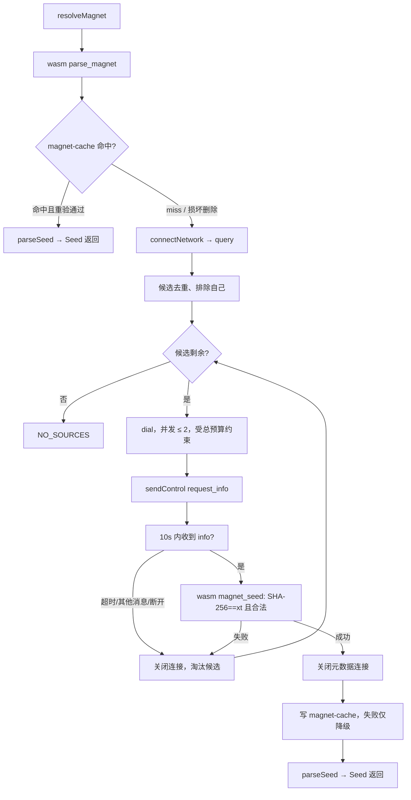

# Q2Q Web 磁力链方案（apps/www）

状态：**方案已确认（2026-11-14），按实施顺序推进**。D1–D4 均按推荐项确认：不使用 `tr`、入口改“下载”对话框、分享侧加“复制磁力链”。本文不表示任何能力已实现；完成状态见文末执行记录。
依据：[磁力链核心方案](magnet-download.md)（Rust core/CLI 已实现并本地验收）、[协议 4.3 / 5.3](../docs/zh/spec.md)、[Web 客户端方案](web-client.md)。
当前实况：`apps/www` 只接受 `.q2q` 种子与本机分享，无磁力链入口；`packages/client-web` 与 `q2q-wasm` 均无 magnet API；原生端 `request_info` / `info` 消息、上传端响应与 `Client::resolve_magnet` 已上线（协议面无需改动）。

## 目标

- q2q.app 支持粘贴 Q2Q 磁力链（`magnet:?xt=urn:sha256:…`）：解析元数据 → 预览 → 下载，复用现有 P2P 下载、Merkle 逐块校验、OPFS 暂存、保存与刷新恢复。
- 本机分享侧提供“复制磁力链”，并让 Web 发布者响应 `request_info`，实现 Web↔Web、Web↔原生 CLI 双向互通。

## 复用与不变项

- **Peer wire 协议不变**：`request_info` / `info` 消息已在 `Control` 枚举（`peer_wire.rs`），web 端 `decode_peer_control` 走同一 serde 定义，天然可解码；`deny_unknown_fields` 保证了 `request_info` 必须是严格空消息。
- **下载主链路不变**：解析得到的最小 seed（无 `cdn_list`/`proof_list`/`leaf_hashes`）与现有 Peer-only 种子同构，走 `createPeerBlockVerifier` 逐块证明校验路径（transfer.ts 已验证过该路径）。
- **Track 查询不变**：`peerNetwork(session).query(hash)` 已按 info_hash 查询，无需 info。
- **上下限沿用核心冻结值**：链接 16 KiB、info 原始字节 8 KiB、控制消息 16 KiB（web `CONTROL_MAX=16384` 已有）。base64 后 info 最大约 10.9 KiB，envelope 后仍在控制消息限内。

## 边界与决策点

第一阶段边界（对齐核心方案）：

- 仅 `urn:sha256`；`btih`/`btmh` 明确报“不支持 BitTorrent 磁力链”。
- 元数据只从在线 Peer 获取；无 `xs`/`as` HTTP 元数据源。CDN-only、无在线 Peer 的内容无法用磁力链冷启动，仍需 `.q2q`。
- `dn` 只是提示：解析等待期最多显示 hash，不展示 `dn`，不用未验证名称创建任何文件名；目标名来自验证后的 `info.name`（与 CLI 一致）。
- 不做系统 scheme 注册、不接受 URL query 自动填充链接。

**决策点 D1（Track 提示 `tr`）**：推荐 **www 不使用链接中的 `tr`，只连构建配置的 `PUBLIC_Q2Q_TRACK_URL`**。理由：与现行“页面不隐式使用种子里的 Track”边界一致，信任故事单一（页面只连一个构建期确定的 Track），避免粘贴的链接驱动页面连向任意第三方 Track。代价是平台“自定义网络”磁力链在 www 打开时报无来源（需用 CLI）。`tr` 仍会被解析与校验（保持 wasm 与核心行为一致），只是不用于建连。

**决策点 D2（缓存写失败）**：推荐 **缓存写失败不阻断解析成功**（与 CLI 报错不同）。浏览器 IndexedDB 配额/隐私模式失败常见，缓存只是减少网络请求的优化；降级后下次重新发现。损坏/不匹配的缓存记录读取时删除并视为 miss（对齐核心）。

**决策点 D3（入口按钮）**：推荐把“打开种子”按钮改为 **“下载”**，点击打开下载对话框（内含磁力链输入 + 选择种子文件）。这与已确认设计稿的 [ 分享文件 ][ 下载文件 ] 一致；磁力链与种子同属“下载”的信息架构。拖入 `.q2q`、历史行“选择原种子”路径保持直接打开文件选择器不变。

**决策点 D4（分享侧）**：推荐分享行 More 菜单增加 **“复制磁力链”**。成本一个 wasm 导出 + 一个 Client 方法；没有它，“www 支持磁力链”只有接收方向，闭环不完整。

## Wasm 导出（crates/q2q-wasm）

全部为纯函数薄封装，复用 `q2q-primitives`，不在 TS 重写解析/校验：

| 导出 | 签名 | 说明 |
| --- | --- | --- |
| `parse_magnet` | `(link: &str) -> Result<String, JsError>` | 内部 `seed::parse_magnet`；成功返回 JSON `{infoHash, displayName, trackers}`；失败以稳定机器码 message 抛出（`not_magnet`/`missing_xt`/`wrong_namespace`/`bad_hash`/`too_long`/`conflicting_xt`/`bad_encoding`） |
| `magnet_seed` | `(info_b64: &str, info_hash: &[u8]) -> Result<Vec<u8>, JsError>` | base64 长度预检（≤ ⌈8192/3⌉×4）→ 解码 → `Info::parse_verified`（SHA-256 绑定、8 KiB、canonical）→ `Seed::new(info).encode()` 返回最小 seed 字节；TS 再走现有 `parseSeed` 得到统一 `Seed` 对象 |
| `seed_info_b64` | `(seed_bytes: &[u8]) -> Result<String, JsError>` | 上传端响应 `request_info` 用：`Seed::parse(seed).info.encode()`，> 8 KiB 报错 |
| `seed_magnet` | `(seed_bytes: &[u8]) -> Result<String, JsError>` | 分享侧生成链接：`seed::to_magnet`（xt + dn + tr，沿用核心生成规则） |

`decode_peer_control` / `peer_bitfield` / 控制消息编解码无需改动（`Control` 枚举已含两个新消息）。

## SDK 设计（packages/client-web）

### 公共 API（client-types.ts / client.ts）

```ts
export interface MagnetLink { readonly infoHash: string /* 64 hex */; readonly displayName: string | null; readonly trackers: readonly string[] }
export interface Client {
  /** 纯本地解析（wasm），不触网；用于提交前校验与展示 hash。 */
  parseMagnet(link: string, options?: { signal?: AbortSignal }): Promise<MagnetLink>;
  /** 缓存优先；未命中走 P2P 元数据发现，返回经验证的最小 seed。 */
  resolveMagnet(link: string | MagnetLink, options?: { signal?: AbortSignal }): Promise<Seed>;
}
```

- 新错误码：`INVALID_MAGNET`（格式错误）、`MAGNET_UNSUPPORTED`（btih namespace）、`METADATA_MISMATCH`（候选元数据校验失败被淘汰，全部耗尽时上报）。超时复用 `CONTROL_TIMEOUT`，无候选复用 `NO_SOURCES`。
- `resolveMagnet` 缓存命中可在无 `trackUrl`/WebRTC 环境返回；未命中且无 P2P 能力抛 `UNSUPPORTED_CAPABILITY`。
- 解析任务纳入现有 `parsing` 并发限额；UI 单对话框天然串行。
- 首版不单独暴露 `cachedMagnet`（www 不需要离线探测；对齐 core 的 `client::cached_magnet` 留作后续）。

### 新模块 magnet.ts（resolver）

对齐 `q2q-core/src/metadata.rs` 的资源语义：



- 整轮 60 秒总截止（内部常量，不加参数）；单连接建连后等 info 10 秒；并发元数据连接 ≤ 2，另受 Client `peerConnections` 约束。
- 成功即取消其余进行中的候选任务并等待清理；取消（signal abort）关闭进行中连接，不写缓存，无目标/检查点副作用。
- 坏元数据（错 hash、畸形、超限）只淘汰该候选；metadata-only 连接结束后正常关闭。

### 上传端首消息状态机（peer-upload.ts `serve()`）

现行为：RTC ready → 读首条 control → 直接按 bitfield 解码。改为（对齐 Rust `upload_session`）：

```text
读首条 control（10s）
├─ request_info（严格空消息，decode 已拒绝额外字段）
│   → seed_info_b64(seed)（>8KiB 视为该连接协议失败）
│   → 发送 {"v":1,"message":{"type":"info","data":…}}
│   → 读下一条（10s）：元数据-only 接收方在此关闭 = 成功交换，正常清理；
│     否则必须是 bitfield，进入现有流程（再次 request_info 会被 bitfield 解码拒绝 → 关闭该连接）
└─ 其他 → 按现有 bitfield 路径
```

- `serve()` 为完整/部分（`downloadShared` 的 LiveBlocks）发布共用，改一处两端都响应元数据。
- 元数据响应复用既有上传连接额度、超时与取消清理，不新增无界任务；单连接错误不传播为发布失败（现有 `catch(()=>{})` 语义保持）。

### 元数据缓存（新模块 magnet-cache.ts）

- 存储：现有 IndexedDB `q2q-checkpoints-v1` 升版本加 `magnets` object store（keyPath `['namespace','hash']`），或独立小库；实现时按迁移成本二选一，行为一致。
- 内容：最小 seed 字节（≤ 8 KiB + envelope）。**不存 `dn`、不存 `tr`**（对齐核心“不持久化显示名或可能带凭据的 Track URL”）。
- 读取：长度上限校验 → `parseSeed` → 校验 `info.id === sha256:<hash>`；失败删记录按 miss。
- 容量：上限 256 条，超出按写入时间淘汰最旧；多标签页并发写同 key 幂等。

## www UI 设计

### 入口与下载对话框（决策点 D3）

“下载”按钮（空状态与任务工具栏，替换现“打开种子”）打开 AppDialog：

```text
┌─ 下载 ────────────────────────────────────┐
│ 粘贴 Q2Q 磁力链开始下载                      │
│ ┌───────────────────────────────────────┐ │
│ │ magnet:?xt=urn:sha256:…               │ │
│ └───────────────────────────────────────┘ │
│ [ 获取并下载 ]                              │
│                                            │
│ ─────────── 或 ───────────                 │
│ [ 选择 .q2q 种子文件… ]                     │
│                                            │
│ 磁力链需要分享方保持在线；仅支持 urn:sha256。 │
└────────────────────────────────────────────┘
```

- 输入框 autofocus；Enter 等同“获取并下载”；“选择 .q2q 种子文件…”直接触发现有隐藏 file input。
- 提交后先 `parseMagnet`（本地、即时）：非法/btih → 对话框内 `role=alert` 错误，焦点回输入框。
- 通过后进入解析态：输入区替换为“正在查找在线来源并获取元数据…”（spinner）+ hash 前 12 位 + [ 取消 ]；不显示 `dn`。取消即 abort。
- 解析失败：错误文案（见下）+ [ 重试 ] [ 返回 ]；重试复用已解析的 MagnetLink。
- 解析成功：关闭本对话框，进入**现有**“准备下载”预览（文件名/大小来自已验证 info），后续 OPFS/P2P/校验/保存与种子任务完全一致。
- `PUBLIC_Q2Q_TRACK_URL` 为空的构建：入口保留，提交时报“磁力链需要 P2P 网络”类文案（诚实降级，不隐藏入口）。

### 任务行与恢复

- 磁力链任务行与种子任务行显示一致（文件名来自验证后的 `info.name`）。
- 任务历史 `Stored` 增加可选 `origin: 'seed' | 'magnet'`（缺省视为 `'seed'`，旧记录兼容；校验白名单同步收紧）。
- 刷新后未恢复行：
  - `origin==='magnet'` → 提示“重新粘贴磁力链后，将校验暂存内容并继续下载”，主按钮“重新粘贴链接”打开下载对话框（记住 resumeId）；
  - 菜单保留“选择种子文件”（拿到同内容 `.q2q` 亦可恢复，`select` 的 contentId 匹配逻辑复用）。
- 粘贴链接 resolve 成功后校验 `contentId`/`size` 与目标任务一致，不一致走现有 `mismatch` 提示。
- 缓存命中时恢复为秒级（无网络元数据请求），检查点之后照常走 SDK 重验。

### 分享侧（决策点 D4）

分享行 More 菜单新增“复制磁力链”（“传输详情”之下）：

- `client.seedMagnet(row.seed)`（新 Client 方法，包 `wasm.seed_magnet`，async 因 wasm init）→ `navigator.clipboard.writeText`。
- 成功：菜单关闭后行内短暂“已复制”状态（同平台 `magnetCopied` 模式）。
- 失败 fallback：对话框显示只读输入框（值=链接、onfocus 全选）+“自动复制失败，请手动选择复制”（对齐 platform `download-grant-panel` 既有模式）。
- 种子未就绪（`row.seed` 为空）时菜单项禁用；链接内容由 `to_magnet` 依种子内 `track_list` 决定是否带 `tr`。

### 文案（messages.ts 新增键）

| 键 | zh | en |
| --- | --- | --- |
| `download` | 下载 | Download |
| `magnetPlaceholder` | 粘贴磁力链 magnet:?xt=urn:sha256:… | Paste a magnet:?xt=urn:sha256:… link |
| `fetchMagnet` | 获取并下载 | Fetch and download |
| `chooseFile` | 选择 .q2q 种子文件… | Choose a .q2q seed file… |
| `magnetNote` | 磁力链需要分享方保持在线；仅支持 urn:sha256。 | Magnets need an online publisher; only urn:sha256 is supported. |
| `resolving` | 正在查找在线来源并获取元数据… | Finding an online source and fetching metadata… |
| `magnetInvalid` | 无法识别这个磁力链，请检查后重试。 | Cannot read this magnet link. Check it and try again. |
| `magnetUnsupported` | 不支持 BitTorrent 磁力链；Q2Q 使用 urn:sha256 链接。 | BitTorrent magnets are unsupported; Q2Q uses urn:sha256 links. |
| `magnetNoSources` | 此内容没有可用来源，请确认分享方在线后重试。 | No source is available. Check that the publisher is online and retry. |
| `magnetTimeout` | 获取元数据超时，请确认分享方在线后重试。 | Metadata fetch timed out. Check that the publisher is online and retry. |
| `magnetBadMetadata` | 来源提供的元数据与链接不符，已全部拒绝。 | Sources returned metadata that does not match the link; all were rejected. |
| `magnetRequiresP2P` | 磁力链下载需要 P2P 网络，当前构建未启用。 | Magnet downloads need P2P, which this build does not enable. |
| `relink` | 重新粘贴链接 | Paste link again |
| `restoreHelpMagnet` | 重新粘贴磁力链后，将校验暂存内容并继续下载。 | Paste the magnet link again to verify cached content and resume. |
| `copyMagnet` | 复制磁力链 | Copy magnet link |
| `magnetCopied` | 已复制 | Copied |
| `magnetCopyFailed` | 自动复制失败，请手动选择并复制下方链接。 | Could not copy automatically. Select and copy the link below. |

错误映射（`errorMessage`）：`INVALID_MAGNET`→`magnetInvalid`、`MAGNET_UNSUPPORTED`→`magnetUnsupported`、`METADATA_MISMATCH`→`magnetBadMetadata`；resolver 的 `NO_SOURCES` 在磁力链上下文由对话框直接使用 `magnetNoSources`。空状态 intro 同步为“分享本地文件，打开种子或粘贴磁力链下载”。

### 布局、窄屏与无障碍

- 对话框沿用 AppDialog 既有宽度与边距；320/390px 输入框全宽、按钮全宽堆叠，无横向溢出。
- 输入框有可见 label；解析中容器 `aria-busy`；错误 `role=alert` 并关联输入框；重试后焦点回输入框；Esc 关闭等同取消（abort resolver）。
- 复制失败 fallback 对话框中链接输入框 `readonly` + `aria-label`。

## 隐私与安全边界

- 任务历史仍只存白名单字段（新增 `origin`）；不持久化链接原文、`dn`、`tr`、种子字节或凭据。
- 元数据缓存只存验证过的最小 seed 字节，key 为内容 hash；不含显示名与 Track URL。
- 解析与下载全部内容校验走 Rust/Wasm 同一实现（`Info::parse_verified` 的 SHA-256 绑定 + canonical 规则），TS 不另写校验算法。
- 连接诊断白名单机制不变，磁力链失败沿用现有脱敏 JSON 展示。

## 测试与验收

### SDK（packages/client-web/tests/）

1. wasm fixtures 对照：畸形链接（非 magnet、缺 xt、btih、非 ASCII hash、冲突 xt、坏 percent、超长）、`tr` 过滤与 `to_magnet` 往返，与 Rust 用例同输入断言。
2. magnet-cache：命中不触网、损坏/不匹配删除降级、容量淘汰、并发写。
3. resolver（临时本地真实 Track/Punch）：发布 → 磁力链 → 全新身份解析 → 下载完成独立哈希一致；坏元数据 Peer 与健康 Peer 混合可成功；旧上传端（不回 info）候选切换；取消无残留（连接/缓存/检查点）；缓存命中不发网络请求。
4. 上传端：`request_info` → `info` → 元数据-only 关闭为成功交换；重复 `request_info` 连接被关闭；部分持有者（downloadShared）提供元数据；既有种子下载回归不破坏。

### www（apps/www/tests/，沿用 network/p2p fixture）

- 页面分享 → 复制磁力链 → 另一页面粘贴 → 解析 → 下载 → 导出独立 SHA-256 一致。
- 磁力链任务刷新 → “重新粘贴链接” → 缓存秒回 → 检查点恢复 → 完成。
- 非法链接、btih 链接、分享方离线、解析中取消、HTTP-only 构建提示。
- 原生 CLI 发布 → www 磁力链下载；www 发布 → CLI 磁力链下载（互通双向）。
- 320/390 窄屏 + 中英文 + 浅深色新状态并入 ui-matrix；键盘完成粘贴→确认→取消→重试。

### 文档

- 中英文 `docs/*/guide/web-client.md`：磁力链输入、恢复语义、需在线 Peer、`tr` 不使用（按 D1 结论）、CDN-only 限制。
- `apps/www/README.md` 已实现路径与本地状态边界同步。

## 实施顺序

1. Wasm 四个导出 + fixtures 对照测试。
2. SDK：magnet-cache、magnet.ts resolver、上传端首消息状态机、Client API 与错误码、单元/联机测试。
3. www：下载对话框与解析状态、恢复流程与 `origin`、分享复制磁力链、文案、Playwright 用例与矩阵补充。
4. 中英文文档与应用 README 同步。

规模估计：wasm ~150 行；SDK ~400 行（含测试 fixture 扩展）；www ~250 行；不修改 Rust 协议与服务端。

## 执行记录（2026-11-14）

状态：**已实现，本机验收通过**。未提交、未推送、未部署；PR/CI 结果尚不适用于本轮。

### 实现

- Wasm（`crates/q2q-wasm`）：新增 `parse_magnet`、`magnet_seed`、`seed_info_b64`、`seed_magnet`，错误以稳定机器码抛出；
  Rust 单元测试 3 项、`crates/q2q-wasm/scripts/check-magnet.mjs` 4 组 Node 检查通过；`cargo clippy`（native 与 wasm32 target）与 `fmt` 通过。
- SDK（`packages/client-web`）：新增 `magnet.ts`（解析、缓存优先、≤2 并发候选、60s 总预算、单连接 10s、Track 索引 3×250ms 重试、
  错误归并区分无候选/连接失败/元数据不符）、`magnet-cache.ts`（独立 IndexedDB `q2q-magnet-v1`，按内容哈希存最小种子，256 条上限、
  `writtenAt` 淘汰、读取重验）、`Client.parseMagnet/resolveMagnet/seedMagnet` 与三个错误码；`peer-upload.ts` 首消息状态机接受
  `request_info` → 回 `info`（严格空消息由 Rust 解码保证，重复请求按 bitfield 解码失败结束该连接，元数据-only 关闭视为成功交换）。
- www（`apps/www`）：“打开种子”改为“下载”对话框（磁力链输入 + 解析中/失败/重试 + 选择 `.q2q`）；解析成功进入既有预览；
  任务历史新增 `origin`（缺省按种子处理，旧记录兼容）与“重新粘贴链接”恢复入口（同内容 `.q2q` 仍可恢复）；分享行菜单“复制磁力链”
  与行内“已复制”、剪贴板被拒时的只读链接对话框；中英文案 18 个新键；`SvelteMap` 保存分享种子句柄，避免 Svelte 代理破坏 SDK 身份。

### 本地验证

| 范围 | 结果 |
| --- | --- |
| Wasm Node check | 4 组通过（畸形链接不 panic、往返/dn/tr 归一化、元数据校验拒绝、最小种子可被共享解码） |
| SDK 磁力链 Playwright（Chromium/Edge 148） | 6/6：原生发布者 resolve+下载+独立哈希、缓存命中（发布者下线后）、解析/权限/取消错误分类、坏元数据拒绝、web→web 上传端元数据互通 |
| SDK 相关回归 | p2p 22 通过、publication 8 通过、partial 8 通过、`npm test` 13 通过、类型检查通过 |
| www 磁力链 Playwright（Chromium/Edge 148） | 9/9：粘贴解析下载+哈希、复制磁力链→另一页面下载、非法/btih/无来源错误、解析中取消、刷新后重粘贴恢复、原生种子磁力链下载、320px 键盘/无横向溢出、英文文案、原生 SDK 从页面磁力链解析下载、HTTP-only 构建提示 |
| www 回归 | download 7/7、sharing 12/12、ui-matrix 13/13（320/390/1280 × 中英 × 浅深 + 主题持久）通过 |

### 已知边界与未验证项

- WebKit：本机 Playwright WebKit 的 OPFS 持续报原生 `UnknownError`（PR #101 已记录的已知问题），磁力链下载用例未在 WebKit 执行；
  接收任务改用内存 destination 的用例同样未跑 WebKit（需要 OPFS 的既有套件保持原样）。
- CLI ↔ www 双向磁力链互通：`native_downloads_web_magnet_link` 用例由真实页面导出的磁力链驱动，原生 SDK（与 CLI 相同的 `Client::resolve_magnet` 路径）解析元数据并下载完整文件、哈希一致。CLI 二进制的 magnet 下载入口本身另有既有本地验收（[magnet-download.md](magnet-download.md)）。
- `PUBLIC_Q2Q_TRACK_URL` 为空的 HTTP-only 构建：独立 dev server（5181）级用例断言“磁力链下载需要 P2P 网络，当前构建未启用”。
- 跨 NAT/强制 TURN、真实移动后台、公网 Track/Punch 与线上页面未验证；主站未重新部署，线上仍是旧页面。

### PR #103 首轮 CI 排查（2026-11-15）

- PR head 为 `eb0e6e1`，WWW run `43617011784` 的 WebKit/macOS job `132514199812` 在 SDK `test:browser` 阶段失败：存储组 57 通过、1 跳过、1 失败。
- 失败用例为 `open cancellation does not truncate content or retain the lease`，错误明确为 `fixture create: UnknownError`：发生在 `file-destination.browser.ts` 的原生 `root.getFileHandle(name, { create: true })`，尚未调用该用例的 SDK 逻辑。当前 PR 未修改这个 fixture 或 `src/file-destination.ts`；后续 HTTP、RTC、P2P 和 WWW 页面步骤未执行，不能据此认定磁力链回归通过或失败。
- 与 PR #101 已记录的 WebKit 原生 OPFS 间歇失败属于相近现象，但现有日志不足以确定浏览器底层原因。当前 fixture 为每个用例启动独立 persistent profile，文件名使用 UUID；没有证据指向同文件并发或 SDK lease 泄漏。
- 本机沙箱内启动 WebKit 被阻止；获准在沙箱外执行同一用例、保持 2 workers、重复 5 次，5/5 通过，未复现 CI 错误。未添加重试/跳过，未修改业务实现，也未据此声称根治。
- 排查时 Chromium job 仍在运行；WebKit 后续链路仍需成功的 CI 执行验证。


### WWW / SDK CI 分层（2026-11-15）

按维护者确认调整配置：WWW 保留双浏览器生产预览页面测试、SDK 单元与 Chromium 打包冒烟；移出 SDK 全量底层回归。新增独立 Web SDK 工作流，按 SDK/Wasm、原生依赖和服务/协议测试依赖变化执行 Chromium 全量本地契约，页面/UI 源码变化不触发；WebKit 全量契约改为每天 UTC 19:00 或手动执行，不阻塞 WWW 部署。保留原测试断言，不以重试或新增 skip 掩盖 OPFS 间歇失败；公网与大文件仍需显式专项运行。统一构建后一次收集运行 SDK 各套 Playwright，减少重复构建并保留一份完整报告。

本地验证：影响规则 11 项通过；两个工作流 YAML 解析通过；Chromium SDK 测试收集 167 项（排除大文件/公网）通过；核对实际 npm lock 的 SDK 依赖闭包不含 www/UI。未运行全套浏览器回归；配置随 PR #103 更新，远端 CI 结果另行核实。
