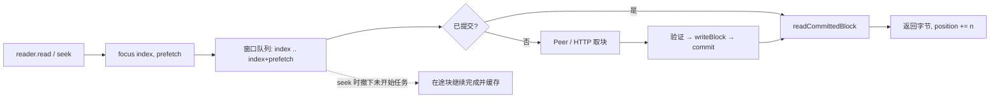

# 浏览器 VOD 读取（边播边下）方案

状态：**已实现并通过本地验收（2026-11-21）**。`Client.openStream` 提供 seek 驱动的有界读窗口，决策点按推荐项执行（D1 独立 API、D2 仅支持有 proof 表的内容、D3 仅 OPFS 目标、D4 SDK 只出读取接口、D5 不做窗口内共享、D6 预取 8 / 超时 30s）。未提交、未发布。
范围：`@q2q/client-browser`（`packages/client-browser`）提供 seek 驱动的有界读窗口，让应用在下载完成前按位置读取已验证字节。
参考实现：[Rust `reader.rs`](../crates/q2q-core/src/reader.rs)、[调度文档](../docs/zh/guide/scheduling.md#vod-的读取窗口)、[客户端 SDK 第四阶段](../todos/client-sdk.md)。

## 1. 目标与非目标

**目标**

- 提供单游标、seek 驱动的读取接口：读到哪一块就取哪一块，并前向预取有限块数。
- 只向应用暴露**已验证且已提交**的字节，不暴露稀疏未下载区域。
- 让应用能对接播放器（`ReadableStream` / range 代理），做边播边下、预览、先取尾部元数据。

**非目标（明确不做）**

- 不实现播放器：不引入 MSE/HLS/DASH，不包装 `<video>`，不处理编解码与容器解析。
- 不做自适应水位、rarest-first、endgame（与 [调度文档](../docs/zh/guide/scheduling.md) 的现状态一致）。
- 不做多游标并发读（Rust 侧同样把多游标列为后续）。
- 不改变整文件 `download()` / `resumeDownload()` 的语义与完成条件。
- 不承诺解决 MP4 `moov` 位于文件尾的容器问题；SDK 提供任意位置 seek 的能力，取哪一段由应用决定。

## 2. 与 Rust 语义对齐

浏览器首版直接照搬 `VerifiedFile` 的语义，避免两套 SDK 行为分叉：

| 行为 | Rust `client.open()` | 浏览器首版 |
| --- | --- | --- |
| 建立窗口 | 首次 `read`/`seek` 才建需求 | 同 |
| 排序 | 当前块 → 前向预取块 | 同 |
| 预取 | 默认 8，范围 0–64，0 只取当前块 | 同 |
| seek | 撤下旧窗口未开始任务；在途块仍完成并缓存；失败租约不重新入队 | 同 |
| EOF | `read` 返回 0；seek 到 EOF 及其后不预取 | 返回空 `Uint8Array`，不预取 |
| 非法偏移 | 负值或 u64 溢出报 `InvalidInput` | `bigint` 负值/超 `u64` 报 `INVALID_RANGE` |
| 缺块等待 | 受 `read_timeout` 限制（默认 30s），超时游标不动 | `readTimeoutMs` 默认 30000 |
| 取消 | `read` 取消不推进游标；Drop 取消网络并保留已验证块 | `read` 的 `signal` 同语义；`close()` 取消网络、保留检查点 |
| 完成 | 窗口读完仍可继续；全文件同步后才 `Completed` | 同 |
| 共享 | `share(true)` 共享已验证块，`take_sharing()` 分离生命周期 | 见决策点 D5 |

## 3. 现状与差距（代码事实）

已具备、可直接复用：

- `CheckpointSession.readCommittedBlock(index)`：只读已提交块，经 IO 队列串行化，读回后**重新校验**并按需返回 proof；未提交返回 `null`，校验不符抛 `CONTENT_MISMATCH`。
- 逐块提交与检查点：`writeBlock` → `commit()` → 位图 CAS，`resumeCheckpoint` 负责恢复重验。
- 既有并发上限：`limits.peerConnections` / `httpRequests` / `commitBytes`。

缺失：

| 差距 | 现状 |
| --- | --- |
| 调度 | `transfer.ts` 用线性游标 `next` 从 0 递增取块，没有窗口、seek、预取概念 |
| 对外读取 | `Transfer` 只有 `snapshot/subscribe/pause/resume/cancel/wait`，无 `read` |
| 块级等待 | 没有"等到某块提交"的原语；下载循环是顺序推进，失败即整体失败 |
| 目标可读性 | OPFS `source.open()` 要求 `state === 'complete'`，下载中不可读；user-file 的 writable stream 在 `finish` 前不保证可读 |
| 播放器对接 | 无 `ReadableStream` 适配、无 range 代理 |

## 4. SDK 设计

### 4.1 公共接口

```ts
export interface StreamOptions {
  seed: Seed;
  destination: ContentDestination;
  prefetchBlocks?: number;   // 0–64，默认 8
  readTimeoutMs?: number;    // 默认 30000，必须 > 0
  sharing?: boolean;         // 见 D5，首版默认 false
}

export interface StreamReader {
  readonly info: ContentInfo;
  readonly position: bigint;
  /** 等待目标块验证并提交后返回；只返回已验证字节。 */
  read(length: number, options?: { signal?: AbortSignal }): Promise<Uint8Array>;
  seek(offset: bigint): Promise<void>;
  /** 当前窗口与总进度，复用 DownloadSnapshot 的字段语义。 */
  progress(): Readonly<DownloadSnapshot>;
  /** 取消网络；已验证块与检查点保留，可再次 open 继续。 */
  close(): Promise<void>;
}

export interface Client {
  openStream(options: StreamOptions): Promise<StreamReader>;
}
```

设计理由：与 `download()` 并列而非挂在其上。`download` 的完成条件是整文件，`openStream` 的完成条件是"窗口按需"，两者状态机不同；混在一个句柄里会让 `wait()` 语义含混。

### 4.2 调度器改造

把 `transfer.ts` 的线性游标换成窗口需求队列：



要点：

- **块级等待**：每块一个 deferred，`commit()` 成功后 resolve；失败或超时 reject 且不推进游标。窗口内任一来源错误只影响该块，不终止整个读取会话（区别于 `download` 的整体失败）。
- **窗口切换**：`seek` 重建队列，撤下未开始任务；在途块完成后仍写盘并提交（可被后续读取命中）；旧窗口的失败租约不重新入队。
- **并发**：沿用 `peerConnections`/`httpRequests`，不新增预算参数；单游标同一时刻只推进一个窗口。
- **内存**：只缓存当前块（对齐 Rust `cache: Option<(usize, Vec<u8>)>`），不做整文件缓冲。

### 4.3 存储层

- **读取路径走会话**：`readCommittedBlock` 已经做到"只读已提交 + 读回重验 + 串行化"，直接复用，不新开一条裸文件读取路径。这样 OPFS 的 `state === 'complete'` 限制**不需要放宽**——流式读取不经过 `entry.source`。
- **写入路径不变**：仍由 `resumeCheckpoint` 的 writer 持有排他租约。
- **user-file 目标（`showSaveFilePicker`）不支持流式**：writable stream 在 `finish` 前不保证可读。`openStream` 在 `open()` 阶段就明确返回 `UNSUPPORTED_CAPABILITY`，不静默降级成"边下边写到看不见的地方"。
- **peer-only 种子**：`readCommittedBlock` 依赖 `verifier.proof`，纯 Peer 内容没有 proof 帧时会报 `UNSUPPORTED_CAPABILITY`。这是 D2 要拍板的边界。

### 4.4 播放器对接（SDK 之外）

SDK 只交付"能按位置读已验证字节"。应用侧两条路径：

- `ReadableStream`：把 `read()` 包成 pull 源，交给 MSE 或自定义消费方。
- Service Worker range 代理：拦截同源 `Range` 请求，转成 `seek + read`，供 `<video src>` 直接播放。

容器约束如实说明：MP4 的 `moov` 在文件尾时，播放器起播需要先取尾部；SDK 支持任意窗口，但"先取尾再回跳"的策略属于应用层（或提供的示例），不写进 SDK。

## 5. 决策点（需维护者确认）

| 编号 | 问题 | 建议 |
| --- | --- | --- |
| D1 | API 形态 | `client.openStream(options)` 独立于 `download`，理由见 4.1 |
| D2 | peer-only（无 proof 表）是否支持流式 | 首版**不支持**，明确报错；有 proof 的内容走 `readCommittedBlock`。若后续要支持，需要 witness 版读回路径，属于独立改动 |
| D3 | user-file 目标 | 首版不支持，`open()` 时报能力错误 |
| D4 | 首版是否带 range 代理 / 示例页 | SDK 只出 `ReadableStream` 适配；Service Worker 代理放 `apps/www` 或后续独立项，避免 SDK 绑死同源与 SW 生命周期 |
| D5 | 读窗口期间共享已验证块 | 首版关闭（`sharing: false`），保留字段；与现有"部分块共享"开关一致地显式开启 |
| D6 | 预取与超时默认值 | 对齐 Rust：8 块 / 30s；上限 64 |

## 6. 与既有机制的关系

- **检查点**：窗口内块照常 `commit` 并 CAS 位图；刷新后 `resumeCheckpoint` 重验，`openStream` 复用同一恢复路径。
- **部分共享**：只共享已提交块（不变）；D5 关闭时不额外宣告。
- **暂停/取消/完成**：`close()` 取消网络并保留已验证内容；只有全文件同步后才可能报告完成（对齐 Rust），窗口读完不等于完成。
- **进度**：`progress()` 复用 `DownloadSnapshot` 字段，避免第二套进度模型。

## 7. 验收项

**SDK 单元（Node + wasm，无浏览器）**

- 窗口计算：`prefetch` 0 / 1 / 8 / 64 的边界，`prefetch=0` 只取当前块。
- `seek` 重建：旧窗口未开始任务被撤下、在途块完成且被缓存、失败租约不入队。
- EOF 与越界：`seek` 到 EOF/其后不预取；`read` 返回空；负值与超大偏移报 `INVALID_RANGE`。
- 超时：缺块等待超时后游标不动，可重试。
- 取消：`read` 的 signal 取消不推进游标；`close()` 后网络停止、检查点保留。
- 并发上限与读写同队列顺序：不超额、不交错破坏。

**浏览器联机（Chromium/Playwright，本地真实 Track/Punch）**

- 顺序读头部若干块：字节与源一致，且只请求窗口内范围（断言请求范围集合）。
- 中途 `seek` 到尾部：只请求新窗口，旧窗口未开始任务不发出。
- 缺块超时 → 重试成功；整个文件读完后与独立校验一致。
- 刷新后重开：从检查点恢复继续读，已提交块不重下。
- 与分享并存：读取期间发布/停止不互相破坏。

**明确不验收**

真实播放器起播（Safari MSE）、跨 NAT/强制 TURN、真实码率与卡顿指标、MP4 容器策略正确性。这些需单独环境，不在本项声称通过。

## 8. 实施记录（2026-11-21）

实现：`packages/client-browser/src/source.ts`（从 `transfer.ts` 抽出的来源/重试/授权刷新/校验管线，整文件下载与流式读取共用）、`src/stream.ts`（窗口调度 + `StreamReader`）、`Client.openStream` 与 `StreamOptions`/`StreamReader` 类型；`apps/www` 未接入播放器。

本地验证（Chromium/Edge 148，`test:stream`）：

| 用例 | 结果 |
| --- | --- |
| `sequentialHeadRead`：prefetch=0 只取游标块，单次读不跨块 | 通过 |
| `windowAndSeek`：窗口不越界，seek 只取新窗口 | 通过 |
| `readTimeoutThenRetry`：缺块超时报 `CONTROL_TIMEOUT` 且游标不动 | 通过 |
| `closePreservesVerifiedBlocks`：关闭后重开不重下已提交块 | 通过 |
| `peerOnlyRejected`：无 proof 表报 `PROOF_UNAVAILABLE`（open 阶段） | 通过 |
| `argumentBounds`：越界 seek / 非正长度 / prefetch>64 / 超时≤0 均拒绝 | 通过 |
| `p2pStream`：真实原生发布者经 Track/Punch 读头部、seek 尾部、读末块 17 字节 | 通过 |

回归：SDK 单元 13、`@http` 33、`@p2p` 23、`@storage|@publish|@partial` 75、`@magnet` 6 通过（重构后整文件下载行为不变）；`@stream` 连跑两轮 14/14 稳定；`docs:build`、`www:check`、`www:build`、SDK 类型检查通过。

与设计稿的差异：
- 无 proof 表时的错误是 `PROOF_UNAVAILABLE`（沿用既有语义），不是 `UNSUPPORTED_CAPABILITY`；D2 的限制不变。
- 读窗口并发取 `min(prefetch+1, peerConnections + httpRequests)`，仍受既有预算约束，未新增参数。

未验证：真实播放器起播（MSE/Safari）、Service Worker range 代理、跨 NAT/TURN、真实码率；`apps/www` 尚未提供预览播放界面。

远端 CI（PR #107，head `27e9540`）：SDK contracts（Chromium）通过 6m14s，含 `@stream` 7 项；WWW checks 的 Chromium 与 WebKit 均通过；其余 11 项 pass、2 项 Deploy 按 PR 规则跳过，无失败。WebKit 的 SDK 全量契约按既定分层每日/手动执行。

## 9. 实施顺序与规模（原始估算）

1. **调度原语**：块级 deferred + 窗口队列 + `focus/seek`（改造 `transfer.ts` 的推进方式，抽出可共用的调度器）。约 250 行。
2. **公共 API**：`openStream` / `StreamReader` / 能力错误；复用 `readCommittedBlock` 与会话。约 120 行。
3. **测试**：单元 + Playwright（新 spec，`@vod` 标签并入 `test:p2p` 家族）。约 250 行。
4. **文档**：本文件转正式指南（`docs/zh|en/guide/web-client.md` 增补一节）、SDK README。

不改 Rust、不改协议、不新增依赖。

## 阶段一落地：完成后可播放（2026-11-25）

在 PR #107 分支上新增“已完成内容可在页面播放”，边下边播仍留给阶段二。

实现：
- `q2q-wasm` 的 `decode_seed` 导出协议里已有的可选 `mime`；SDK `ContentInfo` 增加 `mime: string | null`。发布端目前不写该字段，因此它是提示而非保证。
- `OpfsEntry.objectUrl()`：为已完成缓存返回可撤销的 blob URL，OPFS 布局仍留在 SDK 内；URL 直接从磁盘流式读取，不整文件进内存。
- 页面：任务行按扩展名（`.mp4`/`.webm`/`.mov`/`.mp3`/`.wav` 等）或 `mime` 判断类型，`播放` 按钮打开 `<video>`/`<audio>` 对话框；解码失败时对话框内说明原因而不是静默关闭；关闭播放不删除暂存，blob URL 不持久化。

本地验证（Chromium/Edge 148，生产预览）：新增 `playback` 2 项通过——用真实可解码的 8 kHz PCM WAV 断言 `duration > 0.2s` 且 `readyState > 0`（真解码，不只是结构），关闭后缓存仍在且可保存；假 `.mp4` 断言 video 元素与 blob URL、解码失败提示；`.bin` 断言不出现播放按钮。回归：download+magnet 16、ui-matrix 13、SDK storage 59、SDK 单元 13 通过。

未验证：真实视频编解码（测试只有结构断言）、Safari 播放、超大文件起播延迟、边下边播。
